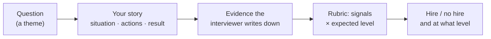

Engineers spend months on algorithms and system design, then walk into the behavioral round with nothing prepared. The thinking goes: "it's just a chat, I'll be myself." It isn't just a chat. A behavioral interviewer has a rubric, takes notes on specific signals, and submits a hire or no-hire like every other interviewer. At several big companies the behavioral signal can **veto** strong technical rounds, and it's often what decides the **level** you're offered. The good news: it's the most preparable round of the loop. Your stories already exist; you only have to find them and learn to tell them.

## What the interviewer is actually doing

A behavioral question like "Tell me about a time you disagreed with your manager" isn't a personality quiz. It rests on a simple idea that structured hiring is built on: **how you behaved in a real past situation is the best available predictor of how you'll behave in a similar one**. So the interviewer is:

1. **Collecting evidence**: specific things you did, in a specific situation, with a specific result.
2. **Mapping it to signals** the company cares about: ownership, collaboration, conflict handling, judgment, growth.
3. **Calibrating to a level**: was the scope of the story what we expect at this level?
4. **Probing** with follow-ups to tell a real story from a rehearsed one.

Google's public hiring guidance describes exactly this. It uses structured interviews with vetted questions, detailed notes and **rubrics** that define poor, borderline, solid and outstanding answers. It also asks two kinds of question:

- **Behavioral**: "Tell me about a time…", asking about the past.
- **Hypothetical**: "What would you do if…", about an unfamiliar future situation.

Amazon says its interviews are rooted in behavioral questions about real past situations, scored against its Leadership Principles.

## The signals almost every company scores

Company names for them differ (see the [Company Guides](/behavioral/companies/amazon)), but the underlying signals are remarkably similar:

| Signal | What they want to see | Typical question |
| --- | --- | --- |
| **Ownership** | You treat problems as yours, beyond your job description | "Tell me about a time you went beyond your role." |
| **Collaboration** | You work well with others, including difficult people | "Tell me about a difficult teammate." |
| **Conflict & influence** | You disagree with data and respect, and move people without authority | "Tell me about a time you disagreed with your manager." |
| **Judgment & trade-offs** | You decide well with incomplete information | "Tell me about a decision you made without all the data." |
| **Delivery** | You get things done, under pressure and on time | "Tell me about a tight deadline." |
| **Growth** | You learn, take feedback, and change | "Tell me about critical feedback you received." |
| **Self-awareness** | You admit failure honestly and reflect | "Tell me about your biggest mistake." |
| **Impact** | Your work mattered, and you can show how much | "What are you proudest of?" |
| **Motivation** | You want *this* job for real reasons | "Why do you want to work here?" |

## Why it decides offers

- **It's a filter.** A candidate who blames teammates, can't name a single mistake, or says "we" for twenty minutes is a risk no matter how good their code is.
- **It sets your level.** Two engineers with equally good coding rounds can get different levels because one told stories about owning a component and the other about leading a cross-team migration. See [Signals by Level](/behavioral/playbook/signals-by-level).
- **It's often the tie-breaker.** When technical rounds are mixed, a strong behavioral round gives the hiring committee a reason to say yes.

## Five myths that make people under-prepare

| Myth | Reality |
| --- | --- |
| "I'll just be myself." | Being yourself is right, but unprepared people ramble, forget their best examples, and pick weak stories under pressure. |
| "There are no right answers." | There's no single right answer, but there are clearly **better** and **worse** ones, and the rubric says which. |
| "I don't have impressive stories." | You do. A bug you chased for two days, a code review you pushed back on, a teammate you helped: these are behavioral stories. Specific beats grand. |
| "I need a different story for every question." | Eight to ten good stories cover almost everything. See [Build Your Story Bank](/behavioral/foundations/story-bank). |
| "Memorising answers word for word is safest." | Scripted answers collapse under follow-up questions. Prepare the **story**, not the script. |

## What a good answer looks like

In one sentence: **a specific past situation, told in about two minutes, where most of the time goes on what *you* did and why, ending with a measurable result and what you learned.** The next lesson, [The STAR Method, Done Right](/behavioral/foundations/star-method), turns that sentence into a structure.

<Callout type="interview" title="What interviewers write down">

Interviewers take notes close to verbatim, then score them. Notes like "candidate said *I* proposed the rollback and *I* wrote the runbook; cut incidents from 6 to 1 a quarter" score well. "Candidate described team process, unclear personal role" does not. Speak in a way that produces good notes: concrete actions, your own role, numbers.

</Callout>

## Interview questions

<QA q="Why do companies ask about past behaviour instead of what you would do?">
Past behaviour in a similar situation is a better predictor of future behaviour than a description of what someone thinks they would do, which is easy to idealise. A real story can be probed for detail — who said what, what you tried first, what the numbers were — so it's harder to fake. Many companies also ask hypothetical questions, but the behavioral ones carry the most evidence.
</QA>

<Practice task="Write down, from memory, three situations from your last job: something that went wrong, something you are proud of, and a disagreement. Do not polish them yet. Which signals from the table could each one show?">

A typical first pass looks like this:

- **A production incident you helped fix** shows ownership, delivery under pressure, and possibly a failure if you caused it.
- **A feature that moved a metric** shows impact and customer focus.
- **A design review where you disagreed** shows conflict and influence, and judgment.

Most people find that one story can show two or three signals. That's why a small story bank covers most questions. Keep these three; you'll turn them into STAR stories in the next two lessons.

</Practice>

<Takeaways>

- Behavioral interviews are scored with rubrics; they can veto a hire and often set your level.
- Interviewers collect evidence of past behaviour and map it to signals such as ownership, collaboration, conflict, judgment, delivery, growth and impact.
- Specific, recent and personal beats grand and vague.
- Prepare stories, not scripts: follow-up questions expose memorised answers.

</Takeaways>

## Further reading

- Next: [The STAR Method, Done Right](/behavioral/foundations/star-method).
- Google re:Work, "A guide to structured interviewing" — rubrics, behavioral and hypothetical questions ([rework.withgoogle.com](https://rework.withgoogle.com/intl/en/guides/a-guide-to-structured-interviewing-for-better-hiring-practices)).
- Gayle Laakmann McDowell, *Cracking the Coding Interview* (6th ed.), Chapter V "Behavioral Questions".
