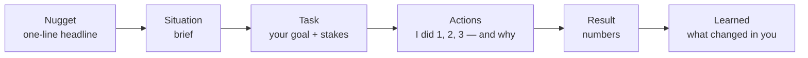

Every behavioral answer has the same job: let the interviewer write down **what you did and what happened**. STAR is the structure that makes that easy: **S**ituation, **T**ask, **A**ction, **R**esult. Almost everyone has heard of it and almost everyone uses it badly. They spend a minute on the situation, mumble the action in plural, and forget the result. This lesson shows the proportions, the habits and the small additions that turn STAR into a strong answer.

## The four parts, and how long each gets

| Part | What it answers | Length | Share of the answer |
| --- | --- | --- | --- |
| **Situation** | Where, when, what was going on | 1–2 sentences | ~10% |
| **Task** | What **you** were responsible for, and why it was hard | 1–2 sentences | ~10% |
| **Action** | What **you** did, step by step, and why | Most of the answer | **~60%** |
| **Result** | What changed, ideally with a number, and what you learned | 2–3 sentences | ~20% |

Aim for **about two minutes**; Amazon's own guide suggests two to three. Shorter means not enough evidence; much longer and the interviewer stops writing.

<StackedBar title="Where the two minutes go" unit="s" segments={[
  { label: 'Nugget', value: 5, tone: 'muted', note: 'one-line headline' },
  { label: 'Situation', value: 12, tone: 'note', note: 'one or two sentences of context' },
  { label: 'Task', value: 8, tone: 'note', note: 'your goal and why it was hard' },
  { label: 'Action', value: 70, tone: 'accent', note: 'numbered steps, each with a because' },
  { label: 'Result', value: 15, tone: 'success', note: 'what changed, with a number' },
  { label: 'Learned', value: 10, tone: 'interview', note: 'what you do differently now' },
]} />

## Two additions that make STAR much stronger

**1. Start with a nugget.** *Cracking the Coding Interview* recommends opening with a one-sentence headline that says what the story is about. "Sure, let me tell you about the time I convinced my team to drop a release date to fix a data-loss bug." The interviewer now knows where you're going, and so do you.

**2. End with what you learned.** A result says what happened; a lesson says what changed in **you**. "Since then I put a rollback plan in every design doc." Many companies explicitly want reflection. Amazon's guide asks for measurable results **and** lessons learned, and Meta's prep advice says discussing what you learned from things that went wrong is valued.

## Spend the time on the Action

The action is where the evidence lives, and it's the part people rush. Two habits fix it:

- **Number your actions.** "I did three things. First… second… third…" It forces depth and makes notes easy to take. (The book uses exactly this pattern in its sample answer.)
- **Give the why.** "I wrote a script to replay the failed payments, **because** asking each merchant to retry manually would have taken a week." Reasons show judgment, which is a signal in its own right.

## "I", not "we"

Interviews assess **you**. Answers full of "we decided", "we built", "the team improved" leave the interviewer unable to tell what you did, and they may conclude: not much. Amazon's guide contrasts "we improved customer satisfaction" with a version that says what *you* personally did and the measurable result.

Use "we" for the context ("we were three engineers on the payments team") and "I" for the actions. If something was a team effort, say what **your** part was: "Two of us split the work; I took the database migration."

## Make the result measurable

Numbers turn "it went well" into evidence:

| Vague | Measurable |
| --- | --- |
| "Performance improved a lot." | "p99 latency dropped from 1.2 s to 300 ms." |
| "Fewer incidents." | "Pages for that service went from about six a month to one." |
| "Users were happier." | "Support tickets about failed refunds fell by 40% in the next quarter." |
| "We shipped on time." | "We shipped two days before the regulatory deadline." |

If you don't know the exact number, give an honest estimate and say so: "roughly a third, from what I remember of the dashboard." If there's genuinely no number, describe the concrete change: "the on-call runbook I wrote became the template for the other two teams."

## Weak vs strong: the same story

> **Question:** Tell me about a time you solved a difficult technical problem.

**Weak answer**

"So at my last company we had this payments system, it was pretty complex, built on Spring Boot with Kafka and Postgres, and there were a lot of services, maybe twelve, and we had some issues with duplicate payments sometimes. We investigated it as a team for a while and figured out it was a retry issue, so we added idempotency and it got fixed. It was a good learning experience."

What the interviewer writes: *"Context-heavy, unclear personal role, no specifics on the fix, no result."*

**Strong answer**

"I'll tell you about how I tracked down duplicate charges in our payment service. *(nugget)*

"I was one of four backend engineers on payments at an e-commerce company. A few times a week, customers were being charged twice, and finance was refunding them by hand. *(situation)* I picked up the investigation because I owned the checkout API. The goal was to find the cause before the festive-sale traffic, three weeks away. *(task)*

"I did three things. First, I joined our logs with the gateway's settlement report for a week of duplicates. Every duplicate had two requests about 30 seconds apart: our client timeout. So the gateway was succeeding slowly, we were timing out and retrying, and it charged again. Second, I proposed idempotency keys: the checkout generates a key per order attempt, and the gateway deduplicates on it. I wrote a short design doc, because it changed a shared client library and two other teams depended on it. Third, I rolled it out behind a flag, starting with 5% of traffic, and added an alert on any two charges for the same order. *(actions, with reasons)*

"Duplicates went from about 15 a week to zero, and stayed at zero through the sale, which had four times normal traffic. Finance stopped the manual refunds, which saved them several hours a week. *(result)* What I took from it: I now ask 'what happens if this request is retried?' in every design review I'm in. *(learned)*"

That's about two minutes, and every sentence gives the interviewer something to write down.

## Expect follow-up questions

A good interviewer will probe, and the follow-ups are where rehearsed stories fall apart:

- "What did you try first that didn't work?"
- "Why idempotency keys instead of just a longer timeout?"
- "Who disagreed with you, and how did you handle it?"
- "What would you do differently?"
- "How did you know it was the timeout and not something else?"

You can only answer these if the story is **real and you remember the details**. Prepare the story, then rehearse it out loud in different lengths: a 30-second version, a 2-minute version and the deep dive.

<Callout type="warning" title="Common mistakes">

- **A minute of situation** before anything happens.
- **"We" throughout**: the interviewer can't credit you.
- **A hypothetical answer** ("I would…") to a "tell me about a time" question. Give a real example.
- **No result**, or a result with no numbers.
- **A story with no tension**: if nothing was hard, there's nothing to assess.
- **Over-long technical detail.** Give the key point and offer to go deeper: "I can go into the details of the dedup logic if you like."

</Callout>

## Interview questions

<QA q="What should you do if you have no example for the question asked?">
Say so briefly, then offer the closest real example and connect it: "I haven't had a direct conflict with a manager, but I had a strong disagreement with a senior engineer about a migration plan — can I tell you about that?" A real, adjacent story is better than an invented one, and far better than a hypothetical answer. If you truly have nothing, describe how you would approach it, but this should be rare if your story bank is prepared.
</QA>

<Practice task="Take the incident story from the previous lesson and write it as STAR with a nugget and a lesson. Then count: how many sentences are Situation, and how many are Action?">

Check the proportions:

- Situation and task: **two to four sentences in total**.
- Action: **at least half the answer**, with numbered steps and a reason for each.
- Result: **one number** if at all possible, and one sentence on what you learned.

If the situation is longer than the action, cut the context: the interviewer doesn't need your architecture diagram to understand the story. If every action starts with "we", rewrite it with "I" and say who did the rest.

</Practice>

<Takeaways>

- STAR: Situation (brief), Task (your goal and the stakes), Action (about 60%), Result (numbers). Add a nugget at the start and a lesson at the end.
- About two minutes per story; number your actions and explain why.
- Say "I" for your actions and "we" only for context.
- Measurable results beat adjectives; an honest estimate beats nothing.
- Prepare the story, not the script, so you can handle the follow-ups.

</Takeaways>

## Further reading

- Next: [Build Your Story Bank](/behavioral/foundations/story-bank).
- Amazon, "Amazon interview guide" — STAR, metrics, "I" vs "we" ([aboutamazon.com](https://www.aboutamazon.com/news/workplace/amazon-interview-guide)).
- Gayle Laakmann McDowell, *Cracking the Coding Interview* (6th ed.), Chapter V: "Nugget First", "S.A.R." and "Explore the Action".
