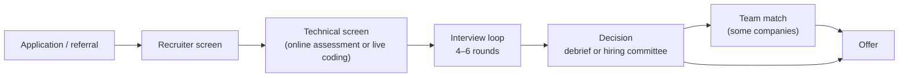

Knowing how a hiring decision is actually made changes how you prepare. Who decides, what they read, which signals set your level and what happens after the loop are rarely explained to candidates, yet they explain most of the surprises: an offer at a lower level than expected, weeks of silence after a good loop, or a "no" after four interviews you thought went well.

<Callout type="note" title="Processes vary and change">
What follows is the common shape at large tech companies, drawn from companies' own preparation material and many candidates' reports. Details differ by company, team, level and country, and change from year to year. Your recruiter is the best source for your specific loop; ask them, it's their job to tell you.
</Callout>

## The typical pipeline

- **Recruiter screen (15–30 min):** background, motivation, location, compensation expectations, timeline. Not a formality: recruiters filter out candidates whose experience doesn't match the level or whose expectations are far off.
- **Technical screen:** an [online assessment](/dsa/playbook/online-assessments), or a 45–60 minute live coding interview, sometimes two.
- **The loop:** usually 4–6 interviews in one day or spread over a week.
- **Decision:** written feedback from every interviewer, then a debrief meeting or a committee.
- **Team match** at some companies, before or after the decision.
- **Offer**, with negotiation (see [Offers & Negotiation](/behavioral/playbook/offers-and-negotiation)).

End to end, 3 to 8 weeks is common; longer when team matching or approvals drag.

## What the loop contains

| Round | Typical count | Who gets it |
| --- | --- | --- |
| Coding (data structures and algorithms) | 2–3 | Everyone |
| System design (HLD) | 1–2 | Usually mid-level and above; the weight grows with seniority |
| Low-level design or machine coding | 0–1 | Common in India (Flipkart, Swiggy, Razorpay and others); some global teams |
| Behavioral / leadership | 1 (or woven into every round) | Everyone; more weight for senior roles |
| Hiring manager | 0–1 | Many companies; often focuses on past projects and team fit |
| Domain (ML, mobile, frontend, data) | 0–2 | Specialist roles |

## How individual companies differ

These are the differences candidates most often report; confirm the current process with your recruiter.

- **Google:** coding rounds plus a "Googleyness and leadership" round, and system design for experienced hires. Interviewers write detailed feedback; a **hiring committee** that didn't interview you reviews the packet. **Team matching** with a specific team is a separate step that may happen before or after the committee, and can take a while.
- **Meta:** coding rounds, a design round (System Design, or the [Product Architecture](/system-design/hld/product-architecture-interview) variant for product roles) and a behavioral round. The behavioral round weighs heavily in deciding the level. Meta has historically placed many new engineers into teams after they join rather than before.
- **Amazon:** an online assessment for many roles, then a loop where **every** interviewer also asks [Leadership Principles](/behavioral/companies/amazon) questions. One interviewer is a **Bar Raiser** from outside the hiring team, trained to keep standards consistent, with strong influence over the decision.
- **Microsoft:** loops are run by the hiring team and vary more between teams; the hiring manager typically has a strong voice in the decision.
- **Indian product companies:** a machine-coding round (build a working, extensible program in 60–120 minutes) is common, alongside DSA, HLD and a hiring-manager round. See [Machine-Coding Walkthrough](/system-design/lld/lld-snake-and-ladder).

## How the decision is made

1. **Each interviewer writes feedback independently**, before seeing the others', with evidence (what you said and wrote) and a rating, typically on a scale from "strong no hire" to "strong hire".
2. **A debrief or committee** reads all the feedback together. They look for consistent signal, not an average: one round with a clear red flag (dishonesty, rudeness, being unable to code at all) can outweigh several good ones, while a single weak round among strong ones is often survivable, especially if the weakness was in a non-core area.
3. **Level** is decided from the same evidence (below).
4. **Approvals** follow at larger companies, especially for senior levels or offers outside the usual band.

What this means for you:

- **Interviewers can only score what they observe.** Thinking silently, skipping testing, or not stating complexity leaves gaps in the written feedback, however good your final code is. See [Solving Out Loud](/dsa/playbook/interview-communication).
- **You can't tell how a round went from the vibe.** Friendly interviewers write tough feedback and vice versa. Don't let one round you think went badly affect the next.
- **Every round counts the same for integrity.** Exaggerating a project in the behavioral round and being found out in system design is far worse than a weak answer.

## Levels: what the numbers mean

Large companies hire into a level, which sets your expected scope and your pay band. Rough equivalents:

| Typical scope | Google | Meta | Amazon | Microsoft |
| --- | --- | --- | --- | --- |
| New graduate / early career | L3 | E3 | SDE I (L4) | SDE (59–60) |
| Mid-level, owns features | L4 | E4 | SDE II (L5) | SDE II (61–62) |
| Senior, owns systems and leads projects | L5 | E5 | SDE III / Senior (L6) | Senior (63–64) |
| Staff, leads across teams | L6 | E6 | Principal (L7) | Principal (65–67) |

These are approximate mappings, commonly used for comparison, not official equivalences; companies define their levels differently, and titles in India mostly follow the same ladders.

**Years of experience don't decide your level; the interview evidence does.** Senior levels are mostly decided by:

- **System design depth:** driving the design yourself, handling ambiguity, discussing trade-offs and failure modes without prompting.
- **Behavioral scope:** stories where you led across people and teams, defined the problem and influenced decisions. See [Signals by Level](/behavioral/playbook/signals-by-level).
- **Coding:** expected to be strong at every level; it rarely raises your level on its own, but weak coding can lower it.

### Down-levelling

Being offered a level below the one you applied for is common, especially for senior roles. If it happens:

1. **Ask which signal was missing**, usually system design or behavioral scope. Recruiters often share this at a high level.
2. **Decide on the level before negotiating money.** Pay bands are per level; negotiating salary within the wrong level has a low ceiling. If you have evidence (a competing offer at the higher level, scope you didn't get to show), ask whether a re-review or an extra interview is possible.
3. **Weigh it honestly.** Promotion after joining is possible but usually takes a year or more, and starting below your level affects pay for years. Sometimes the right answer is to accept; sometimes it's to decline and reapply later.

## After a rejection

- Many companies have a **cooling-off period**, often 6 to 12 months, before you can interview again for a similar role; it's usually shorter if you were close.
- Detailed feedback is rare (legal reasons), but asking your recruiter "which area should I focus on?" sometimes gets a useful hint.
- Write down every question and your answers the same day. That record is the best guide for the next attempt.

## Practical checklist

- Ask the recruiter: how many rounds, which types, the language and tools allowed, whether there's an online assessment, and any official preparation material.
- Ask whether the role is for a specific team or goes through team matching.
- Schedule the loop when you're ready, not when it's offered first; recruiters usually accept a reasonable delay.
- Keep several processes running so decisions arrive close together.

## Interview questions

<QA q="I felt three rounds went well and one went badly, but I was rejected. How can that happen?">
Decisions aren't an average of how rounds felt. Each interviewer writes evidence-based feedback, and the debrief or committee looks for a consistent signal. A round you felt was fine may have been rated lower because steps were missing from what the interviewer could observe, such as testing, complexity or trade-offs. A single serious concern, especially in a core area for the role or about behaviour, can also outweigh positive rounds. Ask the recruiter which area to focus on, and note the questions while they're fresh for next time.
</QA>

<QA q="What usually decides whether an experienced engineer is hired at senior level or one level below?">
Mostly the system design and behavioral rounds. Senior candidates are expected to drive the design conversation themselves, handle ambiguous requirements and discuss trade-offs and failures without being led, and to tell stories about leading work across people and teams with clear scope and impact. Strong coding is expected but rarely raises the level on its own. Years of experience matter far less than the evidence each interviewer can write down.
</QA>

## Practice

Write your answer before opening the suggested one. Anything you mark "Partly" or "Missed it" comes back in your review deck.

<Practice task="You applied for a senior role (L5/E5 equivalent) and the recruiter offers the level below, with 15% higher pay than your current job. What do you ask, and how do you decide?">

Ask:
- Which signal was missing for the senior level (system design depth, behavioral scope, something else)?
- Is a re-review or an extra round possible, given a competing senior offer or scope you didn't get to show?
- What's the typical time to promotion from this level on this team, and what evidence would it need?

Decide by comparing the whole picture: the pay band at each level over 3–4 years (not just year one), how long promotion realistically takes, and how much you want this team or company compared with your alternatives. If another company offers the senior level, that's evidence for a re-review; if not, accepting and growing into the level can still be a good outcome. Settle the level before you negotiate the numbers.

</Practice>

<Takeaways>

- The usual pipeline: recruiter screen, technical screen, a loop of 4–6 rounds, a debrief or committee decision, sometimes team matching, then the offer.
- Interviewers write independent, evidence-based feedback; decisions look for a consistent signal, and a serious concern can outweigh good rounds.
- Your level comes from interview evidence, mostly system design and behavioral scope, not years of experience.
- Settle the level before negotiating pay; ask which signal was missing if you're down-levelled.
- Ask your recruiter about the exact format; processes vary by company, team and year.

</Takeaways>

## Further reading

- Next: [Signals by Level](/behavioral/playbook/signals-by-level).
- Google, Meta, Amazon and Microsoft careers sites: each publishes interview preparation pages for software engineers.
- Gayle Laakmann McDowell, *Cracking the Coding Interview* (6th ed.), Chapter II "Behind the Scenes" — how decisions are made at the large companies.
