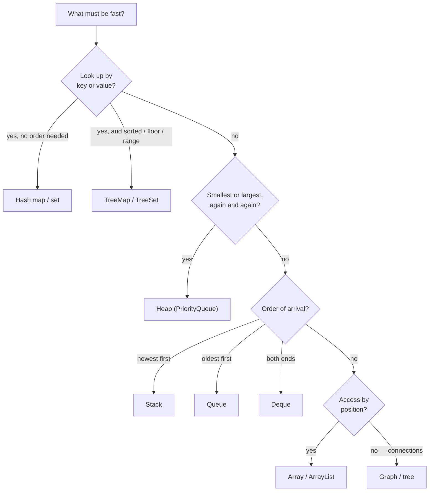

Picking the data structure is often the whole problem. Once you know you need "the minimum, repeatedly", the answer is a heap. Once you know you need "have I seen this?", it's a hash set. This lesson puts every structure from this course side by side, and turns the choice into a question you can ask of any problem: **which operations must be fast?**

## The method

1. **List the operations** the problem performs, and roughly how often: lookups by key, inserts, removals of the smallest, access by position, order of arrival…
2. **Find the structure** whose fast operations cover the frequent ones (table below).
3. If no single structure covers everything, **combine two** and keep them in sync. An LRU cache is a hash map plus a linked list ([Designing Data Structures](/dsa/patterns/design-data-structures)).

## Every structure, every operation

| Structure | Access by position | Search by value/key | Insert | Delete | Min / max | Ordered iteration |
| --- | --- | --- | --- | --- | --- | --- |
| [Array / ArrayList](/dsa/data-structures/arrays-and-strings) | **O(1)** | O(n) | O(1)* end, O(n) middle | O(1) end, O(n) middle | O(n) | Insertion order |
| Sorted array | O(1) | **O(log n)** | O(n) | O(n) | **O(1)** | **Sorted** |
| [Linked list](/dsa/data-structures/linked-lists) | O(n) | O(n) | **O(1)** at a known node | **O(1)** at a known node (doubly) | O(n) | Insertion order |
| [Stack / queue / deque](/dsa/data-structures/stacks-and-queues) | — | O(n) | **O(1)** at the ends | **O(1)** at the ends | O(n) | LIFO / FIFO |
| [Hash map / set](/dsa/data-structures/hash-tables) | — | **O(1)** avg | **O(1)** avg | **O(1)** avg | O(n) | None |
| Balanced BST (`TreeMap`) — [trees](/dsa/data-structures/trees) | — | O(log n) | O(log n) | O(log n) | O(log n) | **Sorted** |
| [Heap (`PriorityQueue`)](/dsa/data-structures/heaps) | — | O(n) | O(log n) | O(log n) min only | **O(1)** peek | No |
| [Trie](/dsa/patterns/tries) | — | O(L) word length | O(L) | O(L) | — | Lexicographic |
| [Graph (adjacency list)](/dsa/data-structures/graphs) | — | — | O(1) add edge | O(degree) | — | — |

\* amortised.

## Signals that point to a structure

| The problem needs… | Reach for |
| --- | --- |
| "Have I seen this?", counts, pairs with a sum, grouping | **Hash map / set** |
| Fast access by index; scanning; two pointers | **Array** |
| The most recent item first; matching brackets; undo | **Stack** |
| Items in arrival order; level by level; fewest steps | **Queue** (BFS) |
| Both ends, or a sliding-window max/min | **Deque** |
| The smallest or largest, repeatedly; top k; merge sorted streams | **Heap** |
| Sorted keys with floor/ceiling or ranges, plus updates | **TreeMap / TreeSet** |
| Prefixes of strings; autocomplete | **Trie** |
| Relationships, networks, dependencies, grids | **Graph** |
| Insert or remove in the middle at a known position, many times | **Linked list** (usually combined with a map) |
| Range sums with updates | **Fenwick / segment tree** ([Range Queries](/dsa/patterns/range-queries)) |
| Groups that merge | **Union-find** ([Union-Find](/dsa/patterns/union-find)) |

## A decision guide

## Worked examples

**"Return the first non-repeating character in a string."**

- Operations: count occurrences, then scan in order.
- So: a **hash map** (or `int[26]`) for counts, plus the string itself for order.
- Two passes, O(n).

**"Design a leaderboard: add scores, and report the top 10 at any time."**

- Operations: frequent inserts, and repeatedly reading the largest values.
- So: a **heap**, or a **TreeMap** from score to count if scores also change.
- An unsorted array would make every top-10 query O(n).

**"Process tasks in the order they arrive, but some tasks are urgent."**

- Plain arrival order is a **queue**. With priorities it's a **priority queue (heap)**, ordered by (priority, arrival time) so ties stay first-come-first-served.

<Callout type="interview" title="Say the trade-off out loud">

Interviewers listen for the reason behind a choice. "I'll use a HashMap from value to index, because I need O(1) lookups of earlier values, and order doesn't matter" scores far better than just declaring the map. If two structures fit, name both and the trade-off: "a heap gives O(log n) per update; a sorted array would make inserts O(n)".

</Callout>

<Practice task="A browser needs Back and Forward buttons. Visiting a new page clears the Forward history. Which data structures, and what does each operation cost?">

Use **two stacks**. **Visit** pushes the current page onto `back` and clears `forward`. **Back** pushes the current page onto `forward` and pops `back`. **Forward** does the reverse. Every operation is O(1), apart from clearing, which is O(size) but can be O(1) by just replacing the stack. A doubly linked list with a current pointer also works: Back and Forward move the pointer, and visiting a new page truncates everything after it.

</Practice>

<Practice task="You must store phone contacts and support: lookup by exact name, list all names starting with a prefix, and list everything in alphabetical order. Pick one structure, and say what you would add if you also needed lookup by phone number.">

A **trie** handles exact lookup and prefix listing in O(length) plus the output size, and a depth-first walk in child-letter order lists everything alphabetically. A `TreeMap<String, Contact>` also works: `get` for exact lookup, `subMap(prefix, prefix + Character.MAX_VALUE)` for prefixes, and its iteration order is sorted, all in O(log n). For lookup by phone number add a second index, a **HashMap from number to contact**, and keep both in sync on every add and delete.

</Practice>

<Takeaways>

- Choose by operations: list what must be fast, then find the structure whose fast operations cover them.
- Hash map for lookups, array for positions, stack and queue for arrival order, heap for repeated minimums.
- Use TreeMap for sorted keys with ranges, a trie for prefixes, and a graph for relationships.
- When one structure isn't enough, combine two and keep them in sync.
- Always say why: the operation, its cost, and the alternative you rejected.

</Takeaways>

## Further reading

- Next: start the patterns with [Hash Maps & Sets](/dsa/patterns/hashing).
- [The Pattern Picker](/dsa/playbook/pattern-picker): choosing the algorithm, once the structure is clear.
