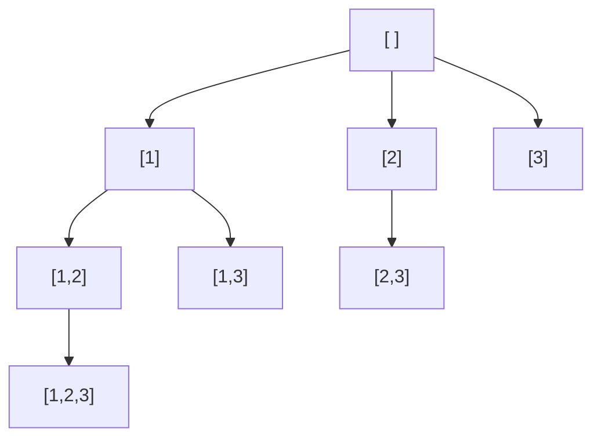

"Generate all subsets." "All permutations." "Every way to place 8 queens." These problems ask for **every** valid arrangement, and that sounds like it needs a different clever trick each time. It doesn't. They're all the same algorithm: walk a **decision tree** — at each step make a choice, explore everything that follows from it, then **undo** the choice and try the next one. Choose, explore, un-choose. Once you have that template, these problems become fill-in-the-blanks.

<Callout type="tip" title="How to spot it">

- The question asks for **all** solutions: all subsets, combinations, permutations, partitions, arrangements.
- Or for **any** solution to a constraint puzzle: N-Queens, Sudoku, word search in a grid.
- The input is **small** (n ≤ 15–20 for subsets, n ≤ 8–10 for permutations) — the constraints are telling you exponential time is expected ([Big-O](/dsa/start-here/complexity-made-easy)).
- If the question asks for the **count** or the **best** value rather than the list itself, check [dynamic programming](/dsa/patterns/dp-made-easy) first — it's often far faster.

</Callout>

## The decision tree

For subsets of `[1, 2, 3]`, each level decides which element to add next, only looking **forward** (so `[2, 1]` is never produced after `[1, 2]`):



Every node is a subset — eight nodes, eight subsets. Backtracking is a DFS over this tree, building the current node in one shared `path` list.

Step through the decision tree as it grows: choose (go down), record, un-choose (come back up). Compare subsets, permutations and combination sum with pruning.

<BacktrackViz examples={['subsets', 'perms', 'combsum']} />

## The template

```java
void backtrack(state, List<Integer> path, List<List<Integer>> out) {
    if (/* path is a complete answer */) {
        out.add(new ArrayList<>(path));       // COPY — path keeps changing
        return;                               // (for subsets, record at every node instead)
    }
    for (/* each choice available at this step */) {
        if (/* choice is invalid */) continue;     // prune
        path.add(choice);                          // 1. choose
        backtrack(next state, path, out);          // 2. explore
        path.remove(path.size() - 1);              // 3. un-choose
    }
}
```

Three decisions customise it for each problem:

1. **What are the choices** at each step (and which ones are already used)?
2. **When is a path complete?**
3. **What can be pruned** early?

## Subsets and combinations: move forward with `start`

```java
static void dfsSubsets(int[] nums, int start, List<Integer> path, List<List<Integer>> out) {
    out.add(new ArrayList<>(path));              // every node is a subset
    for (int i = start; i < nums.length; i++) {
        path.add(nums[i]);
        dfsSubsets(nums, i + 1, path, out);      // later elements only
        path.remove(path.size() - 1);
    }
}
```

The `start` index is what makes these **combinations** (order doesn't matter): you never look back, so each set is produced once.

### Combinations of size k (with pruning)

```java
static void dfsCombine(int start, int n, int k, List<Integer> path, List<List<Integer>> out) {
    if (path.size() == k) { out.add(new ArrayList<>(path)); return; }
    for (int i = start; i <= n - (k - path.size()) + 1; i++) {   // stop early: leave room for the remaining picks
        path.add(i);
        dfsCombine(i + 1, n, k, path, out);
        path.remove(path.size() - 1);
    }
}
```

### Combination sum — reuse allowed

```java
static void dfsSum(int[] c, int start, int remaining, List<Integer> path, List<List<Integer>> out) {   // c is sorted
    if (remaining == 0) { out.add(new ArrayList<>(path)); return; }
    for (int i = start; i < c.length; i++) {
        if (c[i] > remaining) break;                 // sorted: every later candidate is too big too
        path.add(c[i]);
        dfsSum(c, i, remaining - c[i], path, out);   // i (not i + 1): the same number may be used again
        path.remove(path.size() - 1);
    }
}
```

The difference between "each element once" and "reuse allowed" is a single character: `i + 1` versus `i`.

## Handling duplicates in the input

With input `[1, 2, 2]`, naive subsets produce `[1, 2]` twice (using either 2). The fix is always the same: **sort**, then at a given depth **skip a value equal to the previous one** — choosing the second `2` at the same position would build exactly the same subtree as the first.

```java
static void dfsDup(int[] nums, int start, List<Integer> path, List<List<Integer>> out) {   // nums is sorted
    out.add(new ArrayList<>(path));
    for (int i = start; i < nums.length; i++) {
        if (i > start && nums[i] == nums[i - 1]) continue;   // same value at the same depth → skip
        path.add(nums[i]);
        dfsDup(nums, i + 1, path, out);
        path.remove(path.size() - 1);
    }
}
```

The condition is `i > start`, not `i > 0`: using a duplicate **deeper** in the path (`[2, 2]`) is fine; using it **again at the same depth** is the duplicate.

## Permutations: track what's used

Order matters now, so every unused element is a choice at every step — there's no `start`. A `boolean[] used` marks what's already in the path.

```java
static void dfsPerm(int[] nums, boolean[] used, List<Integer> path, List<List<Integer>> out) {
    if (path.size() == nums.length) { out.add(new ArrayList<>(path)); return; }
    for (int i = 0; i < nums.length; i++) {
        if (used[i]) continue;
        used[i] = true;  path.add(nums[i]);
        dfsPerm(nums, used, path, out);
        used[i] = false; path.remove(path.size() - 1);
    }
}
```

For **duplicates** in permutations, sort and add one rule: use equal values only in their original order — skip `nums[i]` if it equals `nums[i − 1]` and `nums[i − 1]` is not currently used:

```java
if (i > 0 && nums[i] == nums[i - 1] && !used[i - 1]) continue;
```

## Building strings

### Generate valid parentheses

Instead of generating all strings and filtering, only make choices that can still lead to a valid answer: add `(` while you have some left, add `)` only if it would close an open one.

```java
static void dfsParen(int n, int open, int close, StringBuilder sb, List<String> out) {
    if (sb.length() == 2 * n) { out.add(sb.toString()); return; }
    if (open < n)     { sb.append('('); dfsParen(n, open + 1, close, sb, out); sb.deleteCharAt(sb.length() - 1); }
    if (close < open) { sb.append(')'); dfsParen(n, open, close + 1, sb, out); sb.deleteCharAt(sb.length() - 1); }
}
```

That's **pruning by construction**: invalid branches are never created. The reference solution checks the counts against the Catalan numbers.

### Palindrome partitioning

Choices at each step: where the next piece ends. Only continue if the piece is a palindrome.

```java
static void dfsPart(String s, int start, List<String> path, List<List<String>> out) {
    if (start == s.length()) { out.add(new ArrayList<>(path)); return; }
    for (int end = start + 1; end <= s.length(); end++) {
        if (!isPal(s, start, end - 1)) continue;        // prune
        path.add(s.substring(start, end));
        dfsPart(s, end, path, out);
        path.remove(path.size() - 1);
    }
}
```

## Constraint puzzles

### Word search in a grid

The "path" is the set of grid cells used so far. Mark a cell while it's on the path, and **restore it** when backtracking so other paths can use it:

```java
static boolean search(char[][] b, String w, int i, int r, int c) {
    if (i == w.length()) return true;
    if (r < 0 || c < 0 || r >= b.length || c >= b[0].length || b[r][c] != w.charAt(i)) return false;
    char saved = b[r][c];
    b[r][c] = '#';                                     // choose: in use on this path
    boolean found = search(b, w, i + 1, r + 1, c) || search(b, w, i + 1, r - 1, c)
                 || search(b, w, i + 1, r, c + 1) || search(b, w, i + 1, r, c - 1);
    b[r][c] = saved;                                   // un-choose
    return found;
}
```

### N-Queens

Place one queen per row; the choice is the column. Prune with three boolean arrays — columns, and the two diagonal directions (`row − col` and `row + col` are constant along each diagonal):

```java
static void placeQueens(int n, int row, int[] colOf, boolean[] cols, boolean[] diag, boolean[] anti, List<List<String>> out) {
    if (row == n) { out.add(render(colOf)); return; }
    for (int c = 0; c < n; c++) {
        if (cols[c] || diag[row - c + n] || anti[row + c]) continue;          // attacked
        cols[c] = diag[row - c + n] = anti[row + c] = true; colOf[row] = c;
        placeQueens(n, row + 1, colOf, cols, diag, anti, out);
        cols[c] = diag[row - c + n] = anti[row + c] = false;                  // un-choose
    }
}
```

O(1) attack checks are what make it fast; scanning the board for every placement would multiply the work by n². The reference solution checks the known solution counts for n = 1 to 8 (1, 0, 0, 2, 10, 4, 40, 92).

Step through it on a 4 × 4 board (both solutions) and a 5 × 5 board (the first one). Shaded squares are attacked.

<QueensViz examples={['four', 'five']} />

## How expensive is backtracking?

| Problem | Number of answers | Time |
| --- | --- | --- |
| Subsets | 2ⁿ | O(n · 2ⁿ) (copying each) |
| Combinations C(n, k) | C(n, k) | O(k · C(n, k)) |
| Permutations | n! | O(n · n!) |
| N-Queens | much less than nⁿ thanks to pruning | exponential, but fine for n ≤ 12 or so |

You can't beat "the size of the output" when you must list everything — so say that out loud. Pruning shrinks the tree you explore, not the answers you must produce.

<Callout type="warning" title="Common mistakes">

- **Adding `path` without copying** — every stored result ends up as the same (eventually empty) list.
- **Forgetting to un-choose** — choices leak into sibling branches.
- **`i > 0` instead of `i > start`** when skipping duplicates — removes valid answers like `[2, 2]`.
- **Not restoring grid cells** in word search — later paths see corrupted cells.
- **Listing everything when only a count is asked** — that's usually DP.

</Callout>

## Practice ladder

| # | Problem | Level | What it trains |
| --- | --- | --- | --- |
| 1863 | [Sum of All Subset XOR Totals](https://leetcode.com/problems/sum-of-all-subset-xor-totals/) | Easy | Include / skip each element |
| 78 | [Subsets](https://leetcode.com/problems/subsets/) | Medium | The template, `start` index |
| 77 | [Combinations](https://leetcode.com/problems/combinations/) | Medium | Fixed length + pruning |
| 46 | [Permutations](https://leetcode.com/problems/permutations/) | Medium | `used[]` instead of `start` |
| 39 | [Combination Sum](https://leetcode.com/problems/combination-sum/) | Medium | Reuse: recurse with `i` |
| 17 | [Letter Combinations of a Phone Number](https://leetcode.com/problems/letter-combinations-of-a-phone-number/) | Medium | Choices per position |
| 22 | [Generate Parentheses](https://leetcode.com/problems/generate-parentheses/) | Medium | Prune by construction |
| 90 | [Subsets II](https://leetcode.com/problems/subsets-ii/) | Medium | Duplicates: sort + skip |
| 40 | [Combination Sum II](https://leetcode.com/problems/combination-sum-ii/) | Medium | Once each + duplicates |
| 47 | [Permutations II](https://leetcode.com/problems/permutations-ii/) | Medium | Duplicate permutations |
| 131 | [Palindrome Partitioning](https://leetcode.com/problems/palindrome-partitioning/) | Medium | Choosing cut points |
| 79 | [Word Search](https://leetcode.com/problems/word-search/) | Medium | Mark and restore in a grid |
| 473 | [Matchsticks to Square](https://leetcode.com/problems/matchsticks-to-square/) | Medium | k buckets with pruning |
| 51 | [N-Queens](https://leetcode.com/problems/n-queens/) | Hard | O(1) constraint checks |
| 37 | [Sudoku Solver](https://leetcode.com/problems/sudoku-solver/) | Hard | Stop at the first solution |
| 52 | [N-Queens II](https://leetcode.com/problems/n-queens-ii/) | Hard | Count only: bitmask backtracking |
| 140 | [Word Break II](https://leetcode.com/problems/word-break-ii/) | Hard | Backtracking memoised by start index |

## Interview questions

<QA q="Why must you copy the path when adding it to the results?">
The path is one list shared by the whole search and modified on every choose and un-choose. Adding the list itself stores a reference, so all stored results point to the same object and end up showing its final state, usually empty. Adding new ArrayList(path) stores a snapshot of the current answer.
</QA>

<QA q="How do you avoid duplicate results when the input contains duplicates?">
Sort the input so equal values are adjacent, then at each recursion depth skip a candidate equal to the previous candidate considered at that same depth (i > start and nums[i] == nums[i − 1]). Picking the second copy at the same depth would build an identical subtree. For permutations, the equivalent rule is to skip nums[i] if it equals nums[i − 1] and nums[i − 1] is not currently in use.
</QA>

<Practice task="Return all ways to split a string of digits into valid IP addresses (four parts, each 0–255, no leading zeros). Define the choices, the completion condition and the pruning.">

**Choices:** the next part's length — 1, 2 or 3 digits. **Complete:** exactly 4 parts **and** all digits used. **Prune:** a part with a leading zero (unless it's `"0"`), a part above 255, and stop early if the remaining digits can't fill the remaining parts (fewer than 1 each, or more than 3 each). With pruning, the search is tiny — at most 3⁴ = 81 paths.

</Practice>

<Practice task="'How many subsets of nums sum to target?' A teammate writes backtracking. When is that a bad idea, and what would you suggest?">

Backtracking explores up to 2ⁿ subsets — fine for n ≤ 20, hopeless for n = 100. Since only the **count** is needed, use DP: `ways[s]` = number of subsets summing to s, updated per element (the [0/1 knapsack](/dsa/patterns/dp-knapsack) pattern), O(n · target). Rule of thumb: "list all" → backtracking; "how many" or "best" → think DP first.

</Practice>

<Takeaways>

- Backtracking = DFS over a decision tree: choose, explore, un-choose.
- Combinations/subsets: a `start` index (never look back); permutations: a `used[]` array.
- Reuse allowed → recurse with `i`; once each → `i + 1`.
- Duplicates: sort, then skip equal values at the same depth (`i > start`).
- Prune early; copy the path when storing it; restore grid cells.
- If only a count or the best value is needed, consider DP instead.

</Takeaways>

## Further reading

- Next: [DP Without Fear](/dsa/patterns/dp-made-easy).
- Steven Skiena, *The Algorithm Design Manual* — section 9.1, "Backtracking".
