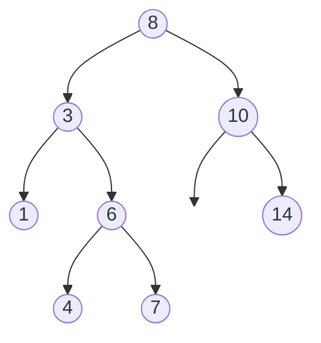
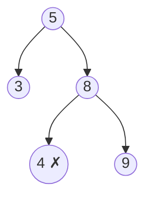

A binary search tree is a binary tree with one promise: **everything in a node's left subtree is smaller, everything in its right subtree is larger**. That single rule gives you two superpowers. You can **search** by going left or right, like binary search, in O(height). And an **in-order traversal visits the values in sorted order**. Nearly every BST interview question uses one of those two facts.

<Callout type="note" title="New to binary search trees?">

This lesson assumes you know what a BST is and how search and insert work. If not, read [Trees](/dsa/data-structures/trees) in Data Structures Basics first. It has step-through visuals.

</Callout>

<Callout type="tip" title="How to spot it">

- The input is a **BST** — the word itself is the biggest signal; ask yourself what the ordering gives you.
- "**k-th smallest**", "sorted order", "closest value", "successor/predecessor" → in-order traversal.
- **Validate** a BST, or recover one with swapped nodes.
- **Search, insert, delete** in a BST.
- Build a **balanced** tree from sorted data.

</Callout>

## Fact 1: in-order is sorted



In-order (left, node, right) visits `1, 3, 4, 6, 7, 8, 10, 14` — sorted. So "the k-th smallest" is "the k-th node an in-order traversal visits", and you can stop as soon as you reach it:

```java
static int kthSmallest(TreeNode root, int k) {
    Deque<TreeNode> stack = new ArrayDeque<>();
    TreeNode cur = root;
    while (true) {
        while (cur != null) { stack.push(cur); cur = cur.left; }   // go as far left as possible
        cur = stack.pop();                                         // the next smallest value
        if (--k == 0) return cur.val;
        cur = cur.right;                                           // then its right subtree
    }
}
```

This iterative in-order is worth knowing by heart: it stops early (O(h + k) instead of O(n)) and is the basis of a BST iterator.

Step through it: the stack holds the nodes you passed on the way left, and each visit is numbered.

<BstViz examples={['kth']} />

## Fact 2: search by going left or right

```java
static TreeNode searchBST(TreeNode root, int val) {
    while (root != null && root.val != val) root = val < root.val ? root.left : root.right;
    return root;
}

static TreeNode insertIntoBST(TreeNode root, int val) {
    if (root == null) return new TreeNode(val);                // found the empty spot
    if (val < root.val) root.left = insertIntoBST(root.left, val);
    else root.right = insertIntoBST(root.right, val);
    return root;
}
```

Both are O(h): O(log n) when the tree is balanced, O(n) when it degenerates into a line (e.g. inserting sorted values). That's why real libraries use self-balancing trees (Java's `TreeMap` is a red-black tree).

Step through a search and an insert: one comparison per node rules out a whole side.

<BstViz examples={['search', 'insert']} />

## Worked problems

### Validate a BST — pass the allowed range down

The classic mistake is checking only `left.val < node.val < right.val`. That misses a deeper node violating an ancestor:



`4 < 8` locally, but 4 is in 5's **right** subtree, so it must be greater than 5. The fix: every node inherits a range `(lo, hi)` from its ancestors.

<BstViz examples={['validate']} />

```java
static boolean isValidBST(TreeNode root) { return valid(root, Long.MIN_VALUE, Long.MAX_VALUE); }

static boolean valid(TreeNode n, long lo, long hi) {
    if (n == null) return true;
    if (n.val <= lo || n.val >= hi) return false;
    return valid(n.left, lo, n.val) && valid(n.right, n.val, hi);   // left: below n; right: above n
}
```

The bounds are `long` so that nodes holding `Integer.MIN_VALUE` or `Integer.MAX_VALUE` are still valid. (Alternative: do an in-order traversal and check every value is strictly greater than the previous one.)

### Lowest common ancestor in a BST

Values tell you which way to go. While both targets are smaller, go left; while both are bigger, go right; the first node where they **split** is the LCA.

```java
static TreeNode lcaBST(TreeNode root, TreeNode p, TreeNode q) {
    TreeNode cur = root;
    while (true) {
        if (p.val < cur.val && q.val < cur.val) cur = cur.left;
        else if (p.val > cur.val && q.val > cur.val) cur = cur.right;
        else return cur;                                           // they split here (or one of them is here)
    }
}
```

O(h) and O(1) space — compare with the general-tree [LCA](/dsa/patterns/tree-dfs), which must search both sides.

Step through it:

<BstViz examples={['lca']} />

### Delete a node

Three cases:

1. **No children** — just remove it.
2. **One child** — replace the node with that child.
3. **Two children** — copy in the **in-order successor** (the smallest value in the right subtree), then delete that successor from the right subtree (it has at most one child, so this is case 1 or 2).

```java
static TreeNode deleteNode(TreeNode root, int key) {
    if (root == null) return null;
    if (key < root.val) root.left = deleteNode(root.left, key);
    else if (key > root.val) root.right = deleteNode(root.right, key);
    else {
        if (root.left == null) return root.right;                  // cases 1 and 2
        if (root.right == null) return root.left;
        TreeNode succ = root.right;                                // case 3: in-order successor
        while (succ.left != null) succ = succ.left;
        root.val = succ.val;
        root.right = deleteNode(root.right, succ.val);
    }
    return root;
}
```

### Sorted array to a balanced BST

Pick the **middle** element as the root, so both sides get half; recurse.

```java
static TreeNode sortedArrayToBST(int[] a) { return fromRange(a, 0, a.length - 1); }

static TreeNode fromRange(int[] a, int lo, int hi) {
    if (lo > hi) return null;
    int mid = lo + (hi - lo) / 2;
    TreeNode n = new TreeNode(a[mid]);
    n.left = fromRange(a, lo, mid - 1);
    n.right = fromRange(a, mid + 1, hi);
    return n;
}
```

The reference solution checks that the result is balanced and that its in-order traversal returns the original array.

## BST operations at a glance

| Operation | Approach | Time |
| --- | --- | --- |
| Search / insert / delete | Go left or right | O(h) |
| k-th smallest | Iterative in-order, stop at k | O(h + k) |
| Validate | Pass (lo, hi) down, or in-order increasing | O(n) |
| LCA | Walk until p and q split | O(h) |
| Build from sorted | Middle as root | O(n) |
| Floor / ceiling / closest | Walk down, remember the best so far | O(h) |

In Java, a `TreeMap`/`TreeSet` is a balanced BST you can use directly: `floorKey`, `ceilingKey`, `headMap`, `firstKey` are all O(log n).

<Callout type="warning" title="Common mistakes">

- **Validating with parent/child comparisons only** — use ranges from all ancestors.
- **`int` bounds** in validation — `Integer.MIN_VALUE` as a node value breaks them; use `long` or `null` to mean "no bound".
- **Assuming O(log n)** — it's O(h); an unbalanced BST can be a linked list.
- **Duplicates** — clarify where equal values go (usually not allowed, or always right).
- **Forgetting to reassign children** in recursive insert/delete (`root.left = …`).

</Callout>

## Practice ladder

| # | Problem | Level | What it trains |
| --- | --- | --- | --- |
| 700 | [Search in a Binary Search Tree](https://leetcode.com/problems/search-in-a-binary-search-tree/) | Easy | Go left or right |
| 108 | [Convert Sorted Array to Binary Search Tree](https://leetcode.com/problems/convert-sorted-array-to-binary-search-tree/) | Easy | Middle as root |
| 235 | [Lowest Common Ancestor of a Binary Search Tree](https://leetcode.com/problems/lowest-common-ancestor-of-a-binary-search-tree/) | Medium | Walk until they split |
| 98 | [Validate Binary Search Tree](https://leetcode.com/problems/validate-binary-search-tree/) | Medium | Ranges from ancestors |
| 230 | [Kth Smallest Element in a BST](https://leetcode.com/problems/kth-smallest-element-in-a-bst/) | Medium | Iterative in-order |
| 701 | [Insert into a Binary Search Tree](https://leetcode.com/problems/insert-into-a-binary-search-tree/) | Medium | Recursive reassignment |
| 450 | [Delete Node in a BST](https://leetcode.com/problems/delete-node-in-a-bst/) | Medium | Three cases |
| 173 | [Binary Search Tree Iterator](https://leetcode.com/problems/binary-search-tree-iterator/) | Medium | In-order with a stack |
| 99 | [Recover Binary Search Tree](https://leetcode.com/problems/recover-binary-search-tree/) | Medium | Find the two out-of-order nodes |

## Interview questions

<QA q="Why isn't it enough to check that each node is greater than its left child and smaller than its right child?">
The BST property is about whole subtrees, not just children. A node deep in the right subtree of an ancestor must be greater than that ancestor, which a local parent–child check never compares. Passing down the tightest lower and upper bounds from all ancestors, or checking that an in-order traversal is strictly increasing, catches these violations.
</QA>

<QA q="What is the complexity of BST operations, and when does it degrade?">
Search, insert and delete take O(h), where h is the tree's height. For a balanced tree h is O(log n), but inserting already sorted data into a plain BST produces a chain with h = n, making operations O(n). Self-balancing trees such as red-black or AVL trees keep h at O(log n); Java's TreeMap is a red-black tree.
</QA>

<Practice task="Two nodes of a BST were swapped by mistake. Find them using the in-order fact. What pattern do you look for in the in-order sequence?">

In-order should be increasing. Swapping two values creates either **one** "drop" (adjacent nodes swapped, e.g. 1 3 2 4) or **two** drops (e.g. 1 6 3 4 5 2 7). Walk in-order keeping the previous node: at the first drop, the **first** wrong node is `prev`; the second wrong node is `cur` at the **last** drop. Swap their values back. O(n) time, O(h) space (O(1) with Morris traversal).

</Practice>

<Practice task="Find the value in a BST closest to a target (a double). How can you do it in O(h) without a full traversal?">

Walk down from the root like a search: at each node, update the best if `|node.val − target|` is smaller, then go left if `target < node.val`, else right. The closest value must lie on this search path — any node off the path is further from the target than some node on it. O(h), O(1) space.

</Practice>

<Takeaways>

- A BST orders every subtree: left smaller, right larger.
- In-order traversal is sorted → k-th smallest, iterators, validation, recovering swapped nodes.
- Search, insert, delete, LCA and closest value walk one path: O(h), which is only O(log n) if balanced.
- Validate with (lo, hi) ranges passed down from ancestors, using `long` bounds.
- In Java, `TreeMap`/`TreeSet` give you a balanced BST for free.

</Takeaways>

## Further reading

- Next: [Graphs & Grids: BFS and DFS](/dsa/patterns/graph-traversal).
- Cormen et al., *Introduction to Algorithms* — chapter 12, "Binary Search Trees".
