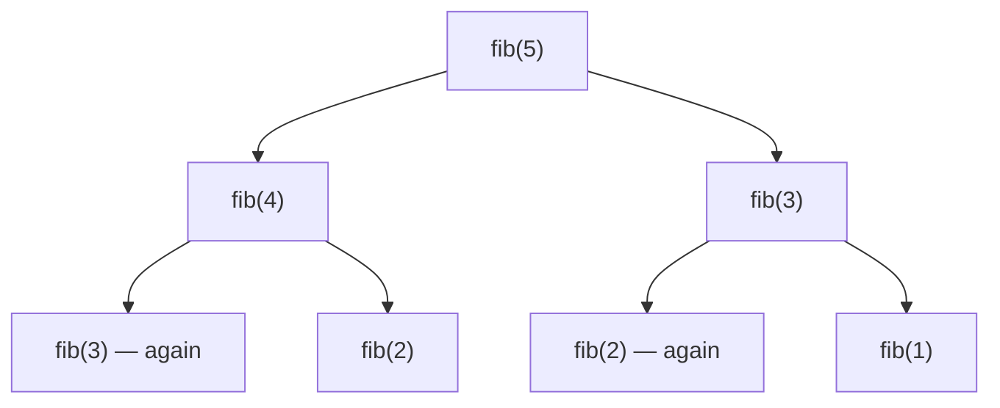

Dynamic programming has the scariest reputation in interview prep, mostly because it's usually taught backwards: here's a table, here's a formula, fill it in. Nobody explains where the formula came from. This lesson does it the other way round. **DP is recursion that remembers.** You write the obvious recursive brute force, notice it solves the same subproblems again and again, and save each answer the first time. Everything else — tables, loops, space optimisation — is a mechanical transformation of that recursion.

If you're comfortable with [recursion](/dsa/start-here/recursion-made-easy), you already know 80% of DP.

<Callout type="tip" title="How to spot it">

- The question asks for an **optimum** (minimum cost, maximum profit, longest, shortest) or a **count** ("how many ways").
- The answer is built from **choices** made step by step (take or skip, which coin, which step, match or not).
- A brute-force recursion would **solve the same subproblem many times** — the same index, the same remaining amount, the same pair of positions.
- Constraints like n ≤ 1000 or n × m ≤ 10⁶ suggest O(n²) or O(n·m) — a typical DP table size.
- If you must **list** every solution rather than count them, that's [backtracking](/dsa/patterns/backtracking), not DP.

</Callout>

## Why plain recursion is slow

Fibonacci, the classic: `fib(n) = fib(n − 1) + fib(n − 2)`.

```java
static long fibNaive(int n) { return n < 2 ? n : fibNaive(n - 1) + fibNaive(n - 2); }
```



`fib(3)` is computed twice, `fib(2)` three times; for `fib(50)` the same values are recomputed **billions** of times. That's the signal: **overlapping subproblems**. Exponential time comes from solving the same thing again.

Step through the call tree: in plain recursion the same calls light up again and again; with a memo the repeats are answered at once and their branches disappear.

<FibTreeViz examples={['plain', 'memo']} />

## The four steps (always the same)

### Step 1 — Write the brute-force recursion

Define a function that answers the problem for a **smaller piece**, and write it by trusting smaller calls. The function's parameters are the **state**.

### Step 2 — Add memoisation

Store each answer the first time you compute it; return the stored answer next time.

```java
static long fibMemo(int n, long[] memo) {
    if (n < 2) return n;
    if (memo[n] != 0) return memo[n];                 // already solved
    return memo[n] = fibMemo(n - 1, memo) + fibMemo(n - 2, memo);
}
```

Now each `n` is computed **once**: O(n) time. This version is called **top-down** DP, and it's a perfectly good interview answer.

### Step 3 — Turn it into a table (bottom-up)

The recursion depends on smaller `n`, so compute in increasing order and the answers you need are always ready:

```java
static long fibTab(int n) {
    if (n < 2) return n;
    long[] dp = new long[n + 1];
    dp[1] = 1;
    for (int i = 2; i <= n; i++) dp[i] = dp[i - 1] + dp[i - 2];   // the recursion, as a loop
    return dp[n];
}
```

No recursion, so no stack-overflow risk on large inputs.

### Step 4 — Shrink the memory (optional)

`dp[i]` only needs the previous two values, so keep two variables:

```java
static long fibConst(int n) {
    if (n == 0) return 0;
    long prev = 0, cur = 1;
    for (int i = 2; i <= n; i++) { long next = prev + cur; prev = cur; cur = next; }
    return cur;
}
```

The reference solution checks all four versions agree for n = 0 to 30.

## A complete worked example: min cost climbing stairs

> `cost[i]` is the price of stepping off stair i. You can climb 1 or 2 stairs at a time and start on stair 0 or 1. Minimum cost to reach the top (just past the last stair)?

**Step 1 — recursion.** Define `best(i)` = cheapest cost to *stand on* stair i. To stand on stair i, you came from i − 1 (paying `cost[i − 1]`) or from i − 2 (paying `cost[i − 2]`):

`best(i) = min(best(i − 1) + cost[i − 1], best(i − 2) + cost[i − 2])`, with `best(0) = best(1) = 0`.

**Step 2 — memoise:**

```java
static int minCostAt(int[] cost, int i, int[] memo) {          // memo filled with −1
    if (i <= 1) return 0;
    if (memo[i] != -1) return memo[i];
    return memo[i] = Math.min(minCostAt(cost, i - 1, memo) + cost[i - 1],
                              minCostAt(cost, i - 2, memo) + cost[i - 2]);
}
```

**Step 3 — table:**

<Dp1dViz examples={['stairs']} />

```java
static int minCostClimbingStairs(int[] cost) {
    int n = cost.length;
    int[] dp = new int[n + 1];                                   // dp[0] = dp[1] = 0
    for (int i = 2; i <= n; i++)
        dp[i] = Math.min(dp[i - 1] + cost[i - 1], dp[i - 2] + cost[i - 2]);
    return dp[n];                                                // the top
}
```

**Step 4** would replace the array with two variables, exactly like Fibonacci.

Notice that the hard part was **step 1** — choosing what `best(i)` means and how it depends on smaller cases. Steps 2–4 were mechanical.

## How to find the state (the hard part)

Ask these questions in order:

1. **What decision do I make at each step?** (Take or skip this item? Which coin next? Match these two characters or not?)
2. **After making some decisions, what do I need to know to finish the problem optimally?** That information is the **state** — usually an index (how far I've got), sometimes plus a remaining budget or a second index.
3. **What does the function return?** The optimum or count *for the rest of the problem from this state* (or for the prefix up to it).
4. **How does it depend on smaller states?** Try each choice, recurse, combine with `min`, `max` or `+`.
5. **Base cases:** the smallest states, answered directly.

| Problem type | Typical state | Typical transition |
| --- | --- | --- |
| Sequence, one pass | index `i` | `dp[i]` from `dp[i − 1]`, `dp[i − 2]` |
| Items with a capacity | item `i`, remaining capacity `c` | take (c − weight) or skip |
| Two strings | prefix lengths `i`, `j` | match → diagonal; mismatch → drop one |
| Grid | cell `(r, c)` | from above or from the left |
| Substrings / intervals | `[i, j]` | shrink from the ends |

The next four lessons are exactly these families: [1D](/dsa/patterns/dp-linear), [knapsack](/dsa/patterns/dp-knapsack), [grid](/dsa/patterns/dp-grid) and [string](/dsa/patterns/dp-strings) DP.

## Top-down or bottom-up?

| | Memoisation (top-down) | Tabulation (bottom-up) |
| --- | --- | --- |
| How you write it | Recursion + a cache | Loops over a table |
| Easier to get right | ✅ follows the recursion directly | Need the right fill order |
| Computes only needed states | ✅ | Computes all states |
| Stack overflow risk | Deep recursion can overflow | ✅ none |
| Space optimisation | Hard | ✅ often O(row) or O(1) |

In an interview, writing the memoised version first is completely acceptable — and if you have time, converting it to a table shows mastery.

<Callout type="interview" title="Say the recurrence before the code">
"Let `dp[i]` be the cheapest cost to stand on step i. To get there I came from i − 1 or i − 2, so `dp[i] = min(dp[i − 1] + cost[i − 1], dp[i − 2] + cost[i − 2])`, with `dp[0] = dp[1] = 0`." If the interviewer agrees with that sentence, the code writes itself — and if it's wrong, you find out before writing twenty lines.
</Callout>

<Callout type="warning" title="Common mistakes">

- **Jumping to a table** without a clear definition of what each cell means — define `dp[i]` in words first.
- **Missing state**: if the answer from a position depends on something else (remaining capacity, whether the previous item was taken), that something must be part of the state.
- **Using 0 as "not computed"** when 0 is a valid answer — initialise the memo with −1 (or use `Integer` / `null`).
- **Wrong fill order** in tabulation — every cell must be computed after the cells it depends on.
- **Off-by-one** between "first i elements" (size n + 1 tables) and "index i".

</Callout>

## Practice ladder

| # | Problem | Level | What it trains |
| --- | --- | --- | --- |
| 509 | [Fibonacci Number](https://leetcode.com/problems/fibonacci-number/) | Easy | All four steps |
| 70 | [Climbing Stairs](https://leetcode.com/problems/climbing-stairs/) | Easy | Counting ways |
| 746 | [Min Cost Climbing Stairs](https://leetcode.com/problems/min-cost-climbing-stairs/) | Easy | Minimising cost |
| 1137 | [N-th Tribonacci Number](https://leetcode.com/problems/n-th-tribonacci-number/) | Easy | Three previous states |
| 198 | [House Robber](https://leetcode.com/problems/house-robber/) | Medium | Take or skip (next lesson) |
| 322 | [Coin Change](https://leetcode.com/problems/coin-change/) | Medium | Try every last choice |

## Interview questions

<QA q="What's the difference between memoisation and tabulation?">
Memoisation is top-down: write the recursion and cache each result the first time it's computed, so later calls return immediately. Tabulation is bottom-up: fill a table in an order where every entry's dependencies are already computed, using loops. Both give the same time complexity for most problems; memoisation is often easier to derive and only computes needed states, while tabulation avoids recursion depth limits and makes space optimisation (keeping only the last row or two) straightforward.
</QA>

<QA q="How do you know a problem can be solved with DP?">
Two properties. Optimal substructure: the best answer for the whole problem can be built from best answers to smaller subproblems of the same kind. Overlapping subproblems: a brute-force recursion would solve the same subproblem many times. Practically: if you can write a recursive brute force whose parameters take a modest number of distinct values, and it repeats calls with the same parameters, memoising it is DP.
</QA>

<Practice task="'How many ways can you climb n stairs taking 1, 2 or 3 steps at a time?' Do steps 1–4: state, recurrence, base cases, and the O(1)-space version.">

**State:** `ways(i)` = number of ways to reach stair i. **Recurrence:** the last move was 1, 2 or 3 steps, so `ways(i) = ways(i − 1) + ways(i − 2) + ways(i − 3)`. **Base:** `ways(0) = 1` (one way to be at the start: do nothing), and treat negative indexes as 0. **Table:** fill `i = 1…n`. **O(1) space:** keep the last three values in variables and shift them each step. It's Tribonacci — notice how "the last move" defined the recurrence.

</Practice>

<Practice task="Decode ways: '12' can be read as 'AB' (1, 2) or 'L' (12). Count decodings of a digit string. What is the state, and which two choices does each position offer?">

**State:** `dp[i]` = ways to decode the first i characters. **Choices at position i:** decode the last character alone (valid if it's 1–9, adding `dp[i − 1]`), or the last two together (valid if they form 10–26, adding `dp[i − 2]`). **Base:** `dp[0] = 1`. The zeros are the trap: `'0'` can't stand alone, and `'06'` isn't a valid pair. Solved in the [1D DP](/dsa/patterns/dp-linear) lesson.

</Practice>

<Takeaways>

- DP is recursion that remembers: overlapping subproblems + caching.
- Four steps: brute-force recursion → memoise → table → shrink memory.
- The hard part is the state: what do you need to know to finish optimally? Define it in words.
- State the recurrence and base cases out loud before coding.
- Memoisation is a fine interview answer; tabulation adds stack safety and space savings.

</Takeaways>

## Further reading

- Next: [1D DP](/dsa/patterns/dp-linear).
- Jeff Erickson, *Algorithms* (2019, free online) — chapter 3, "Dynamic Programming", the clearest treatment of "recursion first, then memoise".
