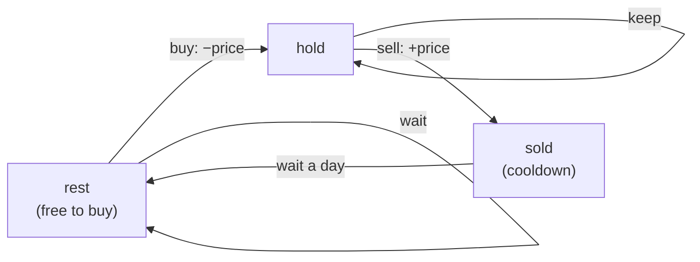

Some DP problems add a twist: what you can do next depends on **what state you're in**. "Can I buy today? Only if I'm not holding a share and not in cooldown." Or the state is a **set**: "which cities have I visited so far?". These look like they need a new idea each time. They don't. Both are the DP you already know, with a slightly richer state:

- **State machine:** a handful of named states per step, with transitions between them.
- **Bitmask:** a subset of a small set, stored as the bits of an integer.

<Callout type="tip" title="How to spot it">

- **State machine:** rules like "after selling you must wait a day", "at most k transactions", "pay a fee per trade", or a string built under "no three in a row" constraints.
- You can **draw the situation as a few circles and arrows** (holding, not holding, cooling down).
- **Bitmask:** n ≤ 20 (often ≤ 16) and the problem asks for an **order** or **assignment** of all items: visit every node, split into k groups, assign people to tasks.
- The brute force is n! permutations; the bitmask DP is 2ⁿ · n, which is far smaller.

</Callout>

## State-machine DP: one variable per state

Model the problem as a small machine:

1. **Name the states** at the end of each step, e.g. *hold*, *sold*, *rest*.
2. For each state, write **where it can come from** yesterday, and at what gain or cost.
3. Keep one variable per state and update them **all from yesterday's values** each day.

> **Stock with cooldown.** Buy and sell as often as you like, one share at a time, but after selling you must wait one day before buying.



<ArrayViz title="Stock with cooldown: three states per day" frames={[
  { arr: [1, 2, 3, 0, 2], vars: { hold: "−∞", sold: 0, rest: 0 }, note: "Stock with cooldown, prices [1, 2, 3, 0, 2]. Three states at the end of each day: hold (own a share), sold (sold today, so tomorrow is a forced rest), rest (no share, free to buy). Each value = best profit so far in that state." },
  { arr: [1, 2, 3, 0, 2], pointers: { day: 0 }, highlight: [0], vars: { hold: "−1", sold: "−∞", rest: 0 }, note: "Day 0, price 1. sold = yesterday's hold + 1 = −∞. hold = max(keep −∞, buy from rest 0 − 1 = −1) = −1. rest = max(0, yesterday's sold 0) = 0." },
  { arr: [1, 2, 3, 0, 2], pointers: { day: 1 }, highlight: [1], vars: { hold: "−1", sold: 1, rest: 0 }, note: "Day 1, price 2. sold = yesterday's hold + 2 = 1. hold = max(keep −1, buy from rest 0 − 2 = −2) = −1. rest = max(0, yesterday's sold −∞) = 0." },
  { arr: [1, 2, 3, 0, 2], pointers: { day: 2 }, highlight: [2], vars: { hold: "−1", sold: 2, rest: 1 }, note: "Day 2, price 3. sold = yesterday's hold + 3 = 2. hold = max(keep −1, buy from rest 0 − 3 = −3) = −1. rest = max(0, yesterday's sold 1) = 1." },
  { arr: [1, 2, 3, 0, 2], pointers: { day: 3 }, highlight: [3], vars: { hold: 1, sold: "−1", rest: 2 }, note: "Day 3, price 0. sold = yesterday's hold + 0 = −1. hold = max(keep −1, buy from rest 1 − 0 = 1) = 1. rest = max(1, yesterday's sold 2) = 2." },
  { arr: [1, 2, 3, 0, 2], pointers: { day: 4 }, highlight: [4], vars: { hold: 1, sold: 3, rest: 2 }, note: "Day 4, price 2. sold = yesterday's hold + 2 = 3. hold = max(keep 1, buy from rest 2 − 2 = 0) = 1. rest = max(2, yesterday's sold −1) = 2." },
  { arr: [1, 2, 3, 0, 2], done: [], vars: { answer: 3 }, note: "Answer = max(sold, rest) = 3 (buy 1, sell 2, cool down, buy 0, sell 2). Three numbers per day replace an exponential search over buy/sell/wait sequences — O(n) time, O(1) memory." }
]} />

```java
static int maxProfitCooldown(int[] prices) {
    int hold = Integer.MIN_VALUE / 2, sold = 0, rest = 0;
    for (int p : prices) {
        int prevSold = sold;
        sold = hold + p;                                           // sell the share we held
        hold = Math.max(hold, rest - p);                           // keep holding, or buy (only from rest)
        rest = Math.max(rest, prevSold);                           // cooldown ends
    }
    return Math.max(sold, rest);
}
```

Two details matter:

- **Update order.** Every new value must use **yesterday's** values. Here `sold` uses the old `hold` because it's computed first, and `rest` needs the old `sold`, so we saved it in `prevSold`. When in doubt, copy all states into temporaries first.
- **Impossible states** start at "minus infinity". `Integer.MIN_VALUE / 2` avoids overflow when a price is added to it.

### The whole stock family is one machine with small changes

| Variant | States | Change |
| --- | --- | --- |
| One transaction (121) | min price so far | Greedy: best = max(price − min) |
| Unlimited (122) | hold, cash | `cash = max(cash, hold + p)`, `hold = max(hold, cash − p)` |
| With fee (714) | hold, cash | Subtract the fee when selling |
| With cooldown (309) | hold, sold, rest | Buy only from rest |
| At most k (188; k = 2 is 123) | buy[j], sell[j] for j = 1..k | The j-th buy comes from the (j−1)-th sell |

```java
static int maxProfitFee(int[] prices, int fee) {
    int hold = Integer.MIN_VALUE / 2, cash = 0;
    for (int p : prices) {
        int prevCash = cash;
        cash = Math.max(cash, hold + p - fee);
        hold = Math.max(hold, prevCash - p);
    }
    return cash;
}

static int maxProfitK(int k, int[] prices) {
    int[] buy = new int[k + 1], sell = new int[k + 1];
    Arrays.fill(buy, Integer.MIN_VALUE / 2);
    for (int p : prices)
        for (int j = 1; j <= k; j++) {
            buy[j] = Math.max(buy[j], sell[j - 1] - p);
            sell[j] = Math.max(sell[j], buy[j] + p);
        }
    return sell[k];
}
```

In `maxProfitK`, `sell[j]` may use the `buy[j]` updated on the **same** day. That amounts to buying and selling on the same day, which earns 0 and never beats the true answer, so it's harmless. The reference solution checks all three variants against an exhaustive search over buy/sell/wait sequences.

The same "states per position" idea counts **strings under rules**. For example, "attendance records with fewer than 2 absences and no 3 lates in a row" has one state per (absences so far, current run of lates), and each new character moves you between them.

## Bitmask DP: the set of things done so far

When the state is "which items are already used", store it as an integer `mask` where bit i means "item i is used" (see [Bit Manipulation](/dsa/patterns/bit-manipulation)). There are 2ⁿ masks: about a million for n = 20.

### Travelling salesman (Held–Karp)

> Visit every city exactly once and return to the start, minimising the total distance.

Trying every order is O(n!), about 2.4 × 10¹⁸ for n = 20. But the cost of the rest of the trip depends only on **which cities are already visited** and **where you are now**, not on the order you visited them. That's the state:

> `dp[mask][v]` = cheapest path that starts at city 0, visits exactly the cities in `mask`, and ends at `v`.

```java
static int tsp(int[][] d) {
    int n = d.length, FULL = (1 << n) - 1, INF = Integer.MAX_VALUE / 2;
    int[][] dp = new int[1 << n][n];
    for (int[] row : dp) Arrays.fill(row, INF);
    dp[1][0] = 0;                                                  // start at city 0
    for (int mask = 1; mask <= FULL; mask++)
        for (int v = 0; v < n; v++) {
            if (dp[mask][v] == INF) continue;
            for (int u = 0; u < n; u++) {
                if ((mask & (1 << u)) != 0) continue;              // already visited
                int next = mask | (1 << u);
                dp[next][u] = Math.min(dp[next][u], dp[mask][v] + d[v][u]);
            }
        }
    int best = INF;
    for (int v = 0; v < n; v++) best = Math.min(best, dp[FULL][v] + d[v][0]);   // return home
    return best;
}
```

That's O(2ⁿ · n²): about 4 × 10⁸ for n = 20, against n! for brute force. Iterating `mask` in increasing order is a valid fill order, because adding a bit always makes the number bigger.

### Partition into k equal-sum subsets

Here the state can be even smaller. Fill the buckets **one at a time**, and store for each mask how full the current bucket is. When a bucket reaches the target, it wraps to 0 and the next bucket starts:

```java
static boolean canPartitionKSubsets(int[] nums, int k) {
    int sum = Arrays.stream(nums).sum();
    if (sum % k != 0) return false;
    int target = sum / k, n = nums.length;
    int[] dp = new int[1 << n];
    Arrays.fill(dp, -1);
    dp[0] = 0;
    for (int mask = 0; mask < (1 << n); mask++) {
        if (dp[mask] < 0) continue;
        for (int i = 0; i < n; i++) {
            if ((mask & (1 << i)) != 0 || dp[mask] + nums[i] > target) continue;
            dp[mask | (1 << i)] = (dp[mask] + nums[i]) % target;  // a full bucket wraps to 0: start the next
        }
    }
    return dp[(1 << n) - 1] == 0;
}
```

That's O(2ⁿ · n). It works because the fill level of the current bucket is determined by the mask: the total of the used numbers modulo target.

### BFS over (node, mask)

> Shortest walk that visits every node of a graph (you may revisit nodes and edges).

Every step costs 1, so instead of a DP table use **BFS** over states `(current node, visited mask)`. Start from every node at once and stop at the first full mask:

```java
static int shortestPathLength(int[][] graph) {
    int n = graph.length, FULL = (1 << n) - 1;
    if (n == 1) return 0;
    boolean[][] seen = new boolean[n][1 << n];
    Deque<int[]> q = new ArrayDeque<>();
    for (int v = 0; v < n; v++) { q.offer(new int[] { v, 1 << v }); seen[v][1 << v] = true; }   // start anywhere
    for (int steps = 1; !q.isEmpty(); steps++)
        for (int size = q.size(); size > 0; size--) {
            int[] cur = q.poll();
            for (int u : graph[cur[0]]) {
                int mask = cur[1] | (1 << u);
                if (mask == FULL) return steps;
                if (!seen[u][mask]) { seen[u][mask] = true; q.offer(new int[] { u, mask }); }
            }
        }
    return -1;
}
```

This is [multi-source BFS](/dsa/patterns/graph-traversal) on an expanded graph with n · 2ⁿ states. "Add the mask to the state" is a general trick for any search that must collect a set: keys in a maze, or nodes to visit.

<Callout type="warning" title="Common mistakes">

- **Updating a state from today's value of another state** when it should use yesterday's. Copy first.
- **`Integer.MIN_VALUE` for impossible states**: adding a price overflows to a large positive number. Use `MIN_VALUE / 2`.
- **Bitmask DP for n = 30**: 2³⁰ states won't fit. It's only for n up to about 20.
- **`1 << n` precedence**: write `(mask & (1 << i)) != 0` with the parentheses.
- **Forgetting the return trip** in a TSP cycle, or adding it when the problem asks for a path.

</Callout>

## Practice ladder

| # | Problem | Level | What it trains |
| --- | --- | --- | --- |
| 122 | [Best Time to Buy and Sell Stock II](https://leetcode.com/problems/best-time-to-buy-and-sell-stock-ii/) | Medium | Two states: hold, cash |
| 714 | [Best Time to Buy and Sell Stock with Transaction Fee](https://leetcode.com/problems/best-time-to-buy-and-sell-stock-with-transaction-fee/) | Medium | Fee on one transition |
| 309 | [Best Time to Buy and Sell Stock with Cooldown](https://leetcode.com/problems/best-time-to-buy-and-sell-stock-with-cooldown/) | Medium | Three states |
| 123 | [Best Time to Buy and Sell Stock III](https://leetcode.com/problems/best-time-to-buy-and-sell-stock-iii/) | Hard | Two transactions |
| 188 | [Best Time to Buy and Sell Stock IV](https://leetcode.com/problems/best-time-to-buy-and-sell-stock-iv/) | Hard | buy[j], sell[j] |
| 552 | [Student Attendance Record II](https://leetcode.com/problems/student-attendance-record-ii/) | Hard | Counting with states |
| 526 | [Beautiful Arrangement](https://leetcode.com/problems/beautiful-arrangement/) | Medium | dp over masks of used numbers |
| 698 | [Partition to K Equal Sum Subsets](https://leetcode.com/problems/partition-to-k-equal-sum-subsets/) | Medium | Bucket fill per mask |
| 1986 | [Minimum Number of Work Sessions to Finish the Tasks](https://leetcode.com/problems/minimum-number-of-work-sessions-to-finish-the-tasks/) | Medium | (sessions, current load) per mask |
| 847 | [Shortest Path Visiting All Nodes](https://leetcode.com/problems/shortest-path-visiting-all-nodes/) | Hard | BFS over (node, mask) |
| 943 | [Find the Shortest Superstring](https://leetcode.com/problems/find-the-shortest-superstring/) | Hard | TSP in disguise |

## Interview questions

<QA q="Why does bitmask DP beat trying all permutations for the travelling salesman problem?">
For the cost of finishing the tour, only two things matter: which cities have been visited and which city you're currently in. The order in which the visited cities were seen doesn't matter. So all the permutations that share the same visited set and current city collapse into one state, dp[mask][v]. There are 2ⁿ · n states with n transitions each, O(2ⁿ · n²) total, which is about 4 × 10⁸ for n = 20 instead of n! ≈ 2.4 × 10¹⁸.
</QA>

<QA q="How do you design the states for a stock problem with constraints?">
Name what you need to know at the end of each day to decide tomorrow's actions: whether you hold a share, whether you're in a cooldown, how many transactions you have used. Each combination is a state holding the best profit so far. Write each state's update as the max over the transitions into it, such as holding today from holding yesterday or buying from a state that allows buying, and compute all of them from yesterday's values. The answer is the best non-holding state at the end. It's O(n · states) time and O(states) memory.
</QA>

<Practice task="Assign n ≤ 16 workers to n jobs (one each), where cost[w][j] is given, minimising the total cost. What's the bitmask state, and why is the current worker not part of it?">

`dp[mask]` = cheapest way to fill the jobs in `mask`, using workers `0 … popcount(mask) − 1` in order. The number of bits set **is** the index of the next worker, so the worker doesn't need to be stored. The transition gives worker `w = popcount(mask)` each free job j:

`dp[mask | 1 << j] = min(…, dp[mask] + cost[w][j])`

That's O(2ⁿ · n), versus n! permutations. (The Hungarian algorithm does O(n³), but the bitmask DP is what's expected in interviews.)

</Practice>

<Practice task="Count binary strings of length n with no two consecutive 1s, modulo 10⁹ + 7. Draw the state machine.">

Use two states for the last character: `end0` and `end1`.

- A 0 may follow anything: `new end0 = end0 + end1`.
- A 1 may only follow a 0: `new end1 = end0`.

Start with `end0 = end1 = 1` for length 1. The answer is `end0 + end1`, which turns out to be a Fibonacci number. It's O(n) with two variables, and for n up to 10¹⁸ you can raise the 2 × 2 transition matrix to the n-th power with fast exponentiation ([Math for Interviews](/dsa/patterns/math-for-interviews)).

</Practice>

<Takeaways>

- State-machine DP: name the states per step, write the transitions, and update all states from yesterday's values.
- The stock family is one machine: hold/cash, plus a cooldown state or a transaction counter.
- Use `MIN_VALUE / 2` for impossible states; copy values before updating if any depend on each other.
- Bitmask DP: the state is the set of used items as an integer; feasible for n up to about 20.
- TSP = dp[mask][last] in O(2ⁿ · n²); unit-cost searches over sets use BFS on (node, mask).

</Takeaways>

## Further reading

- Next: [Greedy](/dsa/patterns/greedy).
- Michael Held and Richard M. Karp, "A Dynamic Programming Approach to Sequencing Problems" (1962): the original bitmask DP for TSP.
