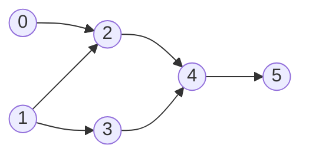

"You must take Algorithms before Machine Learning, and Data Structures before Algorithms. In what order can you take all courses — or is it impossible?" Whenever things have **dependencies**, you're looking at a directed graph, and the question "what order respects every dependency?" is a **topological sort**. The same algorithm answers the follow-up "is it impossible?" — because an order exists exactly when there's no cycle.

<Callout type="note" title="New to graphs?">

This lesson assumes you know directed graphs, DAGs and adjacency lists. If not, read [Graphs](/dsa/data-structures/graphs) in Data Structures Basics first. It has step-through visuals.

</Callout>

<Callout type="tip" title="How to spot it">

- **Prerequisites**, dependencies, "X must come before Y", build order, task scheduling.
- "Is it **possible** to finish all tasks?" — that's cycle detection in a directed graph.
- Derive an **order** from pairwise rules (alien dictionary: letter order from sorted words).
- "Minimum number of semesters/rounds" when independent tasks can run in parallel — BFS levels of the topological sort.

</Callout>

## The idea: start with what's ready

A task is **ready** when all its prerequisites are done — when its **in-degree** (the number of incoming edges) is 0. Take any ready task, mark it done, and reduce the in-degree of everything that depended on it. Anything that drops to 0 becomes ready. This is **Kahn's algorithm**.



Step through it: the number on each course is how many prerequisites it is still waiting for. The second example has a cycle.

<TopoViz examples={['courses', 'cycle']} />

```java
/** prerequisites[i] = {course, prereq}: prereq must come first. Returns an order, or empty if impossible. */
static int[] findOrder(int n, int[][] prerequisites) {
    List<List<Integer>> graph = new ArrayList<>();
    for (int i = 0; i < n; i++) graph.add(new ArrayList<>());
    int[] indegree = new int[n];
    for (int[] p : prerequisites) { graph.get(p[1]).add(p[0]); indegree[p[0]]++; }   // edge prereq → course

    Deque<Integer> q = new ArrayDeque<>();
    for (int i = 0; i < n; i++) if (indegree[i] == 0) q.offer(i);      // nothing blocks these

    int[] order = new int[n];
    int idx = 0;
    while (!q.isEmpty()) {
        int u = q.poll();
        order[idx++] = u;
        for (int v : graph.get(u))
            if (--indegree[v] == 0) q.offer(v);                       // u was v's last blocker
    }
    return idx == n ? order : new int[0];                             // fewer than n ⇒ a cycle
}
```

**Why the count detects cycles:** in a cycle, every course waits for another course in the same cycle, so none of them ever reaches in-degree 0 and they're never added. If the output has fewer than n courses, a cycle exists.

O(V + E) time and space.

<Callout type="warning" title="Get the edge direction right">
"`[course, prereq]`" means prereq → course. Reversing the edge gives you an order that's exactly backwards — and passes the cycle check, so the bug can hide. Say the direction out loud before writing the loop.
</Callout>

## The DFS version: three colours

DFS finds a topological order too: a node can be placed only after everything that depends on it has finished, so the **reverse of the finishing order** is a valid order. To detect cycles, track three states:

- **0 — unvisited**
- **1 — on the current DFS path** (in progress)
- **2 — finished**

Meeting a node in state 1 means you've walked back into your own path: a **cycle**.

```java
static int[] findOrderDFS(int n, int[][] prerequisites) {
    List<List<Integer>> graph = new ArrayList<>();
    for (int i = 0; i < n; i++) graph.add(new ArrayList<>());
    for (int[] p : prerequisites) graph.get(p[1]).add(p[0]);
    int[] state = new int[n];
    Deque<Integer> finished = new ArrayDeque<>();
    for (int i = 0; i < n; i++)
        if (state[i] == 0 && !dfsTopo(i, graph, state, finished)) return new int[0];
    int[] order = new int[n];
    for (int i = 0; i < n; i++) order[i] = finished.pop();      // reverse finishing order
    return order;
}

static boolean dfsTopo(int u, List<List<Integer>> graph, int[] state, Deque<Integer> finished) {
    state[u] = 1;
    for (int v : graph.get(u)) {
        if (state[v] == 1) return false;                         // back edge → cycle
        if (state[v] == 0 && !dfsTopo(v, graph, state, finished)) return false;
    }
    state[u] = 2;
    finished.push(u);
    return true;
}
```

Why two "visited" states? A node in state **2** was fully explored on an earlier path — reaching it again is fine (two courses can share a prerequisite). Only state **1** means a cycle. Using a single boolean `visited` reports false cycles.

| | Kahn (BFS) | DFS three-colour |
| --- | --- | --- |
| Order produced | Ready-first (natural for scheduling) | Reverse finishing order |
| Cycle detection | Output shorter than n | Back edge to a state-1 node |
| Parallel "rounds" | Easy: process the queue level by level | Awkward |
| Recursion depth risk | None | Deep chains can overflow |

Kahn's is usually the better interview default: iterative, and it extends naturally to "minimum number of semesters" (count BFS levels).

## Worked problems

### Course Schedule — can you finish?

```java
static boolean canFinish(int n, int[][] prerequisites) {
    return findOrder(n, prerequisites).length == n;
}
```

### Minimum semesters (parallel courses)

Process Kahn's queue **level by level** (freeze the size, like [tree BFS](/dsa/patterns/tree-bfs)); each level is one semester in which all ready courses are taken together. The number of levels is the answer (or −1 if a cycle prevents finishing).

### Alien dictionary

> Words are sorted in an unknown alphabet. Recover a valid letter order.

1. **Build edges** from each pair of adjacent words: the first position where they differ gives one rule (`'t' before 'f'`). Only that first difference tells you anything.
2. Watch the invalid case: a word followed by its own **prefix** (`"abc"` then `"ab"`) means no valid order exists.
3. **Topologically sort** the letters; a cycle means no valid order.

<Callout type="interview" title="Narrate the graph">
Say explicitly: "nodes are courses, an edge goes from a prerequisite to the course that needs it, and an order exists if and only if the graph has no cycle." Establishing the model clearly is half the score on these problems.
</Callout>

<Callout type="warning" title="Common mistakes">

- **Reversed edges** — the order comes out backwards.
- **One `visited` boolean in DFS** — reports cycles where two paths share a node; use three states.
- **Forgetting isolated nodes** — courses with no edges must still appear in the order; initialise the queue from every node with in-degree 0.
- **Not checking the output length** in Kahn's — that's the cycle detection.
- **Duplicate edges** (the same prerequisite listed twice) — fine for Kahn's as long as in-degree counts both; don't de-duplicate one side only.

</Callout>

## Practice ladder

| # | Problem | Level | What it trains |
| --- | --- | --- | --- |
| 207 | [Course Schedule](https://leetcode.com/problems/course-schedule/) | Medium | Cycle detection |
| 210 | [Course Schedule II](https://leetcode.com/problems/course-schedule-ii/) | Medium | Producing the order |
| 1462 | [Course Schedule IV](https://leetcode.com/problems/course-schedule-iv/) | Medium | Reachability along the order |
| 310 | [Minimum Height Trees](https://leetcode.com/problems/minimum-height-trees/) | Medium | Peeling leaves layer by layer |
| 802 | [Find Eventual Safe States](https://leetcode.com/problems/find-eventual-safe-states/) | Medium | Reverse graph + Kahn |
| 2115 | [Find All Possible Recipes from Given Supplies](https://leetcode.com/problems/find-all-possible-recipes-from-given-supplies/) | Medium | Topological sort on strings |
| 269 | [Alien Dictionary](https://leetcode.com/problems/alien-dictionary/) (Premium) | Hard | Building edges from rules |
| 1203 | [Sort Items by Groups Respecting Dependencies](https://leetcode.com/problems/sort-items-by-groups-respecting-dependencies/) | Hard | Two-level topological sort |
| 269 | [Alien Dictionary](https://leetcode.com/problems/alien-dictionary/) | Hard | Rules from neighbours, then topo sort (LeetCode Premium) |
| 2392 | [Build a Matrix With Conditions](https://leetcode.com/problems/build-a-matrix-with-conditions/) | Hard | Two independent topological sorts |

## Interview questions

<QA q="How does Kahn's algorithm detect a cycle?">
It only outputs nodes whose in-degree has dropped to zero. Nodes on a cycle each depend on another node of the same cycle, so their in-degree never reaches zero and they are never output. If the final order contains fewer nodes than the graph, at least one cycle exists.
</QA>

<QA q="Why does DFS cycle detection in a directed graph need three states rather than a visited boolean?">
Reaching an already-visited node is only a cycle if that node is still on the current recursion path. A node that was fully finished on an earlier path can be reached again legitimately — for example, two courses sharing a prerequisite. Three states (unvisited, in progress, finished) distinguish a back edge to an in-progress node, which is a cycle, from a cross edge to a finished node, which is not.
</QA>

<Practice task="Find the minimum number of semesters to finish n courses, taking any number of courses per semester as long as prerequisites are met. Which change to Kahn's algorithm gives the answer?">

Process the queue **level by level**: at the start of a round, freeze `size = queue.size()`, take exactly those courses (one semester), and push any course that becomes ready into the next round. Count the rounds. If the total number of courses taken is less than n, return −1 (cycle). It's tree-BFS level counting on a DAG.

</Practice>

<Practice task="Given a list of build targets and their dependencies, return a build order — but if several targets are ready at once, build them in alphabetical order. What do you change?">

Replace Kahn's `ArrayDeque` with a `PriorityQueue<String>` (min-heap by name). Ready targets wait in the heap and the alphabetically smallest is always built next. The cost rises to O((V + E) log V). This "lexicographically smallest topological order" variant is a common follow-up.

</Practice>

<Takeaways>

- Dependencies → directed graph → topological sort; an order exists if and only if there's no cycle.
- Kahn's: start with in-degree 0, remove, decrement neighbours, repeat; output shorter than n means a cycle.
- DFS: reverse finishing order, with three states to detect cycles correctly.
- Level-by-level Kahn's counts parallel rounds; a heap instead of a queue gives the smallest order.
- Double-check the edge direction.

</Takeaways>

## Further reading

- Next: [Union-Find](/dsa/patterns/union-find).
- Arthur Kahn, "Topological sorting of large networks" (Communications of the ACM, 1962).
