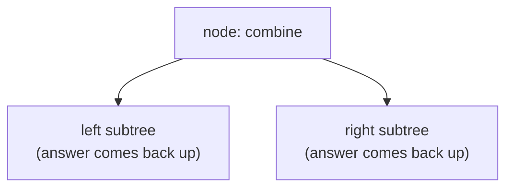

Trees are where recursion stops being scary and starts being the obvious tool — because a tree **is** recursive. A binary tree is either empty, or a node with a left subtree and a right subtree. So almost every tree problem has the same shape: *"if I knew the answer for the left subtree and the right subtree, how would I combine them at this node?"* Most solutions are three to six lines once you see that.

<Callout type="tip" title="How to spot it">

- The input is a **binary tree** and the question is about depth, height, paths, sums, balance, symmetry, ancestors.
- The answer for a node depends on answers for its **children** (heights, sums, "is it valid").
- Information must flow **down** from ancestors (the path so far, the maximum so far, allowed value ranges).
- Paths that can **bend** at a node (diameter, maximum path sum).
- Level-related questions are usually [BFS](/dsa/patterns/tree-bfs) instead.

</Callout>

## The core move: trust the children



Answer three questions, exactly as in [Recursion Without Fear](/dsa/start-here/recursion-made-easy):

1. **Empty tree** — what's the answer for `null`?
2. **Children** — call the function on `left` and `right`, and **trust** the results.
3. **Combine** — build this node's answer from the children's answers and `node.val`.

```java
static int maxDepth(TreeNode root) {
    if (root == null) return 0;                                       // 1. empty tree
    return 1 + Math.max(maxDepth(root.left), maxDepth(root.right));   // 2 + 3. trust, combine
}
```

That's the entire pattern. The rest of this lesson is variations on **which way information flows**.

## Direction 1: return values up (bottom-up)

The node needs facts *about its subtrees*. Each call returns a summary to its parent.

### Same tree, symmetric tree, invert tree

```java
static boolean isSameTree(TreeNode a, TreeNode b) {
    if (a == null || b == null) return a == b;                        // both empty → same; one empty → different
    return a.val == b.val && isSameTree(a.left, b.left) && isSameTree(a.right, b.right);
}

static boolean isSymmetric(TreeNode root) { return root == null || mirror(root.left, root.right); }
static boolean mirror(TreeNode a, TreeNode b) {
    if (a == null || b == null) return a == b;
    return a.val == b.val && mirror(a.left, b.right) && mirror(a.right, b.left);   // outer with outer, inner with inner
}

static TreeNode invertTree(TreeNode root) {
    if (root == null) return null;
    TreeNode l = invertTree(root.left), r = invertTree(root.right);
    root.left = r;
    root.right = l;
    return root;
}
```

### Balanced tree — return a sentinel for "already failed"

A tree is balanced if every node's subtrees differ in height by at most 1. Computing the height separately at every node is O(n²). Instead, return the height, or **−1 to mean "unbalanced somewhere below"** — one pass, O(n):

```java
static boolean isBalanced(TreeNode root) { return height(root) != -1; }

static int height(TreeNode n) {
    if (n == null) return 0;
    int l = height(n.left), r = height(n.right);
    if (l == -1 || r == -1 || Math.abs(l - r) > 1) return -1;        // propagate failure upward
    return 1 + Math.max(l, r);
}
```

## Direction 2: pass context down (top-down)

The node needs facts *about its ancestors*. Pass them as parameters.

### Path sum (root to leaf)

Pass down the **remaining** target:

```java
static boolean hasPathSum(TreeNode root, int target) {
    if (root == null) return false;
    if (root.left == null && root.right == null) return root.val == target;   // must end at a LEAF
    return hasPathSum(root.left, target - root.val) || hasPathSum(root.right, target - root.val);
}
```

### Count "good" nodes — the maximum so far flows down

> A node is good if no ancestor on the path from the root has a greater value.

```java
static int goodNodes(TreeNode root) { return good(root, Integer.MIN_VALUE); }

static int good(TreeNode n, int maxAbove) {
    if (n == null) return 0;
    int self = n.val >= maxAbove ? 1 : 0;
    int m = Math.max(maxAbove, n.val);                               // new context for the children
    return self + good(n.left, m) + good(n.right, m);
}
```

Many problems use **both** directions at once: context goes down as parameters, answers come back up as return values.

## Direction 3: return one thing, record another

The trickiest tree problems involve paths that **bend** at a node — they go up from the left subtree, through the node, and down into the right subtree. Such a path can't be extended to the parent (a path can't fork). So each call does two things:

- **Records** the best path that bends *here* in a field (or array) outside the recursion.
- **Returns** the best path that goes *straight down* from here — the only kind the parent can extend.

### Diameter of a binary tree

<TreeViz title="Diameter: return the height, record the bend" tree={{ id: "n0", v: 1, c: [{ id: "n1", v: 2, c: [{ id: "n3", v: 3, c: [{ id: "n5", v: 5, c: [{ id: "n9", v: 7 }, null] }, null] }, { id: "n4", v: 4, c: [null, { id: "n8", v: 6 }] }] }, null] }} frames={[
  { vars: { diameter: 0 }, note: "Diameter = the longest path between any two nodes, in edges. Each call RETURNS its height (the longest straight-down path, the only kind the parent can extend) and RECORDS l + r, the longest path that bends at this node." },
  { highlight: ["n9"], visited: [], notes: { n9: "h=1" }, vars: { "l + r": 0, diameter: 0 }, note: "Node 7: left height 0, right height 0. Record the bend here: 0 + 0 = 0. Return 1 + max = 1 to the parent." },
  { highlight: ["n5"], visited: ["n9"], notes: { n9: "h=1", n5: "h=2" }, vars: { "l + r": 1, diameter: 1 }, note: "Node 5: left height 1, right height 0. Record the bend here: 1 + 0 = 1 — a new best. Return 1 + max = 2 to the parent." },
  { highlight: ["n3"], visited: ["n9", "n5"], notes: { n9: "h=1", n5: "h=2", n3: "h=3" }, vars: { "l + r": 2, diameter: 2 }, note: "Node 3: left height 2, right height 0. Record the bend here: 2 + 0 = 2 — a new best. Return 1 + max = 3 to the parent." },
  { highlight: ["n8"], visited: ["n9", "n5", "n3"], notes: { n9: "h=1", n5: "h=2", n3: "h=3", n8: "h=1" }, vars: { "l + r": 0, diameter: 2 }, note: "Node 6: left height 0, right height 0. Record the bend here: 0 + 0 = 0. Return 1 + max = 1 to the parent." },
  { highlight: ["n4"], visited: ["n9", "n5", "n3", "n8"], notes: { n9: "h=1", n5: "h=2", n3: "h=3", n8: "h=1", n4: "h=2" }, vars: { "l + r": 1, diameter: 2 }, note: "Node 4: left height 0, right height 1. Record the bend here: 0 + 1 = 1. Return 1 + max = 2 to the parent." },
  { highlight: ["n1"], visited: ["n9", "n5", "n3", "n8", "n4"], notes: { n9: "h=1", n5: "h=2", n3: "h=3", n8: "h=1", n4: "h=2", n1: "h=4" }, vars: { "l + r": 5, diameter: 5 }, note: "Node 2: left height 3, right height 2. Record the bend here: 3 + 2 = 5 — a new best. Return 1 + max = 4 to the parent." },
  { highlight: ["n0"], visited: ["n9", "n5", "n3", "n8", "n4", "n1"], notes: { n9: "h=1", n5: "h=2", n3: "h=3", n8: "h=1", n4: "h=2", n1: "h=4", n0: "h=5" }, vars: { "l + r": 4, diameter: 5 }, note: "Node 1: left height 4, right height 0. Record the bend here: 4 + 0 = 4. Return 1 + max = 5 to the parent." },
  { visited: ["n9", "n5", "n3", "n8", "n4", "n1", "n0"], path: ["n9", "n5", "n3", "n1", "n4", "n8"], marked: ["n1"], notes: { n9: "h=1", n5: "h=2", n3: "h=3", n8: "h=1", n4: "h=2", n1: "h=4", n0: "h=5" }, vars: { diameter: 5 }, note: "Diameter = 5: the path 7 → 5 → 3 → 2 → 4 → 6 bends at node 2, not at the root. The root only sees height 4 from its left child — that's why the best bend must be recorded at every node, not just returned." }
]} />

```java
static int diameter;

static int diameterOfBinaryTree(TreeNode root) { diameter = 0; depth(root); return diameter; }

static int depth(TreeNode n) {
    if (n == null) return 0;
    int l = depth(n.left), r = depth(n.right);
    diameter = Math.max(diameter, l + r);              // record: the longest path bending at n (in edges)
    return 1 + Math.max(l, r);                         // return: the deeper side only, for the parent
}
```

### Binary tree maximum path sum (hard)

Same structure, with one extra idea: a branch with a **negative** sum is better left out — clamp it to 0.

```java
static int bestPath;

static int maxPathSum(TreeNode root) { bestPath = Integer.MIN_VALUE; gain(root); return bestPath; }

static int gain(TreeNode n) {
    if (n == null) return 0;
    int l = Math.max(0, gain(n.left)), r = Math.max(0, gain(n.right));   // ignore negative branches
    bestPath = Math.max(bestPath, n.val + l + r);                         // path bending here
    return n.val + Math.max(l, r);                                        // path continuing up
}
```

Initialise `bestPath` to `Integer.MIN_VALUE`, not 0 — a tree of all negative values must still return its largest (least negative) node.

## Lowest common ancestor

> The deepest node that has both p and q as descendants (a node counts as its own descendant).

Each call returns "p, q, or their LCA if found in this subtree, else null". If p and q turn up on **different sides**, this node is where their paths meet:

```java
static TreeNode lowestCommonAncestor(TreeNode root, TreeNode p, TreeNode q) {
    if (root == null || root == p || root == q) return root;
    TreeNode l = lowestCommonAncestor(root.left, p, q);
    TreeNode r = lowestCommonAncestor(root.right, p, q);
    if (l != null && r != null) return root;           // one on each side: root is the LCA
    return l != null ? l : r;                          // both on one side (or neither)
}
```

## Building and serialising trees

### Build from preorder and inorder

Preorder lists the root **first**; inorder lists the left subtree, then the root, then the right subtree. So: take the next preorder value as the root, find it in inorder to split the range, recurse.

```java
static int preIdx;

static TreeNode buildTree(int[] preorder, int[] inorder) {
    Map<Integer, Integer> where = new HashMap<>();
    for (int i = 0; i < inorder.length; i++) where.put(inorder[i], i);   // O(1) lookups instead of scanning
    preIdx = 0;
    return build(preorder, where, 0, inorder.length - 1);
}

static TreeNode build(int[] pre, Map<Integer, Integer> where, int lo, int hi) {
    if (lo > hi) return null;
    TreeNode root = new TreeNode(pre[preIdx++]);
    int mid = where.get(root.val);
    root.left = build(pre, where, lo, mid - 1);        // build the left first: preorder visits it first
    root.right = build(pre, where, mid + 1, hi);
    return root;
}
```

### Serialise and deserialise

Preorder **with null markers** describes a tree uniquely — without the markers, different shapes would produce the same string.

```java
static void ser(TreeNode n, StringBuilder sb) {
    if (n == null) { sb.append("#,"); return; }
    sb.append(n.val).append(',');
    ser(n.left, sb);
    ser(n.right, sb);
}

static TreeNode des(Deque<String> tokens) {            // read back in the same order
    String s = tokens.poll();
    if (s.equals("#")) return null;
    TreeNode n = new TreeNode(Integer.parseInt(s));
    n.left = des(tokens);
    n.right = des(tokens);
    return n;
}
```

## Which direction?

| The node needs… | Flow | Example |
| --- | --- | --- |
| Facts about its subtrees | Return up | Height, same/symmetric, balanced |
| Facts about its ancestors | Pass down | Path sum, good nodes, valid BST range |
| A path through itself | Record a global, return one side | Diameter, max path sum |
| Where two searches meet | Return what each side found | LCA |

<Callout type="warning" title="Common mistakes">

- **Leaf vs null:** "root-to-leaf" means stop at a node with no children, not at `null` — otherwise a node with one child counts as a path end.
- **Returning the bent path to the parent** in diameter/path-sum problems — only one side can continue up.
- **Initialising a maximum with 0** when values can be negative.
- **O(n²) by recomputing heights** at every node — return them instead.
- **Deep recursion:** a skewed tree with 10⁵ nodes can overflow the stack; mention an iterative version.

</Callout>

## Practice ladder

| # | Problem | Level | What it trains |
| --- | --- | --- | --- |
| 104 | [Maximum Depth of Binary Tree](https://leetcode.com/problems/maximum-depth-of-binary-tree/) | Easy | The core move |
| 100 | [Same Tree](https://leetcode.com/problems/same-tree/) | Easy | Two trees at once |
| 226 | [Invert Binary Tree](https://leetcode.com/problems/invert-binary-tree/) | Easy | Modify on the way up |
| 101 | [Symmetric Tree](https://leetcode.com/problems/symmetric-tree/) | Easy | Mirror pairing |
| 112 | [Path Sum](https://leetcode.com/problems/path-sum/) | Easy | Pass the remainder down |
| 110 | [Balanced Binary Tree](https://leetcode.com/problems/balanced-binary-tree/) | Easy | Sentinel return value |
| 543 | [Diameter of Binary Tree](https://leetcode.com/problems/diameter-of-binary-tree/) | Easy | Record vs return |
| 1448 | [Count Good Nodes in Binary Tree](https://leetcode.com/problems/count-good-nodes-in-binary-tree/) | Medium | Context flows down |
| 236 | [Lowest Common Ancestor of a Binary Tree](https://leetcode.com/problems/lowest-common-ancestor-of-a-binary-tree/) | Medium | What each side found |
| 105 | [Construct Binary Tree from Preorder and Inorder Traversal](https://leetcode.com/problems/construct-binary-tree-from-preorder-and-inorder-traversal/) | Medium | Splitting ranges |
| 124 | [Binary Tree Maximum Path Sum](https://leetcode.com/problems/binary-tree-maximum-path-sum/) | Hard | Bending paths + negatives |
| 297 | [Serialize and Deserialize Binary Tree](https://leetcode.com/problems/serialize-and-deserialize-binary-tree/) | Hard | Null markers |

## Interview questions

<QA q="In the diameter problem, why does the function return one side but record both?">
A path that passes through a node from its left subtree to its right subtree is complete — it can't be extended upward, because the parent would make it fork. So that bent path is only recorded as a candidate answer. The parent can only extend a path that goes straight down through one child, so the function returns 1 plus the deeper side. Mixing the two up gives answers that are too large.
</QA>

<QA q="What's the time and space complexity of a recursive DFS on a binary tree?">
O(n) time, since each node is visited once with O(1) work per visit (as long as you don't recompute subtree results). Space is O(h) for the call stack, where h is the height: O(log n) for a balanced tree and O(n) for a skewed one. For very deep trees in Java, an iterative DFS with an explicit stack avoids stack overflow.
</QA>

<Practice task="Return all root-to-leaf paths whose values sum to a target. What's passed down, what's collected, and what must you undo?">

Pass down the remaining target and the **current path** (a list). At a leaf whose value equals the remainder, add a **copy** of the path to the results. After exploring both children, **remove** the current node from the path before returning — it's backtracking on a tree. O(n) visits, plus O(n · h) to copy paths.

</Practice>

<Practice task="Check whether one tree is a subtree of another (same structure and values at some node). Which helper from this lesson do you reuse, and what's the cost?">

At every node of the big tree, call `isSameTree(node, small)`; return true if any call does. Worst case O(m · n) for trees of sizes m and n. A faster alternative: serialise both trees with null markers and check whether one string occurs in the other (with separators so `12` doesn't match `2`), which is O(m + n) with a linear-time string search.

</Practice>

<Takeaways>

- Tree DFS = empty case + trust the children + combine at the node.
- Facts about subtrees flow **up** (return values); facts about ancestors flow **down** (parameters).
- For paths that bend at a node: record the bent path globally, return only one side.
- Return sentinels (like −1) to avoid recomputing; clamp negative branches to 0 in path sums.
- Root-to-leaf means stop at leaves, not nulls.

</Takeaways>

## Further reading

- Next: [Tree BFS: Level by Level](/dsa/patterns/tree-bfs).
- [Recursion Without Fear](/dsa/start-here/recursion-made-easy) — the leap of faith this lesson relies on.
