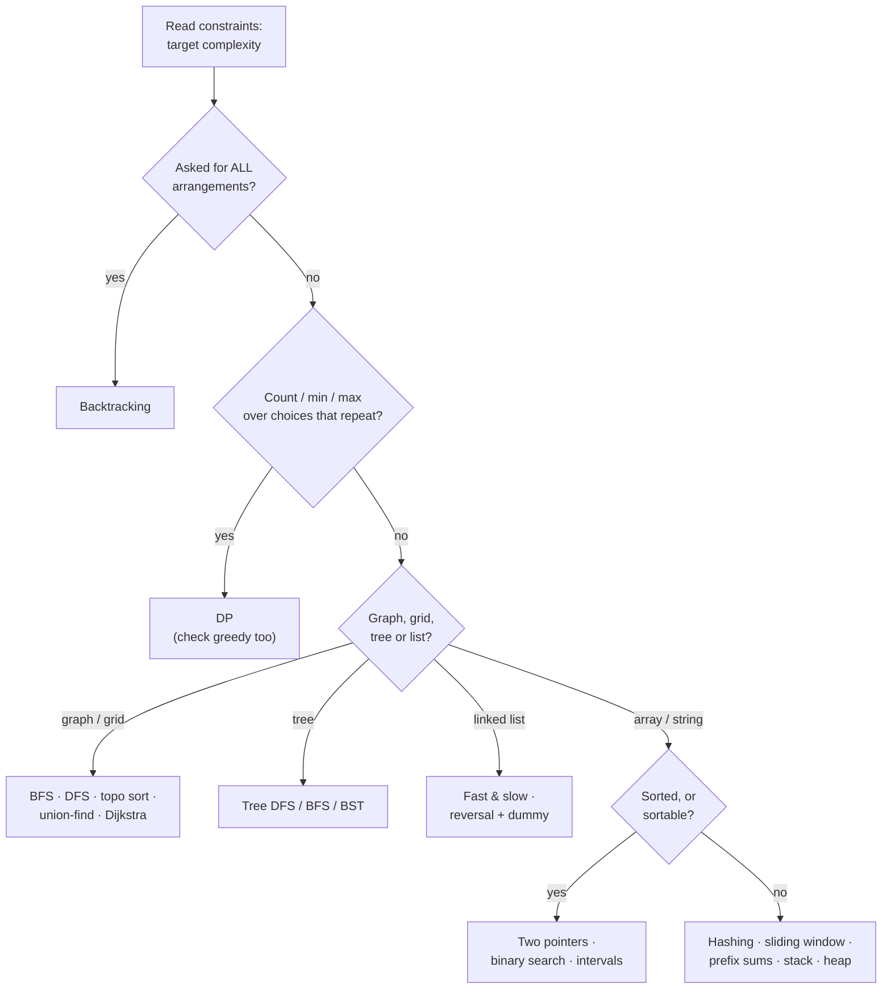

You've learned about thirty-five patterns. In an interview, the hard part is the first two minutes: reading an unfamiliar problem and deciding **which** pattern it is. This lesson turns that decision into a routine. Three quick reads — the **constraints**, the **input shape**, and the **wording** — narrow them down to two or three candidates, and the brute force usually tells you which one wins.

## Read 1: the constraints tell you the target complexity

Before thinking about the algorithm, look at the input size. With a budget of roughly 10⁸ simple operations ([Big-O the Easy Way](/dsa/start-here/complexity-made-easy); value ranges, memory and modulo are in [Reading Constraints](/dsa/data-structures/reading-constraints)):

| Largest n | Target | Patterns that fit |
| --- | --- | --- |
| ≤ 10–12 | O(n!) | Permutations — [backtracking](/dsa/patterns/backtracking) |
| ≤ 20–25 | O(2ⁿ) | Subsets — backtracking, [bitmasks](/dsa/patterns/bit-manipulation), [bitmask DP](/dsa/patterns/dp-state-machine) |
| ≤ 500 | O(n³) | [Interval DP](/dsa/patterns/dp-trees-intervals), Floyd–Warshall, triple loops |
| ≤ 5,000 | O(n²) | 2D DP ([strings](/dsa/patterns/dp-strings), [grids](/dsa/patterns/dp-grid)), every pair |
| ≤ 10⁵ – 10⁶ | O(n log n) or O(n) | [Sorting](/dsa/patterns/sorting-and-selection), [heaps](/dsa/patterns/heap-patterns), [binary search](/dsa/patterns/binary-search), [hashing](/dsa/patterns/hashing), [two pointers](/dsa/patterns/two-pointers), [sliding window](/dsa/patterns/sliding-window), [prefix sums](/dsa/patterns/prefix-sums), [monotonic stack](/dsa/patterns/monotonic-stack), graph traversal |
| ≥ 10⁹ (values, not lengths) | O(log n) | [Binary search on the answer](/dsa/patterns/binary-search-on-answer), maths |

If n is 10⁵, anything with nested loops over pairs is ruled out before you start — that alone removes half the patterns.

## Read 2: the input shape

| Input is… | First patterns to consider |
| --- | --- |
| Unsorted array | Hashing, prefix sums, sliding window, monotonic stack, heap, sort first |
| **Sorted** array | Two pointers, binary search |
| String | Sliding window, hashing (counts), two pointers, string DP, trie |
| Intervals / ranges | Sort + [intervals](/dsa/patterns/intervals) sweep, heap |
| Linked list | [Fast & slow pointers](/dsa/patterns/fast-slow-pointers), [reversal + dummy node](/dsa/patterns/linked-list-manipulation) |
| Binary tree | [DFS](/dsa/patterns/tree-dfs) (subtree answers), [BFS](/dsa/patterns/tree-bfs) (levels) |
| BST | [In-order is sorted](/dsa/patterns/bst-patterns), search by value |
| Grid | [BFS/DFS](/dsa/patterns/graph-traversal), grid DP, backtracking (word search) |
| Graph / relationships / dependencies | BFS/DFS, [topological sort](/dsa/patterns/topological-sort), [union-find](/dsa/patterns/union-find), [shortest paths](/dsa/patterns/shortest-paths) |
| List of words + prefix questions | [Trie](/dsa/patterns/tries) |
| Stream of numbers | Heap (top-k, running median), [reservoir sampling](/dsa/patterns/math-for-interviews) |
| Matrix to traverse or transform | [Matrix & simulation](/dsa/patterns/matrix-simulation) (spiral, rotate, in-place markers) |
| "Implement a class" with fast methods | [Designing data structures](/dsa/patterns/design-data-structures) (combine two structures) |
| Array with updates **and** range questions | [Fenwick / segment tree](/dsa/patterns/range-queries) |

## Read 3: the wording — signal words

| The problem says… | Strongest candidates |
| --- | --- |
| "pair / two numbers that sum to…" | Hashing (unsorted), two pointers (sorted) |
| "contiguous subarray / substring", "longest / shortest window" | Sliding window (positives), prefix sums + hash map (negatives) |
| "subarray sum equals / divisible by k" | Prefix sums + hash map |
| "k largest / smallest / most frequent / closest" | Heap of size k, quickselect, buckets |
| "next greater / smaller", "how far until…", histogram | Monotonic stack |
| "maximum of every window" | Monotonic deque |
| "minimum value that makes X possible", "minimise the maximum" | Binary search on the answer |
| "first / last position", "O(log n)" | Binary search |
| "valid parentheses", "nested", "decode", "undo" | Stack |
| "merge / overlap / meeting rooms" | Sort + intervals |
| "cycle", "middle of a list", "k-th from the end" | Fast & slow pointers |
| "level", "row", "right side view", "nearest", "fewest steps" | BFS |
| "path sum", "depth", "diameter", "ancestor" | Tree DFS |
| "number of islands / regions / connected" | DFS/BFS or union-find |
| "prerequisites", "order of tasks", "dependencies" | Topological sort |
| "connected after each added edge", "redundant edge" | Union-find |
| "minimum cost path" with weights | Dijkstra (or 0-1 BFS / Bellman–Ford) |
| "all subsets / permutations / combinations", "all ways to place" | Backtracking |
| "number of ways", "minimum cost", "maximum profit" with choices that repeat | Dynamic programming |
| "can you reach / partition / make the amount" | DP (knapsack), sometimes greedy |
| "two strings", "edit / common / interleave" | String DP |
| "starts with", "prefix", "autocomplete", "many words in a grid" | Trie |
| "appears twice except one", "without extra space" on 0…n | Bit manipulation (XOR) |
| "design / implement", "O(1) get and put", "evict" | Two structures combined (LRU = hash map + linked list) |
| "spiral", "rotate the image", "in place" on a matrix | Matrix boundaries, transpose + reverse, markers |
| "modulo 10⁹ + 7", "gcd", "prime", huge exponent | Math: modular arithmetic, sieve, fast power |
| "find the pattern in the text", "repeated substring", "shortest palindrome" | KMP failure table, rolling hash |
| "update index i" + "sum / min of range", "count smaller after self" | Fenwick tree, segment tree |
| "cooldown", "at most k transactions", "fee" | State-machine DP |
| "visit every node / city once" with n ≤ 20 | Bitmask DP |
| a choice at each tree node ("rob", "camera") | Tree DP (return a pair or states) |
| "burst", "merge stones", "cut", "take from either end" | Interval DP |
| "earliest finishing", "furthest reach", "smallest that fits" | Greedy (justify it!) |

## The decision flow

The flow gives you **candidates**, not certainty. Confirm by writing the brute force and asking what it repeats ([A Framework for Any Problem](/dsa/start-here/problem-solving-framework)): repeated searching → hashing; repeated sums → prefix sums; repeated subproblems → DP; repeated "find the min" → heap.

## Look-alikes that trip people up

| Confusion | How to tell them apart |
| --- | --- |
| Sliding window vs prefix sums | Window needs monotonic behaviour (all positives); with negatives, prefix sums + hash map |
| Two pointers vs hashing for pairs | Sorted (or sortable without losing what you need) → two pointers, O(1) space; otherwise hashing |
| Backtracking vs DP | "List all" → backtracking; "how many / best" → DP |
| Greedy vs DP | Can you find a small counterexample to the greedy choice? Then DP |
| BFS vs DFS on graphs | Fewest steps → BFS; explore/count regions → either; path properties → DFS |
| Binary search vs binary search on the answer | Searching positions in sorted data vs searching a range of possible answers with a yes/no check |
| Heap vs sorting | Need everything ordered once → sort; need the best repeatedly or on a stream → heap |
| Union-find vs DFS | Edges arriving over time → union-find; static graph → either |
| Prefix sums vs Fenwick tree | No updates → prefix sums; updates mixed with queries → Fenwick or segment tree |
| Interval DP vs plain 2D DP | Splitting a range at every k (O(n³)) vs two indexes moving forward (O(n²)) |

## Spot-the-pattern drills

Read each statement, give the pattern in under a minute, then open the answer.

<Practice task="1. Given an array of integers (some negative), count subarrays whose sum is exactly k.">

**Prefix sums + hash map.** "Subarray sum" + negatives rules out a sliding window. Count earlier prefixes equal to `prefix − k`.

</Practice>

<Practice task="2. Find the length of the longest substring with at most two distinct characters.">

**Sliding window** (longest valid window). Contiguous + condition that updates incrementally (a count map; shrink while more than 2 distinct).

</Practice>

<Practice task="3. Return the k most frequent words.">

**Hashing + heap of size k** (or bucket sort by frequency). Watch the tie-break order.

</Practice>

<Practice task="4. For each day, find how many days until a higher stock price.">

**Monotonic stack** — "how far until something bigger" is next-greater with distances.

</Practice>

<Practice task="5. Given piles of work and h hours, find the minimum speed to finish in time.">

**Binary search on the answer.** "Minimum value that makes it possible" + an easy O(n) check + monotonic feasibility.

</Practice>

<Practice task="6. Given course prerequisites, return an order to take all courses or report it's impossible.">

**Topological sort** (Kahn's algorithm). An order exists iff there's no cycle.

</Practice>

<Practice task="7. Find the minimum number of meeting rooms needed.">

**Intervals sweep line** (sort starts and ends) or a **min-heap** of end times.

</Practice>

<Practice task="8. Return all ways to place n queens on an n×n board.">

**Backtracking** with O(1) column/diagonal checks. "All arrangements" + small n.

</Practice>

<Practice task="9. Count the number of ways to make change for an amount with unlimited coins.">

**DP — unbounded knapsack (counting)**, coins in the outer loop so combinations aren't counted twice.

</Practice>

<Practice task="10. Detect whether a linked list has a cycle, in O(1) space.">

**Fast & slow pointers** (Floyd's algorithm).

</Practice>

<Practice task="11. Minimum number of steps for a knight to reach a target square on an infinite board.">

**BFS** — fewest steps with equal-cost moves.

</Practice>

<Practice task="12. Given edges added one at a time, report after each whether the graph is still a forest (no cycles).">

**Union-find** — `union` returning false means the new edge closes a cycle.

</Practice>

<Practice task="13. Minimum edits to turn one word into another.">

**String DP** (edit distance): two strings, prefixes, match → diagonal, else 1 + min of three neighbours.

</Practice>

<Practice task="14. Find all dictionary words that can be traced in a letter grid.">

**Trie + backtracking** (Word Search II).

</Practice>

<Practice task="15. Can you jump from the start of an array to the end, given maximum jump lengths?">

**Greedy** — track the furthest reachable index. (DP works too, but greedy is O(n) and O(1) space.)

</Practice>

<Takeaways>

- Three reads narrow the choice: constraints (target complexity), input shape, signal words.
- The decision flow gives candidates; the brute force's repeated work confirms which one.
- Know the look-alikes: window vs prefix sums, backtracking vs DP, greedy vs DP, BFS vs DFS.
- Drill spotting separately from solving — it's the skill interviews test first.

</Takeaways>

## Further reading

- Next: [A 10-Week Study Plan](/dsa/playbook/study-plan).
- [A Framework for Any Problem](/dsa/start-here/problem-solving-framework) — finding the pattern from the brute force.
