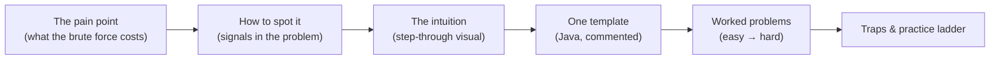
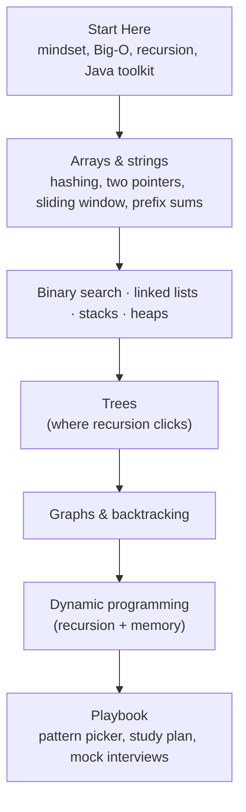

If you've ever opened a problem, read it twice, and felt your mind go blank — you're in good company. Almost everyone who is now good at DSA went through exactly that. The difference between them and someone who gives up is not talent. It's that they stopped treating every problem as a brand-new puzzle and started recognising **patterns**.

This lesson is about why DSA feels hard, which beliefs make it harder than it is, and the approach this track takes instead.

## Why it feels hard

Be honest about which of these sound familiar:

| What it feels like | What's really going on |
| --- | --- |
| "I read the problem and have no idea where to start." | You're trying to invent an algorithm from scratch instead of matching the problem to one you already know. |
| "I understand the solution when I read it, but I can't write it myself." | Reading is recognition; writing is recall. You've practised the first and not the second. |
| "I solved it last week. Now I can't remember how." | You memorised *this solution*, not *the idea behind it*. Ideas transfer; solutions don't. |
| "My code works on the example and fails on submission." | Edge cases (empty input, one element, duplicates, overflow) were never part of your routine. |
| "I freeze in interviews." | You've only practised alone, silently, with unlimited time. |
| "There are 3,000 problems. I'll never finish." | You don't need to. The problems repeat a small set of ideas. |

Every one of those has a concrete fix, and none of the fixes is "be smarter".

## Five myths worth dropping

**Myth 1 — "You need to be naturally good at maths."**
Interview DSA uses counting, a little arithmetic and logical reasoning. You need to know that a loop inside a loop is slow and that halving something repeatedly is fast. That's it. The few mathematical facts that come up (like `a % b`, or that log₂(1,000,000) ≈ 20) fit on one page.

**Myth 2 — "The more problems you solve, the better you get."**
Only up to a point. Solving 500 problems without reflecting teaches you 500 answers. Solving 150 problems while asking *"which pattern was this, and what in the problem told me?"* teaches you the patterns — and those solve problems you've never seen. Quality of reps beats quantity.

**Myth 3 — "Good programmers see the solution immediately."**
They don't. They see *a starting point* immediately — usually a brute-force idea — and then improve it step by step. What looks like instant insight is pattern recognition built through practice. You can build the same thing.

**Myth 4 — "If I can't solve it in 20 minutes, I'm not cut out for this."**
When you're learning a new pattern, not solving it is the expected outcome. The learning happens *after* — when you study the solution, name the pattern, and re-solve it a few days later without looking. Getting stuck is part of the method, not a verdict.

**Myth 5 — "I have to memorise hundreds of solutions."**
You have to understand roughly thirty-five patterns, each with one short template. That's a very different job: a template is ten lines you can rebuild from the idea, not a thousand lines of memorised code.

## Why patterns work

Interview problems are written by people, under constraints: they must be solvable in 30–45 minutes, explainable on a whiteboard, and testable. That pushes them toward a fairly small family of techniques. Once you know the family, a new problem stops being "unknown" and becomes "which of these does it look like?"

Here's what that feels like in practice.

> **Problem:** Given an array of numbers and a target, return the indexes of two numbers that add up to the target.

Without a pattern, you write the obvious version: try every pair.

```java
// Try every pair: about n²/2 checks. For 100,000 numbers that's 5 billion checks.
static int[] twoSumBrute(int[] nums, int target) {
    for (int i = 0; i < nums.length; i++)
        for (int j = i + 1; j < nums.length; j++)
            if (nums[i] + nums[j] == target) return new int[] { i, j };
    return new int[0];
}
```

With the **hashing** pattern, you ask a different question at each number: *"have I already seen the number that would complete this pair?"* A hash map answers that in constant time.

```java
// One pass: about n checks. For 100,000 numbers that's 100,000 checks.
static int[] twoSum(int[] nums, int target) {
    Map<Integer, Integer> seen = new HashMap<>();          // value → index
    for (int i = 0; i < nums.length; i++) {
        Integer j = seen.get(target - nums[i]);            // the partner we need
        if (j != null) return new int[] { j, i };
        seen.put(nums[i], i);
    }
    return new int[0];
}
```

Nothing clever happened. You recognised a signal ("find a pair with a property") and applied a known move ("remember what you've seen in a hash map"). That's the whole game, repeated across about thirty patterns.

## How this track is built

Every pattern lesson follows the same shape, so you always know where to look:



- **How to spot it** comes first, because recognising the pattern is the hard part — the code is the easy part.
- **One template per pattern.** You learn it once and adapt it, instead of memorising each problem.
- **Step-through visuals** let you watch pointers and windows move, which is where most "I don't get why this works" moments disappear.
- **Every solution is compiled and tested** against a brute-force version on thousands of random inputs, so you can trust the code you're learning from.
- **A practice ladder** at the end of each pattern lists real problems from easy to hard, so you know exactly what to solve next.

## The order to learn in

Don't jump to dynamic programming on day one. Each part builds on the one before:



Trees come before graphs because a tree is a graph without cycles. Backtracking and trees come before dynamic programming because DP is "recursion that remembers" — if recursion feels natural, DP stops being scary.

<Callout type="tip" title="The one habit that changes everything">
After every problem — solved or not — write one sentence: **"This was [pattern] because [signal in the problem]."** For example: "This was sliding window because it asked for the longest *contiguous* substring with a condition." That sentence is the pattern recognition you're building. After fifty of them, you'll start seeing the signal before you finish reading.
</Callout>

## What "good at DSA" actually means

It doesn't mean solving every problem instantly. In an interview, a strong candidate:

1. Asks a couple of clarifying questions and works an example by hand.
2. States a brute-force solution and its cost — even if it's slow.
3. Spots the pattern that improves it, and explains *why* it works.
4. Writes clean code, then tests it with an edge case before saying "done".

Notice that only one of those four is "know the algorithm". The rest is method — and method can be learned in weeks. The next two lessons give you that method.

## Interview questions

<QA q="Is it better to solve many problems quickly or fewer problems deeply?">
Fewer problems, deeply — especially early on. Interviews present problems you haven't seen, so what transfers is the pattern and the reasoning, not the specific answer. Spend time naming the pattern, noting the signal that revealed it, and re-solving the problem from scratch a few days later. Volume becomes useful once patterns are familiar, as practice in recognising them quickly.
</QA>

<QA q="What should I do when I can't solve a problem after 30–40 minutes?">
Stop and study the solution — that's not failure, it's the learning step. Read it until you can explain why it works, name the pattern, and write down the signal you missed. Then close it and write the code yourself. Re-solve the same problem two or three days later without help; if you can, you've learned the pattern, not just the answer.
</QA>

<Practice task="Look at these three problem statements and, without solving them, write down what kind of thing each one asks for: (1) 'Find the longest substring without repeating characters.' (2) 'Find the k largest numbers in an array.' (3) 'Can you reach the last index of the array by jumping?'">

You're practising *reading for signals*, which is the skill the rest of the track trains. (1) asks for the longest **contiguous** piece of a string with a condition — that's the classic signal for a **sliding window**. (2) asks for "the k largest" — a signal for a **heap** (keep only k items) or **quickselect**. (3) asks whether something is reachable by making moves — that can be **greedy** (track the furthest reachable index) or **dynamic programming**. Don't worry if you didn't know the names yet; the point is noticing "longest contiguous", "k largest" and "can you reach" as clues.

</Practice>

<Takeaways>

- DSA feels hard because people try to invent algorithms from scratch and memorise solutions instead of learning patterns.
- About thirty-five patterns cover the large majority of interview problems; each has one short template.
- Getting stuck while learning is normal — the learning happens when you study, name the pattern, and re-solve later.
- After every problem, write "this was [pattern] because [signal]".
- Learn in order: arrays and strings → searching, lists, stacks, heaps → trees → graphs and backtracking → DP.

</Takeaways>

## Further reading

- Next: [How to Practise So It Sticks](/dsa/start-here/how-to-practice).
- Barbara Oakley, *A Mind for Numbers* (2014) — how learning technical subjects actually works (chunking, spaced practice).
