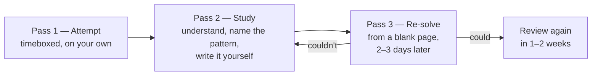

Most people practise DSA the same way: open a problem, struggle, look at the answer, nod, move on. A week later they can't solve the same problem again. That isn't a memory problem — it's a practice problem. **Reading a solution builds recognition; only re-solving it builds recall**, and interviews test recall.

This lesson gives you a simple routine that turns each problem into lasting skill.

## The three-pass method

Every problem gets three passes, spread over a week.

### Pass 1 — Attempt (timeboxed)

- **Easy:** up to 20 minutes. **Medium:** up to 35 minutes. **Hard:** up to 45 minutes.
- Work an example **by hand** first. Write down a brute-force idea, even a terrible one.
- If you have *some* direction, keep going. If you've been staring at a blank page for 10–15 minutes, take a hint (see below) rather than burning the full time.

### Pass 2 — Study

This is where the learning actually happens, so don't rush it.

1. Read the solution until you can explain **why** it works — not just what it does.
2. Write the **pattern** and the **signal** in your log: "Sliding window — asked for the longest contiguous substring with a condition."
3. Close the solution. **Write the code yourself** from your understanding. Getting stuck here is useful: it shows exactly which part you hadn't understood.
4. Note the edge cases the solution handles that you'd have missed.

### Pass 3 — Re-solve from scratch

Two or three days later, open the problem **with no notes** and solve it again. If you can, schedule one more review in a week or two. If you can't, that's fine — go back to pass 2. This step feels slow, but it's the one that makes the pattern yours.

<Callout type="tip" title="Why re-solving works">
Recalling something from memory strengthens it far more than re-reading it — psychologists call this the *testing effect*. Spacing the recall out over days (*spaced repetition*) makes it last. The three-pass method is just those two ideas applied to coding problems.
</Callout>

## Use hints in layers, not all at once

When you're stuck, don't jump straight to the full solution. Reveal as little as possible:

| Level | What you look at | Example |
| --- | --- | --- |
| 1 | The **pattern name** only | "Two pointers." |
| 2 | The **key insight** in one sentence | "If the sum is too small, the left number must grow." |
| 3 | The **approach** in steps, no code | "Sort; put pointers at both ends; move one inward based on the sum." |
| 4 | The **code** | Only after trying with level 3. |

Each level you don't need is a bit of pattern recognition you built yourself. The practice ladders in this track list problems; the lessons give you levels 1–3 by explaining the pattern before the code.

## Keep a pattern log

A small table is all you need. It becomes your personal revision sheet.

| Problem | Pattern | Signal | Key idea / trap | Status |
| --- | --- | --- | --- | --- |
| Two Sum | Hashing | "find a pair" in an unsorted array | store value → index; check complement first | Re-solved ✓ |
| Longest Substring Without Repeating | Sliding window | "longest contiguous" + "no repeats" | shrink from left while a duplicate is inside | Review on Fri |
| Search in Rotated Array | Binary search | sorted + O(log n) required | one half is always sorted | Couldn't re-solve ✗ |

The **Signal** column is the most valuable one. Before an interview, reading fifty signals is a far better warm-up than re-reading fifty solutions.

## How many problems, and in what order?

There's no magic number, but a rough guide:

- **Per pattern:** 3–5 problems from easy to hard is usually enough to own it. More if it keeps surprising you.
- **In total:** around **150 well-chosen problems**, solved with the three-pass method, prepares most people well for typical interviews. 400 problems solved carelessly prepares them less.

**Order matters.** Learn one pattern at a time (this is *blocked* practice — good for building the template). Once you've covered several patterns, switch to **mixed** practice: random problems where you don't know the pattern in advance. Mixed practice feels harder, and that's exactly why it works — it trains the skill an interview tests, which is *choosing* the pattern. The [study plan](/dsa/playbook/study-plan) builds both phases in.

## Practise the interview, not just the problem

Solving silently with unlimited time is a different skill from solving out loud in 40 minutes with someone watching. Once a week, after the first month:

- Set a **timer** for 40 minutes.
- **Talk out loud** the whole time, as if explaining to an interviewer — or record yourself.
- Write code in a **plain editor** without autocomplete, then trace it by hand before running.
- Better still, do mock interviews with a friend, taking turns.

The [Solving Out Loud](/dsa/playbook/interview-communication) lesson covers what to say at each step.

## Signs your practice is working

- You start guessing the pattern **before** you finish reading the problem.
- Your first idea is usually a reasonable brute force, and you can state its complexity.
- You re-solve old problems in a fraction of the time it took the first time.
- You catch edge cases (empty input, duplicates, overflow) while writing, not after failing.

And signs it isn't: you remember that you've "seen this one" but can't solve it; your log has no signals; you never revisit old problems.

## Interview questions

<QA q="Should I study one topic at a time or mix topics?">
Both, in sequence. Study one pattern at a time while you're learning it, so you can build and refine its template. Once you know several patterns, switch to mixed practice where you don't know the pattern in advance, because recognising which pattern applies is exactly what interviews test. Keep revisiting old patterns so they don't fade.
</QA>

<QA q="Is it cheating to look at the solution?">
No — as long as you then close it and write the code yourself, and re-solve the problem from scratch a few days later. Looking at a solution after a genuine attempt is how you learn a new pattern. The trap is reading the solution, feeling that you understand, and moving on without ever recalling it yourself.
</QA>

<Practice task="Design your own weekly routine for 6–8 hours a week of DSA practice using the ideas in this lesson. How many new problems, how many re-solves, and when does a mock interview fit in?">

One reasonable shape: **4–5 new problems per week** from the current pattern (pass 1 and 2 on each, roughly 1–1.5 hours per problem including study), **3–5 re-solves** of problems from 2–7 days ago (20–30 minutes each), and one **mixed** problem or **mock interview** at the end of the week, done out loud with a timer. Spread it across at least four days — five shorter sessions beat one long one, because spacing is what makes it stick. Adjust the numbers, but keep the three ingredients: new, re-solve, and timed mixed practice.

</Practice>

<Takeaways>

- Reading a solution builds recognition; re-solving it from a blank page builds the recall that interviews test.
- Use the three-pass method: timeboxed attempt → study and write it yourself → re-solve 2–3 days later.
- Take hints in layers: pattern name, key insight, approach, then code.
- Keep a log with a **signal** column — it's your best revision material.
- Learn one pattern at a time, then switch to mixed practice; rehearse out loud with a timer.

</Takeaways>

## Further reading

- Next: [A Framework for Any Problem](/dsa/start-here/problem-solving-framework).
- Peter Brown, Henry Roediger and Mark McDaniel, *Make It Stick: The Science of Successful Learning* (2014) — retrieval practice, spacing and interleaving.
