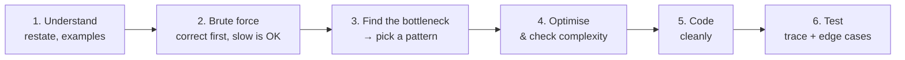

The blank-page feeling usually comes from trying to jump straight from the problem to the perfect solution. Nobody does that. Strong problem solvers follow a sequence of small, safe steps — and each step gives them something to say and something to build on. This lesson gives you that sequence, a checklist of edge cases, and a playbook for when you're stuck.

## The six steps



### 1. Understand the problem

- **Restate it** in your own words. If you can't, you don't understand it yet.
- Pin down **inputs and outputs**: types, ranges, can values be negative, can there be duplicates, is the input sorted?
- Read the **constraints** — they tell you how fast the solution must be ([Big-O the Easy Way](/dsa/start-here/complexity-made-easy) shows how).
- Work **one normal example and one edge case by hand**. Doing it by hand often reveals the algorithm.

### 2. Get a brute force

Write down the most obvious correct solution, however slow, and its cost. Try every pair, every subarray, every subset. This isn't wasted time:

- It proves you understand the problem.
- It gives you something to submit if the clever idea doesn't come.
- It shows you **where the work is wasted** — and that's where the pattern hides.

### 3. Find the bottleneck, then pick a pattern

Look at the brute force and ask **what it repeats**. Then ask the pattern questions:

| Ask yourself | If yes, consider |
| --- | --- |
| Am I searching for something I've already seen? | [Hash map / set](/dsa/patterns/hashing) |
| Is the input sorted (or can I sort it)? Looking for pairs? | [Two pointers](/dsa/patterns/two-pointers), [binary search](/dsa/patterns/binary-search) |
| Is it about a **contiguous** subarray or substring? | [Sliding window](/dsa/patterns/sliding-window), [prefix sums](/dsa/patterns/prefix-sums) |
| Do I need the k largest / smallest, or repeatedly the min/max? | [Heap](/dsa/patterns/heap-patterns) |
| Is the answer a number, and "can I do it with X?" gets easier as X grows? | [Binary search on the answer](/dsa/patterns/binary-search-on-answer) |
| Are things connected (grid, network, dependencies)? | [BFS/DFS](/dsa/patterns/graph-traversal), [topological sort](/dsa/patterns/topological-sort), [union-find](/dsa/patterns/union-find) |
| Must I list **all** combinations, subsets or arrangements? | [Backtracking](/dsa/patterns/backtracking) |
| Am I asked for a max/min/count over choices, and the brute force recomputes the same subproblems? | [Dynamic programming](/dsa/patterns/dp-made-easy) |
| Is it a class with methods that must all be fast? | [Designing data structures](/dsa/patterns/design-data-structures) |
| Does the array change between many range questions? | [Fenwick or segment tree](/dsa/patterns/range-queries) |

The [Pattern Picker](/dsa/playbook/pattern-picker) expands this into a full decision guide.

### 4. Optimise and check the complexity

Apply the pattern, then state the new time and space complexity and compare it with what the constraints require. If it's still too slow, go back to step 3 — there may be another bottleneck.

Two checks from *Cracking the Coding Interview* help here.

**Look for BUD** in your current solution:

| Look for | Example | Typical fix |
| --- | --- | --- |
| **B**ottleneck: the step that dominates the cost | Sorting is O(n log n), but everything after it is O(n) | Remove or replace that step (a hash set instead of sorting) |
| **U**nnecessary work | Trying all d after you've already found a, b, c with a + b + c + d = target | Compute the one value that works and check for it |
| **D**uplicated work | Re-summing the same subarray, re-solving the same subproblem | Store it: prefix sums, a hash map, memoisation |

**Know your best conceivable runtime (BCR).** This is the fastest any solution could possibly be, judged from the input and output alone:

- If you must look at every element, the BCR is O(n).
- If you must print every pair, it's O(n²).

The BCR isn't always reachable. It tells you when to **stop optimising**, and it hints at what remains. If you're at O(n log n) and the BCR is O(n), ask whether the sort is really necessary.

Careful: "find all pairs with sum k" doesn't need to *look at* all pairs, so its BCR is O(n), not O(n²).

### 5. Code it cleanly

- Use **meaningful names** (`left`, `windowSum`, `bestSoFar`), not `a`, `b`, `c`.
- Pull fiddly parts into **small helper methods**.
- Handle the edge cases you found in step 1 **explicitly**, at the top, rather than hoping the main loop copes.

### 6. Test before saying "done"

- **Trace** your code by hand on the example, writing down variable values. This catches more bugs than re-reading.
- Run through the **edge-case checklist** below.
- State the final **time and space complexity**.

## Worked example: best time to buy and sell a stock

> Given daily prices, buy on one day and sell on a later day. Return the maximum profit (0 if no profit is possible).

**1. Understand.** Prices like `[7, 1, 5, 3, 6, 4]`. Buy at 1, sell at 6 → profit 5. Edge case: prices only fall, like `[7, 6, 4]` → 0. Constraints: up to 100,000 prices.

**2. Brute force.** Try every buy day `i` and every later sell day `j`:

```java
static int maxProfitBrute(int[] prices) {
    int best = 0;
    for (int i = 0; i < prices.length; i++)
        for (int j = i + 1; j < prices.length; j++)
            best = Math.max(best, prices[j] - prices[i]);
    return best;                                     // O(n²): too slow for 100,000 prices
}
```

**3. Bottleneck.** For each sell day `j`, the inner loop searches all earlier days for the **cheapest** price. But the cheapest price before day `j` is just the cheapest price before day `j − 1`, possibly updated by day `j − 1` itself. We're recomputing a running minimum from scratch every time.

**4. Optimise.** Keep the running minimum as we go — one pass, O(1) extra space.

```java
static int maxProfit(int[] prices) {
    int minSoFar = Integer.MAX_VALUE, best = 0;
    for (int price : prices) {
        minSoFar = Math.min(minSoFar, price);         // cheapest day to have bought, up to today
        best = Math.max(best, price - minSoFar);      // profit if we sell today
    }
    return best;                                      // O(n) time, O(1) space
}
```

**6. Test.** Trace `[7, 1, 5, 3, 6, 4]`: min goes 7, 1, 1, 1, 1, 1; best goes 0, 0, 4, 4, 5, 5 → **5** ✓. Falling prices `[7, 6, 4]` → best stays 0 ✓. Single price → 0 ✓. Empty array → 0 ✓.

Notice how the optimisation came directly from staring at what the brute force repeated. That move — **"stop recomputing; carry it along"** — is the seed of half the patterns in this track.

## The edge-case checklist

Run through this before you say "done":

| Category | Ask |
| --- | --- |
| Size | Empty input? One element? Two elements? |
| Values | Negative numbers? Zero? All the same value? |
| Duplicates | What if values repeat? Does the answer need distinct values? |
| Order | Already sorted? Reverse sorted? |
| Limits | Can a sum or product overflow `int`? (Use `long`.) |
| Strings | Empty string? Uppercase vs lowercase? Spaces? |
| Answer | What if no answer exists — what should be returned? |
| Graphs/trees | Empty tree? Disconnected graph? Cycles? |

## When you're stuck

Being stuck is a normal part of solving. These moves get you unstuck, roughly in order:

1. **Solve tiny cases by hand** — n = 1, 2, 3 — and watch what you do. Your hands often know the algorithm before your head does.
2. **Simplify the problem.** Drop a constraint (what if the array were sorted? what if there were no negatives?) and solve that. Then add the constraint back.
3. **Look at what the brute force repeats.** Repeated searching → hash map. Repeated sums → prefix sums. Repeated subproblems → DP.
4. **Run through the data structures.** "Would a hash map help? A stack? A heap? Sorting first?"
5. **Work backwards** from the answer: what would the last step look like?
6. **Base case and build.** Solve n = 1, then n = 2 using the answer for n = 1, then n = 3. If each step reuses the last, you've found a recursion or a DP. Permutations of `"abc"` are permutations of `"ab"` with `c` inserted at every position.
7. **Say it out loud.** In an interview, narrating where you're stuck invites a hint — interviewers want to give hints to candidates who are reasoning clearly.

<Callout type="interview" title="Never stay silent">
In an interview, a correct brute force explained clearly, plus a sensible attempt at optimising it, scores far better than ten minutes of silence followed by a half-finished clever idea. Say the brute force and its cost early — it's a safety net and a starting point.
</Callout>

## Interview questions

<QA q="Should I mention the brute-force solution if I already know the optimal one?">
Usually yes, briefly: one or two sentences with its complexity, then "we can do better by…". It shows you understand the problem's cost, gives context for why the optimisation matters, and protects you if the interviewer wanted to see your reasoning. Don't spend long coding it unless asked.
</QA>

<QA q="How do I know whether my solution is fast enough?">
Compare its complexity with the input size in the constraints. A rough rule: a typical judge or interviewer expects around 10⁸ simple operations at most. With n = 100,000, O(n²) is 10¹⁰ — too slow — while O(n log n) is about 1.7 million — fine. The next lesson has a full table of input sizes and the complexities they allow.
</QA>

<Practice task="Apply steps 1–4 to: 'Given an array, return true if any value appears at least twice.' Write the brute force and its cost, name what it repeats, and describe the optimised version.">

**Brute force:** compare every pair — O(n²) time, O(1) space. **What it repeats:** for each element, it re-scans earlier elements to ask "have I seen this value?". That question is exactly what a **hash set** answers in O(1). **Optimised:** walk the array, and for each value, if it's already in the set return true, otherwise add it — O(n) time, O(n) space. **Alternative:** sort first (O(n log n)) and check neighbours, using O(1) extra space if sorting in place is allowed — a good trade-off to mention.

</Practice>

<Takeaways>

- Follow the steps: understand → brute force → find the bottleneck → optimise → code → test.
- A brute force is a safety net *and* the place where the pattern hides: look at what it repeats.
- Check complexity against the constraints before coding.
- Trace your code by hand and run the edge-case checklist before saying "done".
- When stuck: tiny cases by hand, simplify, look for repetition, try each data structure — and keep talking.

</Takeaways>

## Further reading

- Next: [Big-O the Easy Way](/dsa/start-here/complexity-made-easy).
- George Pólya, *How to Solve It* (1945) — the original problem-solving framework, still worth reading.
- Gayle Laakmann McDowell, *Cracking the Coding Interview* (6th ed.), Chapter VII "Technical Questions": the five "Optimize & Solve" techniques (BUD, DIY, Simplify and Generalize, Base Case and Build, Data Structure Brainstorm) and Best Conceivable Runtime.
