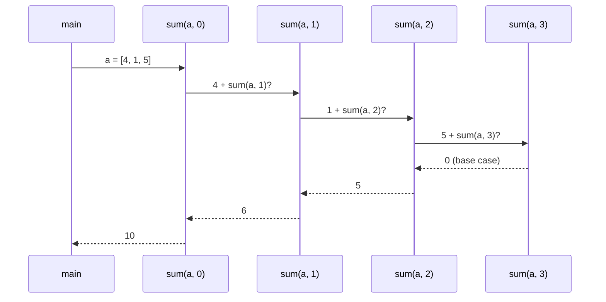

Recursion is where many learners give up, usually because they try to trace every call in their head — and after three levels, nobody can. The trick that makes recursion easy is the opposite: **don't trace it. Trust it.** Once recursion clicks, trees, backtracking, divide and conquer and dynamic programming all become much easier, because they're all recursion underneath.

## The leap of faith

Writing a recursive function is answering three questions:

1. **Base case** — what's the smallest input I can answer directly?
2. **Smaller problem** — how do I shrink the input so it gets closer to the base case?
3. **Combine** — *assuming the recursive call already returns the correct answer for the smaller input*, how do I build the answer for the full input?

Step 3 is the leap of faith. You don't ask "how does the recursive call work?" — you assume it works, exactly as you'd assume `Math.max` works without reading its source.

### Example: sum of an array

- **Base case:** an empty range sums to 0.
- **Smaller problem:** the array without its first element.
- **Combine:** first element + (sum of the rest — trust it).

```java
static int sum(int[] a, int i) {               // sum of a[i..end]
    if (i == a.length) return 0;               // base case: empty range
    return a[i] + sum(a, i + 1);               // trust sum(a, i + 1) to be right
}
```

Read it as a sentence: "the sum from `i` is `a[i]` plus the sum from `i + 1`." If that sentence is true and the base case is right, the function is right. That's the whole proof.

## What actually happens: the call stack

You don't need to trace calls to *write* recursion, but it helps to see once what the computer does. Each call waits on a **stack** until the call it made returns:



Two consequences:

- Every waiting call uses memory, so recursion depth `d` costs **O(d) space**.
- Java's default stack handles a few thousand to tens of thousands of nested calls (it depends on frame size and JVM settings). A recursion **100,000 deep will usually overflow** — for a linked list or a degenerate tree that long, use a loop or an explicit stack.

## Three shapes of recursion

### 1. Linear — one recursive call

Shrink by one each time: sum, reverse a linked list, length of a list. Depth n.

### 2. Divide and conquer — split in halves

Solve each half recursively, then combine. **Fast power** computes xⁿ in O(log n) multiplications:

```java
static long power(long x, int n) {             // x^n for n ≥ 0
    if (n == 0) return 1;                      // base case
    long half = power(x, n / 2);               // trust it: x^(n/2)
    return n % 2 == 0 ? half * half : half * half * x;
}
```

Calling `power(x, n / 2)` **once** and squaring the result is the key. Calling it twice (`power(x, n/2) * power(x, n/2)`) gives the same answer but takes O(n) — the classic recursion trap of repeating identical work.

**Merge sort** is the most famous divide and conquer: sort each half, then merge two sorted halves in O(n). Depth log n, O(n) work per level → O(n log n).

```java
static void mergeSort(int[] a, int lo, int hi, int[] tmp) {   // sorts a[lo..hi)
    if (hi - lo <= 1) return;                                 // 0 or 1 element: already sorted
    int mid = (lo + hi) >>> 1;
    mergeSort(a, lo, mid, tmp);                               // trust: left half sorted
    mergeSort(a, mid, hi, tmp);                               // trust: right half sorted
    int i = lo, j = mid, k = lo;
    while (i < mid && j < hi) tmp[k++] = a[i] <= a[j] ? a[i++] : a[j++];   // combine: merge
    while (i < mid) tmp[k++] = a[i++];
    while (j < hi) tmp[k++] = a[j++];
    System.arraycopy(tmp, lo, a, lo, hi - lo);
}
```

### 3. Branching — several calls per step

Each call makes two or more calls: generating subsets, permutations, naïve Fibonacci. The number of calls grows exponentially, which is fine when the problem genuinely asks for every possibility (that's [backtracking](/dsa/patterns/backtracking)) and wasteful when the calls repeat (that's when you need [dynamic programming](/dsa/patterns/dp-made-easy)).

<TreeViz title="fib(4): the call tree and the call stack" tree={{ id: "f", v: "fib(4)", c: [{ id: "fL", v: "fib(3)", c: [{ id: "fLL", v: "fib(2)", c: [{ id: "fLLL", v: "fib(1)" }, { id: "fLLR", v: "fib(0)" }] }, { id: "fLR", v: "fib(1)" }] }, { id: "fR", v: "fib(2)", c: [{ id: "fRL", v: "fib(1)" }, { id: "fRR", v: "fib(0)" }] }] }} frames={[
  { highlight: ["f"], visited: [], done: [], notes: {  }, aux: { label: "call stack", items: ["fib(4)"] }, note: "Call fib(4): it needs fib(3) and fib(2). It waits on the stack while fib(3) runs first.", hidden: ["fL", "fLL", "fLLL", "fLLR", "fLR", "fR", "fRL", "fRR"] },
  { highlight: ["fL"], visited: ["f"], done: [], notes: {  }, aux: { label: "call stack", items: ["fib(4)", "fib(3)"] }, note: "Call fib(3): it needs fib(2) and fib(1). It waits on the stack while fib(2) runs first.", hidden: ["fLL", "fLLL", "fLLR", "fLR", "fR", "fRL", "fRR"] },
  { highlight: ["fLL"], visited: ["f", "fL"], done: [], notes: {  }, aux: { label: "call stack", items: ["fib(4)", "fib(3)", "fib(2)"] }, note: "Call fib(2): it needs fib(1) and fib(0). It waits on the stack while fib(1) runs first.", hidden: ["fLLL", "fLLR", "fLR", "fR", "fRL", "fRR"] },
  { highlight: ["fLLL"], visited: ["f", "fL", "fLL"], done: [], notes: {  }, aux: { label: "call stack", items: ["fib(4)", "fib(3)", "fib(2)", "fib(1)"] }, note: "Call fib(1): a base case.", hidden: ["fLLR", "fLR", "fR", "fRL", "fRR"] },
  { highlight: ["fLLL"], visited: ["f", "fL", "fLL"], done: [], notes: { fLLL: "= 1" }, aux: { label: "call stack", items: ["fib(4)", "fib(3)", "fib(2)"] }, note: "fib(1) returns 1 immediately and is popped off the stack.", hidden: ["fLLR", "fLR", "fR", "fRL", "fRR"] },
  { highlight: ["fLLR"], visited: ["f", "fL", "fLL"], done: ["fLLL"], notes: { fLLL: "= 1" }, aux: { label: "call stack", items: ["fib(4)", "fib(3)", "fib(2)", "fib(0)"] }, note: "Call fib(0): a base case.", hidden: ["fLR", "fR", "fRL", "fRR"] },
  { highlight: ["fLLR"], visited: ["f", "fL", "fLL"], done: ["fLLL"], notes: { fLLL: "= 1", fLLR: "= 0" }, aux: { label: "call stack", items: ["fib(4)", "fib(3)", "fib(2)"] }, note: "fib(0) returns 0 immediately and is popped off the stack.", hidden: ["fLR", "fR", "fRL", "fRR"] },
  { highlight: ["fLL"], visited: ["f", "fL"], done: ["fLLL", "fLLR"], notes: { fLLL: "= 1", fLLR: "= 0", fLL: "= 1" }, aux: { label: "call stack", items: ["fib(4)", "fib(3)"] }, note: "fib(2) has both answers: returns 1. Popped — control goes back to its caller.", hidden: ["fLR", "fR", "fRL", "fRR"] },
  { highlight: ["fLR"], visited: ["f", "fL"], done: ["fLLL", "fLLR", "fLL"], notes: { fLLL: "= 1", fLLR: "= 0", fLL: "= 1" }, aux: { label: "call stack", items: ["fib(4)", "fib(3)", "fib(1)"] }, note: "Call fib(1): a base case.", hidden: ["fR", "fRL", "fRR"] },
  { highlight: ["fLR"], visited: ["f", "fL"], done: ["fLLL", "fLLR", "fLL"], notes: { fLLL: "= 1", fLLR: "= 0", fLL: "= 1", fLR: "= 1" }, aux: { label: "call stack", items: ["fib(4)", "fib(3)"] }, note: "fib(1) returns 1 immediately and is popped off the stack.", hidden: ["fR", "fRL", "fRR"] },
  { highlight: ["fL"], visited: ["f"], done: ["fLLL", "fLLR", "fLL", "fLR"], notes: { fLLL: "= 1", fLLR: "= 0", fLL: "= 1", fLR: "= 1", fL: "= 2" }, aux: { label: "call stack", items: ["fib(4)"] }, note: "fib(3) has both answers: returns 2. Popped — control goes back to its caller.", hidden: ["fR", "fRL", "fRR"] },
  { highlight: ["fR"], visited: ["f"], done: ["fLLL", "fLLR", "fLL", "fLR", "fL"], notes: { fLLL: "= 1", fLLR: "= 0", fLL: "= 1", fLR: "= 1", fL: "= 2" }, aux: { label: "call stack", items: ["fib(4)", "fib(2)"] }, note: "Call fib(2): it needs fib(1) and fib(0). It waits on the stack while fib(1) runs first.", hidden: ["fRL", "fRR"] },
  { highlight: ["fRL"], visited: ["f", "fR"], done: ["fLLL", "fLLR", "fLL", "fLR", "fL"], notes: { fLLL: "= 1", fLLR: "= 0", fLL: "= 1", fLR: "= 1", fL: "= 2" }, aux: { label: "call stack", items: ["fib(4)", "fib(2)", "fib(1)"] }, note: "Call fib(1): a base case.", hidden: ["fRR"] },
  { highlight: ["fRL"], visited: ["f", "fR"], done: ["fLLL", "fLLR", "fLL", "fLR", "fL"], notes: { fLLL: "= 1", fLLR: "= 0", fLL: "= 1", fLR: "= 1", fL: "= 2", fRL: "= 1" }, aux: { label: "call stack", items: ["fib(4)", "fib(2)"] }, note: "fib(1) returns 1 immediately and is popped off the stack.", hidden: ["fRR"] },
  { highlight: ["fRR"], visited: ["f", "fR"], done: ["fLLL", "fLLR", "fLL", "fLR", "fL", "fRL"], notes: { fLLL: "= 1", fLLR: "= 0", fLL: "= 1", fLR: "= 1", fL: "= 2", fRL: "= 1" }, aux: { label: "call stack", items: ["fib(4)", "fib(2)", "fib(0)"] }, note: "Call fib(0): a base case." },
  { highlight: ["fRR"], visited: ["f", "fR"], done: ["fLLL", "fLLR", "fLL", "fLR", "fL", "fRL"], notes: { fLLL: "= 1", fLLR: "= 0", fLL: "= 1", fLR: "= 1", fL: "= 2", fRL: "= 1", fRR: "= 0" }, aux: { label: "call stack", items: ["fib(4)", "fib(2)"] }, note: "fib(0) returns 0 immediately and is popped off the stack." },
  { highlight: ["fR"], visited: ["f"], done: ["fLLL", "fLLR", "fLL", "fLR", "fL", "fRL", "fRR"], notes: { fLLL: "= 1", fLLR: "= 0", fLL: "= 1", fLR: "= 1", fL: "= 2", fRL: "= 1", fRR: "= 0", fR: "= 1" }, aux: { label: "call stack", items: ["fib(4)"] }, note: "fib(2) has both answers: returns 1. Popped — control goes back to its caller." },
  { highlight: ["f"], visited: [], done: ["fLLL", "fLLR", "fLL", "fLR", "fL", "fRL", "fRR", "fR"], notes: { fLLL: "= 1", fLLR: "= 0", fLL: "= 1", fLR: "= 1", fL: "= 2", fRL: "= 1", fRR: "= 0", fR: "= 1", f: "= 3" }, aux: { label: "call stack", items: [] }, note: "fib(4) has both answers: returns 3. Popped — control goes back to its caller." },
  { highlight: ["fLL", "fR"], notes: { fLLL: "= 1", fLLR: "= 0", fLL: "= 1", fLR: "= 1", fL: "= 2", fRL: "= 1", fRR: "= 0", fR: "= 1", f: "= 3" }, aux: { label: "call stack", items: [] }, note: "fib(4) = 3 after 9 calls. fib(2) was computed 2 times (highlighted) and fib(1) 3 times. The stack never held more than 4 calls — depth, not total calls, sets the memory. Memoising each answer removes the repeats: that is DP." }
]} />

Even for `fib(4)`, `fib(2)` is computed twice. In `fib(50)`, the same values are recomputed billions of times. Remembering each answer the first time ("memoisation") turns this exponential tree into a straight line. Keep that picture in mind; it's the whole idea behind DP.

## Return up vs pass down

Recursive functions move information in two directions:

- **Return values up** — the answer for a subproblem comes back to the caller (sum, height of a tree, "is this valid?").
- **Pass parameters down** — context flows from caller to callee (the current path, the allowed range, the depth so far).

Generating all subsets uses both: the current choice list is passed down, and finished subsets are collected.

```java
static void subsets(int[] nums, int i, List<Integer> current, List<List<Integer>> out) {
    if (i == nums.length) { out.add(new ArrayList<>(current)); return; }   // one complete subset
    subsets(nums, i + 1, current, out);           // branch 1: skip nums[i]
    current.add(nums[i]);
    subsets(nums, i + 1, current, out);           // branch 2: take nums[i]
    current.remove(current.size() - 1);           // undo the choice before returning
}
```

Most tree problems are "return up" (what does this subtree tell its parent?). Most backtracking problems are "pass down" (what have I chosen so far?).

## The classic mistakes

| Mistake | Symptom | Fix |
| --- | --- | --- |
| Missing or wrong base case | `StackOverflowError` | Ask "what's the smallest input?" and handle it first |
| Not getting smaller | `StackOverflowError` | Every call must move toward the base case |
| Forgetting `return` on the recursive call's result | Wrong answer, usually 0 or null | `return f(…)` — or use the value |
| Recomputing identical calls | Very slow (exponential) | Call once and reuse; memoise |
| Adding a mutable list to results without copying | All results look the same | `out.add(new ArrayList<>(current))` |
| Forgetting to undo a choice | Results contain leftovers | Remove what you added before returning |

## Interview questions

<QA q="How do you convince yourself a recursive function is correct without tracing it?">
Check three things: the base case returns the right answer for the smallest input; every recursive call is on a strictly smaller input that eventually reaches a base case; and if the recursive calls return correct answers for their inputs, the combine step produces the correct answer for the current input. That's proof by induction, and it's exactly the leap of faith.
</QA>

<QA q="What is the space complexity of a recursive function that allocates nothing?">
O(maximum recursion depth), because each pending call occupies a stack frame until it returns. A recursive sum over an array of length n uses O(n) stack space; recursive binary search uses O(log n); a traversal of a balanced tree uses O(log n) and of a skewed tree O(n).
</QA>

<Practice task="Write a recursive method that returns true if a string is a palindrome. State the base case, the smaller problem and the combine step before writing code.">

**Base case:** a string of length 0 or 1 is a palindrome. **Smaller problem:** the string without its first and last characters. **Combine:** it's a palindrome if the first and last characters match *and* the inside is a palindrome. Using indexes avoids copying substrings: `isPal(s, i, j) = i >= j || (s.charAt(i) == s.charAt(j) && isPal(s, i + 1, j - 1))`. Time O(n), space O(n) for the call stack — an iterative two-pointer loop does it in O(1) space, which is worth mentioning.

</Practice>

<Practice task="Why does power(x, n/2) * power(x, n/2) take O(n) multiplications even though it halves n?">

Each call makes **two** recursive calls on n/2, so the number of calls doubles at every level while the depth is log₂ n — that's 2^(log₂ n) = n calls. Halving the input only helps if you make **one** call per level and reuse its result: `long half = power(x, n / 2); return half * half …` — log n calls in total.

</Practice>

<Takeaways>

- Write recursion with three questions: base case, smaller problem, combine — and trust the recursive call.
- Recursion depth costs stack space; very deep recursion (around 100,000 calls) overflows in Java.
- Three shapes: linear, divide and conquer, branching. Branching with repeated calls is the signal for DP.
- Information is returned up (answers) or passed down (context); backtracking undoes its choices.
- Never compute the same recursive call twice in one step.

</Takeaways>

## Further reading

- Next: [Java Toolkit for DSA](/dsa/start-here/java-dsa-toolkit).
- Harold Abelson and Gerald Sussman, *Structure and Interpretation of Computer Programs* — chapter 1.2, "Procedures and the Processes They Generate".
