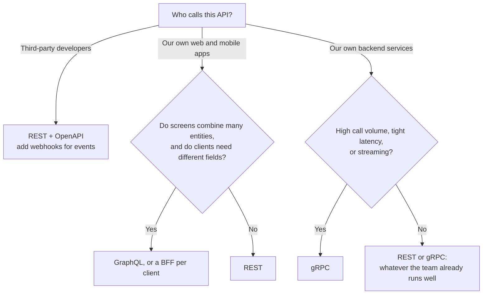
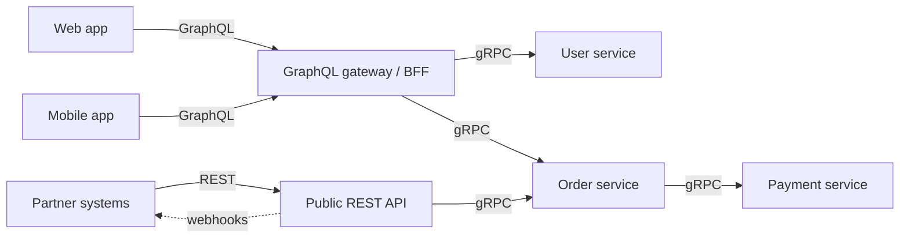
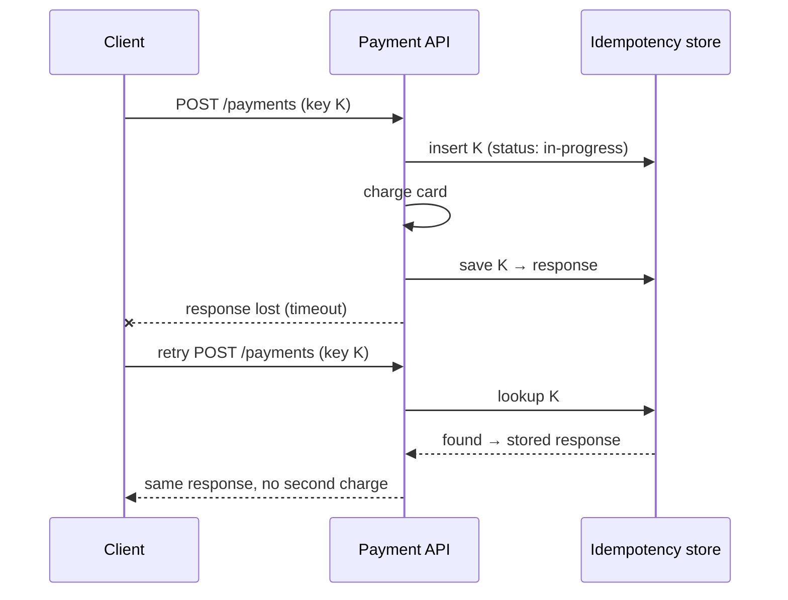

The API is the contract between your system and its clients — mobile apps, web frontends, partners, and other services. A good API is easy to use correctly and hard to use incorrectly; it can evolve without breaking clients; and it behaves predictably under retries and failures.

In an HLD interview, defining the API early forces you to turn vague features into concrete operations and reveals what data your system needs.

## The three common styles

All three usually travel over HTTP. What differs is **what the client names** in each request, and **who decides the shape of the response**.

| Style | The client says… | Who shapes the response | Feels like |
| --- | --- | --- | --- |
| REST | "Give me the thing at this address" | The server, per resource | Browsing a website of data |
| RPC (gRPC) | "Run this function with these arguments" | The server, per method | Calling a library function that happens to be remote |
| GraphQL | "Here is the shape of the data I want" | The client, per query | Filling in a form that lists exactly the fields you need |

Keep that table in mind; every advantage and drawback below follows from it.

### REST

**Representational State Transfer** models the system as **resources** (users, orders, photos), each with a URL. Clients act on resources with a small, fixed set of HTTP methods, and the server replies with a **representation** of the resource (usually JSON) plus a status code.

```text
GET    /v1/users/42                 → fetch a user
POST   /v1/users                    → create a user
PATCH  /v1/users/42                 → partially update
DELETE /v1/users/42                 → delete
GET    /v1/users/42/orders?status=PAID&limit=20
```

**How it works, in four ideas**

1. **Everything is a resource with an address.** `/users/42` means the same thing to every client, proxy and cache.
2. **A uniform interface.** The same verbs (GET, POST, PUT, PATCH, DELETE) and status codes (200, 201, 404, 409, 429…) work on every resource. Any HTTP tool understands your API without learning it.
3. **Stateless requests.** Each request carries everything the server needs, including the auth token. Any server behind the load balancer can answer it, which makes horizontal scaling easy.
4. **Cacheable responses.** Because `GET /products/7` is a plain URL, browsers, CDNs and reverse proxies can cache it using standard headers.

The caching part is REST's biggest practical advantage, so it is worth seeing once:

```text
GET /v1/products/7
→ 200 OK
  Cache-Control: public, max-age=60
  ETag: "v12"
  { "id": 7, "name": "Kettle", "price": 1499 }

# A minute later the client asks again, quoting the version it holds:
GET /v1/products/7
If-None-Match: "v12"
→ 304 Not Modified          (no body: the client's copy is still good)
```

The same ETag also gives you safe concurrent updates: `PUT /products/7` with `If-Match: "v12"` fails with `412 Precondition Failed` if someone else changed the product first. That is optimistic locking, built into HTTP.

The contract is usually described with **OpenAPI** (formerly Swagger), which can generate documentation, client SDKs and request validation. It is optional, though, and many REST APIs drift from their docs.

<Callout type="note">
Most "REST" APIs in the wild are really **JSON over HTTP with resource-style URLs**. Strict REST also includes **HATEOAS**: responses carry links telling the client what it can do next. Almost nobody builds that, and interviewers don't expect it. Use resources, methods and status codes well and you are doing what the industry calls REST.
</Callout>

**Where REST beats the others**

- **Over gRPC:** works from any browser, `curl` or language with no code generation. Payloads are readable in logs and DevTools. Every proxy, API gateway, firewall and CDN already understands it. GET responses can be cached at the edge, so a popular product page can be served without touching your servers at all.
- **Over GraphQL:** each endpoint is a known, fixed query. You can index for it, cache it per URL, rate-limit it per route and alert on its status codes. The server is simpler: no query parser, no resolver tree, no cost analysis.

**Where REST falls short**

- **Over-fetching:** `GET /users/42` returns 40 fields when the screen shows a name and an avatar. On mobile data that is wasted bytes and battery.
- **Under-fetching:** one screen needs the user, their last three orders and each order's shipping status. That is several round trips, and on a 200 ms mobile network, each sequential call adds 200 ms.
- **Actions that are not CRUD** feel forced into the model: "cancel an order", "retry a payment", "merge two accounts". You end up with `POST /orders/42/cancel`, which is fine, but it is RPC wearing a REST costume.
- **No streaming.** Server push needs a separate mechanism (SSE, WebSockets or webhooks).
- **No enforced contract.** Nothing stops the server from renaming a field and breaking clients, unless you add OpenAPI plus contract tests.

**Pick REST when**

- You are building a **public or partner API**. Third-party developers expect REST and JSON, and they will test it with `curl`.
- The domain is **resource-shaped**: create, read, update and delete things.
- **Reads dominate and are cacheable**: product catalogues, articles, profile pictures, configuration.
- You want the **simplest thing** that every engineer, tool and proxy already understands.

**Avoid REST when**

- An internal call sits on a **hot path**, made thousands of times per user request with a tight latency budget. JSON parsing and HTTP/1.1 connections cost real CPU and milliseconds at that volume, so use gRPC.
- **Many different clients** (iOS, Android, web, TV) each need different slices of the same nested data, and you are adding one endpoint per screen. That is the problem GraphQL, or a backend-for-frontend, solves.
- You need **bidirectional streaming** between services.
- The API is mostly **commands**, not resources ("transcode this video", "rebalance this shard"). An RPC style describes that more honestly.

### RPC and gRPC

**RPC (Remote Procedure Call)** is the oldest idea of the three: make a call to another machine look like a local function call. `orders.getOrder("o-91")` in your code becomes a network request, and the result comes back as a typed object. Many systems have done this: Sun RPC, CORBA, Java RMI, SOAP, JSON-RPC, Apache Thrift. Slack's Web API (`POST /api/chat.postMessage`) is RPC over plain HTTP. **gRPC**, open-sourced by Google in 2015, is today's default choice for this style.

With gRPC, you write the contract first in a `.proto` file:

```protobuf
service OrderService {
  rpc GetOrder(GetOrderRequest) returns (Order);                  // unary
  rpc ListOrders(ListOrdersRequest) returns (stream Order);       // server streaming
  rpc UploadEvents(stream Event) returns (UploadSummary);         // client streaming
  rpc Track(stream Location) returns (stream Eta);                // bidirectional
}

message GetOrderRequest { string order_id = 1; }
message Order {
  string id = 1;
  int64 total_paise = 2;
  OrderStatus status = 3;
}
```

A code generator then creates a **typed client stub** and a **server interface** in Go, Java, Python, C++, Kotlin, Swift and more. The client calls `stub.getOrder(req)`; the server implements `getOrder`. Nobody hand-writes URLs, JSON parsing or HTTP status handling.

**What gRPC adds on top of "a function call over the network"**

- **Protocol Buffers on the wire.** Fields are sent as numbered, binary-encoded values, not as repeated field names in text. Messages are typically several times smaller than the same JSON and much cheaper to parse.
- **HTTP/2.** One long-lived TCP connection carries many concurrent calls (multiplexing), with compressed headers. No new connection or TLS handshake per request.
- **Four call types**, shown in the proto above. Streaming is built in, not bolted on.
- **Deadlines and cancellation.** The caller says "I need an answer within 300 ms". That deadline travels with the request, so every service down the chain knows how much time is left and stops work once nobody is waiting for the answer.
- **Standard status codes** such as `NOT_FOUND`, `INVALID_ARGUMENT`, `DEADLINE_EXCEEDED`, `UNAVAILABLE` and `RESOURCE_EXHAUSTED`. Retry policies can say "retry only on `UNAVAILABLE`".
- **Interceptors** (middleware) for auth, metrics, tracing and retries, written once and shared by every service.

<Callout type="warning">
**The load-balancing trap.** Because gRPC keeps one HTTP/2 connection open and sends every call over it, a plain **layer-4 (TCP) load balancer** assigns that connection to one server once and never revisits the choice. All of that client's calls land on the same server while the others sit idle. You need **layer-7 balancing** that spreads individual calls across servers (Envoy, a service mesh, or a cloud L7 balancer), or **client-side load balancing**, where the client knows every server and picks one per call. Interviewers like this detail because it only shows up in production.
</Callout>

**Where gRPC beats the others**

- **Over REST:** smaller payloads, faster parsing and connection reuse. That matters when one user request fans out to dozens of internal calls. The contract is **enforced by the compiler**: if the server changes a type, client code fails to build instead of failing at 3 a.m. Generated clients mean no copy-pasted HTTP code in every team. Streaming and deadlines are built in.
- **Over GraphQL:** every method has a known cost, so capacity planning is simple and no client can send an unexpectedly expensive query. Server machinery is minimal, and the binary encoding plus streaming suit service-to-service traffic far better.

**Where gRPC falls short**

- **Browsers can't call it directly.** Browser JavaScript doesn't get the low-level HTTP/2 control gRPC needs. You need **gRPC-Web** through a proxy such as Envoy, or a gateway that translates REST/JSON into gRPC.
- **Harder to debug.** You can't read a binary payload in a log or paste the request into a browser. You need tools like `grpcurl` and server reflection.
- **No HTTP caching.** Calls are POSTs to method paths, so CDNs and browser caches can't help.
- **Tighter coupling.** Clients and servers share `.proto` files, so you need a way to publish and version them, such as a shared repo or a schema registry such as Buf.
- **Infrastructure must speak HTTP/2 end to end.** Some older proxies, firewalls and L4-only load balancers don't handle it well.

**Pick gRPC when**

- **Internal service-to-service calls**, especially with high fan-out or tight latency budgets.
- **Polyglot teams.** One `.proto` gives every language a correct, typed client.
- **Streaming between services:** telemetry ingestion, live location updates, chat backends, log shipping.
- **Mobile clients you control**, where smaller payloads save battery and data. Some companies use gRPC straight from their apps.

**Avoid gRPC when**

- The API is **public** and its users expect `curl`, JSON and readable docs.
- The main client is a **browser** and you don't want to run a translation proxy.
- You depend on **CDN or HTTP caching** for read-heavy traffic.
- Traffic is low, the team is small and everyone already knows REST. The tooling cost is not worth a few milliseconds nobody will notice.

### GraphQL

GraphQL, open-sourced by Facebook in 2015, exposes **one endpoint** (usually `POST /graphql`) and a **typed schema** describing everything the client can ask for. The client sends a query that names exactly the fields it wants, and the response mirrors the query's shape.

```graphql
# The schema (server side)
type User  { id: ID!  name: String!  avatarUrl: String  orders(last: Int!): [Order!]! }
type Order { id: ID!  total: Int!  status: OrderStatus! }
type Query    { user(id: ID!): User }
type Mutation { cancelOrder(id: ID!): Order }

# A query (client side): one round trip for the whole screen
query {
  user(id: "42") {
    name
    avatarUrl
    orders(last: 3) { id total status }
  }
}
```

There are three operation types: **queries** (reads), **mutations** (writes) and **subscriptions** (server push, usually over WebSockets).

**How the server answers.** Every field in the schema has a **resolver**, a small function that fetches that field's value. The server walks the query tree: it calls the `user` resolver, then the `orders` resolver for that user, then the scalar fields. Resolvers can read a database, call a gRPC service or hit a cache. That is why GraphQL works well as an **aggregation layer** over many backend services.

**The N+1 problem.** Ask for 50 posts with each post's author. A naive server runs 1 query for the posts and then 50 separate queries for authors, one per post. Under load, that sinks the database. The standard fix is a **DataLoader**: during one request, author resolvers don't fetch immediately. They register the author IDs they need, and the loader then runs a single `SELECT … WHERE id IN (…)` for all of them, caching results for the rest of the request. 51 queries become 2.

**Taming expensive queries.** A client can write a query nobody planned for:

```graphql
query { user(id: "42") { friends(first: 100) { friends(first: 100) { friends(first: 100) { name } } } } }
```

That is up to a million user lookups in one request. Production GraphQL servers defend with:

- **Depth limits** (reject queries nested more than, say, 8 levels).
- **Cost analysis**: give each field a cost, multiply by list sizes and reject queries over a budget. GitHub's GraphQL API rate-limits by these **points per hour**, not by request count, because one request can be cheap or enormous.
- **Mandatory pagination arguments** on every list field.
- **Persisted queries**: first-party apps register their queries at build time and send only a hash at runtime. The server can then reject any query it hasn't seen, which closes the door on arbitrary queries completely.

**Caching** needs extra work. Because every request is a POST to the same URL, CDNs can't cache by URL. The usual answers:

- Clients such as Apollo and Relay keep a **normalised cache**, storing each object once by type and ID (`User:42`). Any query that touches `User:42` reads from it.
- **Persisted queries over GET** (`GET /graphql?id=<hash>&variables=…`) make responses cacheable at the CDN again.
- Resolvers cache their own backend calls.

**Errors don't use status codes.** A GraphQL response is usually `200 OK` even when part of it failed. The body carries partial `data` plus an `errors` array. Dashboards that count 5xx responses will report all is well while half the fields are null, so you have to monitor the `errors` field itself.

**Authorization is per field, not per endpoint.** With one endpoint, "who may call `/admin`" is no longer a question. Every resolver, or the business layer beneath it, must check whether this caller may see this field on this object.

**Federation.** In a large company, many teams own parts of the graph. With **federation** (for example Apollo Federation), each team runs a **subgraph** for its own types, and a **router** composes them into one schema for clients.

**Where GraphQL beats the others**

- **Over REST:** the client gets exactly the fields it asked for, so there is no over-fetching, and one round trip covers the whole screen, so there is no under-fetching. Frontend teams can build new screens without waiting for new backend endpoints. Evolution happens field by field: add fields freely, mark old ones `@deprecated` and watch per-field usage until nobody asks for them. Often there is no `/v2` at all. The typed schema plus introspection gives great tooling: autocomplete, generated TypeScript types and documentation that can't drift.
- **Over gRPC:** works natively in browsers with JSON. gRPC methods return fixed messages, while GraphQL lets each client pick its own shape from the same graph.

**Where GraphQL falls short**

- **Server complexity**: resolvers, DataLoaders, cost limits and field-level auth, all of which REST largely gets for free.
- **Unpredictable load.** One request might touch one table or ten services. Capacity planning and per-request rate limits become harder.
- **Caching and monitoring** need the extra work described above.
- **Awkward for files and binary data.** Uploads usually go through a separate REST endpoint or a pre-signed URL.
- **Overkill for small APIs.** For a few CRUD endpoints with one client, the schema, resolvers and tooling are more machinery than the problem needs.

**Pick GraphQL when**

- **Several client types** (iOS, Android, web, smart TV) need different slices of the same rich, connected data.
- **Screens aggregate many entities**, such as a dashboard combining user, orders, recommendations and notifications.
- **Frontend teams iterate quickly** and shouldn't block on backend endpoint changes.
- You need an **aggregation layer** in front of many microservices. GraphQL is a natural backend-for-frontend.

**Avoid GraphQL when**

- The API is **simple CRUD** with one client.
- You rely on **CDN caching** of public, read-heavy content and don't want to run persisted queries.
- Calls are **service to service** inside your backend. gRPC is faster and simpler there.
- You can't invest in **query cost controls, field-level authorization and error monitoring**. An unguarded public GraphQL endpoint is an easy denial-of-service target.
- The workload is **bulk data or file transfer**.

### Choosing

| | REST | gRPC | GraphQL |
| --- | --- | --- | --- |
| Client names | A resource (URL) | A method | The fields it wants |
| Response shape decided by | Server, per endpoint | Server, per method | Client, per query |
| Payload | JSON (text) | Protobuf (binary) | JSON |
| Contract | OpenAPI (optional) | `.proto` (required, compiled) | Schema (required, introspectable) |
| Generated clients | Optional | Standard | Common (types per query) |
| Browser support | Native | Via gRPC-Web proxy | Native |
| HTTP caching / CDN | Excellent | None | Needs persisted GET queries |
| Round trips per screen | Often several | Several (internal, cheap) | Usually one |
| Streaming | Separate (SSE/WebSockets) | Built in, four modes | Subscriptions |
| Errors | HTTP status codes | gRPC status codes | 200 + `errors` array |
| Server complexity | Low | Low–medium | High |
| Load balancing | Any L4/L7 | Needs L7 or client-side | Any L4/L7 |
| Debugging | `curl`, browser | `grpcurl`, reflection | GraphiQL playground |
| Typical home | Public and partner APIs | Between internal services | Behind web and mobile apps |

A quick way to decide, starting from who calls the API:



### Mixing them in one system

Real systems rarely pick just one. A typical layout:



- **Backend for frontend (BFF):** a thin layer per client type that calls internal services and returns exactly what that client's screens need. It can be GraphQL or plain REST endpoints shaped per screen. It is the low-tech answer to over- and under-fetching.
- **gRPC inside, REST or GraphQL outside.** Internal services get speed and compiled contracts; external clients get something browsers and partners can use. **gRPC transcoding** gateways can even expose a `.proto` service as REST/JSON automatically.
- **Webhooks** complement a public REST API: instead of partners polling `GET /payments/…` every few seconds, you `POST` an event to their URL when something changes. See [Real-Time Communication](/system-design/hld/real-time-communication) for polling, SSE and WebSockets.

**Common misconceptions**

- *"gRPC is always faster."* For a handful of calls over the public internet, network latency dominates and the encoding barely matters. The gains show up at high volume between services.
- *"GraphQL replaces the backend."* It is a layer for shaping and composing data. You still need services and databases behind it, and they must be fast for the queries clients send.
- *"REST means CRUD only."* Actions work fine as sub-resources (`POST /orders/42/cancel`) or as resources in their own right (`POST /refunds`).

<Callout type="interview">
A strong answer names the layers and gives a reason for each: **"REST for the public API, because partners expect it and reads are cacheable at the CDN. GraphQL (or a BFF) for our own apps, because the home screen needs data from five services in one round trip. gRPC between services, because one page load fans out to about 30 internal calls and we want small payloads, compiled contracts and deadline propagation."** Then mention one cost of each choice: CDN caching for GraphQL, L7 load balancing for gRPC.
</Callout>

## Designing REST resources well

- **Nouns, not verbs**: `POST /orders`, not `POST /createOrder`. For actions that don't map neatly onto CRUD, a sub-resource works: `POST /orders/42/cancel`.
- **Plural collections**: `/users`, `/users/42`.
- **Nest for ownership, but shallowly**: `/users/42/orders` is fine; `/users/42/orders/7/items/3/reviews` is too deep — expose `/reviews/{id}` directly.
- **Use status codes meaningfully**: 201 for created (with a `Location` header), 204 for no content, 400 for validation errors, 401 vs 403 (unauthenticated vs not allowed), 404, 409 for conflicts, 422 for semantic validation errors, 429 for rate limits.
- **Consistent error format**:

```json
{
  "error": {
    "code": "INSUFFICIENT_FUNDS",
    "message": "Account balance is lower than the transfer amount.",
    "requestId": "req_8f2a…"
  }
}
```

### HTTP method semantics

| Method | Safe (no side effects) | Idempotent | Typical use |
| --- | --- | --- | --- |
| GET | ✅ | ✅ | Read |
| HEAD / OPTIONS | ✅ | ✅ | Metadata / CORS preflight |
| PUT | ❌ | ✅ | Replace a resource entirely |
| DELETE | ❌ | ✅ | Remove |
| PATCH | ❌ | ❌ (not guaranteed) | Partial update |
| POST | ❌ | ❌ | Create, or trigger an action |

**Idempotent** means making the same request multiple times has the same effect as making it once. This property is what makes retries safe.

## Idempotency keys

Networks fail *after* the server has processed a request but *before* the client gets the response. The client can't tell whether the operation happened. For non-idempotent operations like "charge this card" or "place this order", a blind retry could double-charge.

The standard solution (popularised by Stripe) is an **idempotency key**: a unique client-generated ID sent with the request.

```text
POST /v1/payments
Idempotency-Key: 7c4a8d09-ca37-4f1e-9b8b-3e1f6a0d2c11
{ "amount": 4999, "currency": "INR", "source": "card_…" }
```



Implementation notes:

- Store the key with the request's outcome, scoped per client/account, with a retention period (e.g., 24 h).
- Use a unique constraint so concurrent retries with the same key can't both proceed; return 409 if one is still in progress.
- Reject reuse of a key with a different request body.

## Pagination

Never return unbounded lists.

**Offset pagination** — `GET /posts?offset=40&limit=20`

- ✅ Simple; can jump to page N.
- ❌ Slow for deep pages (the database still scans the skipped rows); items shift if data is inserted or deleted between requests, causing duplicates or gaps.

**Cursor (keyset) pagination** — `GET /posts?limit=20&cursor=eyJpZCI6MTIzfQ`

The cursor encodes the position of the last item (e.g., its `created_at` and `id`), and the query continues from there:

```sql
SELECT * FROM posts
WHERE (created_at, id) < (:last_created_at, :last_id)
ORDER BY created_at DESC, id DESC
LIMIT 20;
```

- ✅ Constant performance at any depth (uses the index); stable under inserts.
- ❌ No random access to page N.

Use **cursor pagination** for feeds, timelines and any large or changing dataset. Make cursors **opaque** (base64-encoded) so you can change their internals later.

## Versioning and evolution

APIs change; clients (especially mobile apps that users don't update) can't change instantly.

- **URL versioning** — `/v1/orders`, `/v2/orders`. Explicit and easy to route; the most common choice.
- **Header versioning** — `Accept: application/vnd.example.v2+json` or a custom version header (Stripe uses dated versions, e.g., `Stripe-Version: 2024-06-20`).
- **Additive changes don't need a new version**: adding optional fields or new endpoints is backward compatible. Removing or renaming fields, changing types, or changing semantics is breaking.
- Clients should **ignore unknown fields**; servers should **tolerate missing optional fields**. Protobuf and GraphQL formalise these rules.
- Deprecate with notice: deprecation headers, documentation, usage monitoring, then removal.

## Serialization formats and schema evolution

The format your services exchange data in matters most when the data outlives a deploy — in queues, logs and storage.

| Format | Schema | Size / speed | Evolution story |
| --- | --- | --- | --- |
| JSON | Optional (JSON Schema, OpenAPI) | Verbose, slower to parse | Ad hoc; relies on discipline |
| Protocol Buffers | Required (`.proto`) | Compact, fast | Fields identified by **numbers**: add new optional fields freely; never reuse or renumber a field |
| Avro | Required (JSON-defined) | Very compact (no field tags in data) | Reader and writer schemas are resolved at read time; pairs naturally with a **schema registry** |
| Thrift | Required | Compact | Similar to Protobuf |

Two compatibility directions matter:

- **Backward compatibility** — new code can read data written by old code (needed when you deploy consumers first).
- **Forward compatibility** — old code can read data written by new code (needed during rolling deploys, when old and new versions run side by side).

For event streams, a **schema registry** (e.g., Confluent Schema Registry) stores every version of each topic's schema and rejects producers whose new schema would break existing consumers. This turns "someone renamed a field and broke five teams" into a failed CI check.

## Other concerns for production APIs

- **Authentication** — OAuth 2.0 / OIDC for user-facing APIs, API keys or signed requests for server-to-server, mTLS internally. Never accept a `userId` in the request body as proof of identity — derive it from the token.
- **Rate limiting** — protect the service and enforce fair usage per client (see the Rate Limiting lesson); return 429 with a `Retry-After` header.
- **Request IDs** — include a unique ID in every response and log it everywhere, to trace issues across services.
- **Timeouts and payload limits** — bound request size and processing time.
- **Long-running operations** — return `202 Accepted` with a status URL to poll (or a webhook callback) instead of holding the connection open for minutes.
- **Backwards-compatible defaults** — new behaviour should be opt-in.

## Interview questions

<QA q="How do you make a 'create payment' endpoint safe to retry?">
Require an idempotency key generated by the client and sent in a header. On the first request, atomically record the key (unique constraint) with status in-progress, process the payment, and store the response against the key. On a retry with the same key, return the stored response without reprocessing; if the original is still in progress, return 409 or wait. Scope keys per account, expire them after a retention window, and reject a key reused with a different payload.
</QA>

<QA q="Why is offset pagination a problem for a social media feed?">
Two reasons. Performance: OFFSET N forces the database to read and discard N rows, so deep pages get progressively slower. Correctness: new posts are constantly inserted at the top; between page requests, items shift down, so the user sees duplicates (or misses items when posts are deleted). Cursor pagination continues from the last-seen item's sort key, which is both index-efficient and stable.
</QA>

<QA q="When would you choose gRPC over REST?">
For internal service-to-service communication where performance and strong contracts matter: high request volumes, low latency requirements, polyglot services that benefit from generated clients, and streaming use cases. REST remains better for public APIs, browser clients, and cacheable resources. Many systems use REST or GraphQL externally and gRPC internally.
</QA>

<QA q="When would you not use GraphQL?">
When the API is simple CRUD with one client, because the schema, resolvers and cost controls are more machinery than the problem needs. When read-heavy public content should be cached at a CDN by URL, because GraphQL's single POST endpoint defeats that unless you add persisted GET queries. For service-to-service calls, where gRPC is faster and has a fixed cost per method. For file or bulk transfer. And when the team can't invest in depth and cost limits, field-level authorization and monitoring of the errors array, because an unguarded GraphQL endpoint lets any client send an arbitrarily expensive query.
</QA>

<QA q="The mobile home screen makes seven REST calls and feels slow on 3G. What would you change?">
The cost is round trips: on a high-latency network, sequential calls add up. Put an aggregation layer close to the backend: either a backend-for-frontend endpoint such as GET /home that calls the seven services in parallel over the fast internal network and returns exactly the fields the screen shows, or a GraphQL gateway where the app sends one query for the whole screen. A BFF is simpler to run and cache. GraphQL pays off when several clients need different slices of the same data. Either way, also trim response fields and consider caching parts of the result that are shared across users.
</QA>

<QA q="Why can gRPC traffic end up on just one server behind a load balancer?">
gRPC sends many calls over one long-lived HTTP/2 connection. A layer-4 load balancer balances connections, not requests: it picks a server when the connection opens and then forwards every byte to it. All of that client's calls go to one server, and new servers added during a scale-out get no traffic from existing clients. The fix is per-call balancing: a layer-7 proxy such as Envoy or a service mesh sidecar that understands HTTP/2 streams, or client-side load balancing where the client resolves all server addresses and picks one per call. Periodically recycling connections helps as a stopgap.
</QA>

<QA q="How do you stop a client from sending a GraphQL query that takes down the database?">
Layer several limits. Reject queries deeper than a fixed depth. Compute a cost before running the query, with list fields multiplied by their page size, and reject anything over a budget. Rate-limit clients by cost points rather than request count. Require pagination arguments on every list. Batch database access with DataLoader to avoid N+1 queries, and set a server-side timeout. For first-party apps, use persisted queries: only pre-registered query hashes are accepted, so arbitrary queries never run.
</QA>

<QA q="What changes to an API are backward compatible?">
Compatible: adding new endpoints, adding optional request fields, adding response fields (if clients ignore unknown fields), adding new enum values only if clients handle unknown values. Breaking: removing or renaming fields or endpoints, changing a field's type or meaning, making an optional field required, changing error codes or default behaviour. Breaking changes require a new version and a deprecation period.
</QA>

## Practice

Write your answer before opening the suggested one. Anything you mark "Partly" or "Missed it" comes back in your review deck.

<Practice task="A mobile client calls POST /orders and the connection drops before the response arrives. The app retries. Design the API so the order is not created twice.">

Make the create request idempotent with an idempotency key.

1. The client generates a unique key per checkout attempt (a UUID) and sends it in an `Idempotency-Key` header on the first try and every retry.
2. The server stores the key with a unique constraint together with a hash of the request body and, once done, the response.
3. A retry with the same key returns the stored response (same order ID, same status code) instead of creating a new order. A different body with the same key is rejected as a client bug.
4. Keys expire after a day or so.

Plain `PUT /orders/{id}` with a client-chosen ID is another idempotent option.

</Practice>

<Practice task="Pick an API style for each and justify it: (a) a payments API that thousands of merchants integrate with, (b) checkout calling the inventory service about 20 times per order, (c) the home screen of iOS, Android and web apps that shows profile, recent orders and recommendations.">

(a) **REST with OpenAPI, plus webhooks.** Merchants use every language and expect JSON they can try with `curl`. Status codes, idempotency keys and URL or dated versioning are well understood. Webhooks notify merchants of payment events so they don't have to poll.

(b) **gRPC.** It is internal, high volume and latency sensitive. Protobuf and HTTP/2 connection reuse keep each call cheap, the `.proto` contract catches breaking changes at compile time, and deadlines stop checkout waiting on a slow inventory call. Use L7 or client-side load balancing so calls spread across inventory servers.

(c) **GraphQL or a BFF.** Each client needs different fields from three services. One query, or one BFF endpoint per client, fetches everything in a single round trip, and the gateway calls the backend services over gRPC. With GraphQL, add DataLoader, cost limits and persisted queries.

</Practice>

<Practice task="Your GET /posts?page=500&size=20 endpoint is slow, and users see duplicates or missing items while new posts arrive. Why, and what do you replace it with?">

Offset pagination makes the database scan and discard the first 10,000 rows on every request, so deep pages are slow. And when new posts are inserted at the top, every item shifts by one, so the next page repeats or skips items.

Use cursor (keyset) pagination: return an opaque `nextCursor` that encodes the last item's sort key, for example `(createdAt, id)`. The next request asks for items after that key: `WHERE (createdAt, id) < (?, ?) ORDER BY createdAt DESC, id DESC LIMIT 20`, which uses an index and costs the same on page 500 as on page 1. Inserts above the cursor no longer shift the results.

Trade-off: users cannot jump to page 500 directly, which is rarely needed in feeds.

</Practice>

<Takeaways>

- REST for public, cacheable, resource-oriented APIs; gRPC for fast, typed internal calls; GraphQL for flexible client-driven data fetching.
- Each style's strength is another's weakness: REST caches well but over- and under-fetches; gRPC is fast and typed but needs L7 load balancing and a proxy for browsers; GraphQL fits each screen exactly but needs cost limits, DataLoader and extra work for caching.
- Design around resources, use HTTP methods and status codes meaningfully, and keep error formats consistent.
- Make unsafe operations retry-safe with idempotency keys.
- Prefer cursor-based pagination for large or changing datasets.
- Evolve APIs additively; version and deprecate when breaking changes are unavoidable.

</Takeaways>

## Further reading

- Brandur Leach, "Designing robust and predictable APIs with idempotency" (Stripe blog, 2017).
- [Google Cloud API Design Guide](https://cloud.google.com/apis/design) — resource-oriented design, pagination, errors.
- [Microsoft REST API Guidelines](https://github.com/microsoft/api-guidelines).
- Martin Kleppmann, *Designing Data-Intensive Applications* — ch. 4, "Encoding and Evolution".
- RFC 9110, "HTTP Semantics" — methods, status codes, idempotency.
- [gRPC documentation](https://grpc.io/docs/) — core concepts, deadlines, load balancing.
- [GraphQL documentation](https://graphql.org/learn/) — schema, execution, best practices (pagination, caching).
