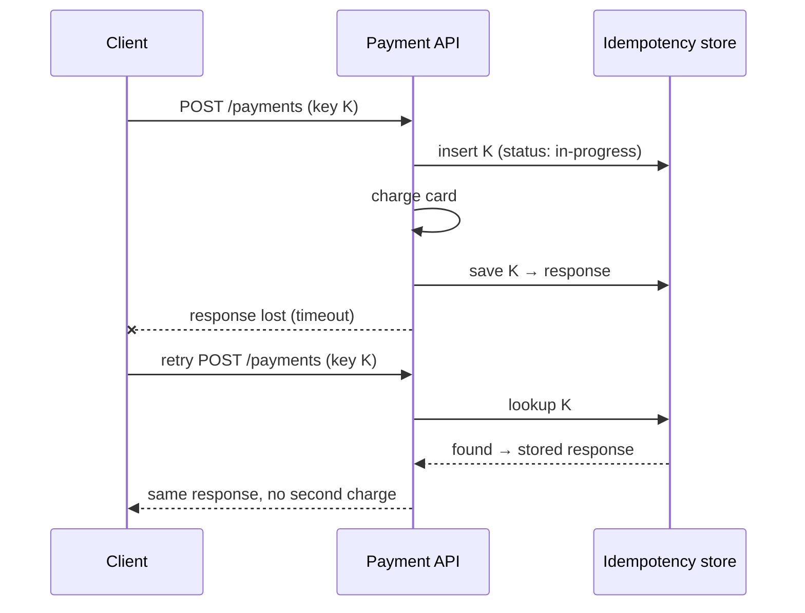

The API is the contract between your system and its clients — mobile apps, web frontends, partners, and other services. A good API is easy to use correctly and hard to use incorrectly; it can evolve without breaking clients; and it behaves predictably under retries and failures.

In an HLD interview, defining the API early forces you to turn vague features into concrete operations and reveals what data your system needs.

## The three common styles

### REST

**Representational State Transfer** models the system as **resources** identified by URLs, manipulated with standard HTTP methods.

```text
GET    /v1/users/42                 → fetch a user
POST   /v1/users                    → create a user
PATCH  /v1/users/42                 → partially update
DELETE /v1/users/42                 → delete
GET    /v1/users/42/orders?status=PAID&limit=20
```

- ✅ Ubiquitous, simple, human-readable; works with browsers, curl, and HTTP caching/CDNs out of the box.
- ✅ Stateless — each request carries everything needed.
- ❌ **Over-fetching** (getting fields you don't need) and **under-fetching** (needing several calls to assemble one screen).
- ❌ JSON over HTTP/1.1 is relatively verbose and slow to parse for high-volume internal traffic.

### gRPC

A high-performance RPC framework from Google. You define services and messages in **Protocol Buffers**; code generators create typed client and server stubs. Runs over HTTP/2.

```protobuf
service OrderService {
  rpc GetOrder(GetOrderRequest) returns (Order);
  rpc ListOrders(ListOrdersRequest) returns (stream Order);
}

message GetOrderRequest { string order_id = 1; }
```

- ✅ Compact binary encoding, fast serialisation, multiplexed HTTP/2 connections.
- ✅ Strong typing and generated clients in many languages; schema evolution rules built in.
- ✅ Streaming: server, client, and bidirectional.
- ❌ Not natively callable from browsers (needs gRPC-Web or a gateway); binary payloads are harder to debug.
- ❌ Less friendly to HTTP caches and CDNs.

### GraphQL

Clients send a **query** describing exactly the data they need; the server resolves it from a typed schema.

```graphql
query {
  user(id: "42") {
    name
    avatarUrl
    orders(last: 3) { id total status }
  }
}
```

- ✅ No over- or under-fetching — one round trip per screen; ideal for diverse clients (mobile vs web).
- ✅ Strongly typed schema with introspection; great tooling.
- ❌ Server complexity: **N+1 query problems** (solved with batching, e.g., DataLoader), query cost limits to prevent abusive deep queries.
- ❌ HTTP caching is harder (usually POST to a single endpoint); needs persisted queries or app-level caching.

### Choosing

| | REST | gRPC | GraphQL |
| --- | --- | --- | --- |
| Best for | Public APIs, CRUD, cacheable resources | Internal service-to-service calls, low latency, streaming | Client-facing APIs with varied, nested data needs |
| Payload | JSON (text) | Protobuf (binary) | JSON |
| Contract | OpenAPI (optional) | `.proto` (required) | Schema (required) |
| Browser support | Native | Via gRPC-Web/proxy | Native |
| HTTP caching / CDN | Excellent | Poor | Limited |
| Streaming | Via SSE/WebSockets | Built in | Subscriptions |

<Callout type="interview">
A common, well-justified combination: **REST (or GraphQL) at the edge** for external clients, and **gRPC between internal services** for performance and typed contracts. Saying this — and why — shows practical judgment.
</Callout>

## Designing REST resources well

- **Nouns, not verbs**: `POST /orders`, not `POST /createOrder`. For actions that don't map neatly onto CRUD, a sub-resource works: `POST /orders/42/cancel`.
- **Plural collections**: `/users`, `/users/42`.
- **Nest for ownership, but shallowly**: `/users/42/orders` is fine; `/users/42/orders/7/items/3/reviews` is too deep — expose `/reviews/{id}` directly.
- **Use status codes meaningfully**: 201 for created (with a `Location` header), 204 for no content, 400 for validation errors, 401 vs 403 (unauthenticated vs not allowed), 404, 409 for conflicts, 422 for semantic validation errors, 429 for rate limits.
- **Consistent error format**:

```json
{
  "error": {
    "code": "INSUFFICIENT_FUNDS",
    "message": "Account balance is lower than the transfer amount.",
    "requestId": "req_8f2a…"
  }
}
```

### HTTP method semantics

| Method | Safe (no side effects) | Idempotent | Typical use |
| --- | --- | --- | --- |
| GET | ✅ | ✅ | Read |
| HEAD / OPTIONS | ✅ | ✅ | Metadata / CORS preflight |
| PUT | ❌ | ✅ | Replace a resource entirely |
| DELETE | ❌ | ✅ | Remove |
| PATCH | ❌ | ❌ (not guaranteed) | Partial update |
| POST | ❌ | ❌ | Create, or trigger an action |

**Idempotent** means making the same request multiple times has the same effect as making it once. This property is what makes retries safe.

## Idempotency keys

Networks fail *after* the server has processed a request but *before* the client gets the response. The client can't tell whether the operation happened. For non-idempotent operations like "charge this card" or "place this order", a blind retry could double-charge.

The standard solution (popularised by Stripe) is an **idempotency key**: a unique client-generated ID sent with the request.

```text
POST /v1/payments
Idempotency-Key: 7c4a8d09-ca37-4f1e-9b8b-3e1f6a0d2c11
{ "amount": 4999, "currency": "INR", "source": "card_…" }
```



Implementation notes:

- Store the key with the request's outcome, scoped per client/account, with a retention period (e.g., 24 h).
- Use a unique constraint so concurrent retries with the same key can't both proceed; return 409 if one is still in progress.
- Reject reuse of a key with a different request body.

## Pagination

Never return unbounded lists.

**Offset pagination** — `GET /posts?offset=40&limit=20`

- ✅ Simple; can jump to page N.
- ❌ Slow for deep pages (the database still scans the skipped rows); items shift if data is inserted or deleted between requests, causing duplicates or gaps.

**Cursor (keyset) pagination** — `GET /posts?limit=20&cursor=eyJpZCI6MTIzfQ`

The cursor encodes the position of the last item (e.g., its `created_at` and `id`), and the query continues from there:

```sql
SELECT * FROM posts
WHERE (created_at, id) < (:last_created_at, :last_id)
ORDER BY created_at DESC, id DESC
LIMIT 20;
```

- ✅ Constant performance at any depth (uses the index); stable under inserts.
- ❌ No random access to page N.

Use **cursor pagination** for feeds, timelines and any large or changing dataset. Make cursors **opaque** (base64-encoded) so you can change their internals later.

## Versioning and evolution

APIs change; clients (especially mobile apps that users don't update) can't change instantly.

- **URL versioning** — `/v1/orders`, `/v2/orders`. Explicit and easy to route; the most common choice.
- **Header versioning** — `Accept: application/vnd.example.v2+json` or a custom version header (Stripe uses dated versions, e.g., `Stripe-Version: 2024-06-20`).
- **Additive changes don't need a new version**: adding optional fields or new endpoints is backward compatible. Removing or renaming fields, changing types, or changing semantics is breaking.
- Clients should **ignore unknown fields**; servers should **tolerate missing optional fields**. Protobuf and GraphQL formalise these rules.
- Deprecate with notice: deprecation headers, documentation, usage monitoring, then removal.

## Serialization formats and schema evolution

The format your services exchange data in matters most when the data outlives a deploy — in queues, logs and storage.

| Format | Schema | Size / speed | Evolution story |
| --- | --- | --- | --- |
| JSON | Optional (JSON Schema, OpenAPI) | Verbose, slower to parse | Ad hoc; relies on discipline |
| Protocol Buffers | Required (`.proto`) | Compact, fast | Fields identified by **numbers**: add new optional fields freely; never reuse or renumber a field |
| Avro | Required (JSON-defined) | Very compact (no field tags in data) | Reader and writer schemas are resolved at read time; pairs naturally with a **schema registry** |
| Thrift | Required | Compact | Similar to Protobuf |

Two compatibility directions matter:

- **Backward compatibility** — new code can read data written by old code (needed when you deploy consumers first).
- **Forward compatibility** — old code can read data written by new code (needed during rolling deploys, when old and new versions run side by side).

For event streams, a **schema registry** (e.g., Confluent Schema Registry) stores every version of each topic's schema and rejects producers whose new schema would break existing consumers. This turns "someone renamed a field and broke five teams" into a failed CI check.

## Other concerns for production APIs

- **Authentication** — OAuth 2.0 / OIDC for user-facing APIs, API keys or signed requests for server-to-server, mTLS internally. Never accept a `userId` in the request body as proof of identity — derive it from the token.
- **Rate limiting** — protect the service and enforce fair usage per client (see the Rate Limiting lesson); return 429 with a `Retry-After` header.
- **Request IDs** — include a unique ID in every response and log it everywhere, to trace issues across services.
- **Timeouts and payload limits** — bound request size and processing time.
- **Long-running operations** — return `202 Accepted` with a status URL to poll (or a webhook callback) instead of holding the connection open for minutes.
- **Backwards-compatible defaults** — new behaviour should be opt-in.

## Interview questions

<QA q="How do you make a 'create payment' endpoint safe to retry?">
Require an idempotency key generated by the client and sent in a header. On the first request, atomically record the key (unique constraint) with status in-progress, process the payment, and store the response against the key. On a retry with the same key, return the stored response without reprocessing; if the original is still in progress, return 409 or wait. Scope keys per account, expire them after a retention window, and reject a key reused with a different payload.
</QA>

<QA q="Why is offset pagination a problem for a social media feed?">
Two reasons. Performance: OFFSET N forces the database to read and discard N rows, so deep pages get progressively slower. Correctness: new posts are constantly inserted at the top; between page requests, items shift down, so the user sees duplicates (or misses items when posts are deleted). Cursor pagination continues from the last-seen item's sort key, which is both index-efficient and stable.
</QA>

<QA q="When would you choose gRPC over REST?">
For internal service-to-service communication where performance and strong contracts matter: high request volumes, low latency requirements, polyglot services that benefit from generated clients, and streaming use cases. REST remains better for public APIs, browser clients, and cacheable resources. Many systems use REST or GraphQL externally and gRPC internally.
</QA>

<QA q="What changes to an API are backward compatible?">
Compatible: adding new endpoints, adding optional request fields, adding response fields (if clients ignore unknown fields), adding new enum values only if clients handle unknown values. Breaking: removing or renaming fields or endpoints, changing a field's type or meaning, making an optional field required, changing error codes or default behaviour. Breaking changes require a new version and a deprecation period.
</QA>

<Takeaways>

- REST for public, cacheable, resource-oriented APIs; gRPC for fast, typed internal calls; GraphQL for flexible client-driven data fetching.
- Design around resources, use HTTP methods and status codes meaningfully, and keep error formats consistent.
- Make unsafe operations retry-safe with idempotency keys.
- Prefer cursor-based pagination for large or changing datasets.
- Evolve APIs additively; version and deprecate when breaking changes are unavoidable.

</Takeaways>

## Further reading

- Brandur Leach, "Designing robust and predictable APIs with idempotency" (Stripe blog, 2017).
- [Google Cloud API Design Guide](https://cloud.google.com/apis/design) — resource-oriented design, pagination, errors.
- [Microsoft REST API Guidelines](https://github.com/microsoft/api-guidelines).
- Martin Kleppmann, *Designing Data-Intensive Applications* — ch. 4, "Encoding and Evolution".
- RFC 9110, "HTTP Semantics" — methods, status codes, idempotency.
