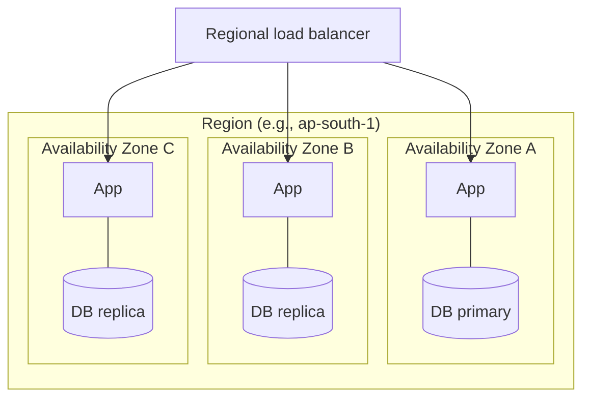
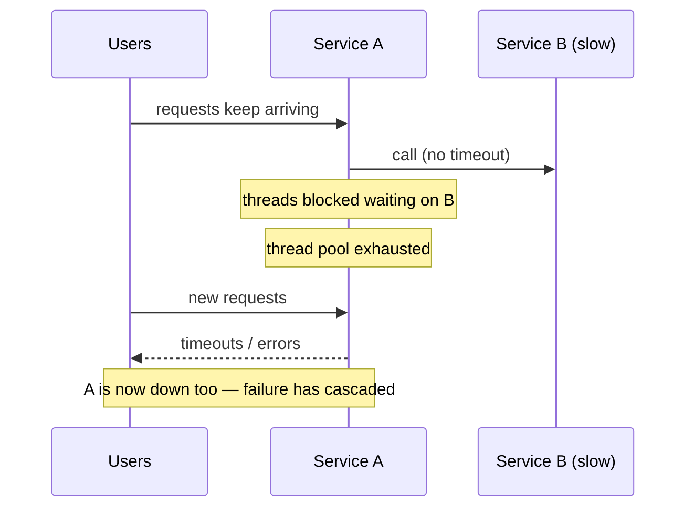
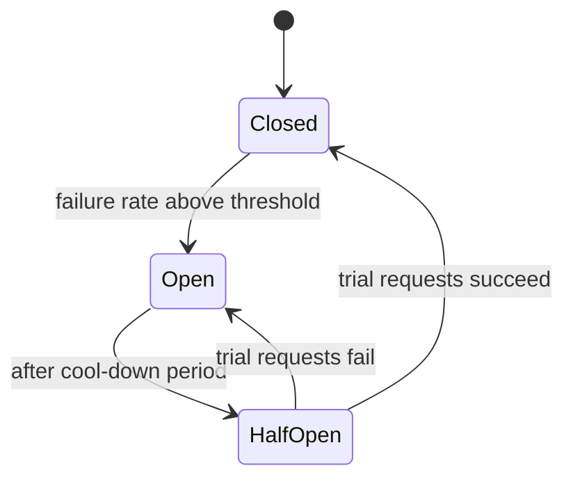

At scale, failure isn't an exception — it's a constant. Disks die, processes crash, deployments go wrong, networks drop packets, and dependencies slow down. With thousands of machines, something is always broken. **Fault tolerance** is the ability to keep serving users correctly despite those failures; **availability** is how we measure the result.

This lesson covers how availability is measured, how redundancy provides it, and the patterns — timeouts, retries, circuit breakers, bulkheads, idempotency, graceful degradation — that stop one failure from cascading into an outage.

## Measuring availability

**Availability** = the fraction of time (or of requests) the system works correctly.

| Availability | Downtime per year | Per month | Per day |
| --- | --- | --- | --- |
| 99% ("two nines") | 3.65 days | 7.3 hours | 14.4 min |
| 99.9% ("three nines") | 8.77 hours | 43.8 min | 1.44 min |
| 99.95% | 4.38 hours | 21.9 min | 43 s |
| 99.99% ("four nines") | 52.6 min | 4.38 min | 8.6 s |
| 99.999% ("five nines") | 5.26 min | 26 s | 0.86 s |

Each extra nine is roughly **10× harder and more expensive**. At four nines, you can't rely on a human noticing and fixing a problem — recovery must be automatic.

### SLI, SLO, SLA

- **SLI (Service Level Indicator)** — a measured metric. Example: the percentage of HTTP requests that return non-5xx within 300 ms.
- **SLO (Service Level Objective)** — the internal target for an SLI. Example: 99.9% of requests succeed within 300 ms over 30 days.
- **SLA (Service Level Agreement)** — a contractual promise to customers, with penalties (e.g., service credits) if breached. SLAs are set looser than SLOs to leave a margin.

The gap between 100% and the SLO is the **error budget**. With a 99.9% SLO, 0.1% of requests may fail per month. If the budget is healthy, ship features faster; if it's exhausted, prioritise reliability work. This turns reliability into an explicit, data-driven trade-off (an idea popularised by Google SRE).

### Availability of composed systems

**Components in series** (a request needs all of them) multiply:

```text
LB (99.99%) → App (99.9%) → DB (99.95%)
Total = 0.9999 × 0.999 × 0.9995 ≈ 99.84%
```

Every extra hard dependency **lowers** availability. A service calling 10 dependencies at 99.9% each is at best ~99.0%.

**Redundant components in parallel** (any one suffices) combine as:

```text
Availability = 1 − (1 − a)^n

Two independent replicas at 99%:  1 − 0.01² = 99.99%
Three replicas at 99%:            1 − 0.01³ = 99.9999%
```

The catch: this assumes failures are **independent**. Replicas in the same rack, zone, or running the same buggy deployment fail together. Real redundancy requires **failure-domain isolation**.

## Redundancy: eliminating single points of failure

A **single point of failure (SPOF)** is any component whose failure takes the whole system down. Walk through every box in your design and ask: *what if this dies?*

| Layer | Redundancy technique |
| --- | --- |
| DNS | Multiple providers or a managed anycast DNS service |
| Load balancer | Active-passive pair with VIP, or a managed distributed LB |
| Stateless services | N+1 or N+2 instances across availability zones |
| Database | Primary + replicas with automated failover; or consensus-based clusters |
| Cache | Replicated cache cluster; app degrades gracefully on cache loss |
| Message broker | Replicated partitions (e.g., Kafka replication factor 3) |
| Data center / region | Multi-AZ by default; multi-region for the highest availability tiers |

### Failure domains



- **Multi-AZ** (zones are separate data centres in one region, a few ms apart) protects against power, cooling and network failures in one building. It's the standard baseline.
- **Multi-region** protects against regional outages and natural disasters but brings cross-region latency, data replication and consistency challenges.

### Active-passive vs active-active

| | Active-passive | Active-active |
| --- | --- | --- |
| Normal operation | Standby idle (or serving reads) | All sites serve traffic |
| Failover | Promote the standby — takes time; risk of untested failover | Shift traffic away from the failed site |
| Cost efficiency | Standby capacity is mostly unused | All capacity used, but each site needs headroom to absorb others' load |
| Data | Simple single-writer replication | Requires multi-writer handling or partitioned ownership |

### Recovery objectives

- **RPO (Recovery Point Objective)** — how much data you can afford to lose, measured in time. Asynchronous cross-region replication with 5 s lag means RPO ≈ 5 s.
- **RTO (Recovery Time Objective)** — how long until service is restored. Automated failover might give minutes; restoring from backups, hours.

## Patterns that stop failures from spreading

The most dangerous failures aren't crashes — they're **slowness**. A crashed dependency fails fast; a slow one ties up threads, connections and memory in every caller until they all fall over. This is a **cascading failure**.



### 1. Timeouts

Every network call must have a timeout. Without one, a hung dependency can block a caller forever.

- Base timeouts on the dependency's observed latency (e.g., slightly above its p99.9), not arbitrary round numbers.
- Use a **deadline** that propagates through the call chain: if the user-facing request has 500 ms left, a downstream call shouldn't be given 2 s. gRPC supports deadline propagation natively.

### 2. Retries with exponential backoff and jitter

Many failures are transient (a dropped packet, a brief leader election). Retrying often succeeds — but naive retries amplify outages.

```text
delay = min(cap, base × 2^attempt) + random_jitter
attempt 1: ~100 ms, attempt 2: ~200 ms, attempt 3: ~400 ms … capped at a few seconds
```

Rules:

- **Retry only idempotent operations** (or ones protected by idempotency keys).
- **Retry only retryable errors** — timeouts, 503, 429 — not 400 or 404.
- **Add jitter** so clients don't retry in synchronised waves.
- **Limit attempts** (e.g., 3) and use a **retry budget** — e.g., retries may add at most 10% extra load.
- **Retry at one layer only.** If each of 4 layers retries 3 times, one user request can become 3^4 = 81 requests to the bottom service — a *retry storm*.

### 3. Circuit breakers

A circuit breaker wraps calls to a dependency and stops calling it when it's failing, giving it time to recover and letting callers fail fast.



- **Closed** — requests flow normally; failures are counted.
- **Open** — requests fail immediately (or use a fallback) without calling the dependency.
- **Half-open** — after a cool-down, a few trial requests test whether the dependency has recovered.

Libraries: Resilience4j (Java), Polly (.NET), and built-in outlier detection in Envoy/Istio.

### 4. Bulkheads

Named after ship compartments: isolate resources so a failure in one area can't sink everything.

- Separate **thread pools or connection pools per dependency** — if the recommendations service hangs, it exhausts only its own pool of 20 threads, not the 200 threads serving checkout.
- Separate **deployments for critical and non-critical traffic** (e.g., a dedicated fleet for payment APIs).
- **Cell-based architecture** — split users into independent cells (each a full stack) so an incident affects only one cell's users. Used at large scale by AWS and others.

### 5. Graceful degradation and fallbacks

When a non-critical dependency fails, return a reduced but useful response instead of an error:

- Recommendations down → show bestsellers (precomputed and cached).
- Personalised ranking down → show chronological feed.
- Review service down → product page renders without reviews.
- Search down → show categories for browsing.

Decide in advance which features are **critical** (must work) vs **optional** (can be dropped), and design the critical path with as few dependencies as possible.

### 6. Load shedding and back-pressure

When overloaded, it's better to reject some requests quickly than to accept everything and serve no one. Shed low-priority traffic first (background jobs, analytics, prefetches) and protect critical paths. Queue sizes must be **bounded** — an unbounded queue just converts overload into unbounded latency and memory exhaustion.

### 7. Idempotency

Retries, at-least-once message delivery, and failover all mean operations may execute more than once. Make them safe to repeat — via idempotency keys, unique constraints, upserts and conditional writes (see the API Design and Message Queues lessons). Idempotency is what makes every other recovery mechanism safe.

## Detecting failures

- **Health checks** at the load balancer (liveness vs readiness — see the Load Balancing lesson).
- **Heartbeats** between cluster members, with timeouts tuned to avoid false positives.
- **Monitoring the four golden signals**: latency, traffic, errors, saturation — alerting on SLO burn rate rather than individual spikes.
- **Distributed tracing** to see where time and errors arise across services.

## Building confidence

- **Chaos engineering** — deliberately inject failures (kill instances, add latency, cut network links) in a controlled way to verify resilience. Netflix's Chaos Monkey randomly terminates production instances so teams must build for it.
- **Game days and failover drills** — regularly practise region evacuation and database failover. An untested failover plan is a hope, not a plan.
- **Safe deployments** — canary releases, feature flags, automatic rollback on SLO regression. A large share of outages are caused by changes, not hardware.

<Callout type="interview">
After presenting your high-level design, proactively walk through failure scenarios: "If an app server dies, the LB's health checks remove it. If the primary DB fails, a replica is promoted within ~30 s, and we may lose up to a second of writes with async replication. If the recommendation service is slow, the circuit breaker opens and we fall back to trending items." This is one of the clearest senior-level signals.
</Callout>

## Interview questions

<QA q="Your service calls five dependencies, each 99.9% available. What's your maximum availability, and how would you improve it?">
In series, availability multiplies: 0.999^5 ≈ 99.5%, about 3.6 hours of downtime per month. Improve it by removing dependencies from the critical path (call them asynchronously, or precompute their data); making optional dependencies non-blocking with timeouts, circuit breakers and fallbacks so their failure doesn't fail the request; caching their responses to survive brief outages; and making each dependency itself redundant.
</QA>

<QA q="What is a retry storm and how do you prevent one?">
When a service slows or fails, its callers retry, multiplying load on the struggling service exactly when it can least handle it; with retries at multiple layers, the amplification is multiplicative (3 retries at each of 3 layers = 27× load). Prevent it with retries at a single layer, small attempt limits, exponential backoff with jitter, retry budgets that cap retries as a fraction of traffic, circuit breakers that stop calls to a failing dependency, and server-side load shedding with 429/503 plus Retry-After.
</QA>

<QA q="Explain how a circuit breaker works and why it helps.">
It tracks recent failures of calls to a dependency. While healthy (closed), calls pass through. When the failure rate crosses a threshold, it opens: calls fail immediately or use a fallback, without touching the dependency. After a cool-down, it goes half-open and lets a few trial calls through; success closes it, failure reopens it. This prevents callers from wasting threads and time on a dead dependency (avoiding cascading failure), gives the dependency room to recover, and enables fast, graceful fallbacks.
</QA>

<QA q="What's the difference between RPO and RTO? Give an example.">
RPO is the maximum acceptable data loss measured in time; RTO is the maximum acceptable time to restore service. Example: a database with asynchronous replication to another region that lags ~10 seconds, and automated regional failover taking ~15 minutes, has RPO ≈ 10 s and RTO ≈ 15 min. Synchronous replication can get RPO to zero at the cost of write latency; hot standbys and automation reduce RTO.
</QA>

## Practice

Write your answer before opening the suggested one. Anything you mark "Partly" or "Missed it" comes back in your review deck.

<Practice task="A request passes through a load balancer (99.99%), an API service (99.9%) and a database (99.95%), all required. What is the end-to-end availability, and how much downtime per month is that? What would you change first?">

Serial components multiply: 0.9999 × 0.999 × 0.9995 ≈ 0.9984, about 99.84%. A 30-day month has 43,200 minutes, so ~0.16% is about 70 minutes of downtime a month.

The weakest link is the API service at 99.9% (~43 minutes alone). Run several stateless instances behind the load balancer: two independent instances at 99.9% give 1 − 0.001² = 99.9999% for that layer (in theory — shared dependencies reduce it in practice). Then the database (failover replica) becomes the main contributor.

Lesson: overall availability is capped by the components in series, and redundancy turns a weak serial component into a strong parallel one.

</Practice>

<Practice task="One slow downstream service (5-second responses instead of 50 ms) is bringing down your whole API, even though it handles only one feature. What is happening, and which patterns stop it?">

Each request to the slow service holds a thread or connection for 5 s instead of 50 ms, so the shared pool fills up (100× longer holds) and every other endpoint queues behind it — a cascading failure.

1. Timeouts: call it with a short timeout (say 300 ms) so threads are released.
2. Circuit breaker: after a burst of failures or timeouts, stop calling it for a while and fail fast or return a fallback.
3. Bulkheads: give that dependency its own small connection or thread pool, so it can exhaust only its own share.
4. Graceful degradation: hide that one feature (or show cached data) instead of failing the page.
5. Retries only with backoff and a budget, or they multiply the load on the struggling service.

</Practice>

<Takeaways>

- Availability is measured in nines; each extra nine is ~10× harder. Use SLOs and error budgets to manage reliability explicitly.
- Dependencies in series multiply availability down; redundancy in parallel raises it — but only if failures are independent.
- Eliminate single points of failure and spread redundancy across failure domains (zones, regions).
- Slowness causes cascading failures: use timeouts, bounded retries with backoff and jitter, circuit breakers and bulkheads.
- Design graceful degradation, shed load under pressure, make operations idempotent, and test failure paths regularly.

</Takeaways>

## Further reading

- *Site Reliability Engineering* (Google, 2016) — ch. 3 "Embracing Risk", ch. 4 "Service Level Objectives", ch. 21 "Handling Overload", ch. 22 "Addressing Cascading Failures".
- Michael Nygard, *Release It!* (2nd ed., 2018) — circuit breakers, bulkheads and other stability patterns.
- Amazon Builders' Library — "Timeouts, retries, and backoff with jitter" and "Workload isolation using shuffle-sharding".
- Related: [Observability](/system-design/hld/observability), [Multi-Region Architecture](/system-design/hld/multi-region-architecture).
