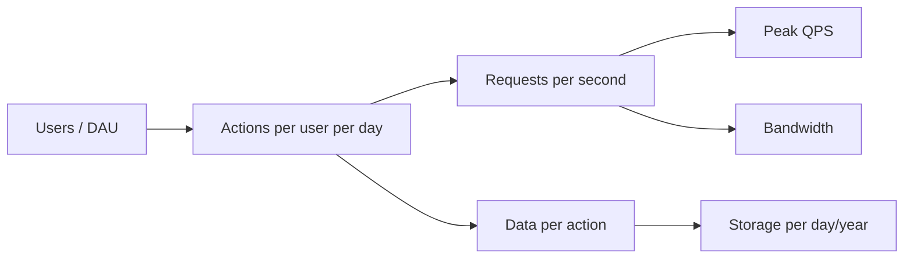

Back-of-the-envelope estimation is the skill of producing a rough-but-useful number quickly. In a design interview it answers questions like *does this fit on one machine?*, *do we need a cache?*, and *is a CDN mandatory?* — before you commit to an architecture.

The goal is **order-of-magnitude correctness**, not precision. Whether you need 40 or 60 servers doesn't change the design. Whether you need 1 or 1,000 does.

## Why it matters

Estimation turns vague requirements into constraints that eliminate options:

- 500 writes/second → a single well-tuned relational database can handle this.
- 500,000 writes/second → you need sharding or a write-optimised distributed store.
- 2 TB of total data → fits on one large machine (plus replicas).
- 2 PB of total data → must be partitioned across many machines; object storage for blobs.
- 50 Gbps of egress → serving from origin servers is impractical; you need a CDN.

<Callout type="interview">
Always finish a calculation with a sentence that starts with "**so…**". "…so the read path must be served from cache." "…so we need to shard the database." Numbers that don't lead to a decision are wasted interview time.
</Callout>

## Numbers worth memorising

### Powers of two and data sizes

| Power | Exact value | Approx | Unit |
| --- | --- | --- | --- |
| 2^10 | 1,024 | 1 thousand | 1 KB |
| 2^20 | 1,048,576 | 1 million | 1 MB |
| 2^30 | ~1.07 billion | 1 billion | 1 GB |
| 2^40 | ~1.1 trillion | 1 trillion | 1 TB |
| 2^50 | | 1 quadrillion | 1 PB |

Typical object sizes are equally useful:

| Object | Typical size |
| --- | --- |
| A character (ASCII / UTF-8 Latin) | 1 byte |
| UUID / 128-bit ID | 16 bytes |
| 64-bit integer / timestamp | 8 bytes |
| A tweet or short message with metadata | ~0.5–1 KB |
| A JSON API response | 1–10 KB |
| A compressed photo | 200 KB – 2 MB |
| One minute of 1080p video | ~50–100 MB |

### Latency numbers

These relative magnitudes explain most caching and architecture decisions. The figures blend Jeff Dean's classic list with modern NVMe and cloud-network measurements, so treat them as orders of magnitude — exact values vary by hardware and generation, but the ratios are what matter.

| Operation | Approx latency | Relative |
| --- | --- | --- |
| L1 cache reference | 1 ns | |
| Main memory reference | 100 ns | 100× L1 |
| Compress 1 KB (fast codec) | 2 µs | |
| Read 1 MB sequentially from memory | 3 µs | |
| SSD random read | 16–100 µs | ~1,000× memory |
| Round trip within a data centre | 500 µs | |
| Read 1 MB sequentially from SSD | 50 µs – 1 ms | |
| HDD disk seek | 2–10 ms | |
| Read 1 MB sequentially from HDD | 5–20 ms | |
| Round trip US East ↔ US West | ~70 ms | |
| Round trip US ↔ Europe | ~80–150 ms | |
| Round trip US ↔ India | ~200–250 ms | |

What to take away from this table:

1. **Memory is ~1,000× faster than SSD and ~100,000× faster than a disk seek.** This is why caches exist.
2. **A network round trip inside a data centre (~0.5 ms) is cheaper than a disk seek.** Reading from a remote in-memory cache is faster than reading from a local spinning disk.
3. **Cross-continent round trips cost 100+ ms.** You cannot make the speed of light faster — you can only move data closer to users (CDNs, regional deployments).
4. **Sequential I/O is dramatically faster than random I/O.** This is why log-structured storage and Kafka are fast.

### Time conversions

| Period | Seconds | Shortcut |
| --- | --- | --- |
| 1 day | 86,400 | **~10^5** (round up to 100K) |
| 1 month | ~2.6 million | ~2.5 × 10^6 |
| 1 year | ~31.5 million | ~3 × 10^7 |

The single most useful shortcut: **1 million requests per day ≈ 12 requests per second**. Rounding a day to 100,000 seconds gives 10/s — close enough.

### Throughput of common components

Very rough single-node ceilings for planning purposes:

| Component | Rough capacity |
| --- | --- |
| Web/app server (simple API) | 1K–10K requests/s |
| Relational DB (PostgreSQL/MySQL), simple indexed reads | 10K–50K queries/s |
| Relational DB, writes | 1K–10K writes/s |
| Redis / Memcached | 100K+ ops/s |
| Kafka broker | hundreds of MB/s; 100K–1M messages/s |
| A single server's network card | 10–25 Gbps |

## The estimation method

Every estimate follows the same chain. Write it down step by step so the interviewer can follow — and correct an assumption if needed.



### 1. Traffic (QPS)

```text
average QPS = DAU × actions per user per day / 86,400
peak QPS    = average QPS × peak factor (typically 2–5×)
```

Always estimate reads and writes separately — they usually differ by orders of magnitude and are scaled by different mechanisms.

### 2. Storage

```text
storage per day   = writes per day × size per write
storage total     = storage per day × retention days × replication factor
```

Remember replication: production data is typically stored **3×**. Add indexes and overhead (~20–30%) if it matters.

### 3. Bandwidth

```text
ingress  = write QPS × average request size
egress   = read QPS  × average response size
```

### 4. Memory for cache

The **80/20 rule** is a reasonable default: 20% of the data receives 80% of the traffic. Caching the hot 20% of a day's reads is a common starting point.

```text
cache memory ≈ 0.2 × (read requests per day × response size)
```

### 5. Number of servers

```text
servers ≈ peak QPS ÷ sustainable QPS per server × headroom (≈ 1.3–2×)
```

e.g., 30,000 peak QPS ÷ 2,000 QPS per server × 1.5 ≈ 23 servers — then add redundancy across zones.

### 6. Cost

Cost is increasingly an interview topic, and for media products it dominates the design. Bandwidth is usually the largest line item:

```text
monthly egress cost ≈ egress bytes per month × price per GB
```

Large-volume CDN egress is on the order of **a few cents per GB** (published list prices for the cheapest US tiers are around $0.02/GB; smaller customers and other regions pay more). See the worked cost example below.

## Worked example: a photo-sharing service

**Assumptions** (state them out loud):

- 500M DAU
- Each user uploads 0.2 photos per day on average, and views 50 photos per day
- Average photo after compression: 500 KB; plus 3 resized thumbnails, ~100 KB total
- Metadata per photo: 1 KB
- Keep photos forever; plan for 5 years

**Traffic**

```text
uploads/day  = 500M × 0.2 = 100M
upload QPS   = 100M / 10^5 ≈ 1,000/s     (peak ~3,000/s)

views/day    = 500M × 50 = 25B
view QPS     = 25B / 10^5 = 250,000/s    (peak ~750,000/s)
```

**So:** reads outnumber writes 250:1. Reads must be served from caches and a CDN; the write path is modest.

**Storage**

```text
per photo  = 500 KB + 100 KB = 600 KB
per day    = 100M × 600 KB = 60 TB/day
per year   = 60 TB × 365 ≈ 22 PB/year
5 years    ≈ 110 PB  (before replication)

metadata   = 100M × 1 KB = 100 GB/day → ~180 TB over 5 years
```

**So:** photo bytes go to object storage (S3-like), never to a database. Metadata at 180 TB requires a sharded database.

**Bandwidth**

```text
egress = 250,000 views/s × ~200 KB (mostly thumbnails/feed-size) = 50 GB/s = 400 Gbps
```

**So:** this is far beyond any origin fleet's reasonable capacity — a CDN is mandatory, and the origin should serve only cache misses.

<Callout type="example">
This is roughly why Instagram's architecture separates **metadata** (sharded PostgreSQL in its early years, later Cassandra for some workloads) from **media bytes** (object storage behind a CDN). The estimate alone pushes you toward that split.
</Callout>

## Worked example: what does video egress cost?

**Assumptions:** 5M DAU, each watches 5 videos/day, average video delivered ≈ 300 MB, CDN price ≈ $0.02/GB.

```text
egress/day = 5M × 5 × 0.3 GB = 7.5M GB = 7.5 PB/day
cost/day   = 7.5M GB × $0.02 ≈ $150,000/day  ≈ $55M/year
```

**So:** delivery cost — not servers — is the first-order design problem. That justifies cost levers you'd otherwise skip: efficient codecs, per-title encoding, serving rarely watched videos from cheaper origin storage, regional distribution, and (at very large scale) caches embedded in ISP networks. This calculation follows the YouTube chapter of Alex Xu's *System Design Interview*.

## Making the arithmetic easy

- **Round aggressively.** 86,400 → 10^5. 2.6M seconds in a month → 2.5 × 10^6. 365 → 400 when multiplying if convenient.
- **Use scientific notation.** 500M × 50 = 5 × 10^8 × 5 × 10^1 = 25 × 10^9 = 2.5 × 10^10.
- **Carry units.** Writing "KB/s" vs "requests/s" prevents the most common mistakes.
- **Sanity-check against reality.** If your estimate says a chat app needs 10,000 database servers, an assumption is probably off by 100×.

<Callout type="warning" title="Common mistakes">

- Forgetting peak traffic — systems are sized for peaks, not averages.
- Forgetting replication when estimating storage.
- Confusing bits and bytes in bandwidth (network links are in **bits** per second; 1 GB/s = 8 Gbps).
- Calculating everything — only compute numbers that influence a design decision.

</Callout>

## Interview questions

<QA q="A service has 10M DAU and each user makes 20 requests per day. Do you need more than one server?">
10M × 20 = 200M requests/day ÷ 10^5 s ≈ 2,000 QPS average; with a 3× peak, ~6,000 QPS. A single application server might handle 1K–5K QPS for a simple API, so you need a small fleet (say 4–10 servers) behind a load balancer — which you want anyway for redundancy. The database likely handles this read load with caching and read replicas.
</QA>

<QA q="Why do we estimate peak QPS rather than average?">
Systems fail at peaks, not averages. Traffic is uneven across a day (and spikes on events like sales or breaking news). Provisioning for the average means saturating during peaks — queues grow, latency explodes, and timeouts cascade. A 2–5× peak factor is a common planning assumption; for event-driven products (ticket sales, flash sales) it can be 10–100×.
</QA>

<QA q="Your estimate shows 5 TB of data. Do you need to shard?">
Not necessarily. 5 TB fits on a single modern database server with large SSDs, and a primary with read replicas can serve a lot of traffic. Sharding is driven by **write throughput**, **working set size relative to memory**, or **growth rate** as much as raw size. If data grows 5 TB per year and write QPS is high, plan for sharding; if it's static and read-heavy, replicas plus caching may be enough. Say this nuance out loud — it shows judgment.
</QA>

<QA q="How much memory would you need to cache the hot set for 1 billion reads per day of 2 KB objects?">
Daily read volume = 10^9 × 2 KB = 2 TB. Using the 80/20 rule, caching 20% of that is ~400 GB. That's too large for one cache node but trivial for a cluster of, say, 8–16 nodes with 32–64 GB each. In practice unique objects are fewer than total reads (many reads hit the same object), so the real requirement is often smaller.
</QA>

<QA q="Practice: 400M monthly users, 50% active daily, 2 posts per user per day, 10% of posts carry a 1 MB image. Estimate write QPS and five-year media storage.">
DAU = 200M. Posts/day = 400M → ÷ 10^5 ≈ 4,000–4,600 writes/s average, ~10,000 at a 2× peak. Media: 400M × 10% × 1 MB = 40 TB/day → × 365 × 5 ≈ 73 PB before replication. **So:** post metadata fits a sharded database, but media must go to object storage behind a CDN, and storage cost will push you toward compression, tiering and deduplication.
</QA>

## Practice

Write your answer before opening the suggested one. Anything you mark "Partly" or "Missed it" comes back in your review deck.

<Practice task="Estimate the storage for a photo app: 10 million daily active users, 10% of them upload 2 photos a day, each photo is stored as the original (2 MB) plus three resized versions totalling 500 KB. How much new storage per year, and what read bandwidth if each user views 50 thumbnails (30 KB) a day?">

Uploads: 10M × 10% × 2 = 2M photos/day. Each costs 2.5 MB → 5 TB/day → about 1.8 PB/year (more with replication, though object storage handles durability for you).

Reads: 10M × 50 × 30 KB = 15 TB/day ÷ 10^5 s ≈ 150 MB/s average, about 1.2 Gbit/s; peak maybe 3× that.

What it tells you: storage growth is the main cost (lifecycle rules to move old originals to colder tiers), and the read traffic is moderate but should be served by a CDN, since thumbnails are small and highly cacheable.

</Practice>

<Practice task="An interviewer says 'assume 100 million requests per day'. Quickly turn that into requests per second, average and peak, and say how many servers you need if one server handles 2,000 requests per second.">

A day has 86,400 s; round it to 10^5 for mental maths. 100M ÷ 10^5 = 1,000 requests/s average.

Peak is commonly 2–5× the average; take 3× → ~3,000 requests/s.

Servers: 3,000 ÷ 2,000 = 1.5 → 2 servers would be at their limit at peak, so plan 3–4 for headroom and so that losing one still leaves enough capacity (N + 1 or N + 2).

Say the rounding out loud: the interviewer cares that the order of magnitude is right and that you plan for peaks and failures, not about the third digit.

</Practice>

<Takeaways>

- Aim for the right order of magnitude, not precision.
- Memorise: 1 day ≈ 10^5 s; 1M requests/day ≈ 12 QPS; memory ≈ 1,000× faster than SSD.
- Estimate reads and writes separately, and always size for peak.
- Storage = writes × size × retention × replication.
- End every calculation with "so…" and the design decision it drives.

</Takeaways>

## Further reading

- Jeff Dean, "Designs, Lessons and Advice from Building Large Distributed Systems" (LADIS 2009 keynote) — origin of the classic latency list.
- Colin Scott, [Latency Numbers Every Programmer Should Know (interactive, by year)](https://colin-scott.github.io/personal_website/research/interactive_latency.html).
- Alex Xu, *System Design Interview*, Vol. 1 — ch. 2, "Back-of-the-envelope Estimation".
- Related: [HLD Cheat Sheet](/system-design/hld/hld-cheat-sheet) collects these numbers on one page.
