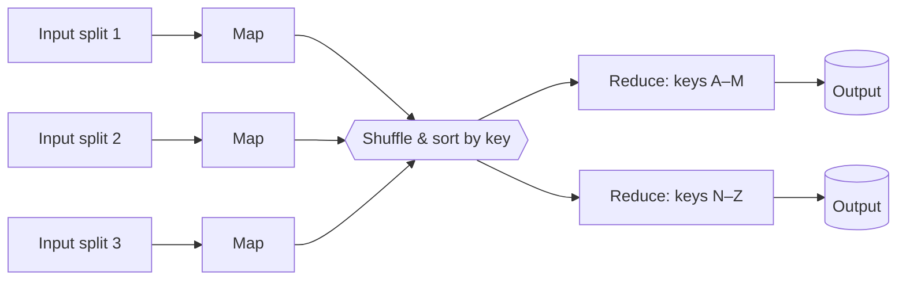
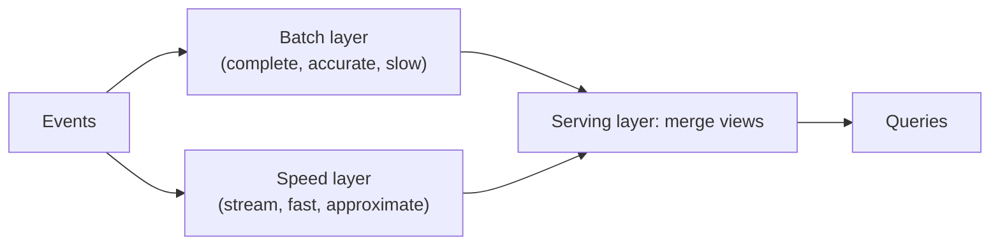

Production databases answer "what is the state of this order?". Businesses also need "how many orders per city per hour, over the last two years?", "which ads are trending right now?" and "recompute everyone's recommendations nightly". These questions scan huge volumes of data and are answered by **analytical** systems and **data processing pipelines** — batch, streaming, or both. They power analytics, ML features, search indexes, billing and fraud detection, and appear in case studies like ad-click aggregation and top-K.

## OLTP vs OLAP

| | OLTP (transactional) | OLAP (analytical) |
| --- | --- | --- |
| Typical query | Read/write a few rows by key | Aggregate millions to billions of rows |
| Users | Application, end users | Analysts, dashboards, data scientists |
| Latency target | Milliseconds | Seconds to minutes |
| Data | Current state | History, often append-only |
| Storage layout | **Row-oriented** | **Column-oriented** |
| Examples | PostgreSQL, MySQL, DynamoDB | BigQuery, Snowflake, Redshift, ClickHouse, Druid, Pinot |

### Why columnar storage

An analytical query like `SELECT country, SUM(revenue) FROM orders WHERE date > … GROUP BY country` touches 3 of perhaps 50 columns. A **column store** keeps each column's values together on disk, so it reads only those 3 columns. Values in a column are similar, so they **compress extremely well** (run-length and dictionary encoding), and engines process them in vectorised batches. The result is often 10–100× less I/O than a row store for analytical queries — and terrible performance for single-row updates, which is why OLTP and OLAP are separate systems.

### Getting data from OLTP to OLAP

- **ETL / ELT** — extract from sources, transform (clean, join, aggregate) and load into the warehouse; modern stacks load raw data first and transform inside the warehouse (ELT, e.g., with dbt).
- **CDC streams** — capture database changes continuously into Kafka and on into the warehouse or lake.
- **Data lake / lakehouse** — raw files (Parquet) in object storage, with table formats like Apache Iceberg, Delta Lake or Hudi adding transactions and schema evolution, queried by Spark, Trino or warehouse engines.

## Batch processing

Process a **bounded** dataset — yesterday's logs, the full user table — in one job, producing output files or tables.

### MapReduce

Google's MapReduce (2004) defined the model:

1. **Map** — read input records and emit key-value pairs (e.g., `(word, 1)`).
2. **Shuffle** — group all values by key across the cluster, sending each key to one reducer.
3. **Reduce** — combine values per key (e.g., sum the counts).

Key ideas that carry over to every modern engine: **move computation to the data**, partition work by key, and achieve fault tolerance by **re-running failed tasks** on immutable inputs.

### Spark and modern batch

**Apache Spark** keeps intermediate data in memory and plans jobs as a DAG of transformations (often expressed as SQL or DataFrames), making multi-stage jobs much faster than chained MapReduce. Batch jobs are typically scheduled by orchestrators like **Airflow** or Dagster.

**Batch strengths:** simple reasoning (inputs are fixed), easy reprocessing (rerun the job), high throughput, exactly-once results via deterministic recomputation.
**Batch weakness:** **latency** — results are as stale as the last run (hours).

## Stream processing

Process an **unbounded** stream of events continuously, updating results within seconds or milliseconds. Engines: **Apache Flink**, Kafka Streams, Spark Structured Streaming, Google Dataflow (Apache Beam).

### Windows

Aggregations over infinite streams need **windows**:

| Window | Definition | Example |
| --- | --- | --- |
| **Tumbling** | Fixed-size, non-overlapping | Clicks per ad per minute: 10:00–10:01, 10:01–10:02 |
| **Hopping / sliding** | Fixed size, overlapping, advancing by a step | Last 5 minutes, updated every minute |
| **Session** | Activity separated by gaps of inactivity | A user's browsing session ends after 30 min idle |

### Event time vs processing time

- **Event time** — when the event actually happened (timestamp in the event).
- **Processing time** — when the system processes it.

Mobile clients go offline, networks delay, and consumers fall behind, so events arrive **late and out of order**. Aggregating by processing time gives wrong answers (a burst of delayed clicks lands in the wrong minute). Correct pipelines aggregate by **event time**.

### Watermarks and late data

How long should a window wait for late events before emitting a result? A **watermark** is the engine's estimate that "all events with event time earlier than T have probably arrived". When the watermark passes the end of a window, the window fires.

- Events arriving after the watermark are **late**: drop them, send them to a side output, or **update** the previously emitted result (allowed lateness).
- The trade-off: waiting longer → more complete results but higher latency.

### State and fault tolerance

Streaming aggregations keep **state** (running counts per key). Flink stores it locally and takes periodic **distributed snapshots (checkpoints)** of all operator state plus the input offsets. On failure, it restores the last checkpoint and replays input from the saved offsets, giving **exactly-once state semantics**. Combined with transactional or idempotent sinks, results are exactly-once end to end.

## Lambda and Kappa architectures

**Lambda architecture** (Nathan Marz) runs two pipelines:

- The batch layer periodically recomputes accurate results from all data; the speed layer covers the gap since the last batch run.
- ✅ Accurate eventually, fast now.
- ❌ **Two codebases** implementing the same logic, which drift apart; complex to operate.

**Kappa architecture** (Jay Kreps) uses **only a stream processor**: keep the full event log (Kafka with long retention, or tiered storage), and when logic changes, **replay** the log through a new version of the job.

- ✅ One codebase; reprocessing is just replay.
- ❌ Requires a replayable log and a stream engine robust enough for large backfills.

Modern engines (Flink, Beam) that handle both bounded and unbounded data have made Kappa-style designs the common default, often with periodic batch **reconciliation** jobs for money-related numbers.

## Choosing

| Requirement | Approach |
| --- | --- |
| Daily reports, ML training, billing runs | Batch (Spark + warehouse/lake) |
| Real-time dashboards, alerting, fraud detection, trending | Stream (Flink / Kafka Streams) |
| Real-time numbers that must also be exactly right (ad billing) | Stream for freshness + batch reconciliation for correctness |
| Ad-hoc analytics over history | Columnar warehouse or lakehouse |
| Sub-second analytical queries on fresh data (user-facing dashboards) | Real-time OLAP stores: Druid, Pinot, ClickHouse |

<Callout type="interview">
In an analytics-heavy case study, say explicitly: "Events go to Kafka. Flink aggregates by **event time** in one-minute tumbling windows with a watermark tolerating a few minutes of lateness, and writes to an OLAP store for dashboards. Raw events also land in object storage, where a nightly batch job recomputes exact totals and reconciles them with the streaming results." This covers freshness, correctness and replay.
</Callout>

## Interview questions

<QA q="Why do analytical databases store data by column?">
Analytical queries read a few columns across huge numbers of rows. Columnar layout reads only the needed columns, and since each column contains similar values it compresses very well and can be processed in vectorised batches, cutting I/O and CPU dramatically. The cost is slow single-row inserts and updates, which is why OLTP systems remain row-oriented and data is copied into column stores for analysis.
</QA>

<QA q="What is a watermark in stream processing?">
A watermark is a moving threshold in event time that represents the engine's assumption that all events with earlier timestamps have arrived. When the watermark passes the end of a window, the window's result is emitted. It balances completeness against latency: a conservative watermark waits longer for stragglers. Events arriving after the watermark are late and are dropped, side-output, or used to update already-emitted results, depending on configuration.
</QA>

<QA q="Lambda vs Kappa architecture — which would you choose today?">
Usually Kappa: a single streaming pipeline over a durable, replayable log, with reprocessing done by replaying through a new job version. It avoids maintaining the same logic in two systems. I'd keep a batch reconciliation job where exact correctness matters for money (billing, payouts), which captures Lambda's main benefit without duplicating the whole pipeline.
</QA>

## Practice

Write your answer before opening the suggested one. Anything you mark "Partly" or "Missed it" comes back in your review deck.

<Practice task="A product team asks for 'real-time' revenue on a dashboard. When is a stream pipeline worth it, and when is an hourly batch job the better answer?">

Ask what decision the number drives and how stale it may be.

- If people watch it during an event (a flash sale, fraud monitoring) and act within minutes, stream it: events into Kafka, a windowed aggregation in Flink or similar, results into a fast store. Accept extra complexity: late events, exactly-once concerns, state management.
- If it is read in daily reviews, an hourly or daily batch over the warehouse is simpler, cheaper and exact, and corrections such as refunds are easy to include.

A common compromise: stream an approximate number for the live view, and let the batch job produce the official figure (similar to the Lambda architecture), or use one streaming system that can replay history (Kappa).

</Practice>

<Practice task="Your streaming job counts orders per minute. Mobile clients sometimes send events 3 minutes late (after being offline). How do you count them in the right minute, and what is the trade-off?">

Use event time (the timestamp from the client), not processing time, and watermarks.

A watermark says 'I believe all events up to time T have arrived'. Set it to lag the maximum seen event time by an allowed lateness, for example 5 minutes. A window for 12:00–12:01 is emitted once the watermark passes 12:01 (plus the lateness). Events later than that go to a side output or trigger an update to an already-emitted result.

Trade-off: a larger allowed lateness gives more complete counts but delays results and keeps more state. Many systems emit an early result quickly and then corrections as late events arrive.

</Practice>

<Takeaways>

- OLTP serves the application with row stores; OLAP serves analytics with columnar stores.
- Batch processing (MapReduce, Spark) handles bounded data with simple, reliable recomputation but stale results.
- Stream processing (Flink, Kafka Streams) handles unbounded data with windows, event time, watermarks and checkpointed state.
- Aggregate by event time and decide explicitly how to handle late data.
- Prefer a Kappa-style single pipeline with replay; add batch reconciliation where results must be exact.

</Takeaways>

## Further reading

- Dean and Ghemawat, "MapReduce: Simplified Data Processing on Large Clusters" (OSDI 2004).
- Zaharia et al., "Resilient Distributed Datasets" (NSDI 2012) — the foundation of Spark.
- Akidau et al., "The Dataflow Model" (VLDB 2015), and Tyler Akidau's "Streaming 101" and "Streaming 102" (O'Reilly, 2015).
- Carbone et al., "Apache Flink: Stream and Batch Processing in a Single Engine" (IEEE Data Engineering Bulletin, 2015).
- Jay Kreps, "Questioning the Lambda Architecture" (O'Reilly Radar, 2014).
- Martin Kleppmann, *Designing Data-Intensive Applications* — ch. 10 "Batch Processing" and ch. 11 "Stream Processing".
- Related case study: [Design an Ad Click Aggregator](/system-design/hld/design-ad-click-aggregator).
