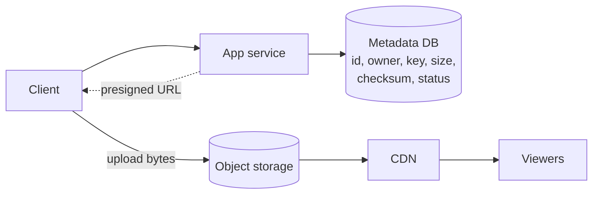
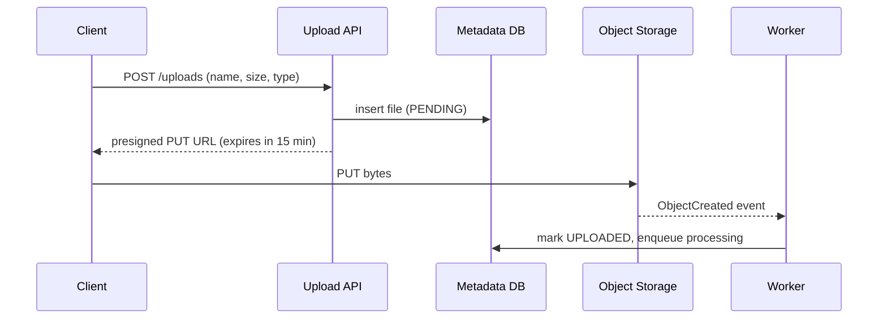

Photos, videos, documents, backups, logs, ML datasets — most bytes in most systems are **unstructured blobs**, not rows. Storing them in a relational database bloats it, slows backups and replication, and wastes expensive IOPS. The standard answer is **object storage** (Amazon S3, Google Cloud Storage, Azure Blob Storage, or self-hosted MinIO/Ceph), with the database holding only **metadata and a pointer**.

## The object storage model

Object storage is a giant, flat key-value store optimised for large values:

- **Bucket** — a namespace (e.g., `photos-prod`).
- **Key** — the object's name (e.g., `users/42/2026/10/abc123.jpg`). The slashes look like folders but the namespace is flat; "folders" are just key prefixes.
- **Object** — the bytes plus metadata (content type, size, checksum, custom headers).
- Operations: `PUT`, `GET` (including byte-range GETs), `DELETE`, `LIST` by prefix. Objects are **immutable** — you replace, not modify in place.

| | Block storage (EBS, disks) | File storage (NFS, EFS) | Object storage (S3) |
| --- | --- | --- | --- |
| Access | Raw blocks via a filesystem on one machine | POSIX file paths, shared | HTTP API, keys |
| Modify in place | Yes | Yes | No — rewrite whole object (or multipart) |
| Scale | One volume, TBs | Large | Practically unlimited |
| Latency | Sub-millisecond | Low milliseconds | Tens of milliseconds for first byte |
| Cost per GB | High | Medium–high | Low (with cold tiers even lower) |
| Use for | Databases, OS disks | Shared files for legacy apps | Media, backups, data lakes, static assets |

### Properties worth knowing

- **Durability** — S3 is designed for 99.999999999% (eleven nines) annual durability by storing data redundantly across multiple devices and availability zones, using replication and **erasure coding**.
- **Erasure coding** — split an object into *k* data fragments plus *m* parity fragments (e.g., 10 + 4); any *k* fragments can reconstruct the object. This tolerates *m* lost fragments at ~1.4× storage overhead, versus 3× for triple replication.
- **Consistency** — since December 2020, S3 provides strong read-after-write consistency for PUTs and DELETEs, including LIST operations.
- **Storage classes and lifecycle rules** — automatically move objects to cheaper tiers (infrequent access, archive such as Glacier) after N days, or delete them. Large savings for logs and old media.
- **Throughput scales with parallelism** — a single stream is limited, but many parallel requests (and byte-range GETs) achieve very high aggregate bandwidth.

## Metadata lives in a database

The database row knows *who* owns the file, *where* it is (bucket + key), its size, type, checksum and processing status. Object storage only knows bytes. Queries like "list this user's files sorted by date" go to the database, never to the object store's `LIST`.

## Uploads: keep bytes off your servers

### The naive way

Client → your API server → object storage. Every byte passes through your fleet, tying up connections and bandwidth for minutes on large uploads, and making your servers the bottleneck.

### Presigned URLs (direct upload)

1. The client asks your API for permission to upload (`POST /uploads` with file name, size, type).
2. The API validates the request (auth, quota, file type), creates a metadata row with status `PENDING`, and returns a **presigned URL** — a time-limited URL signed with your credentials that authorises exactly one operation (PUT to this key, maybe with a size limit and content type).
3. The client uploads directly to object storage.
4. Object storage emits an **event notification** (e.g., S3 → SQS/Lambda/EventBridge) when the object lands; a worker verifies it, marks the row `UPLOADED`, and kicks off processing (thumbnails, virus scan, transcoding).

Downloads work the same way: serve **presigned GET URLs** (or CDN signed URLs/cookies) for private content, so bytes flow from storage or CDN, not through your servers.

<Callout type="tip">
Don't trust the client's claim that the upload finished. Rely on the storage event (or a HEAD check of size and checksum) before marking the file available. Clean up `PENDING` rows and orphaned objects with a periodic job or lifecycle rule.
</Callout>

### Multipart uploads

For large files (S3 recommends multipart above ~100 MB; required above 5 GB per single PUT):

1. **Initiate** the multipart upload → upload ID.
2. Upload **parts** (5 MB – 5 GB each, up to 10,000 parts) independently and **in parallel**, each with its own presigned URL.
3. **Complete** by sending the list of part numbers and ETags; the store assembles the object.

Benefits: parallelism (much faster), **retry a single failed part** instead of the whole file, and the ability to start uploading before the whole file is available (streaming).

### Resumable uploads

On flaky mobile networks, an upload should survive disconnects. The client tracks which parts (or byte offsets) succeeded and, after reconnecting, asks the server which parts are already stored and uploads only the rest. Implementations: S3 multipart with `ListParts`, Google Cloud Storage resumable uploads, or the open **tus** protocol. Remember to abort abandoned multipart uploads (lifecycle rules), since stored parts cost money.

### Chunking and deduplication

Systems like Dropbox split files into content-defined or fixed-size **chunks**, hash each chunk, and upload only chunks the server doesn't already have. Editing one paragraph of a 100 MB file re-uploads one 4 MB chunk, and identical files across users are stored once. See [Design Cloud File Storage](/system-design/hld/design-file-storage).

## Serving blobs

- Put a **CDN** in front for anything read more than a few times (public images, video segments).
- Use **content-addressed or versioned keys** (`/img/{sha256}.jpg`) so objects are immutable and cacheable forever.
- Generate **derived variants** (thumbnails, resolutions, formats) asynchronously after upload, or on demand at the edge with caching.
- Use **byte-range requests** for video seeking and parallel downloads.

## Common mistakes

<Callout type="warning">

- Storing images or videos as BLOB columns in the primary database.
- Proxying all uploads and downloads through application servers.
- Using object storage `LIST` as a query engine — it's slow and eventually paginated; keep an index in your database.
- Public buckets for private data. Default to private and hand out short-lived signed URLs.
- Hot key prefixes: older S3 guidance recommended randomised prefixes; today S3 scales per prefix automatically (thousands of requests per second per prefix), but spreading very high request rates across prefixes still helps.

</Callout>

## Interview questions

<QA q="How would you let users upload 2 GB videos from a mobile app?">
The client requests an upload session from the API, which authenticates, checks quotas and file type, records a PENDING metadata row, and initiates a multipart upload. It returns presigned URLs for parts (or issues them on demand). The client uploads parts in parallel directly to object storage, retrying failed parts and resuming after disconnects by asking which parts already exist. When all parts are done, the client (or API) completes the upload; the storage event triggers a worker to verify size/checksum, mark the file uploaded and enqueue transcoding. Abandoned uploads are cleaned up by lifecycle rules.
</QA>

<QA q="Why not store images in the database?">
Large blobs bloat the database: they slow backups, replication and restores, evict useful rows from the buffer cache, and consume expensive, IOPS-optimised storage. Databases also aren't designed to stream gigabytes to many clients or sit behind a CDN. Object storage is cheaper per GB, more durable, scales effectively without limit, integrates with CDNs, and supports range reads. Keep metadata and the object key in the database.
</QA>

<QA q="What is erasure coding and why do object stores use it?">
It splits data into k data fragments and computes m parity fragments; any k of the k+m fragments reconstruct the original. Spreading fragments across disks, racks or zones tolerates m simultaneous losses at an overhead of (k+m)/k — e.g., 1.4× for 10+4 — versus 3× for triple replication. The trade-off is CPU for encoding and slower reconstruction reads, so hot data is sometimes replicated while warm and cold data is erasure coded.
</QA>

<Takeaways>

- Store blobs in object storage; keep metadata and the object key in a database.
- Object storage is a flat, immutable, HTTP-accessed key-value store with very high durability and low cost.
- Use presigned URLs so clients upload and download directly; confirm uploads via storage events.
- Use multipart and resumable uploads for large files; chunking enables deduplication and delta sync.
- Serve blobs through a CDN with immutable, versioned keys.

</Takeaways>

## Further reading

- Amazon S3 User Guide — "Uploading and copying objects using multipart upload" and "Sharing objects with presigned URLs".
- AWS News Blog, "Amazon S3 Update – Strong Read-After-Write Consistency" (December 2020).
- Beaver et al., "Finding a needle in Haystack: Facebook's photo storage" (OSDI 2010).
- Muralidhar et al., "f4: Facebook's Warm BLOB Storage System" (OSDI 2014) — erasure coding for warm data.
- [tus — resumable upload protocol](https://tus.io).
- Related: [Content Delivery Networks](/system-design/hld/cdn), [Design Cloud File Storage](/system-design/hld/design-file-storage), [Design a Video Streaming Platform](/system-design/hld/design-video-streaming).
