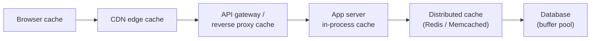
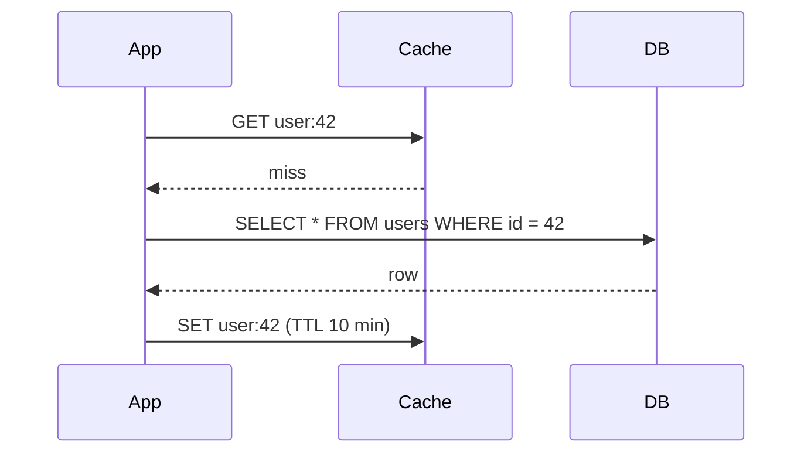

A **cache** stores a copy of data in a faster location so future requests can be served without going back to the slower source. Caching is the single most effective technique for improving read latency and reducing load on databases — and also one of the most common sources of subtle bugs.

> There are only two hard things in Computer Science: cache invalidation and naming things. — Phil Karlton

## Why caching works

Two properties of real workloads make caching effective:

1. **Skewed access.** A small fraction of data receives most requests (popular products, celebrity profiles, today's news). Caching that hot set gives a high **hit ratio** with modest memory.
2. **Speed gap.** Reading from memory takes ~100 ns; a network round trip to an in-memory cache ~0.5 ms; a database query with disk access 5–50 ms. Each cache hit avoids the slow path entirely.

The key metric is the **hit ratio**: `hits / (hits + misses)`. Going from a 90% to a 99% hit ratio cuts database load **by 10×** — misses are what reach the database, and they drop from 10% to 1%.

## Where caches live

A request may pass through many cache layers:



| Layer | What it caches | Pros | Cons |
| --- | --- | --- | --- |
| **Client / browser** | Static assets, API responses (via HTTP headers) | Zero network cost | Hard to invalidate; per-user |
| **CDN** | Static files, media, cacheable API responses | Close to users, offloads origin | Coarse invalidation; mostly public content |
| **Reverse proxy** | Full HTTP responses | Transparent to app | Limited to cacheable responses |
| **In-process (local)** | Hot objects in app memory (e.g., Caffeine, Guava) | Fastest — no network | Each instance has its own copy; inconsistent across instances; limited by heap |
| **Distributed cache** | Objects, query results, sessions | Shared across instances; scalable | Network hop; another system to operate |
| **Database cache** | Pages in the buffer pool | Automatic | Limited control; still DB load |

## Cache read/write strategies

### Cache-aside (lazy loading)

The application manages the cache explicitly. This is the most common pattern.



```js
async function getUser(id) {
  const cached = await cache.get(`user:${id}`);
  if (cached) return cached;
  const user = await db.findUser(id);
  await cache.set(`user:${id}`, user, { ttl: 600 });
  return user;
}

async function updateUser(id, changes) {
  await db.updateUser(id, changes);
  await cache.delete(`user:${id}`);   // invalidate, don't update
}
```

- ✅ Only requested data is cached; cache failure degrades to slower DB reads rather than errors.
- ✅ The cache can hold a different shape from the database: a rendered profile card, a joined result or a computed score.
- ❌ First request for each key is a miss; stale data is possible between DB write and invalidation.
- ❌ Caching logic is repeated in every service that reads the data, and each one must invalidate correctly.

**Pick it when** reads far outnumber writes and a few seconds of staleness is acceptable: profiles, product pages, configuration. It is the right default. **Avoid it when** every read must see the latest write (a balance at the moment of debit), or when keys are almost never read twice, because the hit rate will be too low to pay for the memory.

<Callout type="tip" title="Delete, don't update, on writes">
On a write, **delete** the cache entry rather than setting it to the new value. If two concurrent writers both update the DB and then the cache, the cache updates can land in the opposite order, leaving the cache permanently stale. Deleting forces the next reader to load the fresh value.
</Callout>

### Read-through

The cache itself loads from the database on a miss; the app only talks to the cache. Same behaviour as cache-aside, but the loading logic lives in the cache library or provider. Simplifies application code.

Examples: an in-process loading cache such as Caffeine or Guava (`cache.get(id, loader)`), or DynamoDB Accelerator (DAX) in front of DynamoDB.

- ✅ One place owns loading, so every caller gets the same behaviour. Good libraries also **collapse concurrent misses**: a hundred requests for the same missing key trigger one database read.
- ❌ The cached value must match what the loader returns, usually one row or object, so you lose cache-aside's freedom to cache composed results.
- ❌ The cache is now on the read path. If it's a remote service and it goes down, reads fail unless the library falls back to the database.

**Pick it when** many callers read the same entities and you want consistent loading and miss collapsing without repeating code. **Avoid it when** you need to cache computed or aggregated views rather than plain rows.

<Callout type="note" title="Where sources differ">
Many sources — including Alex Xu's *System Design Interview* — call the pattern "check the cache, on a miss read the database and fill the cache" a **read-through** cache. Strictly, that's **cache-aside**: the *application* does the loading. In a true read-through cache, the *cache layer itself* loads from the database on a miss. Behaviour is the same; the difference is where the loading code lives. If an interviewer says "read-through", clarify which they mean.
</Callout>

### Write-through

Every write goes to the cache **and** synchronously to the database before returning.

Example: a user updates their display name. The service writes the row to the database and the new value to the cache before returning, so the next page load is a cache hit with the new name.

- ✅ Cache is always fresh for written keys; reads after writes hit.
- ❌ Writes are slower (two writes); cache fills with data that may never be read (pair it with a TTL).
- ❌ The two writes are not atomic. If the database write succeeds and the cache write fails, the cache is stale, so keep a TTL as a safety net.

**Pick it when** data is read soon and often after it is written, and stale reads would be visible to users: settings, profiles, session data. **Avoid it when** writes are frequent and reads are rare (you pay double for nothing), or when write latency is the bottleneck.

### Write-behind (write-back)

Writes go to the cache and are acknowledged immediately; the cache flushes them to the database asynchronously in batches.

Example: video view counts. Each view runs `INCR views:video_81` in Redis, and a job writes the accumulated counts to the database every 10 seconds. Ten thousand increments become one `UPDATE`.

- ✅ Very fast writes; batching reduces DB load (great for counters, metrics, view counts).
- ❌ **Data loss risk** if the cache node fails before flushing; harder consistency reasoning.
- ❌ The database is behind the cache, so anything reading the database directly (reports, other services, backups) sees old values.

**Pick it when** writes are very frequent, each one is small, and losing the last few seconds of them in a crash is acceptable: counters, likes, analytics, game state checkpoints. **Avoid it when** a write must never be lost: orders, payments, anything a user was told succeeded.

### Write-around

Writes go directly to the database, bypassing the cache; the cache is filled only on reads. Good for data that's written but rarely read soon after (e.g., logs, bulk imports).

- ✅ Writes don't flood the cache with entries nobody reads, which would evict hot keys.
- ❌ The first read after a write is always a miss, and any old cached copy must be deleted on write or it stays stale until its TTL.

**Pick it when** written data is rarely read back right away: audit logs, chat archives, bulk imports. **Avoid it when** users expect to see what they just wrote, immediately, from a fast path.

| Strategy | Read latency | Write latency | Consistency | Data loss risk | Best for |
| --- | --- | --- | --- | --- | --- |
| Cache-aside | Miss on first read | Normal | Possible brief staleness | None | General-purpose read-heavy data |
| Read-through | Miss on first read | Normal | Possible brief staleness | None | Same, with simpler app code |
| Write-through | Fast after writes | Slower | Strong for cached keys | None | Read-after-write heavy data |
| Write-behind | Fast | Fastest | Eventual | Yes | Counters, high-volume writes |
| Write-around | Miss after write | Normal | Good | None | Write-once, read-rarely data |

### How they combine

A read strategy and a write strategy are always used together:

- **Cache-aside reads + write-around writes** is the everyday default: check the cache on reads, write to the database, delete the cached key. Simple, safe and good enough for most read-heavy data.
- **Read-through + write-through** puts the cache library in charge of both directions. Reads after writes always hit, at the cost of slower writes.
- **Write-behind** is usually reserved for one hot, loss-tolerant dataset such as counters, not applied to a whole system.

<Callout type="interview">
When the interviewer asks "how do you keep the cache consistent?", name the pairing and its weak spot: "Cache-aside with delete-on-write and a 10-minute TTL. A reader can still put an old value back just after a write; the TTL bounds how long that lasts, and for the profile page a few seconds of staleness is fine." Then say which data you would **not** cache this way, such as balances.
</Callout>

## Eviction policies

Caches have finite memory. When full, the **eviction policy** decides what to drop.

- **LRU (least recently used)** — drop the item not accessed for the longest time. The default for most workloads. Implemented with a hash map + doubly linked list for O(1) operations.
- **LFU (least frequently used)** — drop the item with the fewest accesses. Better when popularity is stable; slow to adapt when popularity shifts.
- **FIFO** — drop the oldest inserted item. Simple; ignores access patterns.
- **TTL-based** — items expire after a fixed time regardless of use. Bounds staleness.
- **Modern hybrids** — W-TinyLFU (Caffeine), ARC, Redis's approximated LRU/LFU — combine recency and frequency and resist scan pollution (a one-off scan evicting all hot data).

<Callout type="note">
**Eviction** (removing items for space) and **expiration** (removing items after a TTL) are different mechanisms, and most systems use both: a TTL bounds staleness, and the eviction policy manages memory pressure.
</Callout>


<CacheSim />

## Cache invalidation

Keeping cached data in sync with the source of truth is the hard part. Options, from simplest to most precise:

1. **TTL only** — accept up to T seconds of staleness. Simple and robust; perfect for data where slight staleness is fine (product listings, profiles of other users).
2. **Explicit invalidation on write** — the writer deletes affected cache keys. Precise, but every write path must know every cache key derived from the data — easy to miss one.
3. **Event-driven invalidation** — the database emits change events (via CDC, e.g., Debezium → Kafka); a consumer invalidates or updates cache entries. Decouples writers from cache logic and catches writes from any source.
4. **Versioned keys** — include a version in the key (`product:42:v17`). Writing bumps the version; old entries simply stop being read and expire. Great for immutable or CDN-cached content.

Always combine precise invalidation with a TTL as a safety net — if an invalidation is ever missed, the entry still eventually refreshes.

### The race condition in cache-aside

Even with delete-on-write, this interleaving leaves stale data:

```text
1. Reader: cache miss for key K
2. Reader: reads old value V1 from DB
3. Writer: writes V2 to DB
4. Writer: deletes K from cache
5. Reader: sets K = V1 in cache        ← stale until TTL expires
```

Mitigations: short TTLs; **delayed double delete** (delete again a short time after the write); or use leases — Facebook's memcache paper describes a lease token issued on a miss, so a set is rejected if the key was invalidated in between.

## Failure modes every design should address

### Cache stampede (thundering herd)

A popular key expires; thousands of concurrent requests miss simultaneously and all hit the database to recompute it.

Mitigations:

- **Request coalescing / single-flight** — only one request recomputes; others wait for its result.
- **Locking** — the first misser takes a short lock (e.g., Redis `SET key NX PX`) to rebuild; others serve stale data or wait briefly.
- **Probabilistic early refresh** — refresh slightly before expiry, with randomness so not all instances refresh at once.
- **Stale-while-revalidate** — serve the stale value while one background request refreshes it.

### Cache penetration

Requests for keys that **don't exist** (often malicious or buggy) always miss and always hit the database.

Mitigations: cache negative results ("not found") with a short TTL; use a **Bloom filter** of valid keys to reject impossible lookups before touching the cache or DB; validate inputs.

### Cache avalanche

Many keys expire at the same moment (e.g., all set with the same TTL during a warm-up), or the cache cluster restarts — causing a sudden flood to the database.

Mitigations: add **jitter** to TTLs (e.g., 10 min ± 60 s); warm the cache before shifting traffic; replicate the cache; rate-limit or shed load at the database tier; use circuit breakers.

### Hot keys

One key receives so much traffic that a single cache node saturates.

Mitigations: replicate hot keys across nodes with a suffix (`key#1..#N`) and read a random replica; add a small **local in-process cache** in front of the distributed cache for the hottest keys.

### Cache node failure

A single cache server is a single point of failure — and losing it suddenly shifts its entire load to the database. Replicate cache nodes across zones, size the database to survive a partial cache loss (or shed load), and **over-provision cache memory** by a margin so the working set still fits as data grows; a cache that silently starts evicting hot keys degrades just like a failure.

## Distributed caching: Redis vs Memcached

| | Redis | Memcached |
| --- | --- | --- |
| Data types | Strings, hashes, lists, sets, sorted sets, streams, bitmaps, HyperLogLog, geo | Strings (opaque blobs) only |
| Persistence | Optional (RDB snapshots, AOF log) | None |
| Replication & failover | Built in (replicas, Sentinel, Cluster) | None built in (client-side distribution) |
| Threading | Mostly single-threaded command execution (I/O threads available) | Multi-threaded |
| Extras | Pub/sub, Lua scripting, transactions, TTL per key | Simpler, very efficient memory use |
| Typical choice | Default for most modern systems; also used for rate limiting, leaderboards, queues | Pure, simple, large-scale object caching |

<Callout type="example">
Facebook scaled Memcached to thousands of servers holding trillions of items, using leases to prevent stale sets and thundering herds, and regional pools to replicate hot data. Twitter's timelines are served from Redis clusters, with each user's home timeline precomputed as a Redis list.
</Callout>

## What to cache — and what not to

**Good candidates:** data that's read far more than written; expensive to compute (aggregations, rendered pages, ML features); tolerant of brief staleness; or accessed with a skewed distribution.

**Poor candidates:** data that changes on nearly every read; data requiring strict consistency (account balances at the moment of debit); highly unique, rarely repeated queries (low hit ratio wastes memory); and large blobs better served by a CDN.

<Callout type="interview">
When you add a cache in an interview, cover four things in one breath: **what** you cache (key and value), **strategy** (cache-aside with TTL), **invalidation** (delete on write + TTL safety net), and **failure handling** (stampede protection; the system still works, slower, if the cache is down).
</Callout>

## Interview questions

<QA q="Your cache hit ratio is 95% but the database is still overloaded. What do you check?">
Compute the absolute miss volume: at 200K reads/s, 5% is still 10K queries/s to the database, which may be too much — improving to 99% would cut that to 2K. Then check: whether misses are concentrated on keys that don't exist (penetration — cache negative results); whether expiry causes stampedes on popular keys (coalescing, jitter); whether write traffic, not reads, is the actual load; whether some queries bypass the cache; and whether cache memory is too small, causing hot keys to be evicted (check the eviction rate).
</QA>

<QA q="Why delete the cache entry on update instead of writing the new value?">
Two concurrent writers can update the database in one order and the cache in the opposite order, leaving the cache permanently holding the older value. Deleting is idempotent and order-insensitive: whoever reads next loads the current value from the database. It also avoids computing cache values that may never be read. A small race (a reader repopulating a stale value) still exists, which TTLs, delayed double deletes, or leases address.
</QA>

<QA q="How do you prevent a cache stampede on a very popular key?">
Ensure only one request recomputes the value: use single-flight/request coalescing in each app instance, plus a distributed lock (SET NX with a short expiry) so only one instance rebuilds across the fleet while others serve the stale value or wait briefly. Refresh popular keys before they expire (probabilistic early expiration or background refresh), and add TTL jitter so many keys don't expire together.
</QA>

<QA q="When would you choose an in-process cache over Redis?">
For small, very hot, rarely changing data where even a network hop matters — configuration, feature flags, reference data, or the hottest few keys. In-process caches are fastest but each instance holds its own copy, so invalidation across instances is harder (use short TTLs or pub/sub invalidation messages) and memory is limited by the heap. Many systems use both: a small local L1 cache in front of a shared Redis L2.
</QA>

## Practice

Write your answer before opening the suggested one. Anything you mark "Partly" or "Missed it" comes back in your review deck.

<Practice task="Your product page reads from Redis with cache-aside and a 5-minute TTL. A product's price changes in the database, but customers keep seeing the old price for minutes. Fix it, and explain the race that can still serve a stale price.">

On update, write the database first and then delete the cache key (not update it). The next read misses and loads the new price. Keep the TTL as a safety net.

The remaining race: a reader misses the cache and reads the old price from the database; then the writer updates the database and deletes the key; then the reader writes its old value into the cache. Now the stale price sits there until the TTL expires.

Mitigations: a short TTL for price data; a second, delayed delete a few hundred ms after the write; or versioned values where a cache write only succeeds if the version is newer. For truly critical values (the price at checkout), read from the database, not the cache.

</Practice>

<Practice task="A popular key's TTL expires and 10,000 requests miss the cache at the same moment, flattening the database. Name the problem and three ways to prevent it.">

This is a cache stampede (thundering herd) on a hot key.

1. Request coalescing (single flight): only one request per key rebuilds the value; the others wait for it or briefly get the stale value. A short lock in Redis (`SET NX` with a small TTL) works across servers.
2. Refresh ahead / probabilistic early expiration: refresh hot keys shortly before they expire, so they never actually expire under load.
3. Serve stale while revalidating: keep the old value past its soft TTL and refresh in the background.

Also add jitter to TTLs so many keys created together do not expire together.

</Practice>

<Takeaways>

- Caching exploits skewed access and the memory/disk speed gap; the hit ratio determines its value.
- Cache-aside with delete-on-write and a TTL safety net is the default pattern.
- Write-through keeps cached data fresh; write-behind is fastest but risks data loss.
- LRU is a solid default eviction policy; TTLs bound staleness.
- Plan for stampedes, penetration, avalanches and hot keys — and make sure the system degrades gracefully if the cache fails.

</Takeaways>

## Further reading

- Nishtala et al., "Scaling Memcache at Facebook" (NSDI 2013) — leases, regional pools, thundering herds.
- Vattani, Chierichetti and Lowenstein, "Optimal Probabilistic Cache Stampede Prevention" (VLDB 2015).
- Einziger, Friedman and Manes, "TinyLFU: A Highly Efficient Cache Admission Policy" (ACM ToS, 2017).
- AWS whitepaper, "Database Caching Strategies Using Redis".
- Related: [Content Delivery Networks](/system-design/hld/cdn), [Probabilistic Data Structures](/system-design/hld/probabilistic-data-structures).
