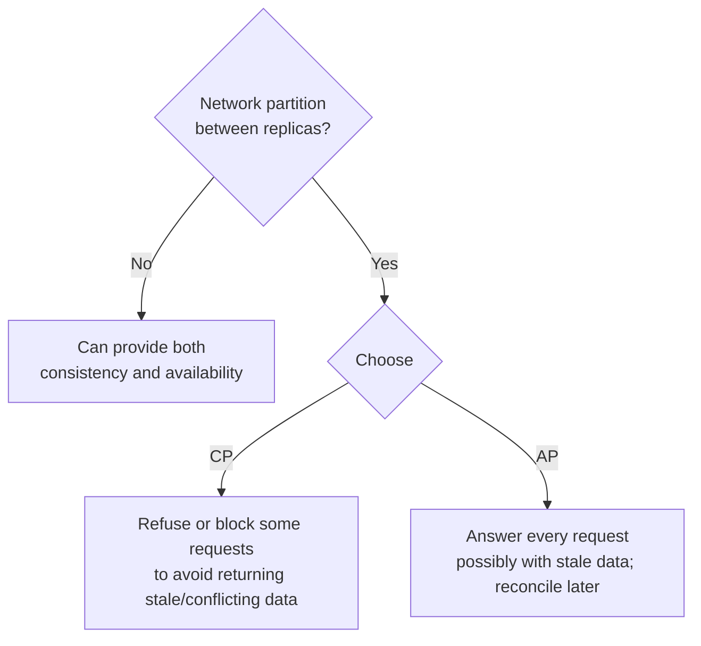

The **CAP theorem** is probably the most cited — and most misunderstood — idea in distributed systems. Interviewers use it to check whether you understand what really happens when a network fails between replicas, and whether you can map that to concrete product decisions.

## The three properties

CAP considers a system that stores data replicated across multiple nodes.

- **Consistency (C)** — every read receives the most recent write or an error. Formally, this is **linearizability**: the system behaves as if there's a single copy of the data, and once a write completes, all later reads see it. (This is *not* the "C" in ACID, which is about constraints.)
- **Availability (A)** — every request to a non-failing node receives a non-error response — without the guarantee that it contains the most recent write.
- **Partition tolerance (P)** — the system keeps operating despite messages between nodes being lost or delayed (a **network partition**).

## What the theorem actually says

> When a network partition happens, a distributed system must choose between consistency and availability.

The popular phrasing "pick 2 of 3" is misleading. In any real distributed system, **partitions will happen** — switches fail, cables are cut, GC pauses and overloaded nodes look like partitions. You cannot opt out of P. So the real choice is only made **during a partition**:

### A concrete scenario

Two replicas, N1 in Mumbai and N2 in Singapore, hold a user's account balance of ₹1,000. The link between them fails. A client in Singapore asks N2 to withdraw ₹800, while a client in Mumbai asks N1 to withdraw ₹700.

- **CP choice:** N2 can't confirm with N1, so it rejects the withdrawal (or waits). The system is unavailable for that request but never lets the balance go negative.
- **AP choice:** both nodes accept their withdrawals. Both clients get a success response. When the partition heals, the system discovers a balance of −₹500 and has to reconcile — apply overdraft rules, reverse a transaction, or flag it for manual review.

For a bank account, CP is the obvious choice. For a "like" counter or a shopping cart, AP is usually better — a briefly inaccurate count or a cart that needs merging is preferable to an error page.

## CP vs AP systems

| | CP | AP |
| --- | --- | --- |
| During a partition | Some requests fail or block | All requests answered, possibly stale |
| After partition heals | Already consistent | Must reconcile divergent replicas |
| Typical mechanisms | Consensus (Raft/Paxos), majority quorums, single leader | Leaderless replication, sloppy quorums, hinted handoff, CRDTs, LWW |
| Examples | ZooKeeper, etcd, Consul, HBase, Spanner, MongoDB with majority read/write concern, single-leader SQL with sync failover | Cassandra, DynamoDB (default reads), Riak, CouchDB, DNS |
| Good for | Payments, inventory, leader election, locks, configuration | Social feeds, carts, counters, presence, caches, product catalogue |

<Callout type="note" title="Systems aren't purely CP or AP">
Many databases are **tunable**. Cassandra with `QUORUM` reads and writes behaves much more like CP for a given key; with `ONE` it's firmly AP. DynamoDB offers both eventually consistent and strongly consistent reads. The choice is often per operation, not per database — and you should say so in an interview.
</Callout>

## Common misconceptions

1. **"CA systems exist."** A single-node database is "CA" only because it isn't distributed. Once data is replicated over a network, partitions are possible and you must decide how to behave during them.
2. **"AP means no consistency."** AP systems still converge (*eventual consistency*), and can offer useful guarantees like read-your-writes or causal consistency.
3. **"CP means unavailable."** CP systems are available most of the time; they only sacrifice availability for some requests on the minority side of a partition.
4. **"CAP is about the whole system."** In practice, you choose per feature. The same product may make checkout CP and recommendations AP.
5. **"Availability in CAP is the same as 99.99% uptime."** CAP availability is a strict theoretical property (every non-failed node responds). Operational availability is a different, practical measure.

## PACELC: the trade-off that exists all the time

CAP only describes behaviour during a partition — which is rare. Daniel Abadi's **PACELC** extends it to normal operation:

> **If** there is a **P**artition, choose between **A**vailability and **C**onsistency;
> **E**lse (normal operation), choose between **L**atency and **C**onsistency.

Why does latency enter? To guarantee strong consistency even without failures, a write must be confirmed by multiple replicas (often across zones or regions) before it's acknowledged, and reads may need to contact a leader or quorum. That coordination costs round trips. Relaxing consistency lets you answer from the nearest replica immediately.

| System | If partition (PA / PC) | Else (EL / EC) | Notes |
| --- | --- | --- | --- |
| Cassandra, Riak, DynamoDB (default) | PA | EL | Fast local responses; eventual consistency |
| MongoDB | Depends on config | EC | Abadi's original analysis classed it PA/EC; with `majority` read/write concern it behaves PC/EC |
| Google Spanner, CockroachDB | PC | EC | Consensus on every write; pays latency for strong consistency |
| PNUTS (Yahoo) | PC | EL | Per-record master; relaxed reads |
| MySQL/PostgreSQL with async replicas | PC (on primary) | EL (reads from replicas) | Depends on where you read |

<Callout type="interview">
PACELC is the more useful framing in interviews because most of the time there's no partition. Say something like: "For the timeline, I'd favour latency over consistency — serve from the nearest replica and accept a few seconds of staleness. For payment status, I'd favour consistency — read from the primary even though it costs extra latency."
</Callout>

## Applying it in a design

For each important piece of data, ask: *what's the business cost of a stale or conflicting value, versus the cost of an error or delay?*

| Feature | Stale/conflicting data cost | Unavailability cost | Lean |
| --- | --- | --- | --- |
| Bank transfer | Money lost or created | User retries later | **CP** |
| Seat/ticket booking | Double booking | User retries | **CP** for the final reservation |
| Inventory count shown on product page | Slight inaccuracy | Lost sale | **AP** (but CP at checkout) |
| Social media likes | Off by a few | Feature looks broken | **AP** |
| Shopping cart | Merge duplicates | Lost sale | **AP** (Amazon's Dynamo was built for exactly this) |
| Distributed lock / leader election | Two leaders → corruption | Brief pause | **CP** |
| User session / auth token validation | Brief stale permission | Users locked out | Usually **AP** with short TTLs |

Note the pattern: the *same product* mixes both. E-commerce shows inventory with AP semantics but reserves stock at checkout with CP semantics.

## Interview questions

<QA q="Explain the CAP theorem in your own words.">
In a system with replicated data, if the network between replicas fails, a node that can't reach the others has two options: answer requests using its possibly outdated data (choosing availability), or refuse/delay requests until it can coordinate (choosing consistency). It can't do both. Since network failures are unavoidable in distributed systems, the meaningful choice is how each operation behaves during a partition.
</QA>

<QA q="Why isn't 'CA' a valid choice for a distributed database?">
CA means consistent and available but not partition tolerant — i.e., assuming the network never fails. In a distributed system, partitions do happen, and when one occurs the system must still do something: either reject requests (giving up A) or allow divergence (giving up C). A system that claims CA simply hasn't defined its behaviour during partitions, or isn't distributed (e.g., a single-node database).
</QA>

<QA q="Is Cassandra CP or AP?">
By default it's AP — it accepts writes and reads on available replicas and reconciles later via hinted handoff, read repair and last-write-wins. But consistency is tunable per query: with QUORUM writes and QUORUM reads (W + R > N), reads usually see the latest write, and requests fail if a quorum isn't reachable, which is closer to CP behaviour (though not fully linearizable without lightweight transactions). The right answer is "it depends on the consistency level you choose".
</QA>

<QA q="What does PACELC add to CAP and why does it matter in practice?">
CAP only covers behaviour during partitions, which are rare. PACELC adds that in normal operation, there's still a trade-off between latency and consistency: strong consistency requires coordination between replicas (extra round trips, possibly cross-region), while weaker consistency lets you respond from the nearest replica immediately. In practice this everyday latency cost drives most database and configuration choices.
</QA>

<Takeaways>

- CAP: during a network partition, a replicated system must choose between consistency (linearizability) and availability.
- Partitions are unavoidable, so "CA" isn't a real option for distributed systems.
- PACELC: even without partitions, you trade latency for consistency.
- Most databases are tunable; the choice is often per operation, not per system.
- Decide per feature based on the business cost of stale data versus errors — money and locks lean CP; feeds, counters and carts lean AP.

</Takeaways>

## Further reading

- Gilbert and Lynch, "Brewer's Conjecture and the Feasibility of Consistent, Available, Partition-Tolerant Web Services" (SIGACT News, 2002) — the formal proof.
- Eric Brewer, "CAP Twelve Years Later: How the 'Rules' Have Changed" (IEEE Computer, 2012).
- Daniel Abadi, "Consistency Tradeoffs in Modern Distributed Database System Design" (IEEE Computer, 2012) — PACELC.
- Martin Kleppmann, "Please stop calling databases CP or AP" (blog, 2015).
