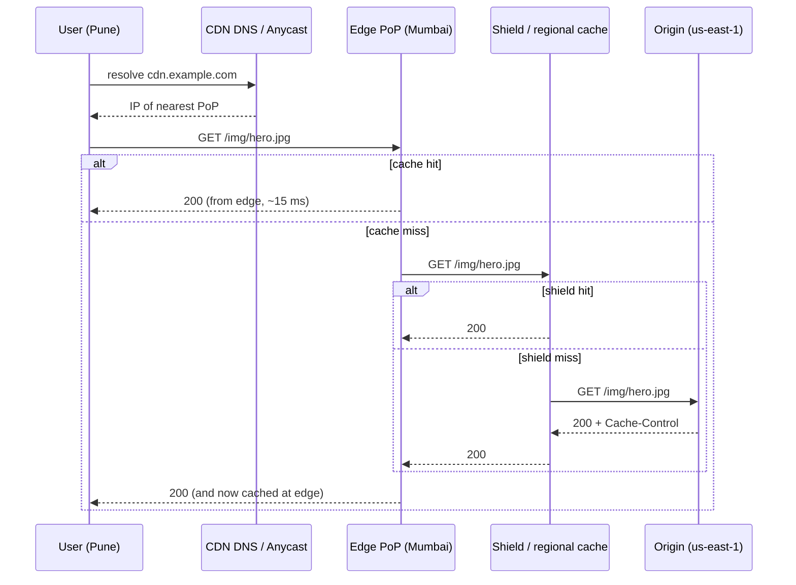

A **Content Delivery Network (CDN)** is a geographically distributed network of cache servers — **edge servers** grouped into **Points of Presence (PoPs)** — that serve content from a location close to the user instead of from your origin servers.

The networking lesson showed that a fresh HTTPS request across continents costs several 100+ ms round trips, and the speed of light can't be improved. A CDN attacks the problem from the other side: **move the content closer to the user**.

## What a CDN gives you

1. **Lower latency** — a user in Chennai fetches from a PoP in Chennai (5–20 ms RTT) instead of an origin in Virginia (~220 ms).
2. **Origin offload** — if 95% of requests are served from the edge, the origin only handles 5%. For media-heavy products, this is the difference between hundreds and thousands of origin servers.
3. **Bandwidth cost reduction** — CDN egress is usually cheaper than cloud egress at scale.
4. **Resilience** — edges can serve cached content even if the origin is briefly down, and absorb traffic spikes.
5. **Security** — DDoS absorption across a huge network, Web Application Firewall (WAF), bot management, TLS termination at the edge.

## How a request flows



- **Routing to the nearest PoP** uses GeoDNS (return different IPs per region) or **anycast** (the same IP announced from every PoP; internet routing picks the closest).
- On a miss, many CDNs use a tiered hierarchy: the edge asks a **regional shield / mid-tier cache** before the origin. This collapses misses from hundreds of edges into a few origin requests.

## Pull vs push CDNs

| | Pull CDN | Push CDN |
| --- | --- | --- |
| How content gets there | Edge fetches from origin on first request, then caches | You upload content to the CDN ahead of time |
| Setup | Point the CDN at your origin; minimal effort | Upload/sync pipeline required |
| First request | Slow (miss) | Fast |
| Storage | Only what's requested | Everything you push |
| Best for | Websites, APIs, long-tail content, frequently changing assets | Large, predictable, popular files: software releases, video libraries, game patches |

Most web applications use **pull** CDNs. Video platforms often combine both — pre-positioning popular titles (Netflix's Open Connect appliances are filled during off-peak hours) and pulling the long tail.

## Controlling caching

CDNs follow HTTP caching headers from the origin (and can override them with rules).

```text
Cache-Control: public, max-age=31536000, immutable      # fingerprinted static assets
Cache-Control: public, max-age=60, s-maxage=300         # browser 60 s, CDN 5 min
Cache-Control: public, s-maxage=30, stale-while-revalidate=300
Cache-Control: private, no-store                        # never cache (personalised data)
```

| Directive | Meaning |
| --- | --- |
| `max-age` | How long any cache may serve it |
| `s-maxage` | Overrides max-age for shared caches (CDNs, proxies) |
| `public` / `private` | Whether shared caches may store it |
| `no-store` | Don't cache at all |
| `no-cache` | Cache, but revalidate with origin before each use |
| `stale-while-revalidate` | Serve stale while fetching a fresh copy in the background |
| `stale-if-error` | Serve stale if the origin is failing |
| `ETag` / `Last-Modified` | Validators for cheap conditional revalidation (304 Not Modified) |

### Cache keys

The **cache key** determines what counts as "the same" object. By default it's usually host + path + query string. Getting it wrong causes either low hit ratios or serving the wrong content:

- Including irrelevant query parameters (`?utm_source=…`) fragments the cache → normalise or strip them.
- Varying on headers like `Cookie` or `User-Agent` explodes the number of variants → only vary on what truly changes the response (e.g., `Accept-Encoding`, or a device class).
- **Never** cache personalised responses under a shared key — a classic incident is user A's account page being served to user B.

## Invalidation strategies

1. **Versioned / fingerprinted URLs** — `app.3f9a2c.js`, `/img/v42/hero.jpg`. A new deploy produces new URLs; old ones simply age out. Allows very long TTLs safely. **This is the preferred approach for static assets.**
2. **Purge / invalidation API** — tell the CDN to evict specific paths or tags. Useful for content updates (a corrected article). Propagation typically takes seconds; some CDNs charge per invalidation or limit the rate.
3. **Short TTLs** — accept a bounded staleness window for content that changes often.
4. **Surrogate keys / cache tags** — tag responses (e.g., `product-42`) and purge everything carrying a tag in one call.

<Callout type="note" title="Where sources differ">
Some guides version assets with a query string (`logo.png?v=2`). It works with most CDNs, but some caches and proxies ignore or strip query strings, and it's easy to forget to bump. Putting the version or content hash **in the path** (`/v2/logo.png`, `logo.8d3f1.png`) is more robust.
</Callout>

## Beyond static files

Modern CDNs are much more than file caches:

- **Dynamic content acceleration** — even uncacheable requests benefit: TLS terminates at the nearby edge, and the edge keeps warm, optimised connections to the origin over the CDN's backbone.
- **Caching API responses** — public, non-personalised endpoints (product details, search suggestions, leaderboards) can be cached at the edge for seconds — at high QPS, even a 5-second TTL removes most origin load.
- **Video streaming** — adaptive bitrate formats (HLS/DASH) split video into small segments that cache perfectly.
- **Edge compute** — run code at the edge (Cloudflare Workers, Lambda@Edge, Fastly Compute) for auth checks, A/B routing, header manipulation, personalisation, or image resizing.
- **Image optimisation** — resize, compress and convert formats (WebP/AVIF) on the fly per device.

<Callout type="example">
Netflix serves the vast majority of its video traffic from its own CDN, Open Connect — appliances placed inside ISPs' networks and pre-filled with the content each region is predicted to watch. When you press play, the bytes often travel only a few network hops.
</Callout>

## Cost and failure considerations

- **You pay per GB (and per request).** Caching assets that are rarely requested buys little latency and still costs money; keep long-tail content on cheaper origin storage, or let it fall out of cache.
- **Plan for CDN outages.** CDNs do have incidents. Large sites use **multi-CDN** with DNS or client-side steering, and clients/players should be able to fall back to an alternative host (or the origin, sized to absorb at least partial traffic).
- **Set TTLs deliberately** — too long and content is stale, too short and the origin is hammered by revalidation.

## When a CDN isn't the answer

- **Highly personalised or real-time data** (a user's inbox, live bids) can't be cached at the edge — though the CDN may still accelerate the connection.
- **Strict freshness requirements** — if a stale response is unacceptable even for seconds, edge caching adds risk.
- **Low, local traffic** — a small internal tool serving one office gains little.

<Callout type="interview">
In almost every HLD for a consumer product, add a CDN for static assets and media without being asked — and say what it buys you: "Images and video go to object storage behind a CDN, which offloads the vast majority of bandwidth from our servers and cuts latency for global users. Assets use content-hashed URLs, so we can cache them for a year and never need to purge."
</Callout>

## Interview questions

<QA q="How would you deploy a new version of a website's JavaScript without users getting a stale version from the CDN?">
Use content-fingerprinted file names (e.g., app.8d3f1.js) generated at build time, and cache them with a long max-age and immutable. The HTML that references them is served with a short TTL (or no-cache with revalidation). On deploy, the new HTML points to new file names, which the CDN fetches as new objects. Nothing needs to be purged, and old pages still loading old assets keep working.
</QA>

<QA q="What is an origin shield and why is it useful?">
An intermediate caching tier between edge PoPs and the origin. Without it, a cache miss at each of, say, 200 PoPs results in 200 requests to the origin for the same object. With a shield, edges fetch from the shield and only the shield fetches from origin, collapsing duplicate misses. It improves hit ratio and protects the origin, at the cost of an extra hop on misses.
</QA>

<QA q="Can you cache API responses on a CDN? What are the risks?">
Yes, for public, non-personalised responses — product details, catalogue pages, configuration — with short TTLs and stale-while-revalidate. Risks: accidentally caching personalised or authenticated responses and serving them to other users (mitigate with Cache-Control: private on such responses and cache keys that exclude cookies); staleness after updates (use purges or surrogate keys); and cache-key fragmentation from query parameters.
</QA>

<QA q="Pull or push CDN for a video-on-demand platform?">
Typically a hybrid. Popular titles are predictable and huge, so pre-position (push) them to edges before peak hours to guarantee hits and avoid origin surges on release. The long tail of rarely watched content is pulled on demand, since pushing everything everywhere would waste storage. Video is split into segments (HLS/DASH), which cache efficiently either way.
</QA>

## Practice

Write your answer before opening the suggested one. Anything you mark "Partly" or "Missed it" comes back in your review deck.

<Practice task="You deploy a new version of your web app, but some users get the new HTML with old cached JavaScript and the page breaks. How do you deploy static assets safely through a CDN?">

Use content-hashed file names and different cache rules for HTML and assets.

1. Build assets with the content hash in the name (`app.3f9a1c.js`). A new version gets a new URL, so a cache can never serve an old file for it.
2. Cache hashed assets for a long time: `Cache-Control: public, max-age=31536000, immutable`.
3. Serve HTML with a short TTL or `no-cache` (revalidate every time), because the HTML is what points to the new asset names.
4. Deploy assets before the HTML that references them, and keep old assets around for a while for users with an old page open.

There is no need to purge the CDN at all.

</Practice>

<Practice task="Your origin serves 2 Gbit/s at peak and the CDN hit ratio is 60%. Marketing expects traffic to double. What happens at the origin, and what do you improve first?">

Today the origin serves 40% of 2 Gbit/s ≈ 0.8 Gbit/s. If traffic doubles at the same hit ratio, the origin serves 1.6 Gbit/s — double the load.

Raising the hit ratio is the cheapest fix. At 90%, doubled traffic means only 0.4 Gbit/s at the origin, half of today's.

How:
1. Normalise the cache key: drop useless query parameters, sort the rest, ignore cookies that do not affect the response.
2. Longer TTLs with versioned URLs for static content.
3. Turn on origin shielding (a mid-tier cache) so edge misses are collapsed into one origin request.
4. Use `stale-while-revalidate` so expiring objects do not cause bursts of misses.

</Practice>

<Takeaways>

- A CDN serves content from edge PoPs near users, cutting latency and offloading the origin.
- Pull CDNs fetch on miss (default for the web); push CDNs pre-position large, predictable content.
- Control caching with Cache-Control headers and carefully designed cache keys.
- Prefer versioned URLs over purges for static assets; use purges or tags for content updates.
- Never cache personalised responses under a shared cache key.

</Takeaways>

## Further reading

- RFC 9111, "HTTP Caching", and RFC 5861 (`stale-while-revalidate`, `stale-if-error`).
- [Netflix Open Connect](https://openconnect.netflix.com) — overview of Netflix's own CDN.
- Ilya Grigorik, [*High Performance Browser Networking*](https://hpbn.co) — latency and the case for the edge.
- Related case study: [Design a Video Streaming Platform](/system-design/hld/design-video-streaming).
