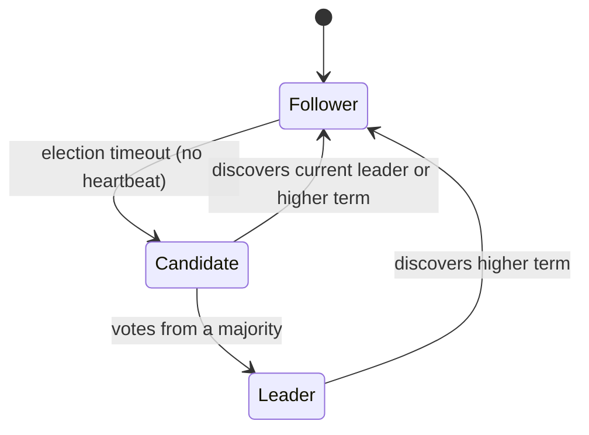
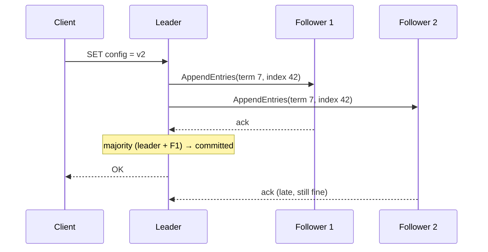
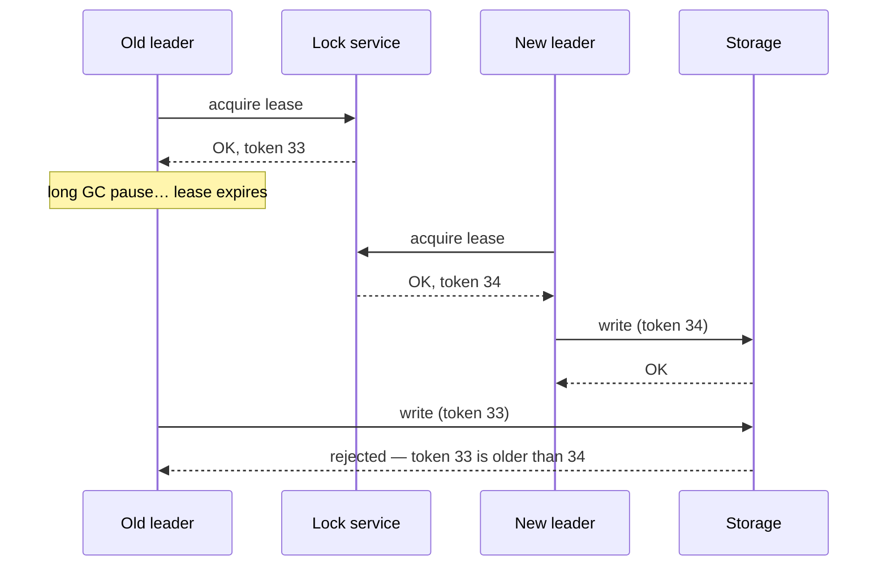

Some decisions in a distributed system must be made **exactly once and agreed on by everyone**: who is the leader of this shard, who holds this lock, which configuration is current, what is the next entry in the log. Getting a group of machines to agree despite crashes and network failures is the **consensus** problem. You rarely implement it yourself, but you rely on it constantly — through etcd, ZooKeeper, Consul, Kafka's KRaft, and distributed databases — and interviewers expect you to know what it guarantees and what it costs.

## What consensus provides

A consensus protocol lets a group of nodes agree on a value (or a sequence of values) such that:

- **Agreement** — no two nodes decide differently.
- **Validity** — the decided value was proposed by some node.
- **Termination** — every non-crashed node eventually decides (as long as a majority can communicate).

Agreeing on a **sequence** of values gives a **replicated log**. If every node applies the same log entries in the same order to a deterministic state machine, all nodes stay identical — **state machine replication**, the foundation of etcd, ZooKeeper, Spanner's Paxos groups and CockroachDB's Raft ranges.

## Majorities (quorums)

Consensus systems use **majority quorums**. With **2f + 1** nodes, the system tolerates **f** failures:

| Cluster size | Majority | Failures tolerated |
| --- | --- | --- |
| 3 | 2 | 1 |
| 5 | 3 | 2 |
| 7 | 4 | 3 |

Any two majorities overlap in at least one node, so a decision made by one majority is always visible to the next. This is why clusters have odd sizes (4 nodes tolerate no more failures than 3) and why consensus can't make progress on the minority side of a partition — the **CP** choice from CAP.

## Raft in brief

Raft (Ongaro and Ousterhout, 2014) was designed to be understandable. It's the protocol behind etcd, Consul, CockroachDB, TiKV and Kafka's KRaft mode.

**Leader election**

- Time is divided into numbered **terms**. Each term has at most one leader.
- Followers expect periodic **heartbeats** from the leader. If none arrives within a randomised **election timeout** (e.g., 150–300 ms), a follower becomes a candidate, increments the term, votes for itself and requests votes.
- Each node votes for at most one candidate per term, and only for candidates whose log is at least as up to date as its own. A candidate with a majority becomes leader. Randomised timeouts make split votes rare.

**Log replication**

1. Clients send commands to the leader.
2. The leader appends the entry to its log and sends it to followers (`AppendEntries`).
3. Once a **majority** has stored the entry, it's **committed**; the leader applies it and replies to the client.
4. Followers apply committed entries in order.

**Safety**: a new leader must already contain every committed entry (guaranteed by the voting rule), so committed data is never lost when leadership changes.

### Costs

- Every write needs a round trip to a majority — in a multi-region cluster, that's cross-region latency per write.
- Throughput is limited by the single leader per group. Systems scale by running **many independent Raft groups** (one per shard/range).
- Linearizable reads must confirm leadership (a quorum round trip, or a time-based **leader lease**).

Paxos (Lamport) solves the same problem and underlies Chubby and Spanner; Multi-Paxos with a stable leader behaves much like Raft. ZooKeeper uses its own protocol, ZAB.

## Coordination services

Most systems don't embed consensus; they use a **coordination service** — a small, strongly consistent key-value store built on consensus:

| Service | Protocol | Typical uses |
| --- | --- | --- |
| **etcd** | Raft | Kubernetes cluster state, service discovery, config, leader election |
| **ZooKeeper** | ZAB | Kafka (legacy), HBase, Hadoop — leader election, membership, config |
| **Consul** | Raft | Service discovery, health checks, KV config |

Building blocks they provide: **compare-and-set** writes, **ephemeral keys** tied to a client session (deleted when the client dies), **watches** (notify on change), and **leases/TTLs**. They're designed for small amounts of critical metadata — not as general databases.

## Leader election in your own services

Often you want **exactly one** instance of something: one scheduler, one compaction job per shard, one writer per partition.

Recipe with etcd/ZooKeeper:

1. Each candidate tries to create a key (e.g., `/leaders/scheduler`) with a **lease** (TTL ~10 s) using compare-and-set — "create only if absent".
2. The winner is leader and **keeps renewing** the lease. Others **watch** the key.
3. If the leader crashes or is partitioned, its lease expires, the key disappears, and watchers race to become leader.

### The problem: a leader that doesn't know it's no longer leader

A leader can be paused (long GC, VM freeze) past its lease expiry. Meanwhile a new leader is elected. When the old one wakes up, it still *believes* it's leader and performs writes — two leaders acting at once.

**Fencing tokens** fix this. Each time a lease is granted, the coordination service issues a **monotonically increasing number** (etcd revision, ZooKeeper `zxid`, or an epoch). The leader includes the token with every write, and the **storage system rejects** any write with a token lower than the highest it has seen.

<Callout type="interview">
Whenever you introduce "only one worker should do X" in a design, mention **lease + fencing token**. It shows you know that timeouts alone can't prevent two actors from overlapping.
</Callout>

## Distributed locks

The same mechanism gives distributed locks. Choose based on what's at stake:

- **Efficiency locks** — avoid doing the same work twice (e.g., two workers regenerating the same cache entry). An occasional double execution is harmless. A simple Redis `SET key value NX PX 30000` lock is fine.
- **Correctness locks** — two holders would corrupt data or double-charge. Use a consensus-backed service (etcd/ZooKeeper) **and fencing tokens checked by the resource**, or avoid the lock entirely with conditional writes in the database.

<Callout type="warning" title="About Redlock">
Redlock (acquiring a lock on a majority of independent Redis nodes) is widely debated. Martin Kleppmann's analysis showed it relies on timing assumptions (bounded pauses and clock drift) and provides no fencing token, so it isn't safe for correctness-critical locking; Redis's author disputed parts of the argument. The safe interview position: Redis locks for efficiency, consensus plus fencing for correctness.
</Callout>

## Membership and failure detection

How does a cluster know which nodes are alive?

- **Heartbeats with timeouts** — simple; the timeout trades detection speed against false positives.
- **Phi accrual failure detector** — instead of a binary timeout, compute a suspicion level from the observed distribution of heartbeat intervals; adapts to network conditions. Used by Cassandra and Akka.
- **Gossip protocols** — each node periodically exchanges membership and state information with a few random peers; information spreads through the cluster in O(log N) rounds. Scales to thousands of nodes without a central coordinator. Used by Cassandra, Consul (Serf/SWIM) and Riak.
- **SWIM** — a gossip-style membership protocol that uses direct and *indirect* probes ("ask other nodes to ping the suspect") to avoid declaring a node dead because of one bad link.

## When you don't need consensus

Consensus is expensive and limits availability during partitions. Many problems avoid it:

- Use **idempotency and conditional writes** in a single strongly consistent database instead of a distributed lock.
- Use **partition ownership** — assign each key to one partition and let that partition's leader (already elected by the database) sequence it.
- Accept **eventual consistency + CRDTs** where conflicts can be merged.

## Interview questions

<QA q="Why do consensus clusters usually have 3 or 5 nodes, not 4 or 6?">
Consensus needs a majority. 3 nodes need 2 and tolerate 1 failure; 4 nodes need 3 and still tolerate only 1. The extra node adds cost and write latency (more acks to wait for in some setups) without improving fault tolerance. 5 nodes tolerate 2 failures, which is the common choice for production control planes; going beyond 5–7 slows writes because each needs a larger quorum.
</QA>

<QA q="A leader holds a lease for 10 seconds, but suffers a 15-second GC pause. What can go wrong and how do you prevent it?">
The lease expires during the pause, a new leader is elected, and when the old leader resumes it still believes it's leader and issues writes — two leaders writing concurrently, potentially corrupting data. Checking the clock before writing doesn't help, because the pause can happen between the check and the write. Prevent it with fencing tokens: the lock service issues a monotonically increasing token with each lease, the leader sends it with every write, and the storage layer rejects writes carrying a token older than the newest one seen.
</QA>

<QA q="How does Raft guarantee committed entries aren't lost when a leader fails?">
An entry is committed only once stored on a majority. A candidate can win an election only with votes from a majority, and nodes vote only for candidates whose log is at least as up to date as their own. Since the committing majority and the electing majority overlap in at least one node, the new leader's log must contain every committed entry. The new leader then forces followers' logs to match its own.
</QA>

<QA q="Would you use Redis or ZooKeeper for a distributed lock?">
Depends on what the lock protects. For efficiency — preventing duplicate work where an occasional overlap is harmless — Redis SET NX with an expiry is simple and fast. For correctness — where two holders would corrupt data or double-charge — use a consensus-backed system like ZooKeeper or etcd, and pass a fencing token to the protected resource so stale holders are rejected. Better still, avoid the lock with a conditional write or unique constraint in the database if possible.
</QA>

## Practice

Write your answer before opening the suggested one. Anything you mark "Partly" or "Missed it" comes back in your review deck.

<Practice task="A cluster runs Raft with 5 nodes. How many can fail while it still accepts writes? Why do teams run 3 or 5 nodes and not 4 or 6?">

Raft needs a majority (a quorum) to elect a leader and commit writes. With 5 nodes the majority is 3, so up to 2 nodes can fail.

With 4 nodes the majority is also 3, so only 1 can fail — the same tolerance as 3 nodes, with more machines to keep in sync and slower commits. Likewise 6 nodes tolerate 2 failures, the same as 5. Odd sizes give the most fault tolerance per node.

Larger clusters (7+) tolerate more failures but every write must reach more nodes, so latency grows. That is why coordination services typically run 3 or 5 nodes and serve many applications.

</Practice>

<Practice task="Your service uses a Redis lock with a 30-second TTL to make sure only one worker processes a payment batch. A worker pauses for 40 seconds during a garbage-collection stop, the lock expires, and a second worker starts. What goes wrong, and how do fencing tokens fix it?">

When the first worker wakes up, it still believes it holds the lock and writes its results — so two workers write at once, and the batch may be processed twice or corrupted. A lock with a timeout cannot know that its holder is paused.

Fencing tokens: every time the lock is granted, the lock service hands out an increasing number (33, then 34). The worker sends its token with every write, and the storage system rejects writes with a token lower than the highest it has seen. The paused worker's writes (token 33) are rejected because the new worker already wrote with 34.

This needs the storage side to check tokens, and a lock service that issues monotonic tokens (ZooKeeper's zxid, etcd revisions).

</Practice>

<Takeaways>

- Consensus lets nodes agree on values or an ordered log despite failures; a 2f+1 cluster tolerates f failures.
- Raft: randomised-timeout elections, majority-acknowledged log entries, and a voting rule that preserves committed data.
- Use coordination services (etcd, ZooKeeper, Consul) for leader election, config and membership — not as general databases.
- Leases alone can't prevent two leaders after a pause; fencing tokens checked by the resource can.
- Redis locks are fine for efficiency; correctness needs consensus plus fencing, or no lock at all.
- Gossip and phi-accrual detectors handle membership at scale.

</Takeaways>

## Further reading

- Ongaro and Ousterhout, "In Search of an Understandable Consensus Algorithm" (USENIX ATC 2014) — Raft. See also [raft.github.io](https://raft.github.io) for a visualisation.
- Leslie Lamport, "Paxos Made Simple" (2001).
- Burrows, "The Chubby Lock Service for Loosely-Coupled Distributed Systems" (OSDI 2006).
- Hunt et al., "ZooKeeper: Wait-free Coordination for Internet-scale Systems" (USENIX ATC 2010).
- Martin Kleppmann, "How to do distributed locking" (2016) — fencing tokens and the Redlock critique.
- Das, Gupta and Motivala, "SWIM: Scalable Weakly-consistent Infection-style Process Group Membership Protocol" (DSN 2002).
- Hayashibara et al., "The φ Accrual Failure Detector" (SRDS 2004).
