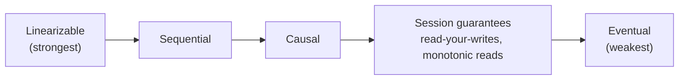
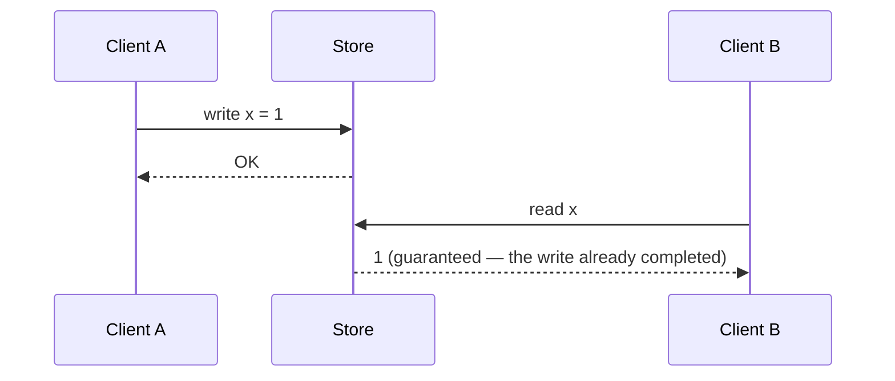

"Consistent" is one of the most overloaded words in software. A **consistency model** is a precise contract between a data store and its clients: *given the writes that have happened, which values may a read return?* Stronger models are easier to program against; weaker models are faster and more available.

This lesson walks the spectrum from strongest to weakest and shows where each model is used in practice.



Moving right: lower latency, higher availability, more anomalies the application must tolerate.

## Linearizability (strong consistency)

The system behaves as if there is **a single copy of the data** and every operation takes effect atomically at some instant between its start and end. Once a write completes, every subsequent read — from any client, on any replica — returns that value or a newer one.



**Where you need it:**

- **Leader election and locks** — two nodes must never both believe they hold the lock.
- **Uniqueness constraints** — two users must not register the same username.
- **Financial balances and inventory** at the moment of commitment.

**How it's achieved:** a single leader that serves reads and writes, or consensus protocols (Raft, Paxos) used by etcd, ZooKeeper, Spanner and CockroachDB. Google Spanner goes further with **TrueTime** — GPS- and atomic-clock-backed time bounds — to provide globally linearizable transactions.

**Cost:** every operation requires coordination. Across regions, that's 50–200 ms per write. And per CAP, a linearizable system must refuse requests on the minority side of a partition.

## Sequential consistency

All clients see all operations in **the same order**, and each client's own operations appear in the order it issued them — but that order need not match real time. A write that completed may not be visible to another client immediately, as long as everyone agrees on the eventual order.

It's mainly of theoretical and hardware interest (CPU memory models), but helps clarify that "everyone agrees on the order" and "the order matches wall-clock time" are separate guarantees.

## Causal consistency

Operations that are **causally related** are seen by everyone in the same order; **concurrent** (unrelated) operations may be seen in different orders.

Causality means "could have influenced". If Alice posts a question and Bob, having read it, posts an answer, the answer is causally dependent on the question. No one should ever see Bob's answer without Alice's question.

```text
Alice:  "Is the office open on Monday?"     (write 1)
Bob:    reads write 1, replies "Yes, 9–5."  (write 2, depends on write 1)

Allowed:     Carol sees [1], then [1, 2]
Not allowed: Carol sees [2] without [1]
```

Causal consistency (more precisely, *real-time causal* consistency) has been shown to be the **strongest model that can remain available during partitions** (Mahajan, Alvisi and Dahlin, 2011), which makes it attractive for geo-distributed systems. It's implemented by tracking dependencies with version vectors or similar metadata (e.g., MongoDB causal sessions, COPS, some CRDT-based systems).

## Session guarantees (client-centric models)

These are practical guarantees scoped to **a single client's session**. They're cheap to provide and fix the most visible anomalies of eventual consistency.

| Guarantee | Promise | Anomaly it prevents |
| --- | --- | --- |
| **Read-your-writes** | A client always sees its own writes | User edits profile, refreshes, sees old version |
| **Monotonic reads** | A client never sees data go back in time | A comment appears, then disappears on refresh |
| **Monotonic writes** | A client's writes are applied in the order issued | "Delete draft" applied before "create draft" |
| **Writes-follow-reads** | A write is ordered after the reads it was based on | A reply stored before the message it replies to |

Typical implementations:

- Route a user's requests to the **same replica** (sticky routing by user ID).
- Read from the **leader** for a short window after the user writes.
- Have the client carry a **version token** (last-seen log position) and only accept reads from replicas that have reached it.

<Callout type="tip">
Session guarantees give most of the user-visible benefit of strong consistency at a fraction of the cost. In interviews, "eventual consistency overall, with read-your-writes for the author" is a very common and well-regarded answer for feeds, profiles and comments.
</Callout>

## Eventual consistency

If no new writes are made to a key, **eventually all replicas converge** to the same value. That's all it promises: nothing about *when*, and nothing about what reads return in the meantime.

Despite how weak that sounds, eventual consistency underpins DNS, CDNs, caches, Cassandra and DynamoDB defaults, and most social features. In practice, convergence usually takes milliseconds.

Eventual consistency raises a key question: **when replicas disagree, which value wins?**

- **Last-write-wins (LWW)** — keep the value with the latest timestamp. Simple, but silently drops concurrent writes, and clock skew can pick the wrong one.
- **Version vectors** — detect that two writes were concurrent (neither saw the other) and keep both as *siblings* for the application to merge.
- **CRDTs** — data types designed so concurrent updates always merge deterministically (e.g., grow-only counters, observed-remove sets).

## Quorums and tunable consistency

Leaderless stores let you choose consistency per request using quorums. With **N** replicas, a write waits for **W** acknowledgements and a read queries **R** replicas.

```text
W + R > N   → read and write sets overlap → reads usually see the latest write
W + R ≤ N   → faster, more available, but reads may be stale
```

| Cassandra consistency level | Behaviour |
| --- | --- |
| `ONE` | Fastest, most available, may return stale data |
| `QUORUM` | Majority of replicas across all datacenters |
| `LOCAL_QUORUM` | Majority within the local datacenter — common for multi-region setups |
| `ALL` | Every replica must respond — strongest, but fails if any replica is down |

<Callout type="warning">
Quorum reads and writes are **not** automatically linearizable. Concurrent writes resolved by LWW, partially failed writes, and sloppy quorums can all violate it. For true linearizability on a key, systems use consensus or compare-and-set (e.g., Cassandra lightweight transactions via Paxos).
</Callout>


<QuorumSim />

## Comparing the models

| Model | Guarantee | Available during partition? | Latency | Example uses |
| --- | --- | --- | --- | --- |
| Linearizable | Real-time single-copy behaviour | No | Highest | Locks, leader election, unique constraints, balances |
| Sequential | Global agreed order | No | High | Mostly theoretical / hardware |
| Causal | Cause-before-effect for everyone | Yes (with sticky clients) | Medium | Comments, messaging, collaborative apps |
| Session guarantees | Per-client sanity | Yes (with stickiness) | Low | Profiles, settings, posts by the author |
| Eventual | Converges eventually | Yes | Lowest | Counters, feeds, caches, DNS, analytics |

## Choosing for a design

1. **Identify invariants that must never break**: no double booking, no negative balance, one leader. Those operations need linearizability (or a transaction in a single strongly consistent store).
2. **Identify user-visible anomalies that would feel broken**: not seeing your own post. Add session guarantees for those.
3. **Everything else** — counts, feeds, recommendations, analytics — can usually be eventually consistent.

<Callout type="example">
A ticketing system can show **seat availability** with eventual consistency (a few seconds stale is fine; the map is a hint), but the **seat reservation** itself must be a linearizable operation — e.g., a conditional write `UPDATE seats SET holder = ? WHERE id = ? AND holder IS NULL` on a strongly consistent store. Users may occasionally see an "available" seat that fails at checkout; they never get double-booked.
</Callout>

## Interview questions

<QA q="What's the difference between linearizability and serializability?">
Linearizability is a recency guarantee on single objects (registers/keys): every operation appears to take effect instantaneously at a point between its start and end, consistent with real time. Serializability is an isolation guarantee on transactions (groups of operations on multiple objects): the outcome equals some serial order of the transactions, but that order need not match real time. "Strict serializability" combines both — what Spanner provides.
</QA>

<QA q="How would you implement read-your-writes in a system that reads from replicas?">
Options: (1) for data the user owns (their profile, settings), always read from the leader; (2) after a user writes, route their reads to the leader for a short period such as 10–60 seconds; (3) record the replication log position or timestamp of the user's last write, send it with subsequent reads, and serve them only from replicas that have caught up to that position — falling back to the leader otherwise. Also ensure caches are updated or invalidated on write.
</QA>

<QA q="Why is causal consistency considered a sweet spot?">
It's the strongest consistency model that can remain available during network partitions, so you get meaningful ordering guarantees — replies never appear before the messages they answer — without paying linearizability's coordination cost or losing availability. Its cost is tracking causal dependencies (metadata such as version vectors), which adds complexity.
</QA>

<QA q="With N=3, how would you configure W and R for a read-heavy workload that still wants recent reads?">
Choose W=3 and R=1 if writes are rare and you can tolerate write failures when any replica is down — reads then hit just one replica and still overlap with every write. More commonly, W=2 and R=2 offers a balance with tolerance for one failed node on both paths. If availability of writes matters more, use W=2, R=2 with LOCAL_QUORUM in multi-region setups. Always mention the availability trade-off of high W or R.
</QA>

## Practice

Write your answer before opening the suggested one. Anything you mark "Partly" or "Missed it" comes back in your review deck.

<Practice task="A user updates their profile name and is immediately redirected to their profile page, which still shows the old name. Which guarantee is missing, and how do you provide it without making every read strongly consistent?">

Read-your-writes (a session guarantee) is missing: the write went to the leader, but the read went to a replica that had not caught up yet.

Ways to provide it:
1. After a user writes, route that user's reads to the leader for a short period (for example, the next 10 seconds), tracked with a cookie or the session.
2. Return a version or log position with the write; reads include it, and the replica waits until it has applied that position (or the read goes to the leader).
3. Update the client's own view optimistically.

Other users' reads can still go to replicas; only the writer needs the stronger guarantee.

</Practice>

<Practice task="In a comment thread, someone sees a reply before the comment it answers. Which consistency model prevents this, and what does it cost compared with linearizability?">

Causal consistency: if one write could have influenced another (the reply was written after reading the comment), everyone sees them in that order. Unrelated writes may still appear in different orders to different people.

To implement it, writes carry their dependencies (for example vector clocks or a 'depends on comment X' reference), and a replica shows a write only after its dependencies are visible.

Cost: much cheaper than linearizability. It needs no global ordering and no coordination on every write, so it stays available during partitions and works well across regions. Linearizability would require every write to be agreed on globally, which adds latency.

</Practice>

<Takeaways>

- A consistency model defines which values a read is allowed to return.
- Linearizability gives single-copy, real-time behaviour — needed for locks, uniqueness and balances — at the cost of latency and availability.
- Causal consistency preserves cause-and-effect and stays available during partitions.
- Session guarantees (read-your-writes, monotonic reads) fix the most visible anomalies cheaply.
- Eventual consistency only promises convergence; pair it with a conflict-resolution strategy.
- Choose per operation: strong for invariants, session guarantees for user experience, eventual for the rest.

</Takeaways>

## Further reading

- Herlihy and Wing, "Linearizability: A Correctness Condition for Concurrent Objects" (TOPLAS, 1990).
- Terry et al., "Session Guarantees for Weakly Consistent Replicated Data" (PDIS 1994).
- Mahajan, Alvisi and Dahlin, "Consistency, Availability, and Convergence" (UT Austin TR, 2011).
- [Jepsen — Consistency Models](https://jepsen.io/consistency) — an interactive map of models and how they relate.
- Martin Kleppmann, *Designing Data-Intensive Applications* — ch. 9, "Consistency and Consensus".
- Related: [Time, Clocks & Ordering](/system-design/hld/time-and-ordering), [Transactions, Isolation & MVCC](/system-design/hld/transactions-and-isolation).
