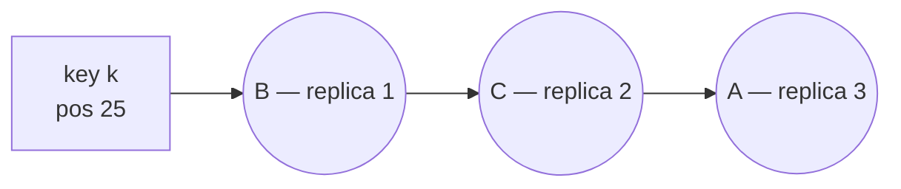

Whenever you distribute keys across a changing set of servers — cache nodes, database shards, WebSocket servers — you need a mapping from key to server. **Consistent hashing** is a mapping that stays mostly stable when servers are added or removed. It's a building block of Cassandra, DynamoDB, Riak, many CDNs, and distributed caches.

## The problem with modulo hashing

The obvious approach is:

```text
server = hash(key) mod N
```

It distributes keys evenly — until N changes. Suppose you have 4 cache servers and add a fifth:

| Key | hash(key) | mod 4 | mod 5 | Moved? |
| --- | --- | --- | --- | --- |
| user:1 | 18 | 2 | 3 | yes |
| user:2 | 25 | 1 | 0 | yes |
| user:3 | 40 | 0 | 0 | no |
| user:4 | 33 | 1 | 3 | yes |
| user:5 | 47 | 3 | 2 | yes |

Going from N to N+1 servers, a key stays put only if `hash mod N` happens to equal `hash mod (N+1)`, which is true for roughly 1 in N+1 keys. So about **N/(N+1)** of all keys move — 80% going from 4 to 5 servers, and over 99% going from 100 to 101. For a cache, that means a near-total cache miss storm: the database suddenly receives almost all the traffic the cache was absorbing, which can take it down. For a database, it means moving nearly all the data.

We want: **when a server is added or removed, only about 1/N of the keys move.**

## The hash ring

Consistent hashing maps both **servers** and **keys** onto the same circular hash space — for example, 0 to 2^32 − 1, wrapped into a ring.

1. Hash each server's identifier (e.g., its IP) to place it on the ring.
2. Hash each key to place it on the ring.
3. A key belongs to the **first server found moving clockwise** from the key's position.

<HashRing
  servers={[{ id: 'A', pos: 10 }, { id: 'B', pos: 40 }, { id: 'C', pos: 80 }]}
  keys={[{ id: 'k1', pos: 25 }, { id: 'k2', pos: 55 }, { id: 'k3', pos: 70 }, { id: 'k4', pos: 95 }]}
  caption="Three servers on a 0–100 ring. Each key is owned by the next server clockwise."
/>

Here k1 → B, k2 → C, k3 → C, k4 → A (wrapping around the ring).

### Adding a server

<HashRing
  servers={[{ id: 'A', pos: 10 }, { id: 'B', pos: 40 }, { id: 'D', pos: 60, added: true }, { id: 'C', pos: 80 }]}
  keys={[{ id: 'k1', pos: 25 }, { id: 'k2', pos: 55 }, { id: 'k3', pos: 70 }, { id: 'k4', pos: 95 }]}
  caption="Server D joins at position 60 and takes over only k2. Every other key stays put."
/>

Add server D at position 60. Only keys between B (40) and D (60) move — from C to D. That's k2. Every other key stays put.

### Removing a server

Remove server B. Only B's keys (between A and B) move to the next server clockwise, C. Every other key stays put.

On average, adding or removing one of N servers moves only **~1/N** of the keys.

## The problem: uneven distribution

With only a few servers placed at random positions, the arcs between them are uneven. One server might own 50% of the ring and another 10%. And when a server leaves, its *entire* load lands on a single neighbour, which may then overload and fail too — a cascading failure.

## Virtual nodes

The fix is to place each physical server on the ring **many times**, at different positions, as **virtual nodes** (vnodes).

```text
Server A → hash("A#1"), hash("A#2"), …, hash("A#150")
Server B → hash("B#1"), hash("B#2"), …, hash("B#150")
Server C → hash("C#1"), hash("C#2"), …, hash("C#150")
```

With 100–200 virtual nodes per server:

- **Even distribution** — many small arcs average out; each server owns close to 1/N of the ring.
- **Spread-out failover** — when a server leaves, its many small arcs are absorbed by *many different* servers, not one neighbour.
- **Heterogeneous capacity** — give a more powerful server more virtual nodes (weighting).

How many is enough? A widely cited simulation (Tom White, 2007) found the standard deviation of load per server was roughly **10% of the mean with 100 virtual nodes** and about **5% with 200** — more vnodes, smoother balance, slightly more metadata.

The cost is a larger ring structure to store and search — trivial in practice (a few thousand entries in a sorted array, looked up by binary search).

### Finding the keys that must move

When membership changes, only one arc of the ring is affected:

- **Server added at position S:** walk **anticlockwise** from S to the previous server P. Keys in (P, S] used to belong to S's successor and now move to S.
- **Server S removed:** keys in (P, S] — from the previous server up to S — move to S's successor clockwise.

With virtual nodes, this happens for each of the server's vnodes, so the moved data comes from (or goes to) many different servers in small slices.


<HashRingSim />

## Implementation sketch

```js
class ConsistentHashRing {
  constructor(vnodes = 150) {
    this.vnodes = vnodes;
    this.ring = [];          // sorted array of { pos, server }
  }

  addServer(server) {
    for (let i = 0; i < this.vnodes; i++) {
      this.ring.push({ pos: hash(`${server}#${i}`), server });
    }
    this.ring.sort((a, b) => a.pos - b.pos);
  }

  removeServer(server) {
    this.ring = this.ring.filter((n) => n.server !== server);
  }

  getServer(key) {
    const h = hash(key);
    // binary search for the first node with pos >= h; wrap to 0 if none
    let lo = 0, hi = this.ring.length;
    while (lo < hi) {
      const mid = (lo + hi) >> 1;
      if (this.ring[mid].pos < h) lo = mid + 1; else hi = mid;
    }
    return this.ring[lo % this.ring.length].server;
  }
}
```

Lookup is **O(log V)** where V is the total number of virtual nodes. Use a fast, well-distributed non-cryptographic hash (MurmurHash3, xxHash).

## Replication on the ring

Consistent hashing extends naturally to replication: store each key on the first **N distinct physical servers** clockwise from its position. Skip virtual nodes belonging to a server already chosen, and in multi-datacenter setups, prefer servers in different racks or zones. This list is the key's **preference list** in Dynamo-style systems.



## Where it's used

| System | How |
| --- | --- |
| **Amazon Dynamo / DynamoDB** | Partitions data across storage nodes; preference lists for replication |
| **Apache Cassandra** | Token ring with vnodes (configurable `num_tokens`) |
| **Memcached clients (Ketama)** | Client-side mapping of keys to cache servers |
| **Load balancers** | Route requests for the same key to the same backend (e.g., Envoy's ring hash, Maglev) |
| **CDNs** | Choose which edge server within a PoP caches a given URL |
| **Discord** | Routes each guild to a specific process |

<Callout type="note" title="Where sources differ">
Some textbooks list "mitigates the hotspot-key problem" as a benefit of consistent hashing. It spreads **keys** evenly — so no server owns a disproportionate share of data — but a single very hot key (a celebrity's profile) still maps to exactly one server. Hot keys need replication, caching or key splitting regardless of the hashing scheme.
</Callout>

## Alternatives worth knowing

- **Rendezvous (highest random weight) hashing** — for each key, compute `hash(key, server)` for every server and pick the highest. Equally minimal disruption, no ring, perfect balance, but O(N) per lookup — fine for tens of servers.
- **Jump consistent hash** (Google) — a tiny, fast algorithm with excellent balance and no memory overhead, but servers can only be added or removed at the end (numbered buckets). Good for sharded storage with stable numbering.
- **Fixed partition slots** — e.g., Redis Cluster's 16,384 hash slots assigned to nodes. Not strictly consistent hashing, but achieves the same goal: moving slots, not remapping keys.
- **Maglev hashing** — Google's lookup-table-based approach used in its network load balancer; very fast lookups with near-perfect balance.

<Callout type="interview">
When you introduce sharding or a distributed cache in a design, say: "I'll use consistent hashing with virtual nodes so adding a cache node only remaps about 1/N of keys, avoiding a miss storm." If the interviewer digs in, explain the ring, clockwise lookup, and why virtual nodes are needed.
</Callout>

## Interview questions

<QA q="Why can't we just use hash(key) mod N for a distributed cache?">
Because when N changes — adding capacity or losing a node — nearly all keys map to a different node. For a cache, almost every lookup becomes a miss at once, sending the full load to the database (a "thundering herd" or miss storm) that it can't handle. Consistent hashing limits the remapping to roughly 1/N of keys.
</QA>

<QA q="What problems do virtual nodes solve?">
Three: (1) uneven load — with few physical nodes at random positions, arc sizes vary greatly; many vnodes per server average this out. (2) Failover hot spots — a departing server's load is spread across many servers instead of falling on a single clockwise neighbour. (3) Heterogeneity — servers with more capacity can be assigned more vnodes.
</QA>

<QA q="Consistent hashing gives even key distribution. Does it guarantee even load?">
No. It balances the *number of keys*, not their *traffic*. A single hot key (a viral item) still lands on one server. Mitigations include replicating hot keys to several nodes, caching them locally on clients, splitting them with suffixes, or algorithms like "consistent hashing with bounded loads", which cap each server's load and spill excess keys to the next server clockwise.
</QA>

<QA q="How does a client know the current state of the ring?">
Options: a coordination service (ZooKeeper/etcd) stores membership and notifies clients of changes; nodes gossip membership among themselves and clients learn it from any node (Cassandra); or a routing proxy holds the ring and clients just call the proxy. During changes, clients may briefly disagree on the ring — systems tolerate this via forwarding, retries, or hinted handoff.
</QA>

## Practice

Write your answer before opening the suggested one. Anything you mark "Partly" or "Missed it" comes back in your review deck.

<Practice task="You cache data on 10 servers using hash(key) % 10. You add an 11th server. Roughly what fraction of keys move, and what fraction would move with consistent hashing?">

With modulo hashing, a key stays only if `hash % 10 == hash % 11`, which is true for about 1 in 11 keys. So roughly 10/11 ≈ 91% of keys move — the cache is effectively emptied and the database is flooded with misses.

With consistent hashing, the new server takes over only the ranges just before its points on the ring, about 1/11 ≈ 9% of keys, all taken from the existing servers; every other key stays put.

With virtual nodes (each server owning many small ranges), that 9% is taken roughly evenly from all 10 servers instead of from one neighbour.

</Practice>

<Practice task="Your ring has 4 physical servers with one point each, and one server receives 45% of the traffic. Why, and how do you fix it?">

With one point per server, the arcs between points are random and can be very uneven, so one server can own almost half the ring. Hot keys can make it worse.

Fix: virtual nodes. Give each server many points (for example 100–200), placed at different hashes. Each server now owns many small arcs, and the total share evens out (the variation shrinks as the number of points grows). It also lets you give a bigger machine more virtual nodes so it takes a proportionally larger share.

If the imbalance comes from a few hot keys rather than the arcs, virtual nodes do not help; replicate or split those keys instead.

</Practice>

<Takeaways>

- hash mod N remaps almost every key when N changes; consistent hashing remaps only ~1/N.
- Servers and keys share one hash ring; each key belongs to the next server clockwise.
- Virtual nodes give even distribution, spread out failover load, and support weighted capacity.
- Replication extends naturally: store a key on the next N distinct servers clockwise.
- Consistent hashing balances keys, not traffic — hot keys still need separate handling.

</Takeaways>

## Further reading

- Karger et al., "Consistent Hashing and Random Trees" (STOC 1997) — the original paper.
- DeCandia et al., "Dynamo" (SOSP 2007), §4.2 — virtual nodes and preference lists in production.
- Lamping and Veach, "A Fast, Minimal Memory, Consistent Hash Algorithm" (2014) — jump consistent hash.
- Mirrokni, Thorup and Zadimoghaddam, "Consistent Hashing with Bounded Loads" (SODA 2018).
- Related case study: [Design a Distributed Key-Value Store](/system-design/hld/design-key-value-store).
