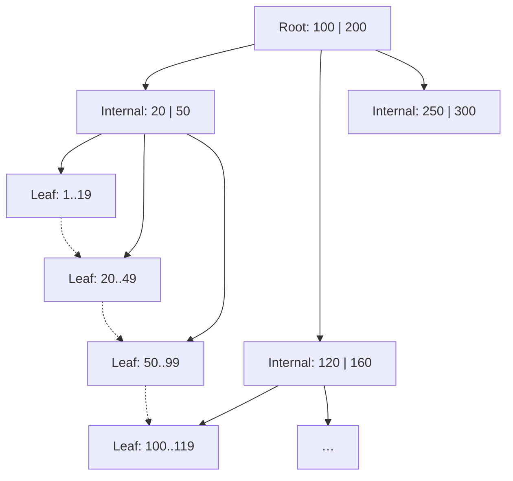
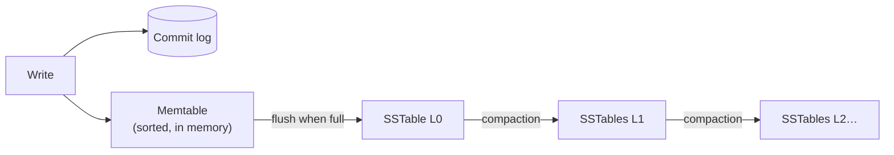

Without an index, finding a row means scanning the whole table — fine for 1,000 rows, catastrophic for a billion. An **index** is an additional data structure that lets the database find rows by some column(s) without scanning everything, the same way a book's index lets you jump to a page.

Indexes are central to performance, and understanding *how* they're built — B-Trees vs LSM-Trees — explains why some databases are better at reads and others at writes.

## The fundamental trade-off

Every index speeds up reads on the indexed columns and **slows down writes**, because each insert, update or delete must also update every index on that table. Indexes also consume disk and memory.

| Without index | With index |
| --- | --- |
| Read by column: O(n) full scan | O(log n) lookup |
| Write: update the table only | Update table + every index |
| No extra storage | Extra storage per index |

<Callout type="interview">
When you propose an index in an interview, mention its cost: "I'll add an index on `(user_id, created_at)` to serve the timeline query. It adds write overhead on every insert, but this table is read-heavy so that's a good trade."
</Callout>

## B-Tree indexes

The **B-Tree** (in practice, B+Tree) is the default index structure in nearly every relational database (PostgreSQL, MySQL InnoDB, SQL Server, Oracle).



How it works:

- Data is organised in fixed-size **pages** (typically 4–16 KB), the unit of disk I/O.
- Each internal page holds keys and pointers to child pages. With hundreds of keys per page (high **fan-out**), the tree stays very shallow: a 4-level tree can index billions of rows.
- **Leaf pages** hold the keys plus either the row itself (clustered index) or a pointer to it. Leaves are linked, making **range scans** efficient.
- Lookups traverse root → leaf: ~3–4 page reads, and upper levels are almost always cached in memory.
- Updates are done **in place**: find the page, modify it, and split it if it overflows. A **write-ahead log (WAL)** records changes first for crash safety.

**Strengths:** fast, predictable reads; excellent for range queries; mature.
**Weakness:** writes are random I/O (modifying pages scattered across the disk), and each write may touch several pages (data + indexes + WAL) — called **write amplification**.

## LSM-Tree storage

The **Log-Structured Merge-Tree** is designed for write-heavy workloads. It powers Cassandra, ScyllaDB, RocksDB, LevelDB, HBase and Bigtable.



How it works:

1. A write is appended to a **commit log** (sequential, for durability) and inserted into an in-memory sorted structure, the **memtable**.
2. When the memtable fills up, it's flushed to disk as an immutable, sorted file — an **SSTable** (Sorted String Table). This is a sequential write.
3. Over time many SSTables accumulate. Background **compaction** merges them, discarding overwritten and deleted values (deletes are written as **tombstones**).
4. A read checks the memtable, then SSTables from newest to oldest. **Bloom filters** (a compact probabilistic structure) let the engine skip SSTables that definitely don't contain the key.

**Strengths:** very high write throughput (all disk writes are sequential); good compression; efficient on SSDs.
**Weaknesses:** reads may check several files (**read amplification**); compaction consumes background I/O and CPU and can cause latency spikes; tombstones can slow reads if they pile up.

## B-Tree vs LSM-Tree

| | B-Tree | LSM-Tree |
| --- | --- | --- |
| Write pattern | Random, in-place updates | Sequential appends |
| Write throughput | Good | Excellent |
| Read latency | Predictable, low | Higher, varies with number of SSTables |
| Range scans | Excellent | Good (merge across files) |
| Space usage | Some fragmentation | Better compression; temporary space for compaction |
| Background work | Page splits, vacuum (Postgres) | Compaction |
| Typical systems | PostgreSQL, MySQL, Oracle, SQL Server | Cassandra, RocksDB, HBase, ScyllaDB, Bigtable |
| Best for | Read-heavy, transactional workloads | Write-heavy: logs, metrics, messaging, time series |

## Types of indexes

### Primary and clustered indexes

- A **clustered index** determines the physical order of rows on disk; the table *is* the index. In MySQL InnoDB, the primary key is always clustered. A table can have only one.
- A **non-clustered (secondary) index** is a separate structure that stores the indexed column(s) plus a pointer to the row (in InnoDB, the primary key; in PostgreSQL, a physical row location).

A consequence: in InnoDB, a secondary index lookup costs two B-Tree traversals (secondary index → primary key → row). Choosing a compact, monotonically increasing primary key keeps this fast and avoids page splits on insert — which is one reason random UUIDv4 primary keys can hurt insert performance, and why time-ordered IDs (UUIDv7, Snowflake IDs) are popular.

### Composite indexes and the leftmost-prefix rule

An index on `(country, city, created_at)` is sorted by country, then city, then created_at. It can serve:

```sql
WHERE country = 'IN'                                        -- ✓ uses index
WHERE country = 'IN' AND city = 'Pune'                      -- ✓
WHERE country = 'IN' AND city = 'Pune' AND created_at > X   -- ✓ range on last column
WHERE city = 'Pune'                                         -- ✗ skips leading column
WHERE country = 'IN' AND created_at > X                     -- partial: uses country only
```

**Column order rule of thumb:** equality conditions first, then the range or sort column last.

### Covering indexes

If an index contains every column the query needs, the database answers from the index alone without visiting the table — an **index-only scan**.

```sql
-- index on (user_id, created_at) INCLUDE (title)
SELECT title, created_at FROM posts
WHERE user_id = 42 ORDER BY created_at DESC LIMIT 20;
```

### Other specialised indexes

| Index | Use |
| --- | --- |
| **Hash index** | Exact-match lookups only; no ranges. (Redis and in-memory KV stores are essentially giant hash indexes.) |
| **Inverted index** | Full-text search: maps each word → list of documents containing it (Elasticsearch, PostgreSQL GIN). |
| **Geospatial index** | R-Trees, geohashes, quadtrees for "find points near X" (PostGIS, Redis GEO). |
| **Bitmap index** | Low-cardinality columns in analytics (e.g., status, gender). |
| **Partial index** | Index only rows matching a condition, e.g., `WHERE status = 'PENDING'`. Small and fast. |

## Indexes in distributed databases

When data is sharded, secondary indexes get harder:

- **Local (document-partitioned) index** — each shard indexes only its own data. Writes are cheap (one shard), but a query by the secondary column must ask **every shard** (scatter-gather). Used by MongoDB, Cassandra secondary indexes, Elasticsearch.
- **Global (term-partitioned) index** — the index itself is partitioned by the indexed value. Reads by that value go to one index shard, but a single write may need to update index shards on other nodes — often asynchronously, so the index is eventually consistent. Used by DynamoDB global secondary indexes.

<Callout type="tip">
In wide-column stores, the idiomatic alternative to a secondary index is a **second denormalised table** keyed by the column you want to query (e.g., `users_by_email`). You write to both tables on every update.
</Callout>

## Common mistakes

<Callout type="warning">

- **Indexing every column.** Each index slows writes and consumes memory. Index for real query patterns.
- **Wrong column order** in composite indexes, so queries can't use them.
- **Functions on indexed columns** — `WHERE LOWER(email) = ?` can't use a plain index on `email` (use an expression index instead).
- **Low-selectivity indexes** — an index on a boolean column rarely helps; the planner will scan anyway.
- **Forgetting `OFFSET` cost** — `OFFSET 100000` still reads and discards 100,000 rows. Use keyset/cursor pagination: `WHERE created_at < :last_seen ORDER BY created_at DESC LIMIT 20`.

</Callout>

## Interview questions

<QA q="Why are LSM-Trees faster for writes than B-Trees?">
LSM-Trees turn random writes into sequential ones. A write goes to an in-memory memtable and a sequential commit log; memtables are flushed as whole sorted files, and compaction later merges files sequentially. B-Trees update pages in place, which means random I/O to wherever the page lives, plus possible page splits and WAL writes. Sequential I/O is much faster than random I/O, especially on HDDs and still meaningfully on SSDs.
</QA>

<QA q="A query on a 500M-row table is slow even though there's an index on the filtered column. What could be wrong?">
Possibilities: (1) the query applies a function or type cast to the column, preventing index use; (2) the index's column order doesn't match (leftmost-prefix rule); (3) low selectivity — the filter matches a large fraction of rows, so the planner chooses a full scan; (4) the query needs columns not in the index, causing millions of random row lookups — consider a covering index; (5) stale statistics mislead the planner; (6) deep OFFSET pagination. Use EXPLAIN ANALYZE to see the actual plan.
</QA>

<QA q="What is a Bloom filter and why do LSM-based databases use it?">
A Bloom filter is a compact bit array with several hash functions that answers "is this key possibly in the set?" with no false negatives and a tunable false-positive rate. Each SSTable has one. Before reading an SSTable from disk, the engine checks its Bloom filter — if the answer is "definitely not here", the disk read is skipped. This dramatically reduces read amplification for point lookups.
</QA>

<QA q="Why might random UUIDs as primary keys hurt performance?">
In a clustered B-Tree (e.g., InnoDB), rows are stored in primary-key order. Random UUIDs insert at random positions, causing page splits, fragmentation, poor cache locality and more I/O. They're also 16 bytes, which enlarges every secondary index that stores the PK. Time-ordered identifiers (auto-increment, UUIDv7, Snowflake IDs) append to the end of the tree and keep hot pages in memory.
</QA>

<Takeaways>

- Indexes trade write speed and storage for read speed — index for actual query patterns.
- B-Trees update in place: great for reads and ranges, the default in relational databases.
- LSM-Trees append and compact: great for write-heavy workloads, at the cost of read and compaction overhead.
- Composite index column order matters: equality columns first, range/sort column last.
- In sharded systems, local indexes need scatter-gather reads; global indexes need cross-shard (often async) writes.

</Takeaways>

## Further reading

- Martin Kleppmann, *Designing Data-Intensive Applications* — ch. 3, "Storage and Retrieval".
- O'Neil, Cheng, Gawlick and O'Neil, "The Log-Structured Merge-Tree (LSM-Tree)" (Acta Informatica, 1996).
- Markus Winand, [Use The Index, Luke!](https://use-the-index-luke.com) — SQL indexing explained for developers.
- Burton Bloom, "Space/Time Trade-offs in Hash Coding with Allowable Errors" (CACM, 1970).
- Related: [Transactions, Isolation & MVCC](/system-design/hld/transactions-and-isolation), [Probabilistic Data Structures](/system-design/hld/probabilistic-data-structures).
