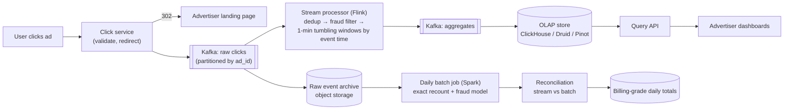
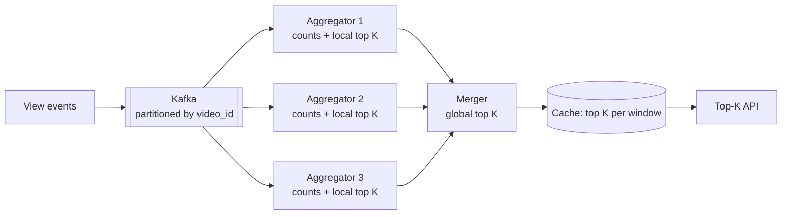

<Related ids={['batch-and-stream-processing', 'message-queues', 'probabilistic-data-structures', 'sharding', 'sql-vs-nosql', 'availability-and-fault-tolerance', 'time-and-ordering']} />

Design a system that records ad clicks and serves aggregated metrics — clicks per ad per minute, filtered by country, device or campaign — to advertisers' dashboards and to the billing system. Billions of clicks per day, results within about a minute, and because advertisers **pay per click**, the counts must be correct: no double counting, no lost clicks, and fraud filtered out.

## 1. Clarify the problem

| Question | Assumption |
| --- | --- |
| Inputs? | Click events: click_id, ad_id, campaign_id, user/device, IP, country, timestamp |
| Queries? | Clicks per ad/campaign over time ranges, at minute granularity, with filters (country, device) |
| Freshness? | Dashboards within ~1 minute; billing numbers finalised daily |
| Scale? | 10B clicks/day; peak 300K clicks/s; 10M active ads |
| Correctness? | Exactly-once counting; fraud/bot filtering; auditable |
| Also? | Redirect the user to the advertiser's landing page quickly |

## 2. Requirements

**Functional:** record clicks and redirect users; aggregate counts per ad per minute with dimensions; query aggregates over time ranges; top-N ads per campaign/time window.

**Non-functional:** fast redirect (click path latency under ~50 ms); aggregation latency about a minute; correctness (exactly-once, late events handled); fault tolerance with replay; scalability to 300K events/s.

## 3. Capacity estimation

```text
Clicks: 10B/day ≈ 115K/s average, 300K/s peak
Raw event ~200 B → 2 TB/day raw (compressed far less); retain raw events for replay/audit (e.g., 1 year in object storage)

Aggregates: 10M ads × 1,440 minutes = 14.4B ad-minute buckets/day if every ad clicked every minute
In practice most ads are sparse; with dimensions (country × device) multiply by active combinations
→ store only non-zero buckets; roll up to hourly/daily for older data
```

**So:** a classic streaming aggregation problem: Kafka for ingestion, a stateful stream processor for minute windows, an OLAP store for queries, and raw events retained for reprocessing and reconciliation.

## 4. API

```text
Click path:
  GET /click?ad=…&imp=<impression_id>&sig=<signature>
  → 302 Location: <advertiser landing URL>     (event recorded asynchronously)

Query API:
  GET /v1/ads/{adId}/clicks?from=…&to=…&granularity=minute&filter=country:IN
  → { buckets: [{ ts, count }, …] }
  GET /v1/campaigns/{id}/top-ads?window=1h&n=10
```

Click URLs are **signed** (HMAC over ad ID and impression ID) so they can't be forged, and the impression ID ties a click to a served ad (used for dedup and fraud detection).

## 5. Data model

```text
Raw click event (Kafka → object storage; kept for reprocessing and audits)
  click_id, impression_id, ad_id, campaign_id, event_ts, device_id, ip, country, user_agent

Minute aggregates (OLAP store such as Pinot, Druid or ClickHouse)
  ad_id, minute_bucket, country, platform → clicks, valid_clicks
  sort key: (ad_id, minute_bucket)

Rollups: hourly and daily rows computed from minute rows; minute rows expire after 30–90 days
Dedup state (inside the stream processor): impression IDs seen in the last few minutes
```

Every query filters by an ad or campaign and a time range, so ordering the aggregates by `(ad_id, minute_bucket)` turns each query into one contiguous scan. Raw events are kept separately because aggregates can't be corrected after the fact: when a bug or a new fraud rule changes what counts as a valid click, the totals are recomputed from the raw events.

## 6. High-level design

<FlowSteps title='A click, from redirect to bill' steps={[
  { path: ['U', 'CS', 'LP'], text: 'The click service checks the signed click URL and redirects the user (302) straight away.' },
  { path: ['CS', 'K'], text: 'In parallel it writes the click event to Kafka, partitioned by ad ID.' },
  { path: ['K', 'FL'], text: 'Flink drops duplicate click IDs, filters obvious fraud and counts clicks per ad per minute by event time.' },
  { path: ['FL', 'K2', 'OLAP', 'QAPI', 'DASH'], text: 'Minute aggregates are upserted into the OLAP store, which serves the advertiser dashboards.' },
  { path: ['K', 'RAW'], text: 'Every raw click is also archived in object storage.' },
  { path: ['RAW', 'BATCH', 'RECON', 'BILL'], text: 'A daily batch job recounts from the archive; reconciliation with the streamed counts produces billing-grade totals.' },
]}>



</FlowSteps>

## 7. Deep dives

### Ingestion and the click path

The click service does minimal work: validate the signature, produce the event to Kafka (asynchronously with a local buffer, or synchronously with `acks=all` if loss is unacceptable), and return the redirect. Kafka is partitioned by `ad_id` so all clicks for an ad go to the same partition — the stream processor can aggregate per ad without a cross-partition shuffle. Hot ads (a viral campaign) can skew partitions; mitigate with a composite key (`ad_id` + small random salt) and a second aggregation stage that merges salted partial counts.

### Aggregation by event time

- **Tumbling one-minute windows** keyed by `(ad_id, minute, country, device)`.
- Use **event time** (click timestamp), not processing time — mobile clicks can arrive late.
- **Watermarks** allow a bounded lateness (e.g., 2–5 minutes); late events beyond that are written to a side output and handled by the batch correction.
- Emit results when the watermark passes the window end; update the OLAP store by **upsert on (ad_id, minute, dims)** so re-emitted corrected results overwrite rather than double-add.

See [Batch & Stream Processing](/system-design/hld/batch-and-stream-processing).

### Exactly-once counting

Duplicates come from several sources: client retries, the click service retrying a Kafka produce, stream processor restarts.

- **Dedup by click ID** (or impression ID — one billable click per impression) in the stream processor: keep a keyed state of seen IDs for the dedup window (e.g., 1 hour), or a Bloom filter per window to cut memory with a tiny false-positive rate.
- **Idempotent producer** in Kafka to avoid producer-side duplicates.
- **Flink checkpoints** (state + Kafka offsets, captured atomically) give exactly-once state on recovery.
- **Idempotent sink**: writes keyed by `(ad_id, window, dims)` with overwrite semantics, or a transactional sink (Kafka transactions → two-phase-commit sink).

### Fraud and invalid traffic

Advertisers won't pay for bot clicks. Real-time rules in the stream (click rate per IP/device, clicks without a matching impression, impossible click-through intervals, known bad IP ranges) filter obvious fraud; a heavier ML model runs in the daily batch job. Dashboards may show "preliminary" numbers that are corrected after batch fraud detection.

### Serving queries

Store aggregates in a columnar **OLAP database** optimised for time-series aggregations and filters (ClickHouse, Druid, Pinot). Partition by time, order by ad/campaign. **Roll up** minute data to hourly and daily granularity after a few days to bound storage and speed up long-range queries. Top-N queries per campaign run directly on the OLAP store or are precomputed in the stream (heap of top ads per window).

### Reconciliation and billing

Streaming numbers are fast but can be slightly off (late data beyond the watermark, rare failures). For **billing**:

- A daily batch job recomputes exact counts from the immutable raw archive (with the full fraud model).
- Reconciliation compares batch vs streaming totals per ad; differences beyond a threshold trigger alerts, and the batch numbers become the billing source of truth.
- Because raw events are retained, any bug in aggregation logic can be fixed and **replayed** (Kappa-style).

## 8. Failure modes

| Failure | Mitigation |
| --- | --- |
| Stream processor crash | Restore from checkpoint; replay from committed Kafka offsets |
| Kafka broker failure | Replication factor 3, `acks=all`, min in-sync replicas 2 |
| Aggregation bug discovered | Fix and replay raw events from Kafka (long retention) or the archive |
| Hot ad partition | Salted keys + two-stage aggregation |
| OLAP store unavailable | Aggregates buffered in Kafka; dashboards degrade, billing unaffected |

## 9. Trade-offs summary

| Decision | Choice | Why |
| --- | --- | --- |
| Ingestion | Kafka, partitioned by ad_id | Durable, replayable, per-ad locality |
| Aggregation | Flink, event-time windows, watermarks | Correct minute buckets despite late data |
| Dedup | Click/impression ID in keyed state (Bloom filter optional) | Exactly-once counting |
| Serving | OLAP store with rollups | Fast filtered time-range queries |
| Billing correctness | Batch recount + reconciliation | Streaming for freshness, batch for truth |

## 10. What interviewers look for

- **Mid-level**: queue + aggregation workers + database for counts, query API.
- **Senior**: event-time windows and watermarks, dedup for exactly-once, partitioning and hot keys, OLAP store choice, raw event retention for replay.
- **Staff**: Lambda vs Kappa trade-offs, reconciliation for billing, fraud pipelines, storage rollups and cost, data correctness SLAs with advertisers.

## 11. Variations interviewers ask

### Top-K most viewed videos (YouTube trending)

"Show the 1,000 most viewed videos of the last hour, the last day and all time." The pipeline is the same (events → Kafka → stream aggregation → serving store). Two things are new: **ranking** among billions of keys, and **sliding windows**.



- **Partition by video ID.** Every view of a video lands on the same aggregator, so each aggregator holds the *complete* count for its videos. Each keeps a min-heap of its local top K. Because no video is split across partitions, merging the local top-K lists gives the **exact** global top K. If you partition randomly instead, a video's count is spread out, and merging local top lists is wrong.
- **Sliding windows.** Keep per-minute counts per video in a ring of buckets. "Last hour" is the sum of the last 60 buckets: add the new minute, subtract the one that fell out. Rebuild the top K from these sums every minute rather than maintaining one heap forever, because videos also drop out of the top as their views fade. A fixed window ("today") is simpler: one counter that resets.
- **Too many keys for exact counts?** With billions of long-tail videos, a **Count-Min Sketch** per window plus a small heap of heavy hitters gives an approximate top K in fixed memory. Its error only ever over-counts, which is fine for a trending page. Exact numbers for creator dashboards come from the batch path.
- **One viral video** makes its partition hot. Pre-aggregate on the producers (send "video 7: +250 views" every few seconds instead of 250 events) or split the key (`video7#0` … `video7#7`) and add the parts back together.
- **Serving** is easy: the answer is 1,000 IDs per window. The merger writes it to a cache every minute, and reads never touch the aggregators.

Interview hook: *"Exact top K needs one owner per key so local top-K lists merge correctly. When the key space is too big for that, Count-Min Sketch gives an approximate top K in fixed memory."*

## Interview questions

<QA q="Why aggregate by event time rather than processing time?">
Clicks can reach the system late — mobile devices offline, network delays, consumer lag after an outage. Aggregating by processing time puts those clicks into the wrong minute and makes results depend on system health rather than reality, and replays would produce different answers. Event-time windows with watermarks assign each click to the minute it actually happened and give the same results on replay.
</QA>

<QA q="How do you avoid counting the same click twice?">
Give each click (or impression) a unique ID and deduplicate in the stream processor using keyed state over a dedup window, or a Bloom filter for memory efficiency. Use Kafka's idempotent producer, Flink checkpoints that snapshot state and offsets together for exactly-once processing, and an idempotent or transactional sink keyed by window, so retries overwrite rather than add. A daily batch recount from raw events verifies the result.
</QA>

<QA q="A bug in the aggregation logic inflated counts for a day. How do you fix it?">
Because raw events are retained in Kafka (long retention) and the object-storage archive, deploy the fixed job and replay that day's events into a fresh output (or recompute with the batch job), then overwrite the affected aggregates in the OLAP store (idempotent upserts keyed by window) and correct the billing totals through reconciliation, notifying affected advertisers if invoices were issued.
</QA>

## Practice

Write your answer before opening the suggested one. Anything you mark "Partly" or "Missed it" comes back in your review deck.

<Practice task="Advertisers need click counts per ad per minute with a delay of no more than one minute, from 10 billion clicks a day. What streaming design and what storage do you use?">

10B ÷ 10^5 s ≈ 100K clicks/s average, peaks several times higher.

1. Click servers validate the click, attach a unique click ID and write it to Kafka, partitioned by ad ID.
2. A stream processor (Flink, Kafka Streams) aggregates per (ad, minute) in tumbling windows using event time with watermarks, so late events up to a limit still land in the right minute.
3. Results go to an OLAP store built for time-series aggregates (Druid, ClickHouse, Pinot), which answers 'clicks per minute for ad X' quickly.
4. Raw clicks also go to object storage for the batch reconciliation below.

Each window emits within seconds of closing, meeting the one-minute target.

</Practice>

<Practice task="Billing depends on these counts, so they must be exact even if a stream job crashes and replays. How do you avoid double-counting and missing clicks?">

1. Deduplicate by click ID: the stream job keeps recently seen click IDs in its state (or a short-TTL store) and drops repeats caused by client retries.
2. Make processing exactly-once within the pipeline: Flink checkpoints its state together with the Kafka offsets, and writes to the sink transactionally (or the sink upserts by (ad, minute), so a replay overwrites the same rows instead of adding to them).
3. Reconcile: a daily batch job recomputes counts from the raw clicks in object storage and compares them with the streamed results; differences are corrected before invoices are produced.

Streaming gives speed; the batch recomputation gives the final, auditable number.

</Practice>

<Takeaways>

- Keep the click path fast: validate, enqueue to Kafka, redirect.
- Aggregate with a stateful stream processor in event-time windows with watermarks; partition by ad and handle hot keys.
- Achieve exactly-once with dedup by click ID, checkpoints and idempotent sinks.
- Serve dashboards from an OLAP store with rollups.
- Retain raw events for replay, and reconcile streaming results with batch recounts for billing.

</Takeaways>

## Further reading

- Akidau et al., "The Dataflow Model" (VLDB 2015) — event time, windows, watermarks.
- Ananthanarayanan et al., "Photon: Fault-tolerant and Scalable Joining of Continuous Data Streams" (SIGMOD 2013) — Google's click/query join for ads.
- Apache Flink documentation — "Event Time and Watermarks" and "Fault Tolerance via State Snapshots".
- Alex Xu and Sahn Lam, *System Design Interview*, Vol. 2 (2022) — ch. "Ad Click Event Aggregation".
