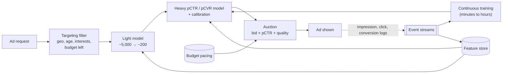

<Related ids={['ml-system-design-framework', 'design-recommendation-system', 'design-ad-click-aggregator', 'batch-and-stream-processing', 'probabilistic-data-structures']} />

Design the system that decides which ad to show in a slot of a social feed or search results page, by predicting how likely each candidate ad is to be clicked. This is the question Meta, Google and every ads company ask, because it combines everything hard about applied ML: extreme scale, very sparse features, rare positive labels, labels that arrive days late, and, unusually, **predictions that go straight into money calculations**.

That last point changes the design. In a feed, only the order of the scores matters. In ads, the predicted probability is multiplied by the advertiser's bid to run an auction, so a model that ranks well but overestimates every click probability by 30% overcharges advertisers and loses their trust. **Calibration** is a first-class requirement here.

Read [The ML System Design Interview](/system-design/hld/ml-system-design-framework) first.

## 1. Clarify the problem

| Question | Assumption |
| --- | --- |
| Surface | Sponsored posts in a social feed (one ad slot per ~5 organic posts) |
| Scale | 1B daily active users; ~100K ad requests/s at peak |
| Candidates | Millions of active ads; ~5,000 pass targeting for a given user |
| Latency | ~100 ms for the whole ad request; ~20 ms for scoring |
| Billing | Advertisers pay per click (CPC) or per conversion (CPA) |
| Business goal | Revenue now, without hurting user experience or advertiser return on spend |

## 2. Frame it as an ML problem

- **Task:** binary classification. For a (user, ad, context) triple, predict **pCTR = P(click | impression)**. For conversion-optimised campaigns, a second model predicts **pCVR = P(conversion | click)**.
- **How it's used:** each eligible ad gets an expected value per impression, and the auction picks the highest:

```text
expected value = bid_per_click × pCTR                 (CPC campaigns)
               = bid_per_conversion × pCTR × pCVR      (CPA campaigns)
ranking score  = expected value + quality / user-experience adjustment
```

The quality term penalises ads users tend to hide or report, so revenue isn't bought with a worse feed.

Because the expected value uses the probability itself, the model must be **calibrated**: across any large group of impressions, the average pCTR should match the observed click rate.

## 3. Metrics

**Offline**

- **Log loss**, or normalised cross-entropy (NE): log loss divided by the log loss of always predicting the average CTR. NE below 1 means the model beats the naive baseline; lower is better. Log loss rewards both ranking and calibration, which is why ads teams prefer it to AUC.
- **ROC-AUC** for ranking quality alone.
- **Calibration ratio:** sum of predicted clicks ÷ actual clicks, overall and per segment (country, placement, advertiser vertical). It should be close to 1.0 everywhere, not just on average.

**Online**

- Revenue per thousand impressions (RPM), CTR, advertiser conversions and return on ad spend.
- Guardrails: ad hide and report rates, user session time, latency.

<Callout type="warning" title="A/B testing ads is harder than it looks">
If the control and treatment groups compete for the same advertiser budgets, a model that spends budgets faster "steals" spend from the control group and looks better than it is. Ads experiments split **advertiser budgets** as well as users, so each arm spends only its own share.
</Callout>

## 4. Capacity estimation

```text
Ad requests: 100K/s at peak; ~5,000 candidates pass targeting each
→ scoring all 5,000 with the heavy model = 500M scorings/s: too much
→ a light model narrows to ~200 for the heavy model = 20M scorings/s

Training data: 1B users × ~30 ad impressions/day = 30B impressions/day
CTR ~1% → 300M clicks/day, 29.7B negatives
→ keep all clicks, sample ~1–5% of negatives
```

## 5. High-level design



1. **Targeting** keeps only ads whose advertiser rules match this user and that still have budget.
2. A **light model** (a small network or logistic regression) scores all ~5,000 cheaply and keeps the top ~200.
3. The **heavy model** predicts pCTR (and pCVR), followed by a **calibration** layer.
4. The **auction** ranks by expected value plus quality, applies reserve prices, and sets the price.
5. **Pacing** throttles campaigns so a daily budget lasts the whole day.
6. Impressions, clicks and conversions stream back into training and into real-time features.

## 6. Deep dives

### Features: sparse, huge and changing

| Group | Examples |
| --- | --- |
| User | Interest categories, ad clicks in the last 7 days by category, device, country, age bracket |
| Ad | Advertiser ID, campaign ID, creative text and image embeddings, ad format, historical CTR |
| Context | Placement (feed, stories, search), position, time of day, connection type |
| Cross | User's past clicks on this advertiser; similarity between user interests and the ad's embedding |

Most of these are **categorical with millions of values** (advertiser IDs, campaign IDs). Two standard techniques:

- **Embeddings** for each ID, learned during training, so similar advertisers end up close together.
- The **hashing trick:** hash each value into a fixed number of buckets (say 2^24) and learn a weight or embedding per bucket. Memory is fixed no matter how many new IDs appear; the cost is occasional collisions.

**Historical CTR features** need smoothing. An ad with 1 click in 2 impressions does not have a 50% CTR. Use a Bayesian estimate that starts from the category average: `(clicks + α) / (impressions + α + β)`, with α and β set from the prior.

**Feature crosses** ("user is in India" × "ad is for cricket gear") matter enormously in ads. Older systems engineered them by hand; models like DCN learn them explicitly.

### Model choice

1. **Logistic regression** with hashed features and crosses. Fast, calibrated by nature, easy to update online. Still a strong baseline.
2. **Gradient-boosted trees feeding logistic regression:** Facebook's 2014 paper used the leaf each tree lands in as a feature for logistic regression, a cheap way to get learned crosses.
3. **Deep models for sparse data** (DLRM, DCN-v2, wide-and-deep): embeddings for every categorical feature, explicit cross layers, an MLP on top. This is the modern standard at large ads companies.

A multi-task model predicting click and conversion together often helps the rarer conversion task.

### Imbalance and the sampling correction

With a 1% CTR, keeping every negative wastes most of the training compute. Keep all positives and a fraction **w** of negatives (say w = 0.05). The model then sees a click rate about 20 times too high, so its raw outputs are too high. Correct each prediction **p** with:

```text
q = p / (p + (1 − p) / w)
```

Example: the model outputs p = 0.17 with w = 0.05 → q = 0.17 / (0.17 + 0.83 / 0.05) = 0.17 / 16.77 ≈ 0.010, a 1.0% click probability.

### Calibration

Even after the correction, models drift out of calibration: new campaigns, holidays, a new placement. A calibration layer maps raw scores to probabilities that match observed rates:

- **Platt scaling** (a one-feature logistic regression on the score) or **isotonic regression** (a monotonic step function), fitted on recent data.
- Calibration is checked **per segment**, because an average of 1.0 can hide one placement at 0.7 and another at 1.3.

### Freshness: train continuously

Ads change constantly: campaigns start and stop daily, creatives are swapped, holidays shift behaviour. A model trained once a week loses accuracy every day. Large ads systems therefore train **continuously**: new labelled examples stream in, the model updates from the latest weights, and new versions are deployed every few hours or faster, each passing automated checks for log loss and calibration on the most recent data.

### Delayed conversions

A click is known within seconds. A purchase may come days later. If you label a click "no conversion" after an hour, many examples that will convert are recorded as negatives, and pCVR is systematically too low, so CPA campaigns under-bid.

Common answers:

- Wait for an **attribution window** (for example 1–7 days) before finalising conversion labels, accepting staler training data.
- Train on the data available now but **model the delay**: learn the distribution of time-to-conversion and treat recent "negatives" as partly unknown.
- Retrain recent examples as late conversions arrive, correcting earlier labels.

### The auction and pacing

- Most ad platforms use variants of a **generalised second-price** auction or its successors: the winner pays roughly the minimum needed to keep their position, not their full bid. This encourages advertisers to bid their true value.
- **Reserve prices** stop slots from selling for almost nothing.
- **Pacing** spreads a daily budget across the day. Without it, a campaign spends everything at 9 a.m. on whatever users are online then. Pacers throttle participation (enter only some auctions) or shade bids based on the spend rate so far.

### Invalid traffic

Bots and click farms produce clicks that never convert. They corrupt training labels as well as bills. Filter them using the same signals as the [ad click aggregator](/system-design/hld/design-ad-click-aggregator) (impression–click matching, rate limits per device, known bad IPs) **before** the events become training data.

## 7. Failure modes

| Failure | Mitigation |
| --- | --- |
| Model miscalibrated after a bad update | Automated calibration checks per segment before deploy; canary; rollback |
| Feature store unavailable | Fall back to the light model with cached features, or to a simpler model with ad-only features |
| Click logging delayed | Training waits rather than learning that "nothing was clicked"; alert on event volume |
| Budget overspend | Pacing reads near-real-time spend; hard caps enforced by the billing system |
| Invalid traffic spike | Filters before training and billing; refunds through reconciliation |

## 8. Trade-offs summary

| Decision | Choice | Why |
| --- | --- | --- |
| Objective | Calibrated pCTR (and pCVR) | Probabilities feed directly into the auction |
| Offline metric | Log loss / normalised cross-entropy, plus calibration | Rewards correct probabilities, not just order |
| Model | Sparse deep model (embeddings + crosses) | Handles millions of IDs and learns interactions |
| Imbalance | Negative downsampling with correction | Cuts training cost without biasing the output |
| Freshness | Continuous training | Campaigns and behaviour change daily |
| Conversions | Attribution window or delay modelling | Late conversions would otherwise look negative |
| Funnel | Targeting → light model → heavy model → auction | Heavy model only on a shortlist |

## 9. What interviewers look for

- **Mid-level:** binary classification framing, sensible features, logistic regression or a deep model, AUC and CTR.
- **Senior:** why calibration matters, log loss over AUC, negative sampling and its correction, hashing and embeddings for sparse IDs, continuous training, delayed conversions.
- **Staff:** the auction and pacing, budget-split experiments, the quality term balancing revenue against user experience, invalid traffic, and privacy limits on tracking conversions.

## Interview questions

<QA q="Why do ads systems care about calibration when a feed ranker mostly doesn't?">
A feed only sorts items, so any monotonic transformation of the scores gives the same order. An ad auction multiplies the predicted click probability by the bid to compare ads from different advertisers with different bids, and the price charged depends on it. If the model overestimates CTR for one category of ads, those ads win auctions they shouldn't and advertisers pay for value that isn't there. So the probability itself must match the real click rate, overall and per segment.
</QA>

<QA q="You downsample negatives to 5%. How do you get correct probabilities back?">
The model trains on a click rate roughly 20 times higher than reality, so its raw outputs are too high. Re-weight with q = p / (p + (1 − p) / w), where w is the fraction of negatives kept (0.05). This exactly undoes the change in the base rate. Then check calibration on unsampled recent data and fit a final calibration layer, such as isotonic regression, if segments still drift.
</QA>

<QA q="Why is AUC not enough to compare two CTR models?">
AUC only measures how well the model orders clicks above non-clicks. Two models with identical AUC can produce very different probabilities: one could predict 2% where the truth is 1%. In an auction, that error changes which ad wins and what the advertiser pays. Log loss, or normalised cross-entropy, penalises badly calibrated probabilities as well as poor ordering, so it is the primary offline metric, with per-segment calibration checks alongside.
</QA>

<QA q="How do you handle conversions that happen days after the click?">
If labels are fixed too early, conversions that haven't happened yet are recorded as negatives and the conversion model learns rates that are too low. Options: wait for an attribution window before using examples for training, which costs freshness; model the delay explicitly by learning the time-to-conversion distribution and treating recent unconverted clicks as uncertain; or train on early labels and correct them by retraining when late conversions arrive. Large systems combine a fast model on recent data with delay correction.
</QA>

## Practice

Write your answer before opening the suggested one. Anything you mark "Partly" or "Missed it" comes back in your review deck.

<Practice task="Two ads compete for a slot. Ad A bids ₹20 per click with pCTR 2%. Ad B bids ₹50 per click with pCTR 0.6%. Which wins, and what happens if the model overestimates B's CTR by 50%?">

Expected value per impression: A = 20 × 0.02 = ₹0.40; B = 50 × 0.006 = ₹0.30. **A wins.**

If the model wrongly predicts B's CTR as 0.9% (50% too high), B's value becomes 50 × 0.009 = ₹0.45 and **B wins** a slot it shouldn't. The platform earns less than it would have from A (B's true expected value is ₹0.30), users see a less relevant ad, and B's advertiser pays for clicks that come less often than the price assumed. This is why calibration is checked per advertiser segment, not only overall.

</Practice>

<Practice task="A new advertiser launches 50 new ads today. The model has never seen these ad IDs. How does the system make reasonable predictions for them?">

- The ad ID embedding is untrained (or hashes into a shared bucket), so the model leans on **features that generalise**: the advertiser's other ads, the vertical, the creative's text and image embeddings, the format and targeting.
- **Smoothed historical CTR** starts from the category prior instead of zero.
- A small **exploration** allowance lets new ads win some impressions even with uncertain scores, so they gather data quickly.
- **Continuous training** picks up the new IDs within hours as clicks arrive.
- Calibration is monitored on new ads as a separate segment, since they are the most likely to be off.

</Practice>

<Takeaways>

- Ad ranking multiplies predicted probabilities by bids, so pCTR must be calibrated, not just well ordered.
- Use log loss or normalised cross-entropy offline, with per-segment calibration checks; AUC alone is not enough.
- Sparse, high-cardinality features need embeddings or hashing; feature crosses matter a lot.
- Downsample negatives for training and correct the output with q = p / (p + (1 − p)/w).
- Train continuously, because campaigns and behaviour change daily, and handle delayed conversions explicitly.
- The auction ranks by bid × pCTR plus a quality term; pacing spreads budgets over the day; experiments must split budgets too.

</Takeaways>

## Further reading

- Xinran He et al., "Practical Lessons from Predicting Clicks on Ads at Facebook" (ADKDD 2014) — normalised entropy, trees + logistic regression, data freshness, negative downsampling and its correction.
- H. Brendan McMahan et al., "Ad Click Prediction: a View from the Trenches" (KDD 2013) — Google's large-scale online logistic regression.
- Maxim Naumov et al., "Deep Learning Recommendation Model for Personalization and Recommendation Systems" (DLRM, 2019).
- Ruoxi Wang et al., "DCN V2: Improved Deep & Cross Network" (WWW 2021).
- Olivier Chapelle, "Modeling Delayed Feedback in Display Advertising" (KDD 2014).
