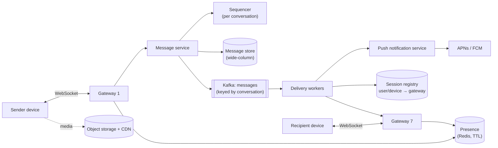

<Related ids={['real-time-communication', 'message-queues', 'sql-vs-nosql', 'time-and-ordering', 'unique-id-generation', 'caching', 'blob-storage', 'security-fundamentals']} />

Design a chat application like WhatsApp, Messenger or Slack: one-to-one and group messaging delivered in real time, with message history across devices, delivery and read receipts, online presence, and offline delivery via push notifications. The hard parts: holding millions of persistent connections, routing messages to the right connection, **ordering**, and never losing a message.

## 1. Clarify the problem

| Question | Assumption |
| --- | --- |
| 1:1 and groups? | Both; groups up to 500 members (large channels are a follow-up) |
| Media? | Images/video/files via object storage |
| Multi-device? | Yes — phone, web, desktop stay in sync |
| History? | Stored server-side indefinitely (not end-to-end encrypted; E2EE as a discussion point) |
| Receipts? | Sent, delivered, read |
| Presence? | Online / last seen |
| Scale? | 500M DAU, 50M concurrent connections at peak, 40B messages/day |

## 2. Requirements

**Functional:** send/receive messages in 1:1 and groups; message history with pagination; delivery/read receipts; presence; push notifications when offline; media sharing.

**Non-functional:**

- **Low latency** — under ~200 ms end to end for online recipients in the same region.
- **Durability** — an acknowledged message is never lost.
- **Ordering** — messages within a conversation appear in the same order for all participants.
- **High availability**; multi-device consistency.

## 3. Capacity estimation

```text
Messages: 40B/day ÷ 10^5 ≈ 400K messages/s average; peak ~1M/s
Message size: ~100 B text + ~100 B metadata ≈ 200 B
Storage: 40B × 200 B = 8 TB/day ≈ 3 PB/year (× replication) — media far larger, in object storage

Connections: 50M concurrent; ~50–100K per gateway server (memory for TLS + buffers)
→ ~500–1,000 gateway servers

Group fan-out: average group size ~20 → deliveries/s several times the message rate
```

**So:** a write-heavy, time-ordered, append-only message store partitioned by conversation (wide-column); a large fleet of connection gateways; routing between gateways is the key infrastructure problem.

## 4. API

Real-time over a persistent **WebSocket** connection (bidirectional, low overhead):

```text
client → server
  { "type": "send", "clientMsgId": "c-7f…", "conversationId": "cv_42", "body": "hi", "mediaKey": null }
  { "type": "ack", "conversationId": "cv_42", "upToSeq": 1043 }       // delivered
  { "type": "read", "conversationId": "cv_42", "upToSeq": 1043 }
  { "type": "typing", "conversationId": "cv_42" }

server → client
  { "type": "sent", "clientMsgId": "c-7f…", "messageId": "m_…", "seq": 1044, "ts": … }
  { "type": "message", "conversationId": "cv_42", "seq": 1044, "from": "u_7", "body": "hi" }
  { "type": "receipt", "conversationId": "cv_42", "userId": "u_9", "status": "read", "upToSeq": 1044 }
```

REST for everything else: `GET /v1/conversations/{id}/messages?beforeSeq=…&limit=50`, conversation management, media upload URLs.

## 5. Data model

```text
messages        PRIMARY KEY ((conversation_id), seq)  CLUSTERING ORDER BY seq DESC
                message_id, sender_id, body, media_key, created_at
conversations   (conversation_id, type 1:1/group, members, last_seq, …)
user_inbox      PRIMARY KEY ((user_id), last_activity DESC)  → conversation list with unread counts
device_cursors  (user_id, device_id, conversation_id, last_delivered_seq, last_read_seq)
```

Only chat history goes in this store. Profiles, settings and contact lists are ordinary relational data. Chat history is huge, append-heavy, mostly read when recent, with a read:write ratio near 1:1 for one-to-one chat — the profile of a wide-column/key-value store (Facebook Messages used HBase, Discord Cassandra and later ScyllaDB).

Partitioning by `conversation_id` makes "latest 50 messages in this conversation" a single-partition, sequential read. Very active group conversations need **time bucketing** in the partition key (`(conversation_id, month)`) to keep partitions bounded. (Discord's message store follows this pattern.)

## 6. High-level design



**Send flow**

1. Sender's device sends the message with a client-generated `clientMsgId` (for idempotent retries).
2. Gateway forwards to the message service, which assigns the next **sequence number** for the conversation, persists the message, and only then acks the sender (`sent`, with `seq`).
3. The message is published to Kafka keyed by `conversation_id`.
4. Delivery workers look up each recipient's connected devices in the **session registry** and forward to the right gateways, which push down the sockets.
5. Recipient devices ack (`delivered`); offline recipients get a push notification and sync on reconnect.

## 7. Deep dives

### Connection management and routing

- **Gateways** are thin and stateful: hold sockets, authenticate, heartbeat, forward. No business logic, so they can be drained and replaced.
- On connect, the gateway registers `(user_id, device_id) → gateway_id` in the **session registry** (Redis with TTL refreshed by heartbeats).
- Delivery workers route to the specific gateway via RPC or a per-gateway queue. Alternative: gateways subscribe to per-user channels in a pub/sub system.
- Load balancing: L4 balancing with least-connections; clients reconnect with **exponential backoff and jitter** to avoid reconnection storms after a gateway restart.

**Which gateway should a client connect to?** After login, a **service discovery** layer (backed by a registry such as ZooKeeper, etcd or Consul) returns the best gateway for this client — nearby, healthy and not overloaded — and the client opens its WebSocket there. A rough sizing check: at ~10 KB of memory per idle connection, 1M connections need ~10 GB — one big machine could hold them, but a single server would be an unacceptable single point of failure, so start from a fleet.

Long polling is a weak fit here: the server receiving a message may not be the one holding the recipient's long-poll request, the server can't easily tell if a client has gone, and idle users still reconnect after every timeout.

### Ordering

Client timestamps are unreliable and server clocks skew (see [Time, Clocks & Ordering](/system-design/hld/time-and-ordering)). Instead:

- Each conversation has a **monotonic sequence number** assigned by a single authority: e.g., the message-service instance that owns the conversation's partition (consistent hashing on `conversation_id`), using an atomic increment in a strongly consistent store, or the Kafka partition offset.
- Clients display messages by `seq`, not by timestamp, so everyone sees the same order.
- Gaps in `seq` tell a client it missed messages → fetch the missing range.

### Never losing a message

- **Persist before ack**: the sender's message is acknowledged only after it's durably stored (replicated write). If the send fails, the client retries with the same `clientMsgId`; the server deduplicates on `(conversation_id, clientMsgId)`.
- **Delivery is at-least-once**: if a recipient's ack doesn't arrive, the message is redelivered; clients dedupe by `seq`/`message_id`.
- **Sync on reconnect**: each device keeps `last_delivered_seq` per conversation; on reconnect, it asks for everything after it. The socket push is an optimisation — the store is the source of truth.

### Multi-device sync

Each device has its own cursor. Messages are delivered to all of a user's connected devices; read receipts from one device update `last_read_seq`, which is synced to the user's other devices (clearing their unread badges).

### Group messaging

- **Small groups** (up to a few hundred): fan out on write — delivery workers look up members and deliver to each online device; offline members are notified via push and catch up by sync. The message itself is stored **once** per conversation, not per recipient.
- **Alternative: an inbox per recipient.** Copy each group message into every member's message-sync queue ("inbox"). Each device then syncs from a single place — its own inbox — which simplifies multi-device sync. The cost is N copies per message, acceptable only for small groups (WeChat caps groups at 500 members). Storing once per conversation, as above, costs less storage but means each client syncs several conversations.

- **Large channels** (thousands to millions of members, Slack/Discord/Telegram channels): don't push every message to every member. Push to members currently viewing the channel; others see an unread indicator and fetch on open (fan-out on read).

### Receipts and typing indicators

- Receipts are aggregated as "read up to seq N" per user per conversation — one update covers many messages.
- In large groups, show aggregated receipts or none (per-member receipts explode traffic).
- Typing indicators are **ephemeral**: sent over sockets, never persisted, throttled (e.g., at most once per few seconds).

### Presence

- Online status is derived from heartbeats: gateway writes `presence:{user_id} = online` with a TTL (e.g., 60 s), refreshed by heartbeats; expiry means offline, and `last_seen` is recorded.
- **Avoid flapping.** Networks drop briefly (lifts, tunnels). Don't mark a user offline on every disconnect; mark them offline only after no heartbeat for a grace period (e.g., ~30 s with heartbeats every 5 s).

- Presence fan-out is expensive (a status change for a user with 500 contacts). Fetch presence **lazily** — only for conversations on screen — or subscribe only to contacts currently visible, rather than broadcasting every change to everyone.

### Push notifications for offline users

If no device is connected, the delivery worker sends a push via APNs/FCM (through the [notification system](/system-design/hld/design-notification-system)), collapsing many messages into one notification per conversation. The app wakes, connects and syncs.

### End-to-end encryption (discussion)

With E2EE (Signal protocol, used by WhatsApp), the server stores and routes only ciphertext; keys live on devices. Consequences: server-side search and history are impossible, multi-device requires per-device encryption (messages are encrypted separately for each device), and backups need client-side encryption.

## 8. Failure modes

| Failure | Mitigation |
| --- | --- |
| Gateway crash | Clients reconnect (backoff + jitter) to other gateways and sync from last seq; registry entries expire |
| Message service instance down | Conversation ownership moves to another instance (consistent hashing); sequence continues from the store |
| Kafka lag | Messages are already persisted; delivery delayed, clients can pull on open |
| Region outage | Users reconnect to another region; conversation data replicated cross-region (home region per conversation) |

## 9. Trade-offs summary

| Decision | Choice | Why |
| --- | --- | --- |
| Transport | WebSocket | Bidirectional, low overhead, real-time |
| Ordering | Per-conversation server sequence numbers | Consistent order regardless of clocks |
| Storage | Wide-column, partitioned by conversation (+ time bucket) | Write-heavy, sequential reads per conversation |
| Delivery | Persist → ack → at-least-once push, sync on reconnect | No message loss |
| Large groups | Fan-out on read | Avoid pushing to millions of idle members |

## 10. What interviewers look for

- **Mid-level**: WebSockets, a message store, delivering to online users, push notifications for offline users.
- **Senior**: session registry and cross-gateway routing, sequence numbers for ordering, persist-before-ack, idempotent retries, sync on reconnect, group fan-out, presence cost.
- **Staff**: multi-region conversation placement, very large channels, E2EE implications, capacity of connection fleets and reconnection storms.

## Interview questions

<QA q="How do you guarantee that all participants see messages in the same order?">
Assign each message a per-conversation sequence number from a single authority — the service instance owning that conversation (via consistent hashing), using an atomic counter in a strongly consistent store or the conversation's Kafka partition offset. Clients sort and display by sequence number rather than timestamps, and detect gaps to fetch missing messages. Client timestamps are only for display.
</QA>

<QA q="A user's phone was offline for two days. How does it catch up?">
On reconnect, the device sends its last delivered sequence number per conversation (or a global per-user cursor). The server returns the conversations with new activity and the missing messages after each cursor, paginated, plus updated receipts. The device updates its local database, then resumes live delivery over the socket. Push notifications sent while it was offline only woke the app; the sync is what guarantees completeness.
</QA>

<QA q="How would you design presence for 500M users without overwhelming the system?">
Store presence as a TTL key per user, refreshed by connection heartbeats, so going offline is detected by expiry. Don't broadcast every status change to all contacts; instead, clients request presence for the conversations currently on screen and subscribe only to those users while visible, with throttled updates. For large groups, show only counts or omit presence. This makes cost proportional to what users are looking at.
</QA>

<Takeaways>

- Thin, stateful WebSocket gateways plus a session registry route messages across a large connection fleet.
- Order messages with per-conversation sequence numbers, not timestamps.
- Persist before acknowledging; deliver at-least-once; dedupe with client message IDs; sync on reconnect.
- Store messages once per conversation in a wide-column store partitioned by conversation and time bucket.
- Fan out to small groups; use fan-out on read for huge channels; keep presence and typing indicators cheap and ephemeral.

</Takeaways>

## Further reading

- Discord Engineering, "How Discord Stores Billions of Messages" (2017) and "How Discord Stores Trillions of Messages" (2023).
- Slack Engineering, "Real-time Messaging" (2023).
- Signal, "The Double Ratchet Algorithm" and "The X3DH Key Agreement Protocol" specifications — end-to-end encryption.
- Alex Xu, *System Design Interview*, Vol. 1 — ch. 12, "Design a Chat System".
- Facebook Engineering, "The Underlying Technology of Messages" (2010) — HBase for Messenger.
- Slack Engineering, "Flannel: An Application-Level Edge Cache to Make Slack Scale" (2016).
