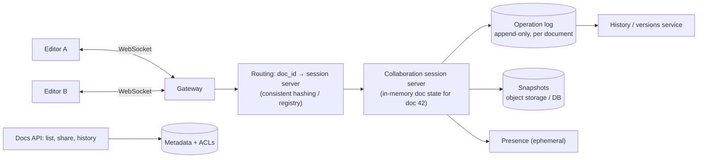

<Related ids={['real-time-communication', 'event-driven-architecture', 'time-and-ordering', 'consistency-models', 'replication', 'blob-storage', 'consistent-hashing']} />

Design a collaborative document editor like Google Docs or Notion: many people edit the same document at the same time, everyone sees each other's changes within a fraction of a second, cursors and selections are visible, edits made offline merge cleanly later, and full version history is available. The core problem is **concurrent edits to shared state** — and the two families of algorithms that solve it: **Operational Transformation (OT)** and **CRDTs**.

## 1. Clarify the problem

| Question | Assumption |
| --- | --- |
| Document type? | Rich text (paragraphs, formatting); not spreadsheets |
| Concurrent editors per doc? | Typically under 10; up to ~100 for popular docs |
| Latency? | Local edits appear instantly; remote edits within ~100–300 ms |
| Offline? | Supported; changes merge on reconnect |
| History? | Version history, restore, see who changed what |
| Scale? | 100M documents, 10M daily active editors |

## 2. Requirements

**Functional:** create/open/edit documents collaboratively in real time; presence (who's here, cursors); comments; version history; sharing with permissions; offline editing.

**Non-functional:** **convergence** (all replicas end with the same document), **intention preservation** (edits do what the user meant), responsiveness (local-first editing, no waiting for the server), durability (no lost edits), and availability.

## 3. Capacity estimation

```text
Active editing sessions: 10M DAU, ~2M concurrently connected at peak
Operations: an active editor sends ~1–5 ops/s while typing (batched) → peak ~2M ops/s across the fleet
Per document: tens of ops/s at most — small and bounded

Storage: 100M docs × ~100 KB snapshot = 10 TB, plus operation logs (compacted into snapshots)
```

**So:** total traffic is large but **each document is small and independent**. The natural design routes all editors of a document to the **same server** (document-level sharding), which turns a distributed problem into a per-document single-owner problem.

## 4. Why naive approaches fail

Two users edit "ABC" at the same time:

```text
Alice: insert "X" at position 1   → "AXBC"
Bob:   delete character at position 2 ("C") → "AB"

If each applies the other's operation naively:
Alice: "AXBC" then delete at 2 → "AXC"   ✗ (deleted "B", not "C")
Bob:   "AB"   then insert X at 1 → "AXB"
Replicas diverge.
```

Locking the document (one editor at a time) or last-write-wins on the whole document both destroy the collaborative experience. We need operations that can be applied concurrently and still converge.

## 5. Approach A — Operational Transformation (OT)

Operations are **transformed** against concurrent operations before being applied, adjusting positions to account for what the other operation did.

```text
transform(Bob's delete@2, against Alice's insert@1) → delete@3
Alice: "AXBC" → delete@3 → "AXB"  ✓
Bob:   "AB"   → insert X@1 → "AXB" ✓   converged
```

- Production OT systems (Google Docs, and the classic Jupiter/Wave design) use a **central server** that defines a single order of operations. Each client sends ops tagged with the server revision they're based on; the server transforms them against any ops committed since, assigns the next revision, and broadcasts.
- ✅ Compact operations, proven at enormous scale, natural fit for a server-authoritative model.
- ❌ Transformation functions are notoriously tricky for rich operations; peer-to-peer OT is very hard to get right; offline editing for long periods is awkward.

## 6. Approach B — CRDTs

**Conflict-free Replicated Data Types** give every character (or element) a **unique, ordered identifier** so that inserts and deletes commute — replicas can apply operations in **any order** and still converge, without a central transformer.

- A text CRDT (RGA, YATA as used by Yjs, Automerge's algorithms, Fugue) assigns each inserted character an ID like `(client_id, counter)` and records its position relative to neighbours. Deletions mark elements as removed (tombstones).
- ✅ Works peer-to-peer and offline by design; merging is automatic and deterministic; the server can be a simple relay + storage.
- ❌ Metadata overhead (IDs, tombstones) — modern implementations compress this well; some semantic oddities (interleaving) that newer algorithms address.

| | OT | CRDT |
| --- | --- | --- |
| Convergence mechanism | Transform ops against concurrent ops | Ops commute by construction |
| Needs central ordering? | Practically yes | No |
| Offline / P2P | Hard | Natural |
| Metadata | Small | Larger (IDs, tombstones), compressible |
| Used by | Google Docs, many classic editors | Figma (CRDT-inspired, server-authoritative), Yjs-based editors, Automerge, Apple Notes |

<Callout type="interview">
Either approach is acceptable — what matters is explaining **why concurrent edits need special handling**, then choosing one with trade-offs: "I'll use a server-authoritative design with one session owner per document. With OT, the server orders and transforms ops; with a CRDT, the server just relays and persists, and offline merge comes for free. Given the offline requirement, I'll use a CRDT (e.g., Yjs) and keep a single owner per document for efficient broadcasting and persistence."
</Callout>

## 7. High-level design

<FlowSteps title='One edit, end to end' steps={[
  { path: ['C1', 'GW', 'RT'], text: 'Editor A\'s operation arrives over a WebSocket, and the gateway routes it by document ID.' },
  { path: ['RT', 'SS'], text: 'Every operation for document 42 reaches the one session server that owns the document.' },
  { path: ['SS', 'OPLOG'], text: 'The session server puts the operation in order (transforming it if needed) and appends it to the operation log.' },
  { path: ['SS', 'RT', 'GW', 'C2'], text: 'The ordered operation is broadcast to every connected editor, so Editor B applies the same change.' },
  { path: ['SS', 'SNAP'], text: 'Every so often the server saves a snapshot, so opening a document does not replay its whole history.' },
  { path: ['SS', 'PRES'], text: 'Cursors and selections travel through a separate, short-lived presence channel.' },
  { path: ['API', 'META'], nodes: ['OPLOG', 'HIST'], edges: [['OPLOG', 'HIST']], text: 'Listing, sharing and version history use the ordinary API, the metadata store and the history service.' },
]}>



</FlowSteps>

**Editing flow**

1. A client opens a document: authenticates, gets the latest snapshot + any ops since, and connects via WebSocket. The gateway routes all connections for `doc_id` to the **same session server**.
2. Local edits apply **immediately** in the client (optimistic, local-first), then are sent as ops.
3. The session server validates permissions, integrates the op (OT: transform and assign revision; CRDT: merge), appends to the document's **operation log**, and broadcasts to other connected clients.
4. Clients apply remote ops (transforming against their own pending ops in OT, or merging in CRDT).
5. Periodically the server writes a **snapshot** and compacts the log.

## 8. Deep dives

### One owner per document

Routing all editors of a document to a single session server keeps ordering simple (one place to sequence ops), allows in-memory state, and makes broadcasting local. Ownership is assigned by consistent hashing on `doc_id` or via a registry with leases; if the server dies, another loads the latest snapshot + log tail and clients reconnect. Hot documents (hundreds of editors) are still small enough for one server.

### Durability: log + snapshots

- The op log is the durable source of truth — ops are appended (replicated write) before being acknowledged to the sender.
- Snapshots every N ops or minutes bound load time; older ops are compacted but kept long enough for history.
- This is event sourcing applied to documents (see [Event-Driven Architecture](/system-design/hld/event-driven-architecture)).

### Presence and cursors

Cursor positions and selections are **ephemeral**: broadcast through the session server, never persisted, throttled (e.g., 10–20 updates/s). Positions must be expressed relative to document elements (CRDT IDs or transformed indices) so they stay correct as text changes.

### Offline editing

Clients persist the document and pending ops locally (IndexedDB). On reconnect, they send pending ops; with CRDTs the merge is automatic, with OT the server transforms the backlog against everything that happened meanwhile. Very long offline divergence can produce surprising merges — show a notice or a "changes merged" diff.

### Version history

Named versions and the timeline are reconstructed from snapshots + ops; restoring a version is a **new** set of ops that transforms the current document into the old state (history is never rewritten). Attribute ops to users for "who changed what".

### Permissions

Checked on connect and on each op (a viewer's ops are rejected); permission changes push a reconnect/downgrade to affected sessions. Comments and suggestions are separate entities anchored to document positions.

## 9. Failure modes

| Failure | Mitigation |
| --- | --- |
| Session server crash | New owner loads snapshot + op log; clients reconnect and resend unacknowledged ops (idempotent op IDs) |
| Client disconnects | Local edits continue; pending ops sent on reconnect |
| Op log write fails | Don't ack the op; client retries |
| Divergence bug | Periodic checksums of document state between client and server; resync from snapshot |

## 10. Trade-offs summary

| Decision | Choice | Why |
| --- | --- | --- |
| Concurrency control | CRDT (or OT with central server) | Convergence without locking |
| Topology | Single session owner per document | Simple ordering, in-memory state, cheap broadcast |
| Persistence | Append-only op log + periodic snapshots | Durability, history, fast loading |
| Editing model | Local-first, optimistic | Instant feedback |
| Presence | Ephemeral, throttled | Not worth persisting |

## 11. What interviewers look for

- **Mid-level**: WebSockets, sending edits to a server, broadcasting to others, storing documents.
- **Senior**: why concurrent edits conflict; OT or CRDT explained with trade-offs; single owner per document; op log + snapshots; presence; offline.
- **Staff**: OT vs CRDT depth (tombstones, interleaving, server authority), scaling session ownership, history and permissions, rich-text and structured documents.

## Interview questions

<QA q="Why can't we just use last-write-wins on the whole document?">
Concurrent editors would constantly overwrite each other's work: whoever saved last replaces everything, even if they edited a different paragraph. Collaboration requires merging at the granularity of individual operations (characters, formatting spans), which is exactly what OT and CRDTs provide while guaranteeing all replicas converge.
</QA>

<QA q="Explain the difference between OT and CRDTs in one minute.">
OT represents edits as position-based operations and, when two are concurrent, transforms one against the other to adjust positions so both apply correctly; in practice it relies on a central server to establish a single order. CRDTs give every element a unique identifier and define operations that commute, so replicas can apply them in any order and still converge, with no central coordinator — making offline and peer-to-peer collaboration natural, at the cost of extra metadata.
</QA>

<QA q="How do you scale to millions of concurrently edited documents?">
Shard by document: each document is owned by one session server (consistent hashing or a lease-based registry) that holds its state in memory and handles its connections, so servers scale horizontally with the number of active documents. Gateways route connections by doc_id. State is persisted as an op log plus snapshots so ownership can move on failure or rebalancing.
</QA>

## Practice

Write your answer before opening the suggested one. Anything you mark "Partly" or "Missed it" comes back in your review deck.

<Practice task="Two users type at the same position at the same moment: one inserts 'A' at index 5, the other inserts 'B' at index 5. Explain how operational transformation or a CRDT makes both editors end up with the same text.">

With operational transformation (OT): the server orders the operations. Say A's insert is applied first. B's operation, which was made against the old document, is transformed against A's: because A inserted at or before position 5, B's insert shifts to index 6 (a tie-breaker such as the user ID decides who goes first at equal positions). Both clients apply the same transformed operations in the same order and converge to '…AB…'.

With a CRDT: each character gets a unique, ordered position identifier (for example a fractional position plus the user ID). Inserting 'A' and 'B' at 'the same place' produces two distinct identifiers with a fixed order, so every replica sorts them the same way no matter which arrives first. No central ordering is needed.

Either way, the result is identical on every screen.

</Practice>

<Practice task="A shared document is open in 300 browser tabs and the server for that document is overloaded. How do you scale the real-time part?">

Real-time collaboration usually pins each document to one server (the document's 'owner') so it can order operations, which is why one hot document overloads one machine.

1. Keep one authoritative sequencer per document, but move fan-out off it: the sequencer appends each operation to a per-document log, and separate relay servers subscribe and push to the connected tabs.
2. Batch and compress: send operations in small batches every 50–100 ms instead of one message per keystroke.
3. Send cursor and presence updates less often and with lower priority than edits.
4. Snapshot periodically so new tabs load a snapshot plus recent operations instead of replaying the whole history.

The sequencer's work is now proportional to edits, not to edits × viewers.

</Practice>

<Takeaways>

- Concurrent edits must be merged at the operation level; naive application diverges.
- OT transforms concurrent operations and usually needs a central server; CRDTs make operations commute and support offline/P2P naturally.
- Route each document to one session owner; apply edits locally first, then sync.
- Persist an append-only op log with periodic snapshots; build history from it.
- Treat presence and cursors as ephemeral, throttled broadcasts.

</Takeaways>

## Further reading

- Ellis and Gibbs, "Concurrency Control in Groupware Systems" (SIGMOD 1989) — the origin of OT.
- Nichols et al., "High-Latency, Low-Bandwidth Windowing in the Jupiter Collaboration System" (UIST 1995).
- Shapiro et al., "Conflict-free Replicated Data Types" (SSS 2011).
- Martin Kleppmann et al., "Local-first software: You own your data, in spite of the cloud" (Onward! 2019).
- Figma Engineering, "How Figma's multiplayer technology works" (2019).
- [Yjs documentation](https://docs.yjs.dev) and [Automerge](https://automerge.org).
