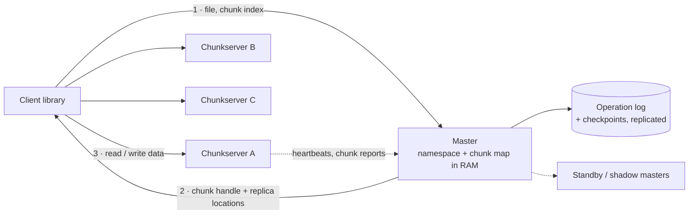
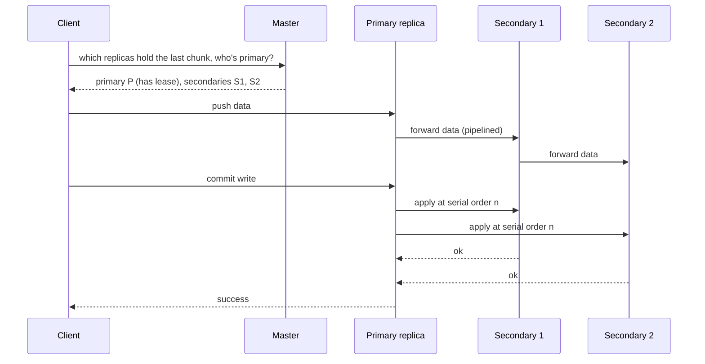

<Related ids={['blob-storage', 'replication', 'consensus', 'availability-and-fault-tolerance', 'batch-and-stream-processing', 'design-key-value-store']} />

Design a distributed file system like the Google File System (GFS) or Hadoop's HDFS: store petabytes of large files across thousands of commodity machines, survive disks and servers failing every day, and deliver high throughput to batch jobs that read and append data. Infrastructure teams at Google, Meta and Amazon ask it, and it shows up as "design HDFS" or "design storage for MapReduce".

The design is a classic because of one bold decision: **a single master holds all the metadata in memory**, while file data flows directly between clients and storage servers. Understanding why that works, and where it stops working, is the heart of the interview.

How it differs from object storage such as S3 (see [Object Storage & File Uploads](/system-design/hld/blob-storage)): a distributed file system offers a directory tree, files that grow by appending, and high-throughput sequential access for compute running in the same data centre. Object stores offer whole-object writes over HTTP at near-unlimited scale. Many modern data platforms run on object storage; the file-system design still teaches the core ideas of metadata, chunking, replication and repair.

## 1. Clarify the problem

| Question | Assumption |
| --- | --- |
| Files | Mostly large (100 MB to many GB); millions of files, not billions |
| Workload | Large sequential reads; appends; few random overwrites |
| Clients | Batch jobs (MapReduce/Spark) in the same data centre |
| Scale | Several PB on ~1,000 servers with 10+ disks each |
| Failures | Disks and servers fail daily; a whole rack occasionally |
| Priority | Throughput and durability over low latency |

## 2. Requirements

**Functional:** a namespace of directories and files; create, delete, open, read, append; list directories; snapshots.

**Non-functional:** no data loss on disk, server or rack failure; high aggregate throughput (many clients reading in parallel); automatic repair; one master's failure must not lose metadata.

## 3. Capacity estimation

```text
Data: 5 PB of files × 3 replicas = 15 PB raw
Chunks: 5 PB ÷ 64 MB per chunk ≈ 80 million chunks

Master metadata: ~100 bytes per chunk + file and directory entries
  80M × 100 B ≈ 8 GB → fits in one machine's RAM

Failure rate: 15,000 disks with ~2% annual failure → ~300 failed disks a year, about one a day
  → re-replication is routine, not an emergency
```

**So:** with large chunks, all metadata fits in memory on one master. That's what makes the single-master design possible.

## 4. High-level design



- **Files are split into fixed-size chunks** (64 MB in GFS, 128 MB by default in HDFS), each with a unique ID and stored as a plain file on several **chunkservers**.
- The **master** keeps the namespace (directories, files) and the map file → chunks → replica locations, all in memory.
- **Clients ask the master only for metadata**, cache it, and then read and write data **directly with chunkservers**. The master never touches file data, so it doesn't become a bandwidth bottleneck.

## 5. Deep dives

### Why large chunks and a single master

- **Large chunks** mean few chunks per file, so the metadata is small enough for RAM, clients make few master requests (one lookup covers 64 MB of reading), and connections to a chunkserver stay open for long sequential transfers.
- **One master** makes placement, replication and namespace operations simple and globally consistent: no distributed coordination for "create file" or "which servers hold chunk 42".
- The price: the master is a **metadata bottleneck** and a single point of failure, and **small files are a problem**: each costs metadata regardless of size, so a billion tiny files exhaust the master's memory long before the disks fill.

### Making the master durable and recoverable

- Every metadata change is appended to an **operation log** (a write-ahead log), flushed to disk and **replicated** to other machines before the client gets a reply.
- Periodically the master writes a **checkpoint** (a compact snapshot of its state), so recovery replays only the log tail.
- **Chunk locations are not persisted.** On startup, the master asks every chunkserver which chunks it holds. Chunkservers are the source of truth for what's on their disks, so the master never has to reconcile a stale location list.
- **Failover:** a standby master replays the replicated log and takes over; leader election uses a coordination service (HDFS uses ZooKeeper-based failover). Read-only **shadow masters** can serve metadata reads while the primary recovers.

### Replica placement

Three replicas by default, placed to survive a rack failure without making writes cross racks too often:

- HDFS's default: the first replica on the writer's node (or a random node), the second on a node in a **different rack**, the third on another node in that **same remote rack**. Losing a whole rack never loses all copies, and only one transfer crosses between racks.
- Also balance by disk usage, and avoid placing too many new chunks on a freshly added (empty) server at once, since new chunks attract the most reads.

### Writing: the pipeline and leases



- **Data flow is separate from control flow.** Data is pushed along a chain of replicas (each forwards to the next while still receiving), so each machine's full network bandwidth is used once, instead of the client sending three copies.
- **Leases decide order.** The master grants one replica a time-limited **lease** for a chunk, making it the **primary**. The primary assigns a serial order to all mutations of that chunk and all replicas apply them in that order. The lease expires on its own if the primary dies, so the master can safely appoint another without two primaries at once.
- **Append is the main write.** GFS's **record append** lets many clients append to one file concurrently; the primary picks the offset, so producers don't need to coordinate. HDFS simplifies further: one writer per file at a time, enforced by a lease on the file.

### Consistency model

Relaxed by design, and worth stating precisely:

- In GFS, a failed or retried append can leave **duplicates or padding** in some replicas. Clients handle this with record checksums and unique record IDs, skipping garbage and duplicates on read.
- HDFS gives simpler semantics: data becomes visible to readers after the writer calls `hflush`/closes the file, and files are append-only after creation.
- Metadata operations (create, rename, delete) go through the single master, so they are atomic and totally ordered. Renaming a directory is a cheap metadata change, which is why batch jobs write to a temporary directory and rename it on success: readers see all of the output or none.

### Detecting and repairing failures

- **Heartbeats:** chunkservers report to the master every few seconds with the chunks they hold. A server that stops reporting is declared dead after a timeout.
- **Re-replication:** the master tracks each chunk's live replica count and copies under-replicated chunks from surviving replicas, prioritising chunks with only **one** copy left and throttling repair traffic so it doesn't starve normal jobs.
- **Corruption:** disks silently corrupt data. Each chunk is stored with **checksums** per small block (e.g. 64 KB); chunkservers verify them on every read and in background scrubs, report bad replicas, and the master replaces them from a good copy.
- **Garbage collection:** deleting a file just renames it to a hidden name; space is reclaimed lazily when the master notices chunks that belong to no file and tells chunkservers to delete them. Lazy deletion is simpler and safer than coordinating immediate deletes across servers that might be down.

### Cheaper durability: erasure coding

Three full replicas cost 200% overhead. **Erasure coding** splits data into k data blocks plus m parity blocks, such that any k of the k + m can rebuild everything. Reed–Solomon (6, 3), supported by HDFS 3, tolerates losing any 3 blocks at 50% overhead.

| | 3× replication | Erasure coding (6+3) |
| --- | --- | --- |
| Storage overhead | 200% | 50% |
| Failures tolerated | 2 copies | Any 3 blocks |
| Read of healthy data | From one replica, local | Usually fine; reads spread over servers |
| Repair cost | Copy one replica | Read 6 blocks to rebuild 1: much more network |
| Best for | Hot data, appends | Cold, rarely changed data |

Many systems write data replicated and convert it to erasure coding once it cools down.

### Scaling past one master

When metadata outgrows one machine's memory, or one master can't handle the request rate:

- **Federation:** split the namespace among several independent masters (`/logs` on one, `/warehouse` on another), each managing its own block pool on shared storage servers.
- **Sharded metadata in a database:** Google's successor to GFS, Colossus, stores metadata in Bigtable, so metadata scales horizontally; many cloud storage systems do something similar.
- **Fewer, larger files:** combine small files into container formats (SequenceFiles, Parquet, archives) so the namespace stays small.

## 6. Failure modes

| Failure | Mitigation |
| --- | --- |
| Disk or server dies | Heartbeat timeout; re-replicate its chunks from other replicas, most endangered first |
| Whole rack lost | Rack-aware placement guarantees another copy elsewhere |
| Silent data corruption | Per-block checksums on read and background scrubbing; replace bad replicas |
| Master crashes | Replicated operation log + checkpoint; standby takes over via leader election |
| Primary replica dies mid-write | Lease expires; master grants a new lease; client retries the append |
| Too many small files | Federation or metadata in a database; pack files into containers |

## 7. Trade-offs summary

| Decision | Choice | Why |
| --- | --- | --- |
| Metadata | Single master, all in RAM | Simple, consistent, fast; fits thanks to large chunks |
| Chunk size | 64–128 MB | Small metadata, few master calls, efficient sequential I/O |
| Data path | Clients ↔ chunkservers directly | Master isn't a bandwidth bottleneck |
| Durability | 3 replicas, rack-aware; erasure coding for cold data | Survive racks; cut cost where data is cold |
| Mutation order | Leases to a primary replica | One ordering authority per chunk without a lock service per write |
| Consistency | Relaxed for appends, atomic metadata | Throughput for batch workloads |
| Deletion | Lazy garbage collection | Simple and safe with failing servers |

## 8. What interviewers look for

- **Mid-level:** chunks, master with metadata, chunkservers, replication, heartbeats.
- **Senior:** why large chunks make a single master viable, separating data and control flow, leases and primaries, rack-aware placement, checksums and re-replication, the small-files problem.
- **Staff:** consistency semantics of concurrent appends, master durability and failover, erasure coding trade-offs, scaling metadata (federation, database-backed metadata), and when to use object storage instead.

## Interview questions

<QA q="How can a single master manage petabytes of data without becoming a bottleneck?">
Three choices make it work. Chunks are large (64–128 MB), so the metadata for petabytes is only gigabytes and fits in RAM. Clients contact the master only for metadata, cache it, and then move data directly with chunkservers, so no file data passes through the master. And chunk locations aren't persisted by the master but reported by chunkservers, so the master's durable state is small. The limits appear with very many small files or very high metadata request rates, which is when federation or database-backed metadata becomes necessary.
</QA>

<QA q="What is a lease, and why does the master grant one for each chunk being written?">
A lease is time-limited authority: the master designates one replica as the primary for a chunk for, say, 60 seconds. The primary decides the order of all mutations to that chunk, and every replica applies them in that order, so replicas stay identical without the master handling each write. Because the lease expires automatically, if the primary crashes or is partitioned, the master can appoint a new primary after the lease runs out without risk of two primaries ordering writes differently.
</QA>

<QA q="Why is storing many small files a problem for HDFS or GFS?">
The master keeps metadata for every file and chunk in memory, regardless of how much data the file holds. A billion 10 KB files use as much master memory as a billion 64 MB chunks would, while storing a tiny fraction of the data, so the master runs out of memory long before the disks fill. Each small file also costs a master lookup and a separate read. Fixes are to pack small files into larger container files, use federation to split the namespace, or use a system whose metadata is stored in a horizontally scalable database.
</QA>

## Practice

Write your answer before opening the suggested one. Anything you mark "Partly" or "Missed it" comes back in your review deck.

<Practice task="A chunkserver with 20 disks of 10 TB each, 70% full, dies permanently. How much data must be re-replicated, and how would you keep repair from hurting running jobs?">

Data lost: 20 × 10 TB × 70% = **140 TB** of replicas, spread over many chunks whose other replicas live on many different servers.

Because those surviving replicas are scattered across the cluster, repair can be parallel: if 500 servers each copy ~280 GB, at a throttled 100 MB/s per server that takes about 47 minutes.

To protect running jobs:
- **Prioritise** chunks with only one surviving replica, then those with two.
- **Throttle** repair bandwidth per server and per rack, and raise it if many chunks drop to one replica.
- Wait a short grace period before declaring the server dead, so a reboot doesn't trigger 140 TB of copying.
- Choose new locations with rack-aware placement and spread them, so no single server becomes a hot spot for writes.

</Practice>

<Takeaways>

- Files are split into large chunks stored on chunkservers with three rack-aware replicas.
- A single master keeps the namespace and chunk map in RAM; large chunks make that feasible.
- Clients get metadata from the master and move data directly with chunkservers.
- Leases make one replica the primary that orders mutations; data flows along a pipeline of replicas.
- Heartbeats, checksums, scrubbing and prioritised re-replication handle daily hardware failures.
- Erasure coding cuts storage overhead for cold data at the cost of expensive repair.
- Small files and metadata scale are the design's limits; federation or database-backed metadata address them.

</Takeaways>

## Further reading

- Sanjay Ghemawat, Howard Gobioff and Shun-Tak Leung, "The Google File System" (SOSP 2003).
- Konstantin Shvachko, Hairong Kuang, Sanjay Radia and Robert Chansler, "The Hadoop Distributed File System" (MSST 2010).
- Apache Hadoop documentation — HDFS architecture, rack awareness, erasure coding.
- Andrew Fikes, "Storage Architecture and Challenges" (Google Faculty Summit, 2010) — Colossus.
