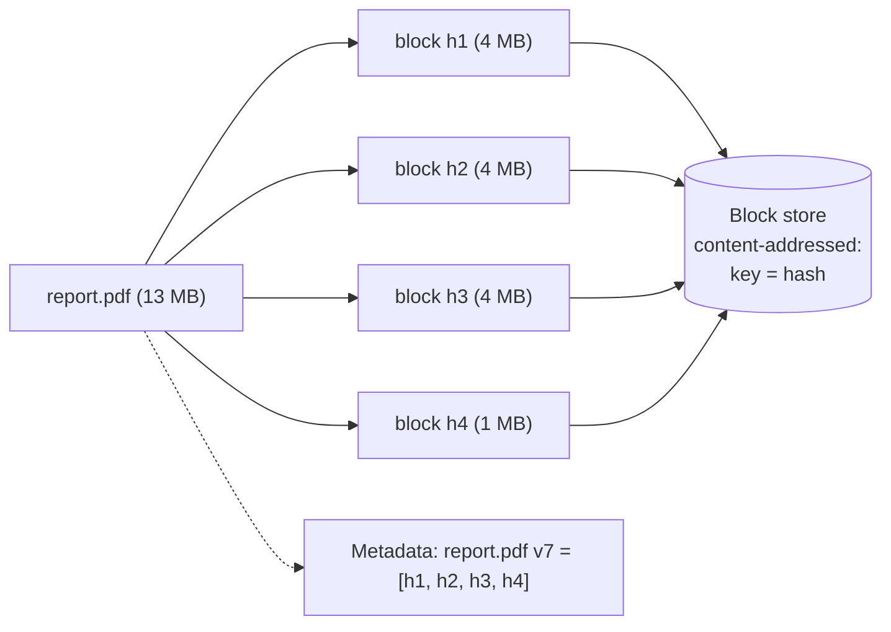
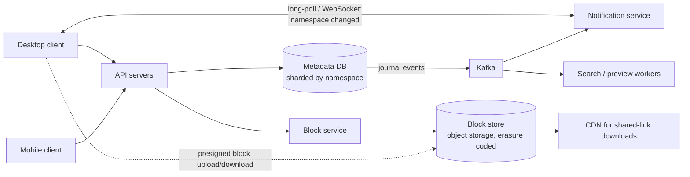

<Related ids={['blob-storage', 'transactions-and-isolation', 'message-queues', 'real-time-communication', 'cdn', 'sql-vs-nosql', 'time-and-ordering', 'security-fundamentals']} />

Design a cloud file storage and sync service like Dropbox or Google Drive: users upload files, they sync automatically across all their devices, they can share files and folders, and they can recover previous versions. The core challenges: **moving bytes efficiently** (only what changed), keeping **metadata consistent** across devices, and handling **conflicts** when the same file is edited in two places.

## 1. Clarify the problem

| Question | Assumption |
| --- | --- |
| Clients? | Desktop sync client, mobile apps, web |
| File sizes? | Up to 50 GB per file |
| Features? | Upload, download, automatic sync, sharing (view/edit), version history (30 days), offline edits |
| Real-time collaboration inside a document? | Out of scope (see the collaborative editor case study) |
| Scale? | 100M DAU, 500M total users, average 10 GB stored per user |
| Consistency? | A user's devices must converge to the same state; no silent data loss on conflicts |

## 2. Requirements

**Functional:** upload/download files; sync changes across devices; share with permissions; version history and restore; offline changes synced later.

**Non-functional:** durability (never lose a file), reliability of sync (eventually identical state everywhere), bandwidth efficiency, low sync latency (changes appear on other devices within seconds), scalability to exabytes.

## 3. Capacity estimation

```text
Storage: 500M users × 10 GB = 5 EB logical
Dedup across users + compression typically saves a significant fraction (common files, versions sharing blocks)

Uploads: 100M DAU × 2 file changes/day = 200M file changes/day ≈ 2,000/s average
Average change transfers ~1 MB after delta sync → ~2 GB/s ingress ≈ 16 Gbps

Metadata: average ~2,000 files per user → 500M × 2,000 = 1T files
          × ~500 B per file + revision rows ≈ 500 TB+ of metadata → must be sharded
```

**So:** blocks go to object storage (exabytes, erasure coded); metadata is a large, transactional, heavily sharded database; bandwidth efficiency (chunking and dedup) is essential.

## 4. Key idea: split files into blocks

Files are split into **blocks** (Dropbox historically used 4 MB blocks), each identified by the **hash of its content** (SHA-256).



Benefits:

<Callout type="note" title="Terminology">
"Blocks" here means **chunks of a file** stored as objects. That's different from *block storage* (EBS-style virtual disks addressed by block number), and some write-ups blur the two. Our blocks live in **object storage**.
</Callout>

- **Delta sync** — when a file changes, only changed blocks are uploaded. (With fixed-size blocks, an insertion near the start shifts every later block; **content-defined chunking**, using a rolling hash to choose boundaries, keeps unchanged regions aligned.)
- **Deduplication** — identical blocks (the same file in many accounts, or unchanged blocks across versions) are stored once.
- **Resumable, parallel transfers** — blocks upload independently.
- **Versioning is cheap** — a version is just a list of block hashes; old versions share most blocks.

<Callout type="warning">
Cross-user deduplication can leak information: if uploading a block is instant because "the server already has it", an attacker can test whether someone else stored a particular file. Mitigations include per-user or per-tenant dedup scopes or requiring the client to prove possession of the data.
</Callout>

## 5. API

```text
POST /v1/files/commit
  { "path": "/work/report.pdf", "parentRev": "rev_41", "blocks": ["h1","h2","h3","h4"], "size": 13631488 }
  → 200 { "rev": "rev_42" }
  → 409 { "missingBlocks": ["h3"] }     -- upload these first
  → 409 { "conflict": true, "currentRev": "rev_43" }

PUT  /v1/blocks/{hash}                  -- or presigned URL to the block store
GET  /v1/blocks/{hash}
GET  /v1/changes?cursor=…               -- list of metadata changes since cursor (long-poll for new ones)
POST /v1/shares                         -- share a file/folder with a user or link
GET  /v1/files/{id}/revisions
```

Offer two upload modes: a **simple upload** in one request for small files, and a **resumable upload** for large ones — (1) create an upload session and get a session URL, (2) send bytes with offsets while tracking progress, (3) after an interruption, ask the server how much it has and continue from there.

## 6. Data model

```text
namespaces       (namespace_id, owner)                      -- a user's root or a shared folder
files            (namespace_id, file_id, path, latest_rev, is_deleted)
revisions        (file_id, rev, block_list, size, author_device, created_at)
journal          (namespace_id, seq, file_id, rev, op)      -- append-only change log per namespace
blocks           (hash, size, storage_location, refcount)
shares/ACLs      (namespace_id, principal_id, role)
device_cursors   (device_id, namespace_id, last_seq)
```

Metadata needs **transactions** (commit a new revision and append to the journal atomically) and strong consistency per namespace → a relational database (Dropbox runs its metadata on sharded MySQL with its own layers on top), **sharded by namespace**.

Metadata must be **strongly consistent** — two devices must never disagree about which revision is current. That's another reason to keep it in a relational database with ACID transactions, and to **invalidate the metadata cache on every write** rather than letting cached entries expire on their own. Existing revision rows are read-only, which keeps history trustworthy.

## 7. High-level design

<FlowSteps title='Syncing a changed file' steps={[
  { path: ['D1', 'API', 'BLK'], text: 'The desktop client splits the changed file into blocks and asks which block hashes the server does not have yet.' },
  { path: ['D1', 'OS'], text: 'It uploads only the missing blocks, directly to the block store with presigned URLs.' },
  { path: ['API', 'META'], text: 'It commits the new version (an ordered list of block hashes) to the metadata database.' },
  { path: ['META', 'K', 'NOTIF'], text: 'The commit is appended to the namespace\'s journal and published through Kafka to the notification service.' },
  { path: ['NOTIF', 'D1'], text: 'Devices holding a long-poll or WebSocket hear \'namespace changed\' and pull the new journal entries and any blocks they lack.' },
  { path: ['K', 'SRCH'], text: 'Search and preview workers process the change in the background.' },
  { path: ['OS', 'CDN'], text: 'Shared-link downloads are served through a CDN in front of the block store.' },
]}>



</FlowSteps>

### Upload / sync flow

1. The client watches the local filesystem, detects a change, splits the file into blocks and hashes them.
2. It sends a **commit** with the block list and the revision it was based on (`parentRev`).
3. The server replies with blocks it doesn't have; the client uploads only those (directly to the block store via presigned URLs).
4. The client retries the commit; the server transactionally creates the new revision and appends an entry to the namespace **journal**.
5. The notification service tells the user's other devices (and collaborators) that the namespace changed.
6. Other devices call `GET /changes?cursor=…`, receive the new metadata, download the missing blocks, and reassemble the file locally.

## 8. Deep dives

### The journal and cursors

Each namespace has an ordered, append-only **journal** of changes with sequence numbers. A device stores its cursor (last applied seq). Sync is "give me everything after my cursor" — simple, resumable, and correct after offline periods. The notification channel only says "something changed"; the journal is the source of truth (same principle as chat sync).

**How clients hear about changes.** Notifications here are one-way and infrequent, so **long polling** is enough — Dropbox used it, reporting over a million open long-poll connections per machine. WebSockets work too but add little. When a notification server dies, all its clients must reconnect elsewhere; even a fleet that can hold millions of connections can only accept reconnects so fast, so clients reconnect with backoff and jitter, and the journal guarantees nothing is missed in the meantime. Changes for offline devices simply wait in the journal.

### Conflict handling

Two devices edit `report.pdf` offline, both based on `rev_41`:

- Device A commits first → `rev_42`.
- Device B commits with `parentRev: rev_41`, but current is `rev_42` → **conflict** (optimistic concurrency).

Binary files can't be merged automatically, so the server keeps both: B's version is saved as `report (Device B's conflicted copy 2026-10-14).pdf`. No data is ever silently overwritten. (Real-time co-editing of documents uses OT/CRDTs instead — a different product.)

### Where does chunking happen?

We chunk, hash and (optionally) encrypt **on the client** and upload blocks directly to object storage. Alex Xu's Google Drive design instead sends files to **block servers** that split, compress and encrypt before writing to storage. Trade-offs:

| | Client-side chunking (ours) | Server-side block servers |
| --- | --- | --- |
| Bytes over the network | Once, client → storage | Twice, client → block server → storage |
| Delta sync and dedup | Client knows which blocks are new before uploading | Server must receive data first (unless the client also hashes) |
| Implementation | Same logic on every client platform (desktop, iOS, Android, web) | One central implementation |
| Security | Clients can be tampered with; encryption keys on devices need care | Encryption done in a trusted environment |

Many real systems do both: clients compute block hashes to skip uploads, while trusted servers handle encryption and verification.

### Sharing and permissions

A shared folder is its own **namespace**, mounted into each member's tree. Membership and roles are stored in ACL tables and checked on every metadata and block request. Shared links use unguessable tokens, optional expiry and passwords, and serve downloads via signed CDN URLs.

### Durability of blocks

Blocks are immutable and content-addressed, stored with erasure coding across zones (see [Object Storage](/system-design/hld/blob-storage)). Verify hashes on upload and periodically (scrubbing) to catch silent corruption. A block is garbage-collected only when no revision references it (reference counting or periodic mark-and-sweep) and after the version-history retention window.

### Controlling storage cost

Version history multiplies storage. Typical policies: **cap the number of versions** (or keep all for 30 days, then thin out — keep more recent versions, sparser older ones, since a file saved 1,000 times in an afternoon doesn't need 1,000 snapshots); **dedup blocks** (within an account at least — see the security note above); and **tier cold data** — files untouched for months move to archive storage such as S3 Glacier at a fraction of the price.

### Large files and slow networks

Blocks give resumability for free: after a disconnect, the client resubmits the commit and uploads only blocks still missing. Upload blocks in parallel, with client-side bandwidth throttling so sync doesn't saturate the user's connection.

### Client efficiency

- Compress blocks before upload where useful.
- Keep a local database of file → block hashes, so detecting changes doesn't re-read whole files unnecessarily (use filesystem events plus size/mtime checks).
- Use **LAN sync**: devices on the same network can transfer blocks directly.

## 9. Failure modes

| Failure | Mitigation |
| --- | --- |
| Client crashes mid-upload | Commit only after all blocks exist; retry is idempotent (same hashes) |
| Metadata shard down | Replicated with failover; sync pauses for affected namespaces only |
| Notification service down | Clients fall back to periodic polling of `/changes` |
| Concurrent edits | Optimistic concurrency on `parentRev`; conflicted copies |
| Corrupted block | Hash verification; reconstruct from erasure-coded fragments |

## 10. Trade-offs summary

| Decision | Choice | Why |
| --- | --- | --- |
| Transfer unit | Content-addressed blocks (content-defined chunking) | Delta sync, dedup, resumability |
| Metadata store | Sharded relational DB with transactions | Atomic commits, consistent journals |
| Sync protocol | Journal + cursor, with change notifications | Correct after offline periods; cheap notifications |
| Conflicts | Optimistic concurrency + conflicted copies | Never lose user data |
| Bytes path | Direct to object storage via presigned URLs | Keep bytes off API servers |

## 11. What interviewers look for

- **Mid-level**: separate metadata and file storage, uploading files to object storage, notifying other devices.
- **Senior**: chunking and content hashing for delta sync and dedup, commit protocol with missing blocks, journal/cursor sync, conflict handling, presigned transfers.
- **Staff**: content-defined chunking, dedup security, garbage collection and retention, metadata sharding by namespace, cost of storage tiers.

## Interview questions

<QA q="Why split files into blocks instead of uploading whole files?">
Blocks enable delta sync (only changed blocks are uploaded after an edit), deduplication (identical blocks across versions and files are stored once), resumable and parallel transfers (a dropped connection only costs the current block), and cheap version history (a version is a list of block hashes sharing most blocks with the previous version).
</QA>

<QA q="How does a device that was offline for a week catch up?">
It stored the last journal sequence it applied for each namespace. On reconnect it requests all changes after that cursor, applies the metadata updates in order, and downloads only blocks it doesn't already have locally. Its own offline edits are committed with their parent revisions; any that conflict with changes made meanwhile become conflicted copies.
</QA>

<QA q="Two people edit the same spreadsheet in a shared folder at the same time. What happens?">
Both clients base their edit on the same revision. The first commit succeeds and becomes the new revision. The second commit's parent revision no longer matches, so the server reports a conflict; the client saves its version as a conflicted copy alongside the file and syncs both, so neither person's work is lost. Merging is left to the users — automatic merging requires a collaborative-editing design with OT or CRDTs.
</QA>

## Practice

Write your answer before opening the suggested one. Anything you mark "Partly" or "Missed it" comes back in your review deck.

<Practice task="A user edits one paragraph of a 200 MB file in a synced folder. How do you avoid uploading the whole file again, and what does the server store?">

Split files into chunks and sync only changed chunks.

1. The client splits the file into chunks (fixed 4 MB, or content-defined chunking so an insertion does not shift every later chunk) and hashes each one.
2. It asks the server which chunk hashes it already has; it uploads only the missing ones (here one or two chunks).
3. The server stores chunks in object storage keyed by hash (which also deduplicates identical chunks across users and versions) and writes a new file version: an ordered list of chunk hashes in the metadata database.
4. Other devices receive a change notification, fetch the new chunk list and download only the chunks they lack.

Old versions remain available because they are just older chunk lists; garbage collection removes chunks no version references.

</Practice>

<Practice task="Two devices edit the same file while one of them is offline. When it reconnects, both have changed version 7. What does the sync service do?">

Detect the conflict with versions and never silently lose work.

1. Each upload says which version it was based on ('based on v7'). The server accepts the first one as v8.
2. The second upload is also based on v7, but the current version is now v8, so the server rejects it as a conflict (an optimistic concurrency check).
3. The client keeps both: the server version stays as the file, and the local edits are saved as a 'conflicted copy' next to it (this is what Dropbox does), and the user decides.
4. For formats that can be merged (plain text, or documents with operational transforms/CRDTs, as in collaborative editors), the client may merge automatically instead.

The key rule: never apply a write blindly over a newer version.

</Practice>

<Takeaways>

- Separate metadata (transactional, sharded by namespace) from content (content-addressed blocks in object storage).
- Chunk files into hashed blocks for delta sync, dedup, resumable transfers and cheap versions.
- Commit revisions with optimistic concurrency; upload only missing blocks; never overwrite — create conflicted copies.
- Sync via an append-only journal and per-device cursors; notifications only trigger a pull.
- Transfer bytes directly to and from storage with presigned URLs; garbage-collect unreferenced blocks safely.

</Takeaways>

## Further reading

- Dropbox Tech Blog, "Streaming File Synchronization" (2014) and "Rewriting the heart of our sync engine" (2020).
- Dropbox Tech Blog, "Inside the Magic Pocket" (2016) — Dropbox's exabyte-scale block storage.
- Muthitacharoen, Chen and Mazières, "A Low-bandwidth Network File System" (SOSP 2001) — content-defined chunking with Rabin fingerprints.
- Related: [Object Storage & File Uploads](/system-design/hld/blob-storage), [Design a Collaborative Editor](/system-design/hld/design-collaborative-editor).
- Andrew Tridgell and Paul Mackerras, "The rsync algorithm" (1996) — delta transfer.
- Neil Fraser, "Differential Synchronization" (2009).
- Alex Xu, *System Design Interview*, Vol. 1 — ch. 15, "Design Google Drive".
