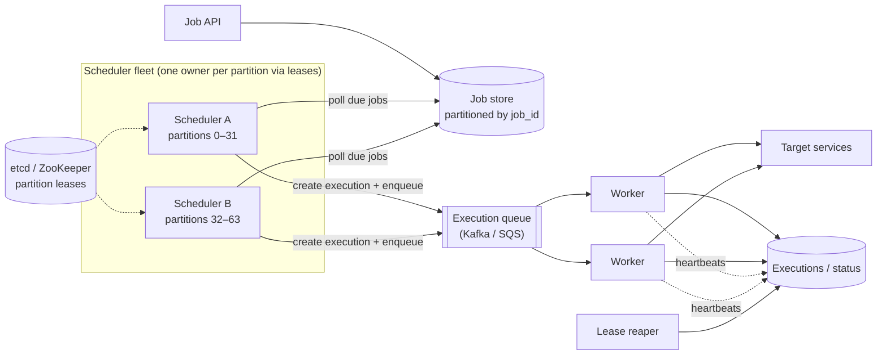

<Related ids={['consensus', 'message-queues', 'sharding', 'time-and-ordering', 'availability-and-fault-tolerance', 'distributed-transactions', 'observability']} />

Design a distributed job scheduler: users submit jobs to run once at a specific time ("send this reminder at 9 AM tomorrow") or on a recurring schedule ("generate invoices every day at 2 AM"), and the system runs them reliably on a pool of workers — think cron for a whole company, or the engine behind delayed tasks in a product. The hard parts: firing millions of jobs **on time**, never losing a job, and **not running a job twice** when machines fail.

## 1. Clarify the problem

| Question | Assumption |
| --- | --- |
| Job types? | One-off (at time T) and recurring (cron expressions); jobs are HTTP calls or messages to a handler, or containers |
| Scale? | 100M scheduled jobs stored; peak 50K jobs due per second (many at round times like 00:00) |
| Timing precision? | Within a few seconds of the scheduled time |
| Execution semantics? | At-least-once with idempotent handlers; at-most-one concurrent run per job |
| Job duration? | Seconds to hours |
| Retries? | Configurable, with backoff; dead-letter after max attempts |

## 2. Requirements

**Functional:** create/update/delete one-off and recurring jobs; execute at the scheduled time; retries and timeouts; job status and history; manual trigger/pause.

**Non-functional:** reliability (no lost jobs), timeliness (seconds), no duplicate concurrent execution, horizontal scalability, high availability (no single scheduler machine).

## 3. Capacity estimation

```text
Stored jobs: 100M × ~1 KB = 100 GB → partitioned database
Executions: e.g., 500M/day ≈ 6K/s average, 50K/s peak (round-hour spikes)
Execution history: 500M × 300 B ≈ 150 GB/day → retain 30 days hot, archive the rest
```

**So:** the job store and the "what's due now?" query must be partitioned; execution is a queue-and-worker problem; spikes at round times need buffering.

## 4. API

```text
POST /v1/jobs
{ "name": "daily-invoices", "schedule": { "cron": "0 2 * * *", "timezone": "Asia/Kolkata" },
  "target": { "type": "http", "url": "https://billing.internal/run", "timeoutSec": 900 },
  "retry": { "maxAttempts": 5, "backoff": "exponential" }, "concurrency": "forbid" }
→ 201 { "jobId": "j_81…" }

POST /v1/jobs   { "runAt": "2026-10-16T09:00:00+05:30", "target": {…}, "idempotencyKey": "reminder-u42-1016" }
GET  /v1/jobs/{id}/executions
POST /v1/jobs/{id}:trigger | :pause | :resume
```

## 5. Data model

```text
jobs        (job_id, owner, schedule (cron/run_at), timezone, target, retry_policy, concurrency_policy,
             next_run_at, status: active/paused, version)
            index on (partition, next_run_at)

executions  (execution_id, job_id, scheduled_for, attempt, status: QUEUED | RUNNING | SUCCEEDED | FAILED | TIMED_OUT,
             worker_id, lease_expires_at, started_at, finished_at, error)
            UNIQUE (job_id, scheduled_for)     -- one execution per scheduled occurrence
```

The `UNIQUE (job_id, scheduled_for)` constraint is the key to preventing duplicate occurrences.

## 6. High-level design



**Flow**

1. Jobs are stored with `next_run_at`.
2. Each **scheduler** instance owns a set of partitions (via leases in etcd/ZooKeeper). Every second or so, it queries its partitions for jobs with `next_run_at <= now + lookahead`.
3. For each due job it **atomically** inserts an execution row `(job_id, scheduled_for)` (unique — duplicates fail harmlessly), enqueues it, and advances `next_run_at` to the next cron occurrence.
4. **Workers** take executions from the queue, mark them RUNNING with a **lease** (heartbeated), run the job, and record the result.
5. Failures are retried with backoff; after max attempts, the execution goes to a dead-letter state and alerts the owner.

## 7. Deep dives

### Finding due jobs efficiently

- An index on `(partition_id, next_run_at)` lets each scheduler scan only its partitions' due jobs.
- **Lookahead**: fetch jobs due in the next 30–60 s and hold them in an in-memory **timing wheel** or priority queue, enqueuing each at its exact time — avoids hammering the DB and improves precision.
- **Round-time spikes**: millions of jobs at 00:00. Pre-load them during the preceding minute, enqueue in batches, and let the queue absorb the burst; optionally add small jitter for jobs that permit it.

### Exactly one scheduler per partition

If two schedulers both think they own a partition, jobs fire twice. Use **leases with fencing** (see [Consensus](/system-design/hld/consensus)): a scheduler acquires a lease per partition from etcd/ZooKeeper, renews it, and stops scheduling if renewal fails. Even if two overlap briefly after a pause, the **unique constraint on `(job_id, scheduled_for)`** makes the second insert fail — the database is the final guard against duplicate occurrences.

### Workers, leases and at-least-once execution

- A worker claims an execution by conditionally setting `RUNNING, worker_id, lease_expires_at` (only if still QUEUED).
- It heartbeats to extend the lease while running.
- If the worker dies, the lease expires; a **reaper** returns the execution to QUEUED (attempt + 1) for another worker.
- A worker that was only paused may still finish after its lease expired → the job might effectively run twice. That's why the guarantee is **at-least-once** and handlers must be **idempotent** (pass `execution_id`/idempotency key to the target). Use fencing tokens (attempt number) when the job writes to shared storage.

### Concurrency policies for recurring jobs

What if the 2:00 AM run is still running at 2:00 AM the next day (or the 5-minute job takes 7 minutes)?

- **Allow** — run concurrently.
- **Forbid** — skip the new occurrence while the previous one runs.
- **Replace** — cancel the running one and start the new one.

(Kubernetes CronJobs expose exactly these options.) Also define **catch-up/misfire** behaviour after downtime: run all missed occurrences, run only the latest, or skip.

### Time zones and DST

Store schedules with an explicit **time zone**; compute next occurrences with a proper timezone library. Daylight saving transitions create non-existent times (2:30 AM on spring-forward day) and repeated times (1:30 AM twice in the fall) — define the policy (run once, skip, or shift). Store `next_run_at` in UTC.

### Priorities and isolation

Separate queues (or weighted fair queuing) by priority and by tenant, so one team's 10M-job batch doesn't delay another team's critical jobs. Per-tenant concurrency limits protect target services from being overwhelmed by the scheduler itself.

### Long-running and workflow jobs

For multi-step jobs (extract → transform → load), use a workflow engine (Airflow for data DAGs, Temporal for application workflows) on top of the scheduler, giving step-level retries and state.

## 8. Failure modes

| Failure | Mitigation |
| --- | --- |
| Scheduler instance dies | Lease expires; another instance takes its partitions; due jobs caught up from `next_run_at` |
| Two schedulers overlap | Unique `(job_id, scheduled_for)` prevents duplicate occurrences |
| Worker dies mid-job | Lease expiry → reaper requeues; idempotent handlers |
| Queue backlog at midnight | Pre-loading, batching, autoscaling workers on queue depth |
| Target service down | Retries with backoff; dead-letter after max attempts; per-target circuit breaker |

## 9. Trade-offs summary

| Decision | Choice | Why |
| --- | --- | --- |
| Triggering | Partitioned schedulers with leases + timing wheel | Scale and precision without a single master |
| Duplicate prevention | Unique execution per occurrence + leases | DB constraint is the last line of defence |
| Execution | Queue + workers, at-least-once | Simple, scalable; exactly-once requires idempotent handlers |
| Failure detection | Heartbeated leases + reaper | Recovers from crashed workers automatically |

## 10. What interviewers look for

- **Mid-level**: job table with next run time, polling, queue, workers, retries.
- **Senior**: partitioned scheduling with leases, unique execution records, worker leases and heartbeats, at-least-once with idempotency, round-time spikes.
- **Staff**: concurrency/misfire policies, time zones and DST, multi-tenant fairness, fencing, workflow composition, observability of lateness (scheduled vs actual start).

## Interview questions

<QA q="How do you ensure a job scheduled for 9:00 doesn't run twice if two scheduler instances both pick it up?">
Partition ownership via leases makes overlap rare, but the real guarantee is a unique constraint on (job_id, scheduled_for) in the executions table: whichever scheduler inserts first creates the execution and enqueues it; the other's insert fails and it skips. Advancing next_run_at uses a conditional update on the job's version for the same reason.
</QA>

<QA q="A worker running a job is paused by a long GC and its lease expires. What happens?">
The reaper sees the expired lease and requeues the execution, so another worker starts it — the job may now be running twice. The paused worker's later writes should be rejected using a fencing token (the attempt number or lease version checked by the status store and, ideally, the target). The overall guarantee is at-least-once, so job handlers must be idempotent, keyed by execution ID.
</QA>

<QA q="How would you measure whether the scheduler is meeting its timing SLO?">
Record scheduled_for and actual start time for every execution and track the distribution of scheduling lag (start − scheduled) as a histogram per priority class, alerting on p99 lag exceeding the SLO. Also monitor queue depth, partitions without an active lease owner, execution failure rates and dead-letter growth.
</QA>

## Practice

Write your answer before opening the suggested one. Anything you mark "Partly" or "Missed it" comes back in your review deck.

<Practice task="A job must run exactly once at 09:00, but you have three scheduler instances for high availability. How do you stop all three from running it, and what happens if the one that started it crashes halfway?">

Separate 'deciding the job is due' from 'running it', and make claiming atomic.

1. Jobs live in a database table with `nextRunAt`, `status` and `leaseUntil`. Due jobs are claimed with a conditional update (`UPDATE … SET status='running', owner=?, leaseUntil=now()+5min WHERE id=? AND status='scheduled'`), or `SELECT … FOR UPDATE SKIP LOCKED`. Only one instance wins.
2. The worker renews its lease while it runs (a heartbeat).
3. If it crashes, the lease expires and another instance can claim the job again.

That gives at-least-once execution, not exactly-once. To make the effect exactly-once, the job itself must be idempotent: pass a run ID (job ID + scheduled time) to downstream systems so a rerun is detected and skipped.

</Practice>

<Practice task="Fifty thousand jobs are all scheduled for midnight (daily reports). What goes wrong, and how do you smooth it out?">

All jobs become due at the same instant: the scheduler's claim queries spike, the worker pool is overwhelmed, and the databases those jobs read are hammered at once (a thundering herd).

Fixes:
1. Add jitter when scheduling: spread 'daily at midnight' across, say, 00:00–01:00 using a hash of the job ID, unless a job truly needs an exact time.
2. Put due jobs onto a queue and let a fixed-size worker pool drain it, so concurrency is bounded no matter how many jobs are due.
3. Use priorities so short or critical jobs are not stuck behind long reports.
4. Rate-limit jobs per downstream dependency.

Users still get their reports 'around midnight', and the system stays stable.

</Practice>

<Takeaways>

- Store jobs with next_run_at; partitioned schedulers (owned via leases) find due jobs and enqueue executions.
- A unique execution per (job, scheduled time) is the final guard against duplicate triggering.
- Workers claim executions with heartbeated leases; a reaper requeues expired ones — at-least-once, so handlers must be idempotent.
- Define concurrency and misfire policies, handle time zones and DST explicitly, and isolate tenants and priorities.
- Absorb round-time spikes with lookahead loading, timing wheels and queue-based autoscaling.

</Takeaways>

## Further reading

- Kubernetes documentation — "CronJob" (concurrency policies, starting deadlines).
- Airbnb Engineering, "Dynein: Building a Distributed Delayed Job Queueing System" (2019).
- George Varghese and Tony Lauck, "Hashed and Hierarchical Timing Wheels" (SOSP 1987).
- [Temporal documentation](https://docs.temporal.io) — durable timers and workflows.
- Related: [Consensus, Leader Election & Locks](/system-design/hld/consensus), [Message Queues](/system-design/hld/message-queues).
