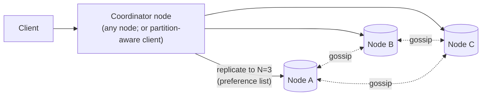
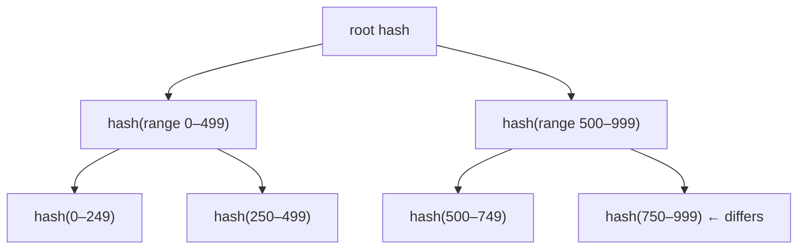

<Related ids={['consistent-hashing', 'replication', 'consistency-models', 'cap-and-pacelc', 'database-indexing', 'time-and-ordering', 'consensus', 'probabilistic-data-structures']} />

Design a distributed key-value store — a simplified Amazon Dynamo, Cassandra or Riak: `put(key, value)` and `get(key)` across hundreds of nodes, highly available, with tunable consistency and automatic recovery from failures. This question checks whether you can assemble the core distributed-systems building blocks into one coherent system: partitioning, replication, consistency, failure detection, repair and storage.

## 1. Clarify the problem

| Question | Assumption |
| --- | --- |
| API? | `get(key)`, `put(key, value)`, `delete(key)`; no range scans or transactions |
| Value size? | Small — under 10 KB typically, up to 1 MB |
| Scale? | Hundreds of TB, millions of ops/s, hundreds of nodes, multiple data centres |
| CAP preference? | **Always writable** (AP), with tunable consistency per request |
| Latency? | Single-digit milliseconds at p99 |
| Durability? | No acknowledged write lost if fewer than N replicas fail |

## 2. Requirements

**Functional:** get/put/delete; per-request consistency level.

**Non-functional:** horizontal scalability (add nodes without downtime), high availability (survive node, rack and DC failures), tunable consistency, low latency, automatic recovery, heterogeneous hardware.

### Start from a single node

On one machine, a key-value store is a hash table. You can stretch it with compression and by keeping only hot data in memory with the rest on disk — but storage and throughput still run out, and one machine is a single point of failure. Everything below is about distributing that hash table.

## 3. The building blocks

| Problem | Technique | Lesson |
| --- | --- | --- |
| Spread data across nodes | Consistent hashing with virtual nodes | [Consistent Hashing](/system-design/hld/consistent-hashing) |
| Survive failures | Replicate to N nodes (preference list) | [Replication](/system-design/hld/replication) |
| Tunable consistency | Quorums: W + R > N | [Consistency Models](/system-design/hld/consistency-models) |
| Concurrent writes | Version vectors / LWW timestamps | [Time, Clocks & Ordering](/system-design/hld/time-and-ordering) |
| Temporary failures | Sloppy quorum + hinted handoff | [Replication](/system-design/hld/replication) |
| Permanent divergence | Anti-entropy with Merkle trees; read repair | [Replication](/system-design/hld/replication) |
| Membership & failure detection | Gossip + phi-accrual detection | [Consensus](/system-design/hld/consensus) |
| Fast local storage | LSM-tree with commit log, memtable, SSTables, Bloom filters | [Indexing & Storage Engines](/system-design/hld/database-indexing) |

## 4. High-level design

Every node is identical (no leader): each owns ranges of the hash ring, stores data in a local LSM engine, gossips membership, and can act as **coordinator** for any request.

### Write path

1. The client sends `put(k, v)` to any node (or directly to a replica if the client is partition-aware).
2. The coordinator hashes `k`, finds the **preference list** — the first N distinct physical nodes clockwise on the ring (preferring different racks/AZs).
3. It sends the write to all N replicas and waits for **W** acknowledgements before replying.
4. Each replica appends to its **commit log** (durability), writes to the **memtable**, and acks; memtables flush to SSTables later.

### Read path

1. The coordinator sends the read to the replicas (or R of them, plus digest requests to the rest).
2. Waits for **R** responses, returns the newest version (by version vector or timestamp).
3. If replicas disagreed, triggers **read repair** — writes the newest version back to stale replicas.

### Tunable consistency

| Setting (N=3) | Behaviour |
| --- | --- |
| W=1, R=1 | Fastest, most available; reads may be stale |
| W=2, R=2 | Read and write sets overlap → usually reads latest; tolerates 1 failed node |
| W=3, R=1 | Fast reads; writes fail if any replica is down |
| LOCAL_QUORUM | Quorum within the local DC — avoids cross-DC latency, async to others |

<Callout type="note" title="Where sources differ">
Some popular guides state that **W + R > N guarantees strong consistency**. It guarantees that the read and write quorums *overlap*, which makes the latest value visible in the normal case. It does not give linearizability once you add sloppy quorums (writes landing outside the preference list), concurrent writes resolved by last-write-wins with skewed clocks, or partially failed writes that were not rolled back. Dynamo-style stores with W + R > N are "usually up to date", not strictly consistent.
</Callout>

## 5. Deep dives

### Handling concurrent writes

Two clients write the same key concurrently via different coordinators:

- **Last-write-wins** (timestamps): simple, used by Cassandra; concurrent writes silently drop one, and clock skew can drop the "wrong" one. Fine for many workloads (caches, user settings).
- **Version vectors** (Dynamo, Riak): detect that writes were concurrent and keep both **siblings**; the next read returns both and the client (or a merge function/CRDT) resolves them. Correct but pushes complexity to clients.

Choose per use case; for a general interview answer, describe both and pick LWW with the caveat, or version vectors for data where losing writes is unacceptable (e.g., shopping carts — Dynamo's original motivation).

**A vector clock in action.** A value is written through server A → `[A:1]`. Another client updates it through A → `[A:2]` (supersedes the first). Two clients then read `[A:2]` and update concurrently, one through B → `[A:2, B:1]`, one through C → `[A:2, C:1]`. Neither vector dominates the other, so they are **siblings**; the next reader merges them and writes back through A → `[A:3, B:1, C:1]`, which dominates both.

Vector clocks grow with every distinct coordinator. Dynamo bounds them by dropping the oldest entries past a threshold (losing some ability to detect ancestry); the paper reports this wasn't a problem in production.

### Temporary failures: sloppy quorum and hinted handoff

If replica C is down, the coordinator writes to the next healthy node D on the ring, with a **hint** ("this belongs to C"). D stores it separately and forwards it when C returns. Writes stay available (the AP choice) at the cost of weaker guarantees during the failure — a read quorum may not overlap with the sloppy write quorum.

### Permanent divergence: anti-entropy with Merkle trees

Replicas drift (missed hints, disk issues). Periodically, replicas compare data per key range using **Merkle trees**: hash trees where each leaf hashes a small key range and parents hash their children.

Compare roots; if equal, the replicas match. Otherwise descend only into differing subtrees. This finds differences while transferring data proportional to the **differences**, not the dataset.

In practice the key space is split into many buckets per tree — for example around a million buckets for a billion keys, so a mismatched leaf means re-syncing only about a thousand keys.

### Membership and failure detection

Nodes **gossip** heartbeat counters and membership state with random peers every second; changes spread in O(log N) rounds. A **phi-accrual detector** marks nodes suspect based on heartbeat arrival history. Distinguish *temporary* unavailability (handled by hinted handoff) from *permanent* removal (an operator or policy decision that triggers rebalancing), to avoid massive data movement on transient blips.

Don't declare a node dead on one peer's say-so: a single observer may simply have a bad link to it. Require corroboration — e.g., the suspect's heartbeat counter hasn't advanced in the membership lists gossiped by several peers — before marking it down.

### Adding and removing nodes

With virtual nodes, a new node takes many small ranges from many existing nodes, streaming those ranges in the background (bootstrapping) while the old owners keep serving; ownership switches once data is transferred. Removing a node does the reverse.

### Storage engine

An LSM-tree per node: commit log → memtable → SSTables with **Bloom filters** to skip SSTables on reads, **compaction** to merge them, and **tombstones** for deletes (kept for a grace period longer than the repair interval so deleted data isn't resurrected by a stale replica).

### Multi-datacenter

Replicate to N replicas per DC (e.g., 3 per DC across 2–3 DCs); use LOCAL_QUORUM for low latency and replicate asynchronously across DCs. The preference list is rack/zone/DC aware.

## 6. Failure modes

| Failure | Mitigation |
| --- | --- |
| Single node down | Other replicas serve; hinted handoff for writes; reads with R ≤ remaining replicas |
| Network partition | Both sides keep accepting writes (AP); version vectors/LWW resolve after healing |
| Node permanently lost | Replace node; stream its ranges from replicas; anti-entropy |
| Deleted data reappearing | Tombstone grace period longer than repair interval |
| Hot key | Client-side caching, request coalescing; it's a fundamental limit of key-partitioned stores |

## 7. Trade-offs summary

| Decision | Choice | Alternative |
| --- | --- | --- |
| Architecture | Leaderless, symmetric nodes | Leader per partition (strong consistency, failover needed) |
| Partitioning | Consistent hashing + vnodes | Fixed partitions / range partitioning |
| Consistency | Tunable quorums | Consensus per write (CP, higher latency) |
| Conflict resolution | LWW or version vectors | Single writer per key |
| Repair | Read repair + Merkle anti-entropy + hints | Full scans |
| Storage | LSM-tree | B-Tree (better reads, worse writes) |

## 8. What interviewers look for

- **Mid-level**: hashing keys to nodes, replication, basic get/put flow.
- **Senior**: consistent hashing with vnodes, quorum math, conflict resolution, hinted handoff, read repair, gossip membership, LSM storage.
- **Staff**: Merkle-tree anti-entropy, tombstones and resurrection, multi-DC quorums, rebalancing mechanics, comparing leaderless vs leader-based (CP) designs and when to choose each.

## Interview questions

<QA q="Why does W + R > N give you read-your-latest-write in the common case?">
With N replicas, any set of W nodes and any set of R nodes must share at least one node if W + R > N. So a read contacts at least one replica that acknowledged the latest successful write, and by comparing versions the coordinator returns it. Edge cases — sloppy quorums, concurrent writes, partially failed writes and LWW clock skew — mean it's not strict linearizability.
</QA>

<QA q="How does a node that was down for an hour catch up?">
Three mechanisms. Hinted handoff: nodes that accepted writes on its behalf forward the hints when it returns. Read repair: reads that touch it and find stale values write back the newest version. Anti-entropy: background Merkle-tree comparison with other replicas finds and streams any remaining differing ranges. Together they converge the node without scanning the full dataset.
</QA>

<QA q="When would you design this store with a leader per partition instead of leaderless?">
When you need strong consistency — linearizable reads and writes, conditional updates (compare-and-set) or transactions on a key — rather than always-on writes. A leader per partition, replicated with Raft (as in TiKV or CockroachDB), orders writes for each key range; the trade-off is that writes to a partition stop during leader election and on the minority side of a partition, and writes pay a quorum round trip.
</QA>

## Practice

Write your answer before opening the suggested one. Anything you mark "Partly" or "Missed it" comes back in your review deck.

<Practice task="Your store keeps 3 replicas per key with tunable quorums. A product needs reads that always see the latest acknowledged write, but writes must stay available when one replica is down. Pick R and W, and explain what happens when two replicas are down.">

With N = 3, choose W = 2 and R = 2. Then R + W = 4 > 3, so every read quorum overlaps every write quorum and sees the newest acknowledged value (resolved by version or timestamp).

One replica down: both reads and writes still get 2 responses, so everything works.

Two replicas down: neither quorum can be reached, so reads and writes fail (or you accept sloppy quorums and hinted handoff, which keeps writes available but gives up the read-your-latest-write guarantee until the hints are delivered).

If the product could live with stale reads, R = 1, W = 2 would be faster for reads; if writes matter less than reads, W = 3, R = 1 gives fast reads but writes fail with any replica down.

</Practice>

<Practice task="A single key ('trending:today') receives 200K reads per second, far more than the three replicas that own it can serve. How do you fix it without changing the client API?">

This is a hot key, and adding nodes does not help because one key lives on one replica set.

1. Read from all replicas, not only the coordinator's preferred one, if slightly stale reads are fine — that triples capacity.
2. Add a small in-process cache in each server node (or client library) for keys detected as hot, with a TTL of a second or two. Hot-key detection can use a Count-Min Sketch of recent requests.
3. For keys that are both hot and written often, split them: store `trending:today#0` … `#9`, write to all copies (or to one and merge), and read from a random copy.

Option 2 is usually enough for read-heavy hot keys and needs no client change.

</Practice>

<Takeaways>

- A Dynamo-style store combines consistent hashing, N-way replication, tunable quorums and LSM storage.
- Conflicts are resolved by last-write-wins (simple, lossy) or version vectors (correct, more complex).
- Hinted handoff covers temporary failures; read repair and Merkle-tree anti-entropy fix divergence.
- Gossip membership and phi-accrual detection replace a central coordinator.
- Choose leaderless for availability; choose a consensus leader per partition for strong consistency.

</Takeaways>

## Further reading

- DeCandia et al., "Dynamo: Amazon's Highly Available Key-value Store" (SOSP 2007).
- Lakshman and Malik, "Cassandra: A Decentralized Structured Storage System" (LADIS 2009).
- Ralph Merkle, "A Digital Signature Based on a Conventional Encryption Function" (CRYPTO 1987) — Merkle trees.
- Elhemali et al., "Amazon DynamoDB: A Scalable, Predictably Performant, and Fully Managed NoSQL Database Service" (USENIX ATC 2022).
- Alex Xu, *System Design Interview*, Vol. 1 — ch. 6, "Design a Key-Value Store".
