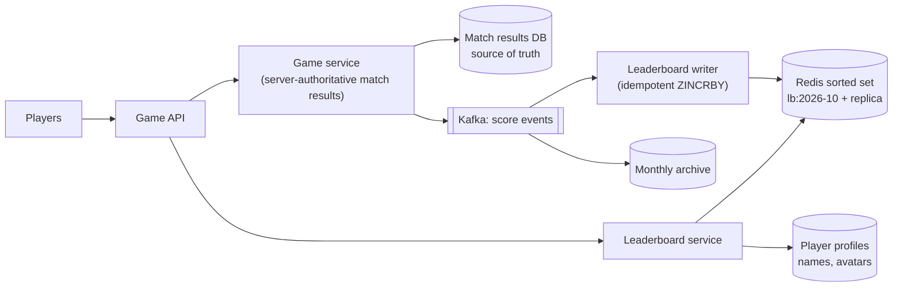

<Related ids={['caching', 'sharding', 'replication', 'message-queues', 'probabilistic-data-structures', 'sql-vs-nosql', 'time-and-ordering']} />

Design a real-time leaderboard for a mobile game. Players earn points by winning matches; the game shows the global top 10, each player's own rank, and the players just above and below them. Scores update in real time, and the leaderboard resets every month.

The core insight is that a relational database is a poor fit for "what is my rank?" at scale, while a **sorted set** answers it in O(log n). The interesting follow-ups are what happens when one machine is no longer enough, how to break ties fairly, and how to stop cheating.

## 1. Clarify the problem

| Question | Assumption |
| --- | --- |
| Scale? | 5M daily active users, 25M monthly active users |
| Score updates? | Each player plays ~10 matches a day; a win adds points |
| Reads? | Top 10, a player's rank and score, players around them |
| Time window? | Monthly leaderboard, reset at the start of each month; history kept |
| Ties? | Equal scores ranked by who reached the score first |
| Freshness? | A player sees their new rank right after a match |

## 2. Requirements

**Functional:** update a player's score after a match; return the top N; return any player's rank; return the players around a given player; keep past months' final standings.

**Non-functional:** rank and top-N reads in a few milliseconds; real-time updates; high availability during peak hours; scores must be trustworthy (no client-reported scores).

## 3. Capacity estimation

```text
Score updates: 5M DAU × 10 matches = 50M/day ÷ 10^5 s ≈ 500 updates/s average
Peak (evenings, events): ~5× → 2,500 updates/s
Leaderboard reads: top-10 views and rank checks, say 5× the updates → ~2,500 reads/s average

Memory for one board: 25M players × ~100 B per entry (ID, score, skip-list overhead)
≈ 2.5 GB → fits comfortably in one Redis instance
```

**So:** the load is modest; the hard part is answering rank queries quickly, which a database table with `ORDER BY score` cannot do at this size.

## 4. Why not just a database?

```sql
SELECT COUNT(*) + 1 AS rank FROM scores WHERE month = ? AND score > ?;
```

Even with an index on `(month, score)`, counting the rows above a player means scanning a large part of the index — millions of entries for an average player — on every rank request. Caching ranks does not help because every score change shifts the ranks of many players. This is the problem sorted sets solve.

## 5. Redis sorted sets

A sorted set keeps members ordered by score, backed by a **skip list** plus a hash map, so most operations cost O(log n):

| Operation | Command | Cost |
| --- | --- | --- |
| Add points after a win | `ZINCRBY lb:2026-10 50 user:42` | O(log n) |
| Top 10 | `ZREVRANGE lb:2026-10 0 9 WITHSCORES` | O(log n + 10) |
| A player's rank (0-based) | `ZREVRANK lb:2026-10 user:42` | O(log n) |
| Players around rank r | `ZREVRANGE lb:2026-10 r-4 r+4` | O(log n + 9) |
| A player's score | `ZSCORE lb:2026-10 user:42` | O(1) |

A skip list can answer "how many elements come before this one" in O(log n) because each forward link also stores how many elements it skips (its span). That is what makes ranks cheap.

## 6. High-level design

<FlowSteps title='A score update and a rank lookup' steps={[
  { path: ['P', 'API', 'GS'], text: 'A player finishes a match. The game server decides the result; the client never reports its own score.' },
  { path: ['GS', 'DB'], text: 'The match result is stored in the database, the source of truth.' },
  { path: ['GS', 'K', 'LBW'], text: 'A score event travels through Kafka to the leaderboard writer.' },
  { path: ['LBW', 'R'], text: 'The writer applies ZINCRBY to this month\'s sorted set, skipping match IDs it has already applied.' },
  { path: ['API', 'LBS', 'R'], text: 'Reads (top 10, my rank, players around me) go to the leaderboard service, which queries the sorted set in O(log n).' },
  { path: ['LBS', 'PROF'], text: 'Names and avatars are added from the profile store.' },
  { path: ['K', 'ARCH'], text: 'Score events are archived, so the board can be audited or rebuilt.' },
]}>



</FlowSteps>

**Update flow**
1. The match result is decided by the game server, never by the client, and stored in the match results database.
2. A score event (match ID, player, points) is published to Kafka.
3. The leaderboard writer applies `ZINCRBY` to the current month's key. It records processed match IDs so a re-delivered event does not add points twice.

**Read flow:** the leaderboard service reads ranks and ranges from Redis, then adds names and avatars from the profile store (cached), because the sorted set holds only IDs and scores.

## 7. Deep dives

### Durability and rebuilding

Redis is fast but not the source of truth. Match results in the database are, so if Redis loses data the board can be rebuilt by replaying the month's score events (or summing the results table). Run Redis with a replica and persistence (AOF) to make that rare. The leaderboard writer's idempotency (processed match IDs) makes replays safe.

### Ties

Players with the same score must be ordered by who got there first. A sorted set orders equal scores by member name, which is not fair. Encode the time in the score instead:

```text
score_for_sorting = points × 2^32 + (MAX_TIME − time_reached)
```

Higher points always win; for equal points, an earlier time gives a larger remainder and therefore a better rank. (Doubles hold integers exactly up to 2^53, so choose the bit split to fit your point and time ranges.)

### Monthly reset and history

Use one key per month (`lb:2026-10`). The new month simply starts writing to a new key, so there is no expensive reset. When the month ends, copy the final standings (or the top part) to the archive, then let the old key expire. Daily or weekly boards work the same way with their own keys.

### Scaling beyond one Redis instance

Suppose the game grows to 500M players: about 50 GB and far more traffic.

- **Shard by score range:** shard 1 holds scores 0–999, shard 2 holds 1,000–1,999, and so on. The top 10 comes from the highest shard. A player's rank = their rank within their shard + the sizes of all higher shards (`ZCARD`, cheap to cache). When a score crosses a range boundary, the player moves to another shard. Ranges must be chosen (and adjusted) so shards stay balanced, because scores are rarely evenly distributed.
- **Shard by player hash:** updates are spread evenly, but top-N needs a scatter-gather (top 10 from every shard, then merge), and an exact rank needs to count higher scores on every shard. Fine for top-N, expensive for exact ranks.

### Approximate ranks for huge boards

For a casual player at rank 48,213,977, an exact number matters less than "top 12%". Keep a histogram of how many players have each score (or each score bucket); a player's approximate rank is the sum of the counts of all higher buckets. This is cheap to compute and to shard, and exact ranks are kept only for the top players who care about them.

### Friends leaderboards

Ranking only among your friends is a different query: fetch the friends' scores (`ZMSCORE` on the global board) and sort the few hundred results in the service. No separate sorted set per player is needed.

### Cheating

Never accept a score from the client. The game server computes match results, validates them (impossible scores, too many matches per hour) and only then emits score events. Suspicious players can be hidden from public boards while a review runs, and the board is rebuilt from cleaned match results if needed.

## 8. Failure modes

| Failure | Mitigation |
| --- | --- |
| Redis primary fails | Automatic failover to the replica (Redis Sentinel or Cluster) |
| Redis data lost | Rebuild the month's key from the match results / Kafka replay |
| Duplicate score events | Idempotent writer: record processed match IDs |
| Hot top-10 reads during an event | Cache the top 10 for a second or two in the service |
| Uneven score-range shards | Re-split ranges based on the score distribution |

## 9. Trade-offs summary

| Decision | Choice | Why |
| --- | --- | --- |
| Rank storage | Redis sorted set (skip list) | O(log n) rank and range queries |
| Source of truth | Match results in a database | Redis can be rebuilt; scores are auditable |
| Updates | Async through Kafka, idempotent | Decouples the game from the board; safe retries |
| Ties | Time encoded into the score | Fair, deterministic ordering |
| Monthly reset | New key per month | No mass deletion or downtime |
| Huge scale | Score-range sharding or approximate ranks | Exact global ranks get expensive |

## 10. What interviewers look for

- **Mid-level:** recognise that `ORDER BY` plus counting does not scale and propose a sorted set; basic API.
- **Senior:** O(log n) operations and why; source of truth and rebuild; idempotent updates; tie-breaking; monthly keys.
- **Staff:** sharding strategies and their effect on rank queries, approximate ranks, anti-cheat, multi-region play, cost.

## Interview questions

<QA q="Why can a sorted set return a rank in O(log n) when a database needs to count rows?">
Redis sorted sets use a skip list in which every forward link stores how many elements it skips (its span). Walking from the top level down to a member and adding up the spans gives its position, in O(log n) steps. A B-tree index in a typical database does not keep such counts, so the database has to count the entries above the player, which is linear in their rank.
</QA>

<QA q="How do you find a player's global rank when the board is sharded by score range?">
Find the shard whose range contains the player's score, take the player's rank within that shard (ZREVRANK), then add the number of players in every higher shard. Those counts change constantly but are cheap to read (ZCARD) or keep cached, so the whole query touches one shard plus a few counters.
</QA>

<QA q="Two players reach 10,000 points. How do you rank the one who got there first higher?">
Make the sort key combine points and time: points multiplied by a large power of two, plus (a maximum time minus the time the score was reached). Higher points always sort first; for equal points, the earlier time leaves a larger remainder and ranks higher. Keep the real points separately (or decode them) for display.
</QA>

## Practice

Write your answer before opening the suggested one. Anything you mark "Partly" or "Missed it" comes back in your review deck.

<Practice task="A tournament has 2 million players and needs a leaderboard for each of 200 countries plus a global one. How many sorted-set entries is that, roughly how much memory, and does it fit on one Redis instance?">

Each player appears in the global board and in one country board: 2M × 2 = 4M entries.

At about 100 bytes per entry, that is roughly 400 MB — easily one Redis instance, with a replica for failover.

Every score update now writes two keys (global and country). Do both in one pipeline or a small Lua script so they cannot drift apart, and keep the writer idempotent per match.

</Practice>

<Practice task="The game now has 300 million players, and the product wants every player to see their exact rank. Your hash-sharded design needs to ask all 20 shards for every rank request. Propose a better design.">

Switch to range sharding by score, so a rank needs one shard plus counts:
1. Split the score space into ranges that each hold a similar number of players (based on the current distribution), one or more ranges per shard.
2. A player's rank = their rank inside their range's sorted set + the total number of players in all higher ranges.
3. Keep the per-range counts in a small, frequently refreshed table (or a Fenwick tree over ranges), so the 'higher ranges' sum is one cheap lookup.
4. When a score crosses a range boundary, move the player: remove from the old set and add to the new one.

If 'exact' can relax for most players, serve approximate percentiles from a score histogram and exact ranks only for the top tiers.

</Practice>

<Takeaways>

- Counting rows above a score does not scale; a sorted set (skip list with spans) gives O(log n) rank, top-N and range queries.
- Keep match results in a database as the source of truth; Redis can be rebuilt from them.
- Update scores asynchronously and idempotently; never trust client-reported scores.
- Break ties by encoding the time a score was reached into the sort key.
- Use a new key per period instead of resetting the board.
- At very large scale, shard by score range so ranks stay cheap, or serve approximate ranks from a histogram.

</Takeaways>

## Further reading

- Redis documentation — "Sorted sets" and the complexity notes for `ZADD`, `ZRANK` and `ZRANGE`.
- William Pugh, "Skip Lists: A Probabilistic Alternative to Balanced Trees" (Communications of the ACM, 1990).
- Alex Xu and Sahn Lam, *System Design Interview*, Vol. 2 (2022) — ch. "Real-time Gaming Leaderboard".
