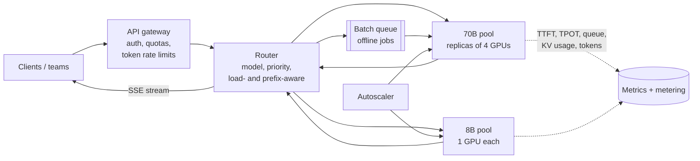

<Related ids={['design-rag-assistant', 'load-balancing', 'rate-limiting', 'real-time-communication', 'caching', 'back-of-the-envelope-estimation']} />

Design a platform that serves large language models (LLMs) to many internal teams, or to external customers through an API: requests come in with a prompt, and answers stream back token by token. This is asked as "design ChatGPT's backend", "design an LLM inference service" or "how would you serve a 70B model to millions of users?".

It is not a normal web service. Each request occupies a GPU for seconds, memory per request grows with every token generated, and the hardware costs far more than anything else in the system. Good answers show you understand **why LLM inference is slow and expensive**, and the handful of techniques that make it affordable. The numbers below matter; interviewers expect you to do this arithmetic.

## 1. Clarify the problem

| Question | Assumption |
| --- | --- |
| Models | A few open-weight models: a 70B model for quality, an 8B model for cheap tasks |
| Traffic | ~500 requests/s at peak; average 1,500 prompt tokens, 300 output tokens |
| Latency | Time to first token (TTFT) under ~1 s; then ~30+ tokens/s per stream |
| Tenants | Many teams; interactive chat and offline batch jobs |
| Interface | Streaming responses (SSE); also a cheaper batch API |

Two latency numbers define the user experience, so name them early:

- **TTFT (time to first token):** how long until the answer starts. Dominated by queueing and processing the prompt.
- **TPOT (time per output token)**, or inter-token latency: how fast the text appears. Reading speed is ~5–10 tokens/s, so 30 tokens/s feels instant.

## 2. How generation works, and why it's expensive

Generation has two phases with very different costs:

1. **Prefill.** The model processes all prompt tokens **in parallel** in one forward pass and stores, for every layer, a key and value vector per token: the **KV cache**. Prefill is **compute-bound**; a long prompt keeps the GPU busy.
2. **Decode.** The model produces one token per forward pass, each pass reading **all the model's weights** from GPU memory plus the KV cache so far. Decode does little arithmetic per byte read, so it is **memory-bandwidth-bound**.

The arithmetic that explains everything else:

```text
Model weights: 70B parameters × 2 bytes (fp16/bf16) = 140 GB
  → doesn't fit on one 80 GB GPU; spread over 4 GPUs with tensor parallelism (35 GB each)

One decode step reads every weight once:
  35 GB per GPU ÷ ~3.35 TB/s memory bandwidth (H100) ≈ 10 ms per token
  → at batch size 1: ~95 tokens/s for one user, while the GPUs' compute sits mostly idle

Batch 64 sequences in the same step: the weights are read once for all 64
  → roughly 64× the throughput for about the same step time
```

**Batching is the single biggest lever.** What limits the batch size is GPU memory for the KV cache:

```text
KV cache per token = 2 (key + value) × layers × KV heads × head dim × bytes
Llama 3 70B: 2 × 80 × 8 × 128 × 2 bytes = 327,680 B ≈ 320 KB per token
Llama 3 8B:  2 × 32 × 8 × 128 × 2 bytes = 131,072 B ≈ 128 KB per token

4 × 80 GB = 320 GB − 140 GB weights − ~20 GB working memory ≈ 160 GB for KV cache
160 GB ÷ 320 KB ≈ 500K tokens in flight
  → ~280 concurrent sequences of 1,800 tokens (prompt + output), or ~120 of 4K tokens
```

So a replica's capacity is set by **how many tokens' worth of KV cache fit in memory**. Most serving techniques either fit more sequences into that memory or use each forward pass better.

## 3. Capacity estimation

```text
Output tokens needed: 500 req/s × 300 tokens = 150K tokens/s at peak

One 70B replica (4 GPUs), batch ~100 active sequences at ~30 tokens/s each
  ≈ 3,000 output tokens/s (prefill work reduces this somewhat)

Replicas: 150K ÷ 3K ≈ 50 → 200 GPUs, plus ~30% headroom ≈ 260 GPUs

Route easy requests to the 8B model (one GPU per replica, ~10× cheaper per token)
→ moving half the traffic there cuts the 70B fleet roughly in half
```

These are rough numbers; real throughput depends on the serving engine, prompt lengths and hardware. The point is the method: tokens per second needed ÷ tokens per second per replica.

## 4. High-level design



- **Gateway:** authenticates, enforces per-tenant quotas and **rate limits in tokens** (requests vary 1,000× in cost, so counting requests isn't enough), and caps prompt and output length.
- **Router:** picks a pool by model and priority, then a replica by load (queue length, KV cache usage) and, where possible, by **prefix affinity**: send requests sharing a long prefix to the replica that already has it cached.
- **Model servers:** an inference engine such as vLLM, TensorRT-LLM or SGLang on each replica, doing the batching and memory management described below.
- **Streaming:** tokens flow back over SSE as they're generated.
- **Metering:** count input and output tokens per tenant for billing and capacity planning.

## 5. Deep dives

### Continuous batching

Naive batching waits for a group of requests, runs them together, and returns when the **longest** finishes; short answers sit idle while one long answer completes, and new requests wait for the next batch.

**Continuous (iteration-level) batching** schedules at every decode step: finished sequences leave the batch immediately and waiting requests join at the next step. The GPU stays full and new requests don't wait for a whole batch to drain. This one change typically raises throughput several times over static batching, and every modern inference engine does it.

### PagedAttention: KV cache without waste

Reserving a contiguous block of memory for each sequence's maximum possible length wastes most of it, because nobody knows in advance how long an answer will be. **PagedAttention** (from vLLM) stores the KV cache in small fixed-size blocks, like pages in an operating system's virtual memory: a sequence gets blocks as it grows, and a table maps its positions to blocks. Fragmentation nearly disappears, more sequences fit, and blocks can be **shared** between sequences.

### Prefix caching

Many requests start with the same tokens: a long system prompt, a RAG instruction template, a few-shot example block, or the earlier turns of the same conversation. Their KV cache is identical, so compute it once and reuse the blocks. This cuts TTFT and prefill compute sharply for templated traffic, and it's why the router tries to send related requests to the same replica.

### Prefill and decode interfere

A 20K-token prompt arriving at a replica means a long prefill pass, during which every other user's decode step stalls: their text freezes mid-sentence. Two remedies:

- **Chunked prefill:** split long prompts into chunks processed alongside decode steps, so decode keeps moving.
- **Disaggregated serving:** separate GPU pools for prefill and decode, transferring the KV cache between them. Each pool is sized and tuned for its own bottleneck. More complex, used at large scale.

### Making the model cheaper to run

| Technique | What it does | Trade-off |
| --- | --- | --- |
| **Quantisation** (FP8, INT8, INT4 weights; quantised KV cache) | Fewer bytes per weight → less memory, faster decode, more room for KV cache | Small quality loss, larger at 4 bits; must be evaluated per model |
| **Speculative decoding** | A small draft model proposes several tokens; the large model checks them all in one pass and keeps the accepted ones | Same output quality; speed-up depends on how often drafts are accepted |
| **Smaller or distilled models** | Route easy requests to an 8B model | Needs a router or task rules and quality checks |
| **Tensor / pipeline parallelism** | Split one model across GPUs (within a node over NVLink; across nodes for very large models) | More GPUs per replica; communication overhead |

### Autoscaling GPUs

GPU replicas are slow to start: provisioning a node and loading 140 GB of weights can take minutes. So:

- Scale on **queue depth, KV cache utilisation and TTFT**, not CPU usage, which says nothing here.
- Keep a **warm buffer** of replicas, and load weights from fast local or regional storage, not across the internet.
- Absorb short spikes by queueing with admission control: reject or degrade (smaller model, shorter max output) rather than letting every request time out.
- Fill idle capacity with **batch jobs** (evaluations, summarising backlogs) at a lower price, and pre-empt them when interactive load rises.

### Multi-tenancy and fairness

- **Priority classes:** interactive requests ahead of batch.
- **Per-tenant token budgets** at the gateway, so one team's runaway job can't starve everyone.
- **Pre-emption:** when KV memory runs out, the engine pauses lower-priority sequences, freeing their blocks by swapping them to CPU memory or discarding and recomputing them later, instead of failing requests.
- **Limits:** maximum prompt and output length per tier.

### Observability

Track per model and tenant: queue time, TTFT, TPOT, tokens/s per GPU, KV cache utilisation, batch size, pre-emptions, error and timeout rates, and cost per million tokens. Alert on TTFT and queue growth: they move first when capacity runs short.

## 6. Failure modes

| Failure | Mitigation |
| --- | --- |
| GPU or node fails mid-stream | Client sees the stream end with an error; retry on another replica (idempotent for non-tool calls); health checks remove the replica |
| KV cache exhausted under load | Continuous batching with pre-emption; admission control; scale out; cap max tokens |
| Long prompts stall other users | Chunked prefill or separate prefill pool; prompt length limits per tier |
| Traffic spike, slow scale-up | Warm buffer, queueing with deadlines, route overflow to a smaller model, shed batch work |
| One tenant floods the system | Token-based rate limits and quotas at the gateway; priority classes |
| Quality regression after quantisation or model update | Evaluation suite before rollout; canary by tenant; keep the previous version deployable |

## 7. Trade-offs summary

| Decision | Choice | Why |
| --- | --- | --- |
| Batching | Continuous batching | Keeps GPUs busy; short requests aren't held by long ones |
| KV memory | Paged blocks, prefix caching | More sequences per GPU; reuse shared prompts |
| Long prompts | Chunked prefill or disaggregation | Protects inter-token latency for everyone |
| Cost | Quantisation, speculative decoding, small-model routing | Memory bandwidth is the bottleneck |
| Rate limiting | Tokens, not requests | Request cost varies by orders of magnitude |
| Scaling signal | Queue depth, KV usage, TTFT | CPU usage is meaningless for GPU inference |

## 8. What interviewers look for

- **Mid-level:** gateway, router, model replicas, streaming, autoscaling; understands GPUs are the scarce resource.
- **Senior:** prefill vs decode, KV cache and its memory arithmetic, continuous batching, token-based rate limits, TTFT and TPOT as SLOs, the capacity estimate.
- **Staff:** PagedAttention and prefix-aware routing, chunked or disaggregated prefill, quantisation and speculative decoding trade-offs, multi-tenant pre-emption, cost per token as the key business metric.

## Interview questions

<QA q="Why is the decode phase memory-bandwidth-bound, and what follows from that?">
Each decode step generates one token per sequence, but to do so the GPU must read every model weight from memory once, plus that sequence's KV cache. That is a lot of data movement for very little arithmetic, so the step time is set by memory bandwidth, not compute. The consequence is that batching many sequences into the same step is almost free: the weights are read once for all of them. Throughput then scales with batch size until KV cache memory runs out, which is why memory management, quantisation and continuous batching matter so much.
</QA>

<QA q="How much GPU memory does the KV cache need for a 70B model with 4,000-token conversations?">
Per token, the KV cache stores a key and a value vector for every layer and KV head: 2 × layers × KV heads × head dimension × bytes per value. For Llama 3 70B that's 2 × 80 × 8 × 128 × 2 bytes ≈ 320 KB per token. A 4,000-token sequence therefore needs about 1.3 GB. With 4 × 80 GB GPUs holding 140 GB of weights, roughly 160 GB remains for cache, enough for about 120 such sequences at once. Longer contexts mean fewer concurrent users per replica, which directly raises cost per request.
</QA>

<QA q="What is continuous batching and why does it matter?">
With static batching, a group of requests runs together until the longest finishes, so short requests waste GPU slots and new arrivals wait for the batch to end. Continuous batching schedules every decode step: completed sequences leave immediately and queued ones join at the next step. GPU utilisation stays high, throughput rises several-fold, and queueing time for new requests, and therefore time to first token, drops.
</QA>

<QA q="Why should an LLM API rate-limit by tokens rather than requests?">
Requests differ enormously in cost: a 50-token question with a 20-token answer and a 100,000-token document summary are both "one request", but the second uses thousands of times more GPU time and memory. Request-based limits let a few heavy users exhaust capacity while staying under their limit. Limiting input and output tokens per minute, along with maximum lengths per request, ties quotas to actual resource use and makes capacity planning and billing consistent.
</QA>

## Practice

Write your answer before opening the suggested one. Anything you mark "Partly" or "Missed it" comes back in your review deck.

<Practice task="Users report that answers sometimes freeze for 2–3 seconds mid-sentence, then continue. GPU utilisation looks fine. What is the likely cause and what would you change?">

The pattern points to **long prefills interrupting decode**. When a request with a very long prompt arrives at a replica, its prefill pass occupies the GPU, and every other sequence's next decode step waits until it finishes, so their streams pause.

Fixes:
- Enable **chunked prefill**, so long prompts are processed in pieces interleaved with decode steps.
- At larger scale, **disaggregate**: a prefill pool and a decode pool.
- Route very long prompts to replicas reserved for them, and enforce prompt length limits by tier.
- Confirm by plotting inter-token latency spikes against prefill events per replica.

</Practice>

<Practice task="Your platform's main traffic is a RAG assistant whose prompts all start with the same 2,000-token instruction block. How can you exploit that, and what does the router need to do?">

Enable **prefix caching**: the KV cache for the shared 2,000-token block is computed once per replica and reused, so each request only needs prefill for its own passages and question. That cuts prefill compute and TTFT substantially.

For it to work, requests must reach replicas that already hold the prefix, so the router should use **prefix-aware routing**: hash the leading tokens (or a template ID) and prefer replicas that recently served the same prefix, while still balancing load so one replica doesn't become hot. Keep the instruction block byte-identical across requests (put variable content after it), or the cache won't match.

</Practice>

<Takeaways>

- LLM inference has a compute-bound prefill and a memory-bandwidth-bound decode; decode reads all weights per step, so batching is the key lever.
- KV cache size per token = 2 × layers × KV heads × head dim × bytes; it limits how many sequences fit on a replica.
- Continuous batching, paged KV memory and prefix caching are the core techniques of modern inference engines.
- Long prompts hurt everyone's streaming unless prefill is chunked or disaggregated.
- Cut cost with quantisation, speculative decoding and routing easy requests to smaller models.
- Rate-limit by tokens, scale on queue depth and KV usage, keep warm GPU capacity, and fill idle time with batch jobs.

</Takeaways>

## Further reading

- Woosuk Kwon et al., "Efficient Memory Management for Large Language Model Serving with PagedAttention" (SOSP 2023) — vLLM.
- Gyeong-In Yu et al., "Orca: A Distributed Serving System for Transformer-Based Generative Models" (OSDI 2022) — iteration-level batching.
- Yaniv Leviathan, Matan Kalman and Yossi Matias, "Fast Inference from Transformers via Speculative Decoding" (ICML 2023).
- Amey Agrawal et al., "Taming Throughput-Latency Tradeoff in LLM Inference with Sarathi-Serve" (OSDI 2024) — chunked prefill.
- Yinmin Zhong et al., "DistServe: Disaggregating Prefill and Decoding for Goodput-optimized LLM Serving" (OSDI 2024).
