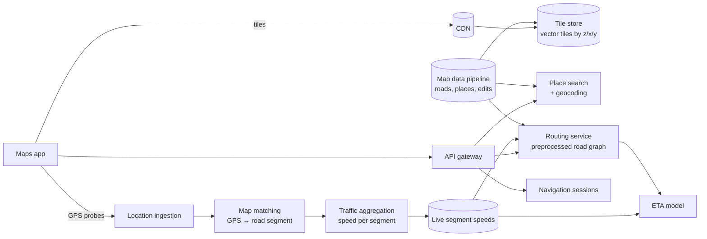
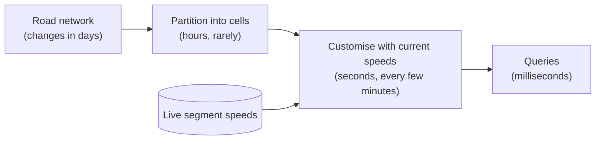

<Related ids={['geospatial-indexing', 'design-ride-hailing', 'batch-and-stream-processing', 'caching', 'cdn']} />

Design a maps and navigation service like Google Maps: show a map users can pan and zoom, search for places, compute a route from A to B with an accurate arrival time, and guide drivers turn by turn, rerouting around traffic. It's a favourite at Google, Uber, Apple and Amazon because it combines three very different problems:

1. **Serving the map itself**, a gigantic static dataset, to a billion devices (a CDN and data-layout problem).
2. **Computing routes** on a graph of hundreds of millions of intersections within milliseconds (an algorithms problem).
3. **Live traffic and arrival times** from millions of moving phones (a streaming and ML problem).

## 1. Clarify the problem

| Question | Assumption |
| --- | --- |
| Features | Map display, place search, routing (driving first), arrival time (ETA), turn-by-turn navigation with rerouting |
| Scale | 1B monthly users; ~50K route requests/s at peak; ~10M devices navigating at once at peak |
| Coverage | The whole world |
| Freshness | Traffic reflected within a couple of minutes; road changes within days |
| Latency | Map tiles fast enough to pan smoothly; routes within ~1 s |
| Out of scope | Street View imagery, reviews, public transit (mention as follow-ups) |

## 2. Requirements

**Functional:** render the map at any location and zoom; search places and addresses; route between points with alternatives; ETA using live traffic; navigation with voice guidance and automatic rerouting.

**Non-functional:** very high availability (people rely on it while driving); low latency; navigation must keep working through brief network loss; location data is personal and must be protected.

## 3. Capacity estimation

```text
Map tiles: a zoom level z covers the world in 4^z tiles
  zoom 18 → ~69 billion tiles; most are empty ocean or unchanged countryside
  vector tiles (compressed geometry, rendered on the device) ≈ tens of KB each
  → store only non-empty tiles; serve almost entirely from CDN caches

Routing: 50K route requests/s at peak, each must finish in well under a second
  road graph of a continent: hundreds of millions of nodes and edges
  → plain Dijkstra exploring millions of nodes per request is far too slow

Traffic probes: 10M navigating devices × 1 location update every ~5 s = 2M updates/s
  → a streaming pipeline, partitioned by region
```

## 4. High-level design



Three largely independent subsystems share one map data pipeline:

- **Tiles** for display, built offline and served through a CDN.
- **Routing and ETA**, on a preprocessed road graph whose edge weights are updated with live traffic.
- **Traffic**, computed from anonymised location probes of devices that are navigating.

## 5. Deep dives

### Serving the map: tiles

The world is cut into square **tiles** at each zoom level, addressed as `z/x/y` (or a single quadkey string). Zoom 0 is one tile for the whole world; each level splits every tile into four.

- **Vector tiles, not images.** Older maps sent pre-rendered PNG images. Modern apps fetch **vector tiles**: compressed road and building geometry plus labels, rendered on the device. They're smaller, look sharp at any screen density, support rotation and tilt, and one tile can be styled for day, night or navigation mode.
- **Generalisation per zoom.** At low zoom you show motorways and country borders; at high zoom, every building. Each zoom level's tiles keep only the detail that matters at that scale, so tile sizes stay bounded.
- **Static and cacheable.** Tiles change only when the map data does, so they're served with long cache lifetimes from the CDN and cached on the device. A new map version produces new tile URLs (a version in the path), so caches never serve a mix of old and new.
- **Offline maps:** the user downloads all tiles for a region in advance, plus the routing data for it.

### Place search and geocoding

- **Geocoding** turns an address into coordinates; **reverse geocoding** turns a tap on the map into an address. Both use spatial indexes over address points and road segments.
- **Place search** ("coffee near me") is a text search ranked by relevance, distance, popularity and the current viewport. It combines an inverted index for text with a geospatial index; see [Geospatial Indexing](/system-design/hld/geospatial-indexing) and the "nearby places" variation in [Design a Ride-Hailing Service](/system-design/hld/design-ride-hailing).

### Routing: why Dijkstra isn't enough

Dijkstra's algorithm finds the shortest path by expanding outward from the start in order of distance. For a cross-country route it may settle tens of millions of nodes: seconds of CPU per request, at 50K requests per second. Even A*, which steers the search towards the destination, explores far too much on continental graphs.

Production routers use **preprocessing**, which spends hours computing helper structures once so each query explores a few thousand nodes instead of millions:

- **Contraction hierarchies (CH).** Rank every node by importance (a quiet cul-de-sac is low; a motorway junction is high). "Contract" nodes from least to most important, adding **shortcut edges** that preserve shortest distances around each removed node. A query then runs a bidirectional search that only ever moves **upward** in importance from both ends; they meet near the top of the hierarchy. Queries take milliseconds. The catch: preprocessing assumes fixed edge weights, so live traffic would mean recomputing everything.
- **Partition-based routing (multi-level overlays, as in customizable route planning).** Split the graph into cells, recursively, and precompute the distances across each cell's boundary. Preprocessing has two phases: the **partition**, which depends only on the road network and changes rarely; and a fast **customisation** that recomputes boundary distances from the current edge weights in seconds. That makes it possible to fold live traffic into routing every minute or two.



Mention that **turn costs and restrictions** (no left turn, U-turn penalties, toll avoidance) are modelled as part of the graph, and that alternatives are generated by finding routes that are not much longer but share little with the best one.

### Live traffic from probes

1. **Ingestion.** Navigating devices send a location roughly every few seconds (batched to save battery). The stream is partitioned by region.
2. **Map matching.** GPS points are noisy (tens of metres off, worse among tall buildings). Snapping each point to the nearest road is wrong at intersections and on parallel roads. Map matching considers the **sequence** of points: a hidden Markov model scores each candidate road by distance to the point and how plausible the transition from the previous road is, then picks the most likely path.
3. **Aggregation.** From matched paths, compute travel speed per road segment over sliding windows (say the last 5 minutes), across many devices. Require a minimum number of distinct devices before trusting a segment, and fall back to historical speeds where data is thin.
4. **Publish** segment speeds to the routing customisation step and the ETA model.

**Privacy:** probes are used for aggregate speeds only; device identifiers are dropped or rotated, trips are not stored in identifiable form longer than needed, and segments with very few users aren't reported.

### ETA: more than distance ÷ speed

A route's ETA is not just the sum of current segment times:

- Traffic **will change** during the trip. A 2-hour drive starting at 4 p.m. hits the evening rush halfway. Combine live speeds for the near segments with **historical speeds for the time each segment will actually be reached** (same weekday and hour).
- Delays concentrate at **intersections** (traffic lights, turns across traffic), not along segments.
- An **ML model** corrects the physics-style estimate using features such as time, weather, events and the route's road types, trained on completed trips. Google has described using graph neural networks over road "supersegments" for this.

Measure ETA quality as the error distribution of predicted vs actual arrival on completed trips, by region and trip length.

### Navigation sessions and rerouting

- The app downloads the route geometry, turn instructions and the tiles along the corridor at the start, so guidance continues through short connectivity gaps.
- The device tracks the user's position against the route **locally**. If the user leaves the route, the app requests a new route from the current position.
- The server periodically re-evaluates active sessions against fresh traffic: if a meaningfully faster route appears (say, 5+ minutes saved), it offers it.
- Arrival times are updated continuously along the trip from live segment speeds.

## 6. Failure modes

| Failure | Mitigation |
| --- | --- |
| Routing cluster overloaded | Routes cached for popular origin–destination areas briefly; shed alternatives first; scale replicas (the graph is read-only, so replicas are easy) |
| Traffic pipeline delayed | Routing falls back to historical speeds; ETA shows less confidence |
| Bad map data (a closed road still routable) | User reports and probe data (nobody drives it) feed corrections; fast-path edits for closures |
| Device loses connection mid-navigation | Route, instructions and tiles cached on the device; local off-route detection |
| GPS spoofing or bad probes | Outlier filtering, minimum number of distinct devices per segment |

## 7. Trade-offs summary

| Decision | Choice | Why |
| --- | --- | --- |
| Map display | Vector tiles by z/x/y via CDN, rendered on device | Small, cacheable, styleable |
| Routing | Preprocessed graph (partition + fast customisation) | Millisecond queries that can still reflect live traffic |
| Traffic | Probes → map matching → per-segment speeds | Accurate speeds without fixed sensors |
| ETA | Live + historical-by-time-of-arrival + ML correction | Traffic changes during the trip |
| Navigation | On-device tracking with cached route | Works through connectivity gaps |

## 8. What interviewers look for

- **Mid-level:** tiles and CDN, a routing service on a graph, traffic from phones, a reasonable API.
- **Senior:** why Dijkstra is too slow, preprocessing ideas (contraction hierarchies or partitions), how live traffic enters routing, map matching, ETA using future traffic.
- **Staff:** customisable preprocessing for frequent weight updates, privacy of location data, offline navigation, map data pipeline and edits, global deployment.

## Interview questions

<QA q="Why can't a routing service just run Dijkstra on each request?">
On a continental road graph, a long route makes Dijkstra settle tens of millions of nodes, which costs seconds of CPU per request. At tens of thousands of requests per second that is impossible to afford, and users expect sub-second answers. Production systems preprocess the graph once: contraction hierarchies add shortcut edges so queries only climb a hierarchy of important roads, and partition-based methods precompute distances across cells. Queries then explore thousands of nodes instead of millions and finish in milliseconds.
</QA>

<QA q="How does live traffic get into the routes if preprocessing takes hours?">
Use a method whose preprocessing is split into a slow part that depends only on the road network and a fast part that depends on edge weights. With partition-based routing, the partition into cells is computed rarely, and a customisation step recomputes the distances across each cell from current segment speeds in seconds. Running that customisation every minute or two keeps routes current. Contraction hierarchies in their basic form need full re-preprocessing when weights change, which is why they suit static weights better.
</QA>

<QA q="How do you turn raw GPS points from phones into traffic speeds?">
First match each device's sequence of noisy GPS points to the road network: a hidden Markov model considers both how close each point is to candidate roads and how plausible each transition is, which avoids snapping to the wrong road at intersections or on parallel roads. From the matched paths, compute travel times per road segment over a sliding window, combining many devices. Require a minimum number of distinct devices before trusting a segment, filter outliers, and fall back to historical speeds where data is sparse.
</QA>

## Practice

Write your answer before opening the suggested one. Anything you mark "Partly" or "Missed it" comes back in your review deck.

<Practice task="A driver starts a 3-hour trip at 3 p.m. on a Friday. The current traffic along the whole route is light. Why would an ETA based only on current speeds be wrong, and how should it be computed?">

Current speeds describe the road **now**, but the driver reaches the far segments 1–3 hours later, when the Friday evening rush has started near cities on the route. Summing current segment times underestimates the trip.

Compute the ETA segment by segment in time order: for each segment, estimate the time the driver will **arrive** at it, and use a speed for that moment: live speeds for the next few minutes, blending into historical speeds for that weekday and hour further out. Add intersection delays, then apply an ML correction trained on completed trips. Keep updating the ETA during the trip as live data replaces predictions.

</Practice>

<Takeaways>

- A maps system is three systems: tiles via CDN, routing on a preprocessed graph, and traffic from probes.
- Vector tiles addressed by z/x/y are small, cacheable and rendered on the device.
- Plain Dijkstra is too slow on continental graphs; contraction hierarchies and partition-based routing make queries take milliseconds.
- Partition-based methods allow fast customisation, so live traffic can enter routing every few minutes.
- Traffic comes from map-matched GPS probes aggregated per road segment, with privacy protections.
- ETAs use the speed expected when each segment is reached, plus an ML correction.

</Takeaways>

## Further reading

- Robert Geisberger, Peter Sanders, Dominik Schultes and Daniel Delling, "Contraction Hierarchies: Faster and Simpler Hierarchical Routing in Road Networks" (WEA 2008).
- Daniel Delling, Andrew Goldberg, Thomas Pajor and Renato Werneck, "Customizable Route Planning" (SEA 2011).
- Paul Newson and John Krumm, "Hidden Markov Map Matching Through Noise and Sparseness" (ACM SIGSPATIAL 2009).
- Austin Derrow-Pinion et al., "ETA Prediction with Graph Neural Networks in Google Maps" (CIKM 2021).
