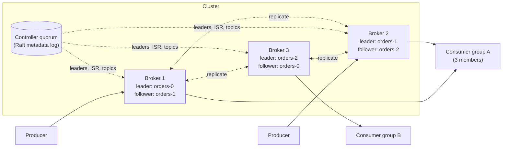

<Related ids={['message-queues', 'replication', 'consensus', 'sharding', 'event-driven-architecture', 'availability-and-fault-tolerance', 'batch-and-stream-processing']} />

Design a distributed message queue in the style of Apache Kafka: producers write messages to named **topics**, consumers read them, messages are kept for days so they can be replayed, and the system must keep working when machines fail. Unlike a classic queue that deletes a message once it is consumed, this is a **distributed log**: an ordered, append-only sequence that many independent consumers read at their own pace.

This question tests whether you understand why Kafka is fast (sequential disk I/O and batching), how it stays durable (replication with in-sync replicas), and what "exactly once" really means.

## 1. Clarify the problem

| Question | Assumption |
| --- | --- |
| Messages or a log? | A log: messages are retained (for example 7 days) and can be re-read |
| Ordering? | Ordered within a partition; no global order across a topic |
| Delivery? | At least once by default; exactly-once processing as an option |
| Message size? | Small (about 1 KB typical, 1 MB maximum) |
| Scale? | 1M messages/s in, 3M messages/s out (several consumer groups) |
| Consumers? | Groups of consumers share the work; many groups read the same topic independently |
| Durability? | No acknowledged message is lost if one machine fails |

## 2. Requirements

**Functional:** create topics with a number of partitions; produce messages with an optional key; consume from a position (offset) and resume after restarts; consumer groups that split partitions among their members; configurable retention by time or size; log compaction (keep only the latest value per key) for some topics.

**Non-functional:** high throughput (GB/s per cluster); low latency (single-digit to tens of ms end to end); durability through replication; horizontal scalability by adding brokers and partitions; availability when brokers fail.

## 3. Capacity estimation

```text
Ingress: 1M messages/s × 1 KB = 1 GB/s written
Egress:  3 consumer groups × 1 GB/s = 3 GB/s read (plus replication traffic)
Replication factor 3 → 3 GB/s of disk writes across the cluster

Retention 7 days: 1 GB/s × 86,400 × 7 ≈ 600 TB of data
× 3 replicas ≈ 1.8 PB of disk

Broker: ~10 disks, ~1 GB/s sequential write, 25 Gbit/s NIC
→ network, not CPU, is usually the first limit; plan ~30–50 brokers with headroom
```

**So:** this is an I/O and network problem. The design must make disk access sequential, move data in large batches, and spread partitions evenly across brokers.

## 4. API

```text
produce(topic, key?, value, headers?) → (partition, offset)
  batched by the client library; acks = 0 | 1 | all

fetch(topic, partition, fromOffset, maxBytes) → [messages]
  consumers pull; long-poll until data or a timeout

commitOffset(group, topic, partition, offset)
joinGroup(group, topics) / heartbeat(group, member)   → partition assignment
```

Consumers **pull**. Pulling lets each consumer read at its own speed and in large batches; a slow consumer simply falls behind (its lag grows) instead of being overwhelmed. That is built-in back-pressure.

## 5. Data model

- A **topic** is split into **partitions**. Each partition is an ordered, append-only log; every message gets an increasing **offset** within its partition.
- A message's partition is chosen by `hash(key) % partitions` (all messages for one key stay in order), or round robin when there is no key.
- On disk, a partition is a series of **segment files** (for example 1 GB each). Only the newest segment is written to; old segments are deleted or compacted as a whole.
- Each segment has a sparse **offset index** (offset → byte position) and a **time index** (timestamp → offset), so a consumer can start reading from an offset or a time.

```text
topic "orders", partition 7
  00000000000000000000.log   (offsets 0 … 4,999,999)       sealed
  00000000000005000000.log   (offsets 5,000,000 … )         active, appended to
  00000000000005000000.index (sparse: every ~4 KB)
```

## 6. High-level design



**Write path**
1. The producer library batches messages per partition (by size or a few ms of `linger`), compresses the batch and sends it to the **leader** broker of that partition.
2. The leader appends the batch to its log (the page cache; disk flush happens later).
3. Followers fetch from the leader and append the same bytes.
4. With `acks=all`, the leader acknowledges once every **in-sync replica** has the batch.

**Read path**
1. A consumer fetches from the partition leader starting at its offset. Data usually comes straight from the OS page cache.
2. The broker sends file bytes to the socket with zero-copy (`sendfile`), without copying them through the application.
3. The consumer processes the batch and commits its new offset.

**Metadata:** a small **controller** quorum (Raft, as in KRaft; older versions used ZooKeeper) stores topics, partition placement, leaders and in-sync replica sets, and elects new partition leaders when brokers fail.

## 7. Deep dives

### Why a log on disk is fast

Disks and SSDs are fast at sequential access and slow at random access. Every write is an append to the end of a segment, and most reads are sequential scans of recent data that is still in the page cache. Batching amortises network and disk overhead over many messages, and compression works better on batches. Zero-copy transfer saves CPU. Kafka relies on the operating system's page cache instead of its own cache, so a restarted broker still benefits from warm memory.

### Replication, ISR and the high watermark

- Each partition has one leader and several followers on different brokers (and racks).
- The **in-sync replica set (ISR)** contains replicas that are caught up within a time limit. A follower that falls behind is removed from the ISR.
- The **high watermark** is the highest offset copied to all ISR members. Consumers only see messages up to the high watermark, so they never read data that could disappear in a failover.
- `acks=all` plus `min.insync.replicas=2` (with replication factor 3) means a write succeeds only when at least two replicas have it. If the ISR shrinks below 2, the partition rejects writes rather than risk losing them.
- **Unclean leader election** (letting an out-of-sync replica become leader) trades durability for availability; it is disabled for important data.

### Consumer groups and rebalancing

Within a group, each partition is assigned to exactly one consumer, so a topic's partitions are the unit of parallelism: with 12 partitions, at most 12 consumers in a group do useful work. Members send heartbeats to a group coordinator broker; when a member joins, leaves or stops heartbeating, partitions are reassigned (a **rebalance**). Cooperative (incremental) rebalancing moves only the partitions that must move instead of stopping every consumer. Committed offsets are stored in an internal, compacted topic.

### Delivery semantics

- **At most once:** commit the offset before processing. A crash loses the message.
- **At least once:** process, then commit. A crash after processing but before committing causes a re-delivery, so consumers must be idempotent.
- **Exactly once (within the log):** the **idempotent producer** attaches a producer ID and per-partition sequence numbers, so the broker drops retried duplicates. **Transactions** let a consume-transform-produce application write its output messages and its consumer offsets atomically. This gives exactly-once *processing* inside Kafka; side effects in external systems still need idempotency there.

### Retention and compaction

Time- or size-based retention deletes whole old segments, which is cheap. **Log compaction** instead keeps the latest message for every key (and deletes keys whose latest value is a "tombstone"). Compacted topics work as a durable changelog or snapshot: a new consumer can rebuild the current state of every key by reading the topic from the start.

### Scaling and hot partitions

Throughput scales with partitions spread over brokers. Adding partitions later changes `hash(key) % partitions`, so keys move to new partitions and per-key ordering is broken across the change; size partitions for future growth up front. A very hot key overloads one partition; options are a better key (a composite key with a salt, aggregated later) or accepting that one partition limits that key's throughput. Moving partitions between brokers to rebalance load copies data in the background with a bandwidth limit.

## 8. Failure modes

| Failure | What happens | Mitigation |
| --- | --- | --- |
| Partition leader's broker dies | Controller elects a new leader from the ISR | Replication factor 3 across racks; clients refresh metadata and retry |
| Follower falls behind | Removed from the ISR | Writes continue if ISR ≥ `min.insync.replicas` |
| Whole ISR lost except an out-of-sync replica | Choose: stay unavailable or lose data | Unclean election disabled for critical topics |
| Consumer crashes mid-batch | Partition reassigned; reprocessing from last commit | Idempotent processing |
| Consumer much slower than producers | Lag grows; data may expire before being read | Alert on lag; add consumers (up to the partition count); longer retention |
| Controller node fails | Raft quorum elects a new active controller | 3 or 5 controller nodes |

## 9. Trade-offs summary

| Decision | Choice | Why |
| --- | --- | --- |
| Storage model | Append-only partitioned log | Sequential I/O, replay, many independent readers |
| Delivery | Consumer pull | Natural back-pressure, large batches |
| Ordering | Per partition, by key | Global order would cap throughput at one machine |
| Durability | Leader–follower replication, ISR, `acks=all` | No acknowledged loss with one failure |
| Metadata | Small Raft quorum | Consistent leader election without a single point of failure |
| Exactly once | Idempotent producer + transactions | Removes duplicates inside the log; external effects still need idempotency |

## 10. What interviewers look for

- **Mid-level:** topics, partitions, offsets, producers and consumer groups; replication for durability.
- **Senior:** why sequential I/O and batching make it fast; ISR, high watermark, `acks` and `min.insync.replicas`; rebalancing; at-least-once versus exactly-once; key-based ordering and its limits.
- **Staff:** capacity planning (network as the bottleneck), tiered storage for long retention, partition count planning, unclean election trade-offs, multi-region replication (mirroring) and its ordering and offset-translation problems.

## Interview questions

<QA q="Why does Kafka guarantee order only within a partition, not across a topic?">
A total order across a topic would require every message to pass through a single point (one leader assigning offsets), which caps throughput at what one machine can do. Partitioning lets different brokers handle different partitions in parallel. Most applications only need order per entity (per user, per order), which you get by using that entity's ID as the key, so all its messages go to the same partition.
</QA>

<QA q="A producer uses acks=all and gets a success. Can that message still be lost?">
Not if the topic is configured sensibly: with replication factor 3 and min.insync.replicas=2, a success means at least two replicas have the message, so losing any one broker cannot lose it. It can still be lost if min.insync.replicas is 1 (the leader alone may have it), if unclean leader election lets an out-of-sync replica take over, or if every replica fails before flushing the page cache to disk at the same moment, which replication across racks makes very unlikely.
</QA>

<QA q="You have 12 partitions and add a 13th consumer to the group. What happens?">
The 13th consumer gets no partitions and stays idle, because within a group each partition is read by exactly one consumer. To use more consumers, increase the partition count, keeping in mind that this changes the key-to-partition mapping for keyed topics.
</QA>

## Practice

Write your answer before opening the suggested one. Anything you mark "Partly" or "Missed it" comes back in your review deck.

<Practice task="A team needs 500 MB/s of writes, three consumer groups and 14 days of retention with replication factor 3. Estimate total disk and outbound network traffic, and name the first resource you expect to run out.">

Disk: 500 MB/s × 86,400 s × 14 days ≈ 605 TB of data, × 3 replicas ≈ 1.8 PB (before compression, which often saves 2–4× on text).

Network out of the brokers: three consumer groups read 500 MB/s each = 1.5 GB/s, plus replication: each write is sent to two followers = 1 GB/s. About 2.5 GB/s, or 20 Gbit/s, spread across the cluster — more at peak.

Network is usually the first limit (it also carries inbound producer traffic), followed by disk capacity for long retention. Tiered storage (old segments in object storage) cuts the local disk need sharply.

</Practice>

<Practice task="A payment-events topic must never lose an acknowledged message, even if a broker dies right after acknowledging. Which producer and topic settings do you choose, and what do you give up?">

- Replication factor 3, replicas in different racks or availability zones.
- `min.insync.replicas=2` and producer `acks=all`: a write is acknowledged only when at least two replicas have it.
- `enable.idempotence=true` so producer retries do not create duplicates.
- Unclean leader election disabled.

Costs: higher write latency (waiting for followers), and reduced availability — if only one replica is in sync, the partition rejects writes instead of accepting them unsafely. For payments, that is the right trade-off.

</Practice>

<Takeaways>

- A distributed message queue is a partitioned, replicated, append-only log; offsets let consumers replay and resume.
- Speed comes from sequential disk I/O, batching, compression, the page cache and zero-copy transfers.
- Order is guaranteed per partition; use the entity ID as the key to keep its messages in order.
- Durability comes from leader–follower replication with an in-sync replica set, `acks=all` and `min.insync.replicas`.
- Consumers pull, which gives back-pressure; consumer groups split partitions, so partitions cap parallelism.
- Exactly-once inside the log needs idempotent producers and transactions; external effects still need idempotent consumers.

</Takeaways>

## Further reading

- Jay Kreps, Neha Narkhede and Jun Rao, "Kafka: a Distributed Messaging System for Log Processing" (NetDB 2011).
- Jay Kreps, "The Log: What every software engineer should know about real-time data's unifying abstraction" (2013).
- Apache Kafka documentation — "Design" (persistence, replication, delivery semantics) and "KRaft".
- Alex Xu and Sahn Lam, *System Design Interview*, Vol. 2 (2022) — ch. "Distributed Message Queue".
