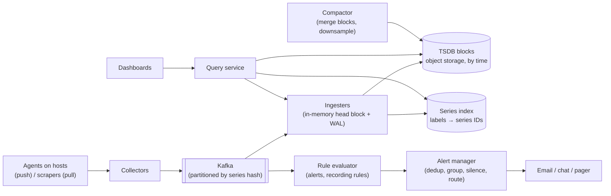

<Related ids={['observability', 'database-indexing', 'batch-and-stream-processing', 'message-queues', 'sharding', 'availability-and-fault-tolerance', 'probabilistic-data-structures']} />

Design a metrics monitoring and alerting system like Prometheus, Datadog or Grafana Cloud. Agents on every host and service report numbers such as CPU usage, request rate and error count every few seconds. Engineers look at dashboards, and the system sends an alert when something goes wrong.

The interesting parts are the write rate (millions of tiny data points per second), a storage format that compresses time series well, the danger of **high cardinality**, and making sure alerting keeps working when the systems it watches are failing.

## 1. Clarify the problem

| Question | Assumption |
| --- | --- |
| What is monitored? | Infrastructure (hosts, containers) and services (request rate, errors, latency) |
| Logs and traces too? | No — numeric metrics only (logs and traces are separate systems) |
| Scale? | 100K hosts, ~1,000 time series each, reported every 10 s |
| Retention? | Full resolution for 7 days, downsampled for 1 year |
| Query latency? | Dashboards in about a second; alert rules evaluated every 30–60 s |
| Alerts to? | Email, chat, paging (PagerDuty-style), with deduplication and silencing |

## 2. Requirements

**Functional:** ingest metrics (name, labels, timestamp, value); store and query them over time ranges with aggregation (sum, average, percentiles, rates) and filters on labels; dashboards; alert rules ("error rate above 5% for 5 minutes"); notification routing, grouping and silencing.

**Non-functional:** very high write throughput; reads mostly over recent data; compact storage; **alerting must be more reliable than the things it monitors**; graceful handling of late or missing data; horizontal scalability.

## 3. Capacity estimation

```text
Series: 100K hosts × 1,000 = 100M active time series
Writes: 100M ÷ 10 s = 10M data points/s

Raw point: 8 B timestamp + 8 B value = 16 B
Raw: 10M × 16 B = 160 MB/s ≈ 14 TB/day

With Gorilla-style compression (~1.4 B/point):
10M × 1.4 B ≈ 14 MB/s ≈ 1.2 TB/day → ~8.5 TB for 7 days at full resolution

Downsampled to 5-min averages for a year:
100M series × 105K points/year × ~1.4 B ≈ 15 TB (plus min/max/count per bucket)
```

**So:** the challenge is the write rate and the number of series, not raw bytes. Compression makes storage manageable, and the series index (label → series) must stay in memory for fast queries.

## 4. Data model

A **time series** is identified by a metric name plus a set of labels:

```text
http_requests_total{service="checkout", region="eu-west", status="500"}
  (t1, 120), (t2, 125), (t3, 131), …
```

Each unique combination of label values is a separate series. **Cardinality** is the number of distinct series. Labels with unbounded values (user ID, request ID, full URL) create millions of series and can take the whole system down; they belong in logs or traces, not metric labels.

Metric types: **counters** (only increase; query their rate), **gauges** (go up and down, like memory used), and **histograms** (counts per latency bucket, from which percentiles are estimated).

## 5. API

```text
Ingest (agents or collectors):
  POST /v1/write   [ { series: {name, labels}, samples: [[ts, value], …] } ]   batched, compressed

Query:
  GET /v1/query_range?q=sum by (service)(rate(http_requests_total{status="500"}[5m]))&start=…&end=…&step=30s

Alert rule (stored config):
  alert: HighErrorRate
  expr: errors_ratio{service="checkout"} > 0.05
  for: 5m
  labels: {severity: page}
```

## 6. High-level design

<FlowSteps title='From sample to page' steps={[
  { path: ['A1', 'COL'], text: 'Agents scrape the processes on their host and push batches of samples to collectors.' },
  { path: ['COL', 'K', 'ING'], text: 'Collectors enforce series limits and write to Kafka by series hash, so each series lands on one ingester.' },
  { path: ['ING', 'TS'], nodes: ['IDX'], edges: [['ING', 'IDX']], text: 'Ingesters keep recent samples in memory (with a write-ahead log) and flush compressed blocks to object storage, updating the label index.' },
  { path: ['DASH', 'Q', 'IDX'], text: 'A dashboard query first finds the matching series in the label index…' },
  { path: ['Q', 'ING'], nodes: ['TS'], edges: [['Q', 'TS']], text: '…then reads recent data from the ingesters and older data from the blocks.' },
  { path: ['K', 'RULE', 'AM', 'N'], text: 'The rule evaluator checks alert rules; the alert manager deduplicates, groups and routes the notifications.' },
  { path: ['CMP', 'TS'], text: 'The compactor merges blocks and writes downsampled rollups for long-range queries.' },
]}>



</FlowSteps>

**Write path:** agents batch samples and send them to collectors (or a scraper pulls them). Collectors validate, enforce per-tenant limits on series count, and write to Kafka partitioned by series hash, so all samples of a series go to the same ingester. Ingesters append samples to an in-memory "head" block (with a write-ahead log for crash recovery) and, every couple of hours, flush a compressed, immutable block to object storage.

**Read path:** the query service looks up matching series in the index, then reads recent data from ingesters and older data from blocks, and aggregates the results.

## 7. Deep dives

### Push or pull?

- **Pull** (Prometheus): the server scrapes each target's `/metrics` endpoint. It knows which targets are down (a failed scrape is itself a signal), and targets need no knowledge of the monitoring system. It needs service discovery and struggles with short-lived jobs and targets behind firewalls.
- **Push** (Datadog agents, OpenTelemetry): agents send data out. Good for short-lived jobs and across network boundaries; the server must detect missing data separately ("no data for 5 minutes" alerts).

Large systems often use both: local agents scrape the processes on a host and push the results to the central system.

### Time-series compression

Facebook's Gorilla paper showed that time series compress extremely well:
- **Timestamps:** samples arrive at regular intervals, so store the *delta of deltas*. For a steady 10-second interval it is 0 almost every time, which takes one bit.
- **Values:** consecutive values are often equal or close. XOR each value with the previous one; the result has many leading and trailing zeros, so only the meaningful bits are stored.

Together that averages about 1.37 bytes per point instead of 16. Data is stored in blocks per time range (for example two hours), each containing chunks per series, so a query reads only the blocks for its time range.

### The series index

Queries filter by labels (`service="checkout" AND status="500"`). An **inverted index** maps each label pair to the sorted list of series IDs that have it; a query intersects the lists. This is the same idea as a search engine's inverted index, and it is why high cardinality hurts: the index grows with every series, and it has to stay in memory to be fast.

### Downsampling and retention

Old data rarely needs 10-second resolution. A compactor merges small blocks into larger ones and produces **rollups** (for example 5-minute and 1-hour buckets with min, max, sum and count, so averages and maximums stay correct). Queries over long ranges automatically use the coarser data. Raw data is deleted after 7 days; rollups are kept for a year.

### Queries at scale

Dashboards repeat the same queries every few seconds. Cache results per time step (most of a time range has not changed since the last refresh), split long queries into shorter ranges that run in parallel, and limit how many series one query may touch. **Recording rules** precompute expensive aggregations (for example the per-service error rate) as new, small series, so dashboards and alerts read the precomputed result.

### Alerting

- A rule evaluator runs each rule every 30–60 s. The `for: 5m` clause requires the condition to hold for 5 minutes before firing, which avoids alerts on brief spikes.
- The **alert manager** deduplicates (many evaluator replicas fire the same alert), groups related alerts into one notification (50 hosts failing in one zone become one page), applies silences during maintenance, and routes by severity and team.
- Alert on **symptoms users feel** (error rate, latency SLO burn rate) rather than every cause (CPU at 80%).
- **Who monitors the monitor?** Run the alerting path with redundancy, and use a "dead man's switch": an alert that always fires and is sent to an external service, which pages someone if the alert *stops* arriving.

## 8. Failure modes

| Failure | Mitigation |
| --- | --- |
| Cardinality explosion (a label gets user IDs) | Per-tenant series limits at collectors, reject new series above the limit, alert on series growth |
| Ingester crash | Replay its write-ahead log; replicate each series to 2–3 ingesters |
| Kafka lag during a traffic spike | Queries show slightly stale data; alert evaluation may read recent data directly from ingesters |
| Late or out-of-order samples | Accept within a small window; drop or flag older ones |
| Monitoring system down | Independent meta-monitoring and a dead man's switch |
| Expensive dashboard queries | Query limits, result caching, recording rules |

## 9. Trade-offs summary

| Decision | Choice | Why |
| --- | --- | --- |
| Collection | Agents scrape locally, push centrally | Works for short-lived jobs and across networks |
| Ingestion buffer | Kafka partitioned by series | Absorbs spikes, keeps a series on one ingester |
| Storage | Compressed, immutable time blocks in object storage | ~10× compression, cheap long retention |
| Index | In-memory inverted index on labels | Fast label filtering |
| Old data | Downsampled rollups | Fast long-range queries, small storage |
| Alerting | Separate, redundant rule evaluator and alert manager | Alerts must work when everything else is failing |

## 10. What interviewers look for

- **Mid-level:** agents, a time-series database, dashboards and an alerting service; a sensible data model.
- **Senior:** write-rate estimation, push versus pull, time-series compression, label cardinality, downsampling, alert deduplication and the `for` duration.
- **Staff:** multi-tenant limits, query fan-out and caching, reliability of the alerting path (meta-monitoring), cost management, and how this connects to SLOs and error budgets.

## Interview questions

<QA q="Why is adding user_id as a metric label a bad idea?">
Every distinct combination of label values is a separate time series. A label with millions of user IDs multiplies the number of series by millions, which explodes memory in the series index, ingestion cost and query time, and can take down the monitoring system. Per-user detail belongs in logs or traces; metrics should use labels with a small, bounded set of values.
</QA>

<QA q="How does Gorilla compress timestamps so well?">
Samples usually arrive at a fixed interval, so instead of the timestamp it stores the difference between consecutive differences (delta of delta). For a regular 10-second interval that value is zero almost every time and can be stored in a single bit. Irregular intervals use a few more bits. Combined with XOR compression of values, the average point takes about 1.4 bytes instead of 16.
</QA>

<QA q="Your monitoring cluster goes down at the same time as production. How do you make sure someone still gets paged?">
Keep the alerting path independent of what it monitors: run it in a different failure domain (another region or provider) with its own redundancy. Add a dead man's switch: a heartbeat alert that always fires and is sent to an external service, which pages the on-call engineer if the heartbeat stops. Also monitor the monitoring system with a small, separate instance.
</QA>

## Practice

Write your answer before opening the suggested one. Anything you mark "Partly" or "Missed it" comes back in your review deck.

<Practice task="A Kubernetes platform runs 20,000 pods, each exposing 500 series, scraped every 15 seconds. Estimate the sample rate and the storage for 15 days with roughly 1.5 bytes per compressed sample.">

Series: 20,000 × 500 = 10M active series.

Samples: 10M ÷ 15 s ≈ 670K samples/s.

Storage: 670K × 86,400 s ≈ 58B samples/day × 1.5 B ≈ 87 GB/day → about 1.3 TB for 15 days (plus the index and replication).

Watch the churn: pods are replaced often, and every new pod name creates new series. The number of series created over 15 days can be many times the 10M active at any moment, which matters more for the index than the bytes do.

</Practice>

<Practice task="Engineers complain they get 300 pages when one availability zone fails, and that alerts fire on 20-second CPU spikes. How do you fix both?">

Grouping: the alert manager groups alerts by labels such as cluster, zone and alert name, waits a short time (say 30 s) to collect related alerts, and sends one notification ('48 hosts unreachable in eu-west-1a'). Add inhibition rules: when 'zone down' fires, suppress the per-host alerts in that zone.

Flapping: add a `for` duration (the condition must hold for, say, 5 minutes), alert on a rate or average over a window instead of instant values, and better still, alert on user-facing symptoms (error rate, latency SLO burn) instead of CPU. CPU belongs on dashboards and in low-priority tickets, not pages.

</Practice>

<Takeaways>

- A time series is a metric name plus labels; cardinality (the number of distinct series) is the main scaling risk.
- Expect millions of small writes per second: batch them, buffer them in Kafka, and partition by series.
- Gorilla-style compression (delta-of-delta timestamps, XOR values) stores a point in about 1.4 bytes.
- Use an inverted index on labels, immutable time blocks, and downsampled rollups for long ranges.
- Precompute heavy queries with recording rules and cache dashboard results.
- Alerting must be the most reliable part: evaluate with a `for` duration, deduplicate and group, alert on symptoms, and monitor the monitor.

</Takeaways>

## Further reading

- Tuomas Pelkonen et al., "Gorilla: A Fast, Scalable, In-Memory Time Series Database" (VLDB 2015).
- Prometheus documentation — "Storage", "Alerting overview" and "Metric and label naming".
- Betsy Beyer et al., *Site Reliability Engineering* (O'Reilly, 2016) — ch. 6 "Monitoring Distributed Systems".
- Alex Xu and Sahn Lam, *System Design Interview*, Vol. 2 (2022) — ch. "Metrics Monitoring and Alerting System".
