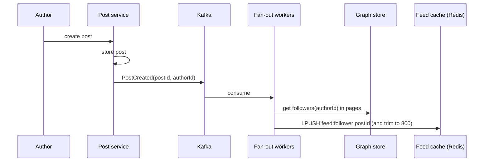
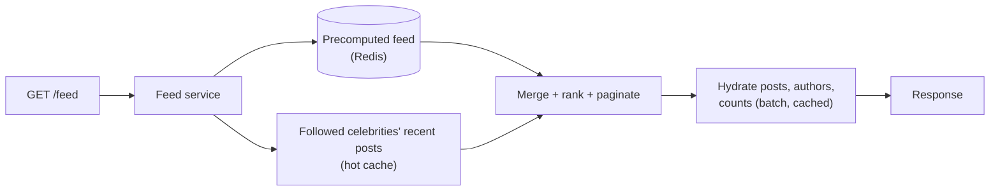
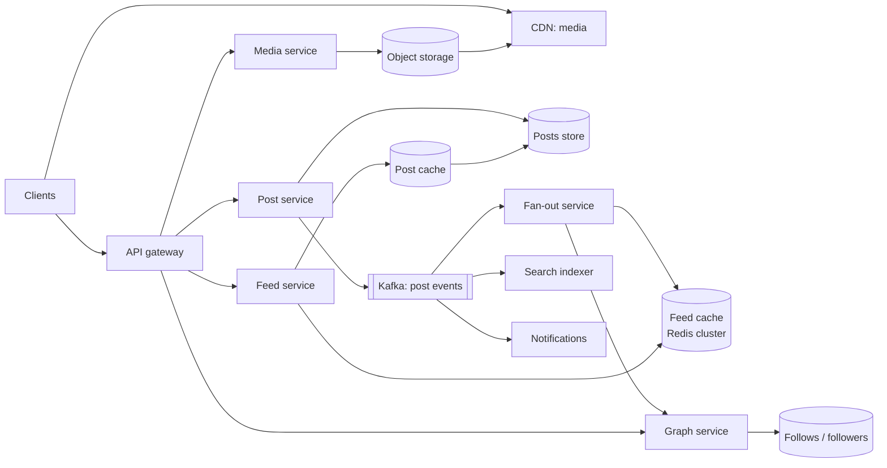

<Related ids={['caching', 'message-queues', 'sharding', 'sql-vs-nosql', 'blob-storage', 'cdn', 'api-design', 'unique-id-generation', 'consistency-models']} />

Design the home feed of a social network (Twitter/X, Instagram, Facebook): users follow others, post content, and see a feed of recent posts from the people they follow. It's one of the most-asked designs because it forces the central trade-off of read-heavy social systems: **do the work when a post is written (fan-out on write) or when a feed is read (fan-out on read)?** — and what to do about celebrities.

## 1. Clarify the problem

| Question | Assumption |
| --- | --- |
| Feed contents? | Posts from accounts the user follows (no ads or recommendations for now) |
| Ordering? | Reverse chronological first; ranking as a deep dive |
| Post contents? | Text up to 280 chars, optional images/video |
| Scale? | 500M DAU, 200M posts/day, average 200 followees per user; some accounts have 100M+ followers |
| Feed latency? | Under 200 ms p99 to load the first page |
| Freshness? | A post may take a few seconds to appear in followers' feeds |

## 2. Requirements

**Functional:** publish a post; follow/unfollow; view home feed (paginated); view a user's own profile timeline.

**Non-functional:** low feed-read latency; high availability (prefer showing a slightly stale feed over an error); eventual consistency acceptable for followers, but **authors must see their own posts immediately** (read-your-writes); scale to celebrities.

## 3. Capacity estimation

```text
Posts: 200M/day ÷ 10^5 ≈ 2,000 writes/s (peak ~6,000/s)
Feed reads: 500M DAU × 10 feed loads/day = 5B/day ≈ 50,000/s (peak ~150,000/s)

Fan-out on write: 200M posts × 200 followers average = 40B feed insertions/day ≈ 400K/s
(The average hides the skew: one post by a 100M-follower account = 100M insertions.)

Feed cache: store the latest ~800 post IDs per active user
500M × 800 × 8 B (ID) ≈ 3.2 TB  (+ overhead; ~ several TB of Redis across a cluster)

Post storage: 200M × ~1 KB ≈ 200 GB/day of metadata/text → ~73 TB/year; media in object storage
```

**So:** reads outnumber posts 25:1, and feed reads must be fast — precomputing feeds is attractive. But fan-out writes are 200× the post rate, and celebrity posts explode it. That tension drives the design.

## 4. API

```text
POST /v1/posts                { text, mediaIds[] }        → 201 { postId, createdAt }
GET  /v1/feed?cursor=…&limit=20                            → { posts: [...], nextCursor }
GET  /v1/users/{id}/posts?cursor=…                         → profile timeline
POST /v1/users/{id}/follow    DELETE /v1/users/{id}/follow
POST /v1/media/uploads        → presigned URL for direct upload
```

Cursor pagination is mandatory — new posts constantly arrive at the top. See [API Design](/system-design/hld/api-design).

## 5. Data model

```text
posts         (post_id PK — Snowflake, time-sortable; author_id; text; media_keys; created_at)
              partition by post_id; secondary table user_posts (author_id, post_id DESC) for profile timelines
follows       (follower_id, followee_id, created_at)  -- "following" list, partitioned by follower_id
followers     (followee_id, follower_id)              -- reverse index, partitioned by followee_id
users         (user_id, handle, name, avatar_key, follower_count, is_celebrity …)
feed cache    Redis list/sorted set per user: feed:{user_id} → [post_id, …] newest first, capped at ~800
```

Posts and social-graph edges are huge, append-mostly and accessed by key → wide-column stores (Cassandra) or sharded MySQL (Twitter and Facebook historically used heavily sharded MySQL). Media lives in object storage behind a CDN.

## 6. The core decision: fan-out on write vs read

### Fan-out on write (push)

When a user posts, push the post ID into every follower's precomputed feed.



- ✅ **Feed reads are trivial and fast**: read a list of IDs from Redis, hydrate posts (batch get, mostly cached).
- ❌ **Write amplification**: one post → N writes. A user with 100M followers generates 100M cache writes, taking minutes and huge resources.
- ❌ Wasted work for inactive followers who never open the app.

### Fan-out on read (pull)

Store posts only per author. At read time, fetch recent posts from each followee and merge.

- ✅ Cheap writes; no wasted work; celebrities cost nothing extra on write.
- ❌ **Slow reads**: following 200 accounts means 200 lookups and a k-way merge per feed load, at 150K feed loads/s.

### Hybrid — the standard answer

- **Normal users**: fan-out on write into followers' feed caches.
- **Celebrities** (e.g., over ~100K–1M followers): **don't fan out**. Their posts are fetched at read time.
- On feed read: take the precomputed feed + recent posts from the few celebrities the user follows (each celebrity's recent posts are cached and extremely hot) → merge by post ID/time → return.



Also skip fan-out to **inactive users** (not seen in 30 days); rebuild their feed on demand (pull) when they return.

<Callout type="interview">
Name the trade-off explicitly, then the hybrid: "Fan-out on write makes reads cheap but celebrity posts explode writes; fan-out on read makes writes cheap but reads slow. I'll fan out on write for regular accounts, pull celebrity posts at read time, and skip fan-out for inactive users." This is the core of the question.
</Callout>

<Callout type="note" title="Where sources differ">
Some sources suggest consistent hashing as the fix for the celebrity "hot key" problem. Consistent hashing spreads *keys* evenly across cache nodes, but a celebrity's post list is still one key on one node, and their fan-out is still 100M writes. The real fixes are the hybrid pull model, replicating hot entries, and local caching.
</Callout>

## 7. High-level design

<FlowSteps title='Posting, then reading the feed' steps={[
  { path: ['C', 'GW', 'PS', 'PDB'], text: 'Posting: the post service stores the new post.' },
  { path: ['PS', 'K', 'FO'], text: 'A post event goes to Kafka, and the fan-out service picks it up.' },
  { path: ['FO', 'GS', 'GDB'], text: 'Fan-out asks the graph service for the author\'s followers.' },
  { path: ['FO', 'FC'], text: 'It inserts the post ID into each follower\'s cached feed (skipped for celebrity authors, whose posts are pulled at read time).' },
  { path: ['C', 'GW', 'FS', 'FC'], text: 'Reading: the feed service takes post IDs from the user\'s cached feed…' },
  { path: ['FS', 'PC', 'PDB'], text: '…and hydrates them from the post cache, falling back to the posts store.' },
  { path: ['GW', 'MS', 'OS', 'CDN'], nodes: ['C'], edges: [['C', 'CDN']], text: 'Images and videos are uploaded through the media service to object storage and served to clients from the CDN.' },
]}>



</FlowSteps>

## 8. Deep dives

### Hydration

The feed cache holds only **IDs**. Hydration batch-fetches post content, author profiles and counters (likes, replies), mostly from caches (post cache, user cache). Storing IDs instead of full posts keeps the feed cache small and means edits/deletes are reflected automatically.

### Cache architecture

A feed system leans on several distinct caches, each with a different access pattern:

| Cache | Holds | Notes |
| --- | --- | --- |
| Feed | Post IDs per user | Capped lists; the core of fan-out on write |
| Content | Post bodies | Hot tier for viral posts; feeds hydrate from here |
| Social graph | Followers/following | Read on every fan-out |
| Action | Has *this viewer* liked/replied/shared a post | Needed to render each post correctly |
| Counters | Likes, replies, followers | Write-heavy; sharded or batched |

### Read-your-writes for the author

Fan-out is asynchronous, so the author's own post could be missing from their feed for a few seconds. Fix: the feed service always merges the author's own most recent posts into their feed (or the client inserts it locally after posting).

### Deletes, edits and unfollows

- **Delete**: mark the post deleted in the post store; hydration filters it out (no need to remove it from millions of feed lists immediately; a background job can clean up).
- **Unfollow**: filter at read time by checking the current followee set, and lazily remove entries.
- **Privacy changes / blocks**: also enforced at hydration time — never rely solely on the precomputed list.

### Audience rules during fan-out

Fan-out isn't "all followers". Before inserting a post into a follower's feed, apply the author's **audience** (close friends, custom lists) and the follower's **settings** (muted authors, hidden topics). Apply them again at read time, since settings change after fan-out.

### Ranking (beyond chronological)

Ranked feeds score candidate posts (from fan-out + celebrities + recommendations) with an ML model using signals like the viewer's affinity with the author, engagement predictions, recency and content type. Architecture: **candidate generation** (a few hundred to a few thousand posts) → **ranking** (model scoring) → **re-ranking/filters** (diversity, dedup, policy). The precomputed feed becomes the main candidate source; scoring happens at read time with features from a feature store.

### Pagination

Use a cursor encoding the last seen post ID (time-sortable Snowflake IDs make this easy). For ranked feeds, the cursor references a cached, ranked session list so that page 2 is consistent with page 1.

### Counters (likes, views)

Like counts on viral posts are a write hot spot. Increment sharded counters or buffer increments in a stream processor and apply them in batches; serve approximate counts from cache.

### Scaling the feed cache

- Partition by `user_id` across a Redis cluster (consistent hashing / hash slots); replicate for availability.
- Cap each list (e.g., 800 IDs); older pages fall back to pull-based reconstruction.
- Cache memory is driven by active users — evict feeds of inactive users and rebuild on return.

## 9. Failure modes

| Failure | Mitigation |
| --- | --- |
| Fan-out lag builds up (big event, many posts) | Kafka absorbs; autoscale fan-out workers on lag; prioritise fan-out to active users |
| Redis shard lost | Replicas; rebuild affected feeds on demand via pull |
| Celebrity cache overloaded | Replicate hot celebrity post lists; local in-process caches on feed servers |
| Graph service slow | Cache follower lists for fan-out; pagination of large follower lists |
| Ranking service down | Fall back to chronological feed |

## 10. Trade-offs summary

| Decision | Choice | Why |
| --- | --- | --- |
| Fan-out | Hybrid (push for most, pull for celebrities, skip inactive) | Fast reads without celebrity write explosions |
| Feed cache content | Post IDs | Small; edits/deletes apply at hydration |
| Consistency | Eventual for followers, read-your-writes for author | Matches user expectations cheaply |
| Ranking | Candidate generation + scoring at read | Personalisation with bounded cost |

## 11. What interviewers look for

- **Mid-level**: post and follow data model, feed generation via push or pull, caching, cursor pagination.
- **Senior**: clear push vs pull trade-off with numbers, hybrid for celebrities, inactive users, hydration of IDs, read-your-writes, failure handling.
- **Staff**: ranking architecture, cache sizing and cost, multi-region feeds, backfill strategies, product-level trade-offs (freshness vs cost).

## 12. Variations interviewers ask

### Photo sharing (Instagram)

The feed is this design. What Instagram adds is **media**:

- Clients upload photos and videos straight to object storage with **pre-signed URLs**, never through the API servers. See [Blob Storage](/system-design/hld/blob-storage).
- A processing pipeline creates several sizes (thumbnail, feed, full screen) and, for video, several bitrates. The post becomes visible once processing finishes.
- Feed entries hold media URLs served by a **CDN**. The feed service only hydrates small metadata, and the bytes never pass through it.

### Post search (Facebook search)

"Find posts containing these words, sorted by recency or by likes."

- **Inverted index:** keyword → list of post IDs. New posts reach the indexer through Kafka (or CDC from the posts database) and are tokenised into the index. See [Search Systems](/system-design/hld/search-systems).
- **Sorting by recency is cheap:** post IDs are appended in time order, so the newest results are at the end of each list.
- **Sorting by likes is the hard part.** Like counts change constantly, and updating the index on every like would mean billions of index writes. Two common answers:
  - Update a post's position in the "by likes" index only when its count **crosses a threshold** (1, 2, 4, 8, 16 …), so a post with 1,000 likes changes position only about 10 times.
  - Take the top few thousand matches by recency, fetch their current like counts from a counter store, and re-rank at query time.
- **Partitioning:** by post ID (each shard indexes some posts; a query asks every shard and merges), or by keyword (a query touches one shard, but popular words create hot shards). Large systems usually partition by document and **cache popular queries** for a few seconds.
- **Privacy** is checked at query time, since who may see a post can change after it was indexed.

## Interview questions

<QA q="A celebrity with 100 million followers posts. Walk through what happens in your design.">
The post is stored and a PostCreated event published. The fan-out service sees the author is flagged as a celebrity and skips per-follower fan-out. The post is added to the celebrity's recent-posts list, which is heavily cached and replicated. When any follower loads their feed, the feed service merges their precomputed feed with recent posts from celebrities they follow, so the post appears on their next refresh — without 100M cache writes.
</QA>

<QA q="Why store only post IDs in the feed cache rather than whole posts?">
IDs are 8 bytes versus hundreds of bytes for a post, so caching ~800 entries for hundreds of millions of users stays in the terabytes rather than hundreds of terabytes. Content changes — edits, deletions, visibility changes, updated counts — are picked up during hydration from the post cache without rewriting millions of feed lists. Hydration is a batched, highly cached multi-get.
</QA>

<QA q="How would you handle a user who follows 5,000 accounts and hasn't logged in for six months?">
Don't maintain their precomputed feed while inactive — skip fan-out to users not seen recently and let their cache entry expire. When they return, rebuild the feed on demand by pulling recent posts from their followees (in parallel, perhaps limited to the most relevant or recently active accounts), merge, store in the cache, then resume fan-out on write for them.
</QA>

## Practice

Write your answer before opening the suggested one. Anything you mark "Partly" or "Missed it" comes back in your review deck.

<Practice task="A celebrity with 80M followers posts. With pure fan-out on write at 400K feed insertions per second across the cluster, how long until every follower has the post? What does that tell you?">

80M ÷ 400K/s = 200 seconds — over three minutes, and that assumes the whole cluster works only on this one post. In reality it competes with normal traffic, so it is worse, and a few celebrities posting together can back up everything.

That is why the hybrid model exists: do not fan out posts from accounts above a follower threshold (say 100K–1M). Instead, when a user loads their feed, merge their precomputed feed with recent posts pulled from the handful of celebrities they follow. The pull is cheap because each celebrity's recent posts are cached and read by millions of people.

Bonus point: inactive followers do not need fan-out either — build their feed on demand when they return.

</Practice>

<Practice task="Product asks for a ranked feed (most engaging first) instead of reverse chronological. What changes in storage and in the read path?">

The precomputed feed becomes a candidate list, not the final order.

1. Keep fan-out of post IDs into each user's feed cache as before, maybe with more candidates (say 1,500 instead of 800).
2. On read, fetch the candidates and the features needed for scoring: author affinity, post age, engagement counts, media type. Engagement counts come from a separate counter store updated by a stream job, not from the post rows.
3. Score them with a ranking service (a model or a weighted formula), take the top page, and cache the ranked page briefly so scrolling is stable.
4. Pagination by timestamp cursor no longer works on a ranked list; use a 'seen' set or a snapshot ID of the ranked list for the session.

Costs: more read-time CPU and a feature store to maintain. Keep a chronological fallback if the ranker is slow or down.

</Practice>

<Takeaways>

- The heart of the problem is fan-out on write (fast reads, expensive writes) vs fan-out on read (cheap writes, slow reads).
- Use a hybrid: push for normal users, pull for celebrities, and skip inactive users.
- Cache post IDs per user, hydrate from post and user caches, and filter deletes and blocks at read time.
- Give authors read-your-writes by merging their own recent posts.
- Ranked feeds add candidate generation and scoring on top of the same infrastructure.

</Takeaways>

## Further reading

- Raffi Krikorian, "Timelines at Scale" (QCon San Francisco, 2012) — Twitter's fan-out architecture.
- Bronson et al., "TAO: Facebook's Distributed Data Store for the Social Graph" (USENIX ATC 2013).
- Silberstein et al., "Feeding Frenzy: Selectively Materializing Users' Event Feeds" (SIGMOD 2010) — the push/pull trade-off formalised.
- Alex Xu, *System Design Interview*, Vol. 1 — ch. 11, "Design a News Feed System".
