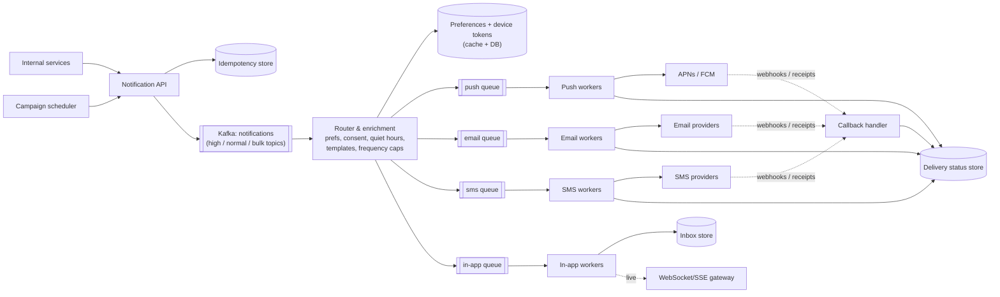

<Related ids={['message-queues', 'availability-and-fault-tolerance', 'rate-limiting', 'real-time-communication', 'api-design', 'sql-vs-nosql', 'observability']} />

Design a notification platform that other teams call to reach users through **push notifications (iOS/Android), SMS, email and in-app** messages — order updates, security alerts, marketing campaigns, reminders. The interesting parts are reliable delivery through unreliable third parties, deduplication, user preferences, prioritisation, and absorbing huge campaign bursts without delaying critical alerts.

## 1. Clarify the problem

| Question | Assumption |
| --- | --- |
| Channels? | Push (APNs, FCM), SMS, email, in-app inbox |
| Who sends? | Internal services via API; marketing via scheduled campaigns |
| Volume? | 500M users; ~2B notifications/day; campaigns can target 100M users at once |
| Latency? | Transactional (OTP, security, order updates) within seconds; marketing within minutes–hours |
| Guarantees? | At-least-once delivery to providers, with deduplication; no duplicate OTPs |
| Preferences? | Users opt out per channel and category; quiet hours; regional law (e.g., marketing consent) |

## 2. Requirements

**Functional**

1. Send a notification to a user (or a segment) on one or more channels using a template.
2. Respect user preferences, consent, quiet hours and frequency caps.
3. Track status: queued, sent, delivered, opened/clicked, failed.
4. Schedule notifications and campaigns.
5. In-app notification inbox.

**Non-functional**

- **Reliability** — never silently drop a transactional notification; retry provider failures.
- **Low latency for high priority** — OTPs in seconds even during a 100M-user campaign.
- **No duplicates** — idempotent at the API and per-send level.
- **Scalability** — handle bursts of tens of thousands of sends/s.
- **Extensibility** — add channels/providers without touching callers.

## 3. Capacity estimation

```text
2B notifications/day ÷ 10^5 s ≈ 20K/s average; campaigns spike to ~100K/s fan-out

Split (assumption): push 70%, email 20%, in-app 8%, SMS 2%
SMS: 40M/day — expensive (₹0.1–0.2 per SMS in India; far more internationally); rate limits per provider

Status records: 2B/day × ~300 B ≈ 600 GB/day → retain 30–90 days hot (≈ 18–54 TB), archive the rest
Device tokens: 500M users × ~2 devices × 200 B ≈ 200 GB
```

**So:** the dispatch tier must scale horizontally behind queues; status storage is a write-heavy time-series workload (wide-column store with TTL); provider rate limits — not our servers — are often the real bottleneck.

## 4. API

```text
POST /v1/notifications
Idempotency-Key: order-812-shipped
{
  "userId": "u_42",
  "category": "order_update",          // drives preferences and priority
  "template": "order_shipped",
  "params": { "orderId": "812", "eta": "Oct 16" },
  "channels": ["push", "email"],       // optional; defaults from category
  "priority": "high",
  "sendAt": null                       // or a timestamp for scheduling
}
→ 202 Accepted { "notificationId": "n_9f…" }

GET  /v1/notifications/{id}            → status per channel
POST /v1/campaigns                      → segment + template + schedule
GET  /v1/users/{id}/inbox?cursor=…      → in-app notifications
PUT  /v1/users/{id}/preferences
```

Return **202 Accepted** — sending is asynchronous.

## 5. Data model

```text
notification            (notification_id PK, user_id, category, template, params, priority, created_at, idempotency_key UNIQUE)
delivery                (notification_id, channel, provider, status, attempts, provider_message_id, updated_at)   -- per channel
user_preferences        (user_id PK, per-category per-channel opt-in, quiet hours, timezone, locale)
device_tokens           (user_id, device_id, platform, token, last_seen, active)
templates               (template_id, channel, locale, version, body)
inbox                   (user_id, created_at, notification_id, read)   -- partition by user_id, cluster by time
```

Status, delivery and inbox tables are high-volume and accessed by key and time → **Cassandra/DynamoDB** with TTLs. Preferences and templates are small → relational DB plus cache.

### Collecting contact details and device tokens

Notifications are only as good as the addresses you hold. On app install or login, the client registers its **device token** (from APNs/FCM) with the API, along with platform and app version; email and phone are captured at sign-up and verified. Store tokens in their own table — **one user, many devices** — and refresh them on every app start, because tokens rotate and become invalid after reinstalls.

## 6. High-level design



**Flow**

1. A service calls the API with an idempotency key. The API validates, records the key, and publishes to the topic matching the priority.
2. The **router** consumes, loads preferences and devices, drops or defers what the user doesn't want (opt-out, quiet hours, frequency cap), renders the template per channel and locale, and enqueues per-channel jobs.
3. **Channel workers** call providers with rate limiting, retries and failover, recording status.
4. Providers report delivery receipts, bounces and opens via webhooks; status is updated.
5. In-app notifications are written to the inbox and pushed live to connected clients.

## 7. Deep dives

### Prioritisation: OTPs must not wait behind campaigns

A 100M-user campaign enqueues 100M jobs. If an OTP lands behind them in the same queue, it arrives an hour late.

- **Separate topics/queues and worker pools by priority** (critical, transactional, bulk). Critical workers are never shared with bulk.
- Campaigns are **throttled at the source**: the campaign scheduler releases recipients at a controlled rate (e.g., 20K/s) rather than enqueuing everything at once.
- Reserve a share of provider rate limits (and separate provider accounts or sender IDs) for critical traffic.

### Exactly-once is impossible — so dedupe at every boundary

- **API level**: idempotency key unique constraint → a retried API call returns the original notification ID.
- **Worker level**: before sending, atomically mark `(notification_id, channel)` as `SENDING` (conditional write). A redelivered message sees the state and skips or checks with the provider.
- **Provider level**: pass our notification ID as the provider's idempotency/reference key where supported.
- Even so, a crash after the provider accepted but before we recorded success can cause a duplicate. That's why critical flows (OTPs) also dedupe on the **client** (same OTP code reused within its validity window) and design content to be harmless if duplicated.

### Retries and provider failover

- Classify errors: **retryable** (timeouts, 5xx, 429) → retry with exponential backoff and jitter; **permanent** (invalid token, unsubscribed, invalid number) → stop, and clean up (deactivate stale device tokens on APNs/FCM "unregistered" responses).
- After N attempts → dead-letter queue with alerting.
- **Multiple providers per channel** (two SMS gateways, two email providers) with health-based routing and a circuit breaker per provider; fail over when one degrades. Also route by cost and deliverability per country.

- **Regional coverage differs.** Firebase Cloud Messaging isn't available in mainland China, where Android apps rely on vendor push channels or providers such as JPush. Hide providers behind a channel interface so one can be swapped per market without touching callers.
- **Lock down the API.** Only authenticated internal services (service credentials or mTLS) may send notifications — an open notification endpoint is a spam cannon.

### Preferences, consent and quiet hours

- Preferences are read on every notification → cache them (Redis) with invalidation on update.
- Enforce **legal consent** for marketing per region and channel; security notifications (password changed) generally bypass marketing opt-outs.
- **Quiet hours** in the user's timezone: defer non-urgent notifications by putting them on a delay queue until the window ends.
- **Frequency caps** (e.g., at most 3 marketing pushes/day): a per-user counter with TTL, checked by the router.
- **Aggregation/digests**: collapse "Alice, Bob and 23 others liked your post" instead of 25 pushes.

### Templates and localisation

Templates are versioned per channel and locale, rendered by the router with parameters. Validate parameters at the API to fail fast. Keep SMS within length limits (160 GSM-7 characters per segment; Unicode scripts like Hindi drop to 70), since each segment is billed.

### In-app inbox

Write to an inbox table partitioned by `user_id`, clustered by time (newest first). If the user is online, push via the real-time gateway; otherwise they fetch with cursor pagination on open. Keep an unread count per user (counter updated on write and on read).

### Tracking

Delivery receipts and engagement (opens via tracking pixels, clicks via redirect links) flow through webhooks into the status store and into an analytics pipeline for campaign reporting. Note that open tracking is unreliable (image blocking, privacy protections), so treat it as a directional metric.

Model each notification as a **lifecycle** — created → queued → sent to provider → delivered → opened/clicked, with failed, bounced and unsubscribed as terminal branches. Emitting an event at each transition gives you both debugging (where did this OTP get stuck?) and funnel analytics (what fraction of pushes are opened?). The most important operational metric is **queue depth per channel and priority**: if it grows, workers aren't keeping up.

## 8. Failure modes

| Failure | Mitigation |
| --- | --- |
| Provider outage | Circuit breaker + failover to secondary provider; queue builds and drains later |
| Kafka consumer lag during campaign | Separate priority pools; autoscale bulk workers on lag; source-side throttling |
| Preference service down | Serve from cache; if unknown, **don't** send marketing (fail closed for consent), but send critical transactional |
| Stale device tokens | Remove on provider "unregistered" feedback; refresh tokens on app open |
| Duplicate sends | Idempotency at API, worker state machine, provider reference keys |

## 9. Trade-offs summary

| Decision | Choice | Why |
| --- | --- | --- |
| Sync vs async API | Async (202) | Providers are slow and unreliable; queues absorb bursts |
| Queue layout | Per priority and per channel | Isolation: campaigns can't delay OTPs; channels scale independently |
| Status store | Wide-column with TTL | Massive write volume, key + time access |
| Delivery semantics | At-least-once + dedup | Exactly-once isn't achievable with external providers |

## 10. What interviewers look for

- **Mid-level**: queue-based async design, per-channel workers, third-party providers, retries.
- **Senior**: priority isolation, idempotency at each boundary, preferences/quiet hours/frequency caps, provider failover, device token hygiene.
- **Staff**: campaign throttling and cost control, regulatory consent, multi-provider routing by country, observability of end-to-end delivery rates.

## Interview questions

<QA q="How do you make sure an OTP is delivered quickly while a 100-million-user marketing campaign is running?">
Isolate priorities end to end: separate Kafka topics or queues and dedicated worker pools for critical notifications, separate provider capacity (reserved rate limits or separate sender accounts) for OTPs, and throttle campaigns at the scheduler so they release recipients at a bounded rate. Monitor critical-path latency separately and autoscale on queue lag.
</QA>

<QA q="A worker crashes after the SMS provider accepted the message but before recording success. What happens?">
The message is redelivered (at-least-once), so the worker may send it again. Mitigate by marking the delivery as SENDING before calling the provider and, on redelivery, checking the provider by our reference ID where the API allows, or skipping if the attempt was recent. Pass an idempotency/reference key to providers that support it. For OTPs, reuse the same code within its validity so a duplicate SMS is harmless.
</QA>

<QA q="How would you implement 'no more than 3 marketing pushes per user per day'?">
In the router, before enqueuing a marketing push, atomically increment a per-user counter in Redis keyed by user and date (INCR with a TTL to the end of the user's local day) and check it against the cap; if exceeded, drop or defer to a digest. Transactional and security categories bypass the cap. Make the cap configurable per category.
</QA>

<Takeaways>

- Accept requests asynchronously, then route through per-priority and per-channel queues.
- Isolate critical notifications from bulk campaigns in queues, workers and provider capacity.
- Deduplicate at the API, worker and provider boundaries; at-least-once is the realistic guarantee.
- Respect preferences, consent, quiet hours and frequency caps in a central router.
- Use multiple providers with circuit breakers, classify errors, and clean up stale device tokens.

</Takeaways>

## Further reading

- Apple Developer documentation — "Sending notification requests to APNs" (status codes and token invalidation).
- Firebase documentation — "Best practices for FCM registration token management".
- Alex Xu, *System Design Interview*, Vol. 1 — ch. 10, "Design a Notification System".
- Related: [Message Queues & Event Streaming](/system-design/hld/message-queues), [Real-Time Communication](/system-design/hld/real-time-communication).
