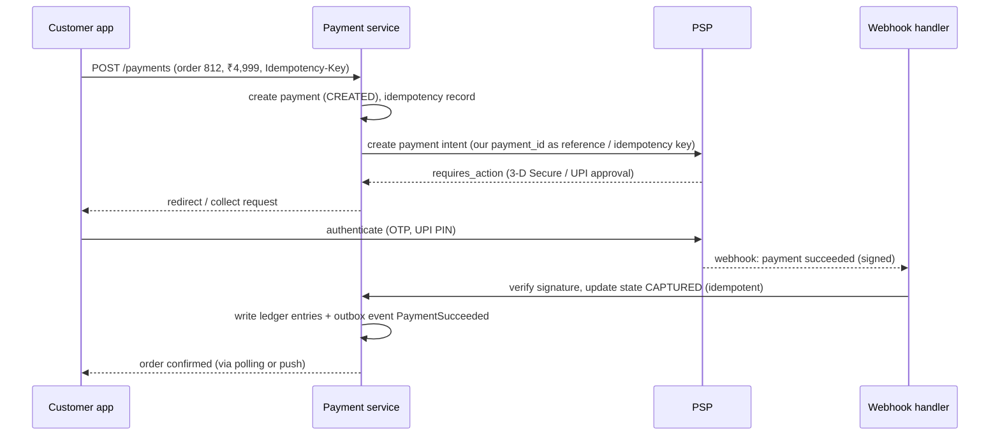
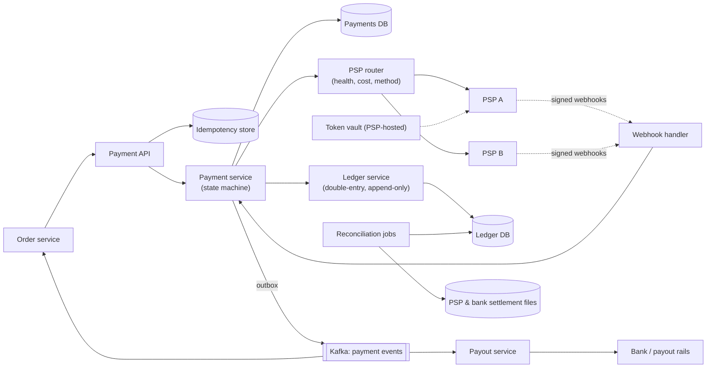
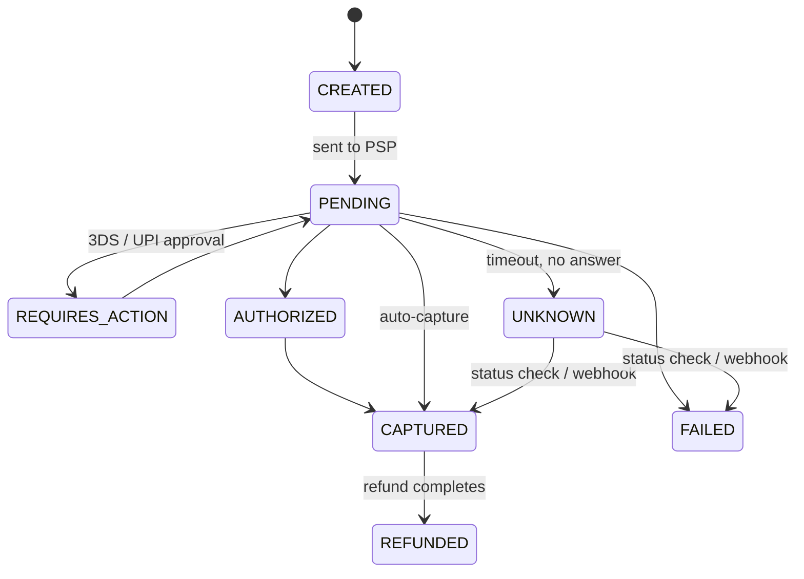

<Related ids={['transactions-and-isolation', 'distributed-transactions', 'api-design', 'message-queues', 'event-driven-architecture', 'security-fundamentals', 'availability-and-fault-tolerance', 'batch-and-stream-processing']} />

Design the payment backend for an e-commerce marketplace: customers pay for orders with cards, UPI or wallets; the platform collects money through payment service providers (PSPs such as Stripe, Adyen or Razorpay) and later pays out sellers. Unlike most designs, the defining requirement here isn't scale — it's **correctness**: never charge twice, never lose a payment, and always be able to prove where every rupee went.

## 1. Clarify the problem

| Question | Assumption |
| --- | --- |
| Do we process cards ourselves? | No — we integrate PSPs (keeps us out of most PCI DSS scope) |
| Flows? | Pay-in (customer → platform), refunds, pay-outs (platform → sellers) |
| Scale? | 10M orders/day ≈ 100–120 payments/s average, peaks of ~2,000/s during sales |
| Currencies? | Multiple; amounts stored in minor units |
| Consistency? | Exactly-once effects for money movements; full audit trail |

## 2. Requirements

**Functional:** create payment for an order; handle PSP responses (sync and async webhooks); refunds; seller balances and payouts; reconciliation with PSP and bank reports.

**Non-functional:**

- **Correctness and idempotency** — no double charges or double payouts, even with retries and crashes.
- **Durability and auditability** — immutable records; every balance explainable.
- **Availability** — a PSP outage shouldn't stop all payments (multiple PSPs).
- **Security and compliance** — tokenised card data, encryption, access controls.
- Moderate throughput; latency matters less than correctness.

## 3. Capacity estimation

```text
Payments: 10M/day ≈ 115/s average; flash-sale peaks ~2,000/s
Ledger entries: each payment → ~2–6 double-entry lines → ~60M lines/day
Storage: 60M × ~200 B ≈ 12 GB/day ≈ 4.4 TB/year — kept forever (regulatory retention)
```

**So:** a well-designed relational database (sharded later) handles the volume. The design effort goes into **state machines, idempotency, ledgers and reconciliation**.

## 4. Key concepts

### The payment lifecycle with a PSP



- Many methods are **asynchronous**: the final result arrives by **webhook**, minutes later or out of order.
- Cards often use **authorise then capture**: authorisation reserves funds; capture (at shipment, or immediately) moves them.

### Double-entry ledger

Every money movement is recorded as balanced entries: total debits = total credits. Balances are **derived** from entries, never stored as a mutable number updated in place.

```text
Customer pays ₹4,999 for an order (platform fee 10%)

account                         debit     credit
psp_receivable (asset)          4,999
seller_payable:s_17 (liability)           4,499.10
platform_revenue (revenue)                  499.90
-------------------------------------------------
                                4,999     4,999      ✓ balanced
```

- Entries are **append-only and immutable**; corrections are new reversing entries.
- Any balance (a seller's payable, the PSP receivable) is the sum of its entries — auditable and reproducible.
- Each journal transaction (set of lines) is written atomically in one database transaction.

## 5. Data model

```text
payments          (payment_id, order_id, amount_minor, currency, method, psp, psp_reference,
                   status, version, created_at)
payment_attempts  (attempt_id, payment_id, psp, request, response, status, created_at)
idempotency_keys  (scope, key, request_hash, response, status, created_at)   UNIQUE(scope, key)
ledger_entries    (entry_id, journal_id, account_id, debit_minor, credit_minor, currency, created_at)
accounts          (account_id, type, owner_id, currency)
refunds, payouts  (… similar state machines …)
outbox            (id, aggregate_id, event_type, payload, published_at)
```

Use **integers in minor units** (paise, cents) — never floating point. Use a relational database with serializable or carefully designed transactions.

## 6. High-level design



## 7. Deep dives

### Idempotency end to end

Retries happen everywhere: the client retries on timeout, our service retries the PSP, PSPs resend webhooks.

1. **Client → us**: `Idempotency-Key` header; the first request inserts `(merchant/order scope, key)` with a unique constraint and the request hash; retries return the stored response (or 409 if still in progress). See [API Design](/system-design/hld/api-design).
2. **Us → PSP**: send our `payment_id` (or attempt ID) as the PSP's idempotency key/reference, so a retried call after a timeout doesn't create a second charge.
3. **PSP → us (webhooks)**: deduplicate by PSP event ID; state transitions are idempotent ("mark CAPTURED" when already CAPTURED is a no-op).
4. **Us → downstream (events)**: outbox + idempotent consumers.

### State machine and unknown outcomes



The dangerous case is a **timeout**: did the PSP charge the customer or not? Never assume failure and retry with a new reference — that's how double charges happen. Mark the payment `UNKNOWN`, then resolve it by querying the PSP's status API with our reference (with backoff) or waiting for the webhook. Transitions use optimistic concurrency (version column) so a late webhook and a status-check result can't conflict.

### Atomicity between payment state, ledger and events

When a payment is captured, three things must happen together: update payment status, write ledger entries, emit `PaymentSucceeded`. Put the payment table, ledger tables and outbox in the **same database** (or at least the same transaction scope) and commit them atomically; a relay publishes the outbox. If the ledger is a separate service, use an idempotent, ordered event stream from the payment service to the ledger rather than a distributed transaction.

### Reconciliation

Even with careful engineering, external systems disagree: a webhook was lost, a PSP reversed a charge (chargeback), a settlement was short. **Reconciliation** is the safety net:

- Daily (and intraday) jobs compare our ledger with **PSP settlement reports** and **bank statements**, matching transaction by transaction.
- Mismatches are classified (missing on our side, missing on theirs, amount mismatch) and either auto-resolved (fetch missing status and apply) or routed to an operations queue.
- Reconciliation results are themselves ledger events (fees, adjustments).

<Callout type="interview">
Mentioning reconciliation unprompted is one of the strongest signals in a payments interview. It shows you know that distributed money systems are made correct not just by protocols but by **continuous verification against external sources of truth**.
</Callout>

### Multiple PSPs

Route by payment method, cost, success rates per bank/card network, and health. A circuit breaker per PSP fails over new payments when one degrades. Never fail over a payment whose outcome is `UNKNOWN` on the first PSP — resolve it first.

### Payouts to sellers

Seller balances accumulate in `seller_payable` ledger accounts. A scheduled payout job (respecting holds for refunds/chargebacks windows) creates payout records with idempotency keys, calls the bank/payout API, and books ledger entries on confirmation. Payouts follow the same state machine discipline.

### Security and compliance

- Card data is entered in **PSP-hosted fields** or SDKs and tokenised; our systems only see tokens, which keeps PCI DSS scope minimal.
- Verify **webhook signatures** (HMAC) and timestamps; reject replays.
- Encrypt sensitive data at rest; strict access controls and audit logs for anyone touching payment data.
- Fraud checks (velocity rules, risk scoring) before sending to the PSP.

## 8. Failure modes

| Failure | Mitigation |
| --- | --- |
| Timeout calling PSP | Mark UNKNOWN; resolve via status API/webhook; same idempotency key on retry |
| Duplicate webhooks / out of order | Dedup by event ID; idempotent, version-checked transitions |
| Crash after PSP success, before DB update | Webhook or status polling of PENDING/UNKNOWN payments recovers it |
| PSP outage | Route new payments to another PSP; queue retries |
| Ledger/PSP mismatch | Reconciliation with auto-fix and manual review queues |

## 9. Trade-offs summary

| Decision | Choice | Why |
| --- | --- | --- |
| Card handling | PSP tokenisation | Security and compliance scope |
| Source of truth for money | Append-only double-entry ledger | Auditability, provable balances |
| Retries | Idempotency keys at every boundary | Retries are inevitable; double charges are unacceptable |
| Unknown outcomes | Explicit UNKNOWN state + status resolution | Never guess about money |
| Cross-system consistency | Outbox events + reconciliation | No distributed transactions with external parties |

## 10. What interviewers look for

- **Mid-level**: payment flow with a PSP, storing payment status, handling success/failure, webhooks.
- **Senior**: idempotency at each boundary, timeouts and unknown states, double-entry ledger, outbox, refunds, multiple PSPs.
- **Staff**: reconciliation, payouts and holds, chargebacks, compliance scope, multi-currency, organisational controls on money movement.

## Interview questions

<QA q="Your call to the PSP times out. Should you retry?">
Not blindly. The PSP may have processed the charge, so the payment's outcome is unknown. Mark it UNKNOWN and resolve it by querying the PSP's status API using our payment reference, or wait for the webhook. If you must retry the create call, use the same idempotency key/reference so the PSP returns the original result rather than charging again. Never create a new attempt with a fresh reference until the first outcome is known to be a failure.
</QA>

<QA q="Why use a double-entry ledger instead of a balance column?">
A mutable balance column loses history — if it's wrong, you can't tell why — and concurrent updates risk lost updates. A double-entry, append-only ledger records every movement as balanced debits and credits, so balances are derived and reproducible, every change is auditable, errors are corrected by explicit reversing entries, and the invariant "debits equal credits" catches bugs immediately.
</QA>

<QA q="How do you make sure a seller isn't paid out twice?">
Each payout has a deterministic idempotency key (e.g., seller ID + payout period) with a unique constraint, so the job can't create two payouts for the same period. The call to the bank/payout API uses that key as its reference. The payout's state machine (CREATED → SENT → CONFIRMED/FAILED) handles timeouts the same way as pay-ins — resolve unknown outcomes before retrying — and the ledger debits the seller's payable account exactly once on confirmation. Reconciliation with bank statements catches anything that slips through.
</QA>

## Practice

Write your answer before opening the suggested one. Anything you mark "Partly" or "Missed it" comes back in your review deck.

<Practice task="The mobile app times out while calling your 'charge' endpoint and retries. Without care the customer could be charged twice. Describe exactly how you make the charge idempotent across your service and the payment processor.">

1. The client generates an idempotency key per checkout attempt and sends it with every retry.
2. Your service stores the key with a unique constraint before doing any work: `INSERT payment_attempt(key, status='pending')`. A retry finds the existing row.
3. If the existing row is complete, return the stored result. If it is pending, either wait or return 'processing' and let the client poll.
4. Call the processor with the same idempotency key (Stripe, Adyen and others support this), so their retries do not double-charge either.
5. Record the processor's result on the row in the same transaction that writes the ledger entries.

If your service crashes after the processor charged but before you recorded it, a reconciliation job that compares processor reports with your ledger finds and fixes it.

</Practice>

<Practice task="Finance wants every cent accounted for. Why do payment systems use double-entry ledgers, and what invariant can you check automatically?">

In double-entry bookkeeping every money movement is recorded as at least two entries — a debit and a credit — that add up to zero. Moving 100 from the customer to the merchant writes −100 on one account and +100 on another, never just a balance update.

Benefits: the ledger is append-only (corrections are new reversing entries, so history is never rewritten), every balance can be recomputed from entries, and errors show up as an imbalance.

Automatic checks:
1. Per transaction, the entries sum to zero.
2. Each account's stored balance equals the sum of its entries.
3. Daily reconciliation: your ledger matches the processor's and the bank's settlement reports.

Any mismatch raises an alert for investigation instead of silently drifting.

</Practice>

<Takeaways>

- Payments are a correctness problem: idempotency at every boundary, explicit state machines, and no guessing on timeouts.
- Integrate PSPs with tokenisation; treat webhooks as the asynchronous source of outcome.
- Record money in an append-only double-entry ledger in minor units; derive balances.
- Commit payment state, ledger entries and outbox events atomically; propagate via events.
- Reconcile continuously against PSP and bank reports; route across multiple PSPs safely.

</Takeaways>

## Further reading

- Stripe blog, "Designing robust and predictable APIs with idempotency" (2017).
- Airbnb Engineering, "Avoiding Double Payments in a Distributed Payments System" (2019).
- Square Engineering, "Books: an immutable double-entry accounting database service" (2019).
- Martin Kleppmann, "Accounting for Computer Scientists" (blog, 2011).
- PCI Security Standards Council — PCI DSS overview.
- Alex Xu and Sahn Lam, *System Design Interview*, Vol. 2 (2022) — ch. "Payment System".
