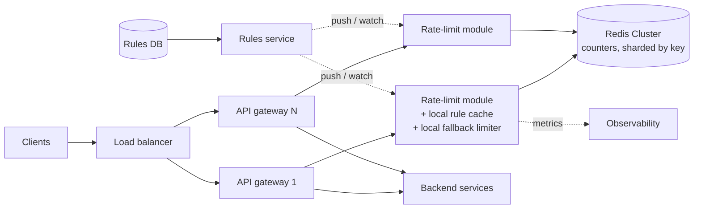

<Related ids={['rate-limiting', 'caching', 'consistent-hashing', 'availability-and-fault-tolerance', 'microservices-architecture', 'multi-region-architecture']} />

Design a rate limiter used by an API platform: hundreds of API gateway instances must enforce limits like "1,000 requests per minute per API key" and "10 login attempts per hour per IP", consistently, while adding almost no latency. The [Rate Limiting](/system-design/hld/rate-limiting) lesson covers the algorithms; this case study is about turning them into a **distributed service**.

## 1. Clarify the problem

| Question | Assumption |
| --- | --- |
| Client-side or server-side? | Server-side, enforced at the API gateway |
| Limit by what? | API key, user ID, IP, and endpoint — combinations configurable |
| How strict? | Small overshoot (a few %) is fine for most limits; security limits (login, OTP) must be strict |
| Scale? | 1M requests/s peak across the fleet; ~50M distinct keys per day |
| Rules change how often? | Rarely; changes should apply within a minute without redeploys |
| Response when limited? | HTTP 429 with `Retry-After` and rate-limit headers |

## 2. Requirements

**Functional**

1. Decide allow/deny for each request based on configurable rules.
2. Support multiple rules per request (per key + per IP + per endpoint) — deny if any is exceeded.
3. Return limit status headers to clients.
4. Manage rules (create, update) via an admin API.

**Non-functional**

- **Low latency** — the check is on every request's critical path: target under 1–2 ms added at p99.
- **High availability** — a limiter outage must not take down the API.
- **Accuracy** — close to the configured limit across all gateway instances.
- **Scalability** — 1M checks/s, horizontally scalable.

## 3. Capacity estimation

```text
Checks: 1M requests/s × ~2 rules each = 2M counter operations/s

State per key (token bucket): tokens (8 B) + last refill timestamp (8 B) + key (~40 B) + overhead ≈ 100 B
Active keys at once: ~10M → ~1 GB of counter state (plus replication)

Redis: ~100K–200K simple ops/s per shard (Lua scripts somewhat fewer)
→ 2M ops/s ÷ ~100K ≈ 20 primary shards, + replicas
```

**So:** state fits easily in memory; throughput, not size, drives the shard count. A sharded Redis cluster is a natural fit.

## 4. API

Internal check API (called by the gateway, or embedded as a library):

```text
check(descriptors: [{ "key": "apikey:ak_9f2", "rule": "per_key_minute" },
                    { "key": "ip:203.0.113.7", "rule": "per_ip_minute" }],
      cost: 1)
→ { allowed: false, limit: 1000, remaining: 0, retryAfterMs: 12000, violatedRule: "per_key_minute" }
```

Admin API:

```text
PUT /v1/rules/per_key_minute
{ "match": { "type": "apikey", "plan": "free" }, "algorithm": "token_bucket",
  "capacity": 1000, "refillPerSecond": 16.67, "failMode": "open" }
```

Client-facing response when limited:

```text
HTTP/1.1 429 Too Many Requests
Retry-After: 12
RateLimit-Limit: 1000
RateLimit-Remaining: 0
RateLimit-Reset: 12
```

## 5. Data model

**Rules** — small, read-mostly configuration: stored in a database, cached in every gateway's memory, refreshed via a watch/pub-sub or every 30 s.

**Counters** — in Redis, keyed by rule and descriptor:

```text
rl:{per_key_minute}:apikey:ak_9f2  →  HASH { tokens: 412.5, ts: 1760450012345 }   TTL ≈ time to refill fully
```

Braces denote a Redis Cluster **hash tag**: all keys with the same tag land on the same slot — useful when one atomic script must touch several keys. Use it carefully — tagging by rule name alone would put every key for that rule on one shard; include the descriptor in the tag when keys don't need to be co-located.

## 6. High-level design

<FlowSteps title='Checking one request' steps={[
  { path: ['C', 'LB', 'G1'], text: 'A request reaches an API gateway through the load balancer.' },
  { path: ['G1', 'L1'], text: 'The gateway\'s rate-limit module matches the request against rules cached in memory.' },
  { path: ['L1', 'RC'], text: 'For the matching rules it runs one atomic Lua script on the Redis shard that owns the counter.' },
  { path: ['G1', 'SVC'], text: 'If every rule allows the request, it goes to the backend. Otherwise the gateway answers 429 with retry headers.' },
  { path: ['CFG', 'RS', 'L1'], nodes: ['L2'], edges: [['RS', 'L2']], text: 'Rule changes are pushed from the rules service into every gateway\'s cache.' },
  { path: ['L1', 'OBS'], text: 'Allow and deny metrics feed dashboards and alerts.' },
]}>



</FlowSteps>

**Request flow**

1. Gateway extracts descriptors (API key, user, IP, route) from the request.
2. Rate-limit module matches rules from its in-memory rule cache.
3. For each matched rule, it runs an atomic Lua script on the Redis shard owning that counter — **pipelined** so all rules cost one round trip per shard.
4. If any rule denies → return 429 with headers. Otherwise forward to the backend, adding remaining-quota headers.

Embedding the limiter **as a library in the gateway** avoids an extra network hop to a separate service; a standalone limiter service (like Envoy's global rate-limit service) is the alternative when many different proxies need it.

## 7. Deep dives

### Algorithm choice

**Token bucket** for API quotas (allows natural bursts, two numbers of state) and **sliding window counter** where precise per-window limits are contractual. Both run as a single Lua script per counter — atomic on the Redis server, so concurrent gateways can't double-spend tokens. The script reads time from Redis's `TIME` command rather than trusting gateway clocks.

### Reducing latency and Redis load

At 2M ops/s, a Redis round trip per request is affordable (sub-millisecond within an AZ), but several techniques cut cost:

- **Pipelining / batching** all rules for a request into one round trip.
- **Local pre-check**: if the local cache knows a key was denied with `retryAfter` 10 s, reject locally without calling Redis until then.
- **Local token leasing** (for high-volume keys): a gateway takes a small batch of tokens (e.g., 50) from Redis at once and spends them locally. Cuts Redis calls ~50× for hot keys, at the cost of slight over/under-enforcement across instances.
- **Approximate local-only limiting** for very coarse limits: each of N gateways enforces limit/N locally. Zero network cost; accurate only if load is spread evenly.

| Approach | Accuracy | Latency | Redis load |
| --- | --- | --- | --- |
| Central counter per request | High | +1 RTT | Highest |
| Token leasing | Good | Mostly local | Low |
| Local limit/N | Approximate | None | None |

### Hot keys

One giant customer can send 100K requests/s on a single key, saturating one Redis shard. Use token leasing for that key, or split its bucket into sub-buckets (`key#0..#9`) each with a tenth of the rate, chosen randomly per request.

### Failure handling

- **Redis shard unavailable** → per-rule **fail mode**: *fail open* (allow, rely on a conservative local limiter as a safety net) for general quotas, *fail closed* for security-sensitive rules (login/OTP).
- Tight **timeouts** (e.g., 5 ms) on limiter calls with a circuit breaker — a slow limiter must not slow every request.
- Redis replicas with automatic failover; losing a few seconds of counter state is acceptable (limits briefly reset).

### Multi-region

Synchronously sharing counters across regions would add 50–200 ms per request. Instead:

- Enforce limits **per region** with a share of the global limit (e.g., by observed traffic split), and/or
- Asynchronously **gossip usage** between regions every few seconds and adjust local allowances.

Accept that a client spraying requests across regions may exceed the global limit briefly.

### Rule management

Rules are versioned in a database, validated, and distributed to gateways via a watch (etcd/Consul) or pub/sub, with gateways keeping the last known good set if the rules service is down. Support **shadow mode** (log what would be limited without enforcing) to test new rules safely.

## 8. Observability

- Allowed vs limited counts per rule and per top keys; limiter decision latency; Redis errors and fail-open activations.
- Alert if limiter latency or fail-open rates rise, or if a rule suddenly limits a large share of traffic (likely misconfiguration).

## 9. Trade-offs summary

| Decision | Choice | Alternative | Why |
| --- | --- | --- | --- |
| Placement | Library in the gateway | Separate service | One fewer hop; central service if many proxy types |
| State | Sharded Redis with Lua | Local memory | Accurate across instances, atomic |
| Algorithm | Token bucket (+ sliding window counter) | Fixed window | Burst-friendly; no boundary spikes |
| Failure | Fail open (quotas), closed (security) | One policy for all | Availability vs abuse risk per rule |
| Multi-region | Per-region budgets + async sync | Global synchronous counter | Latency |

## 10. What interviewers look for

- **Mid-level**: picks and explains an algorithm, uses Redis with expiry, returns 429.
- **Senior**: atomicity with Lua (race conditions), multi-rule checks, fail-open vs fail-closed, latency budget, hot keys, rule distribution.
- **Staff**: token leasing and accuracy trade-offs, multi-region quotas, shadow mode and safe rollouts, cost of the counter tier.

## Interview questions

<QA q="Two gateway instances check the same key at the same moment. How do you avoid both allowing the last request?">
Perform the check-and-decrement atomically on the server that owns the counter: a Redis Lua script (or INCR for fixed windows) executes as a single operation, so the second request sees the updated count. A non-atomic GET then SET from the gateways would let both read "1 token left" and both proceed.
</QA>

<QA q="How would you rate-limit a client to 10 requests per second across three regions without adding cross-region latency?">
Give each region a share of the budget — for example proportional to recent traffic, with a small floor — and enforce locally. Periodically (every second or few) exchange usage between regions and rebalance shares. A client that suddenly concentrates traffic in one region may be slightly over- or under-limited for a few seconds; that's the price of avoiding a synchronous global counter.
</QA>

<QA q="What headers should a rate-limited API return, and why?">
429 status with Retry-After telling the client when to try again, and limit headers (RateLimit-Limit, RateLimit-Remaining, RateLimit-Reset) on all responses so well-behaved clients can pace themselves before being limited. This reduces wasted retries and helps developers debug.
</QA>

## Practice

Write your answer before opening the suggested one. Anything you mark "Partly" or "Missed it" comes back in your review deck.

<Practice task="Your API gateway handles 300K requests/s and checks 3 rules per request against Redis. Each Redis shard handles about 100K simple operations per second. How many shards do you need, and how can you cut that number?">

300K × 3 = 900K counter operations/s ÷ 100K per shard ≈ 9 primary shards, plus replicas, and headroom for peaks — call it 12.

Ways to reduce it:
- Pipeline all rules for a key into one Lua script call, so 3 rules cost one round trip (it is still 3 counter updates, but far fewer network operations).
- Check the coarse per-IP rule locally in each gateway (in-memory token bucket with the limit divided by the gateway count). Only the precise per-API-key quota goes to Redis.
- Batch: each gateway takes a small allowance of tokens from Redis at a time (say 50) and spends them locally, syncing when it runs low. Accuracy drops slightly; Redis load drops by roughly the batch size.

</Practice>

<Practice task="Redis is completely down for five minutes. What should the rate limiter do, and what are the risks of each option?">

The choice is fail-open versus fail-closed, and it depends on what the limit protects.

- Fail open (allow everything): the API stays up for users, but abusive clients and expensive endpoints are unprotected. Acceptable for fairness limits on cheap endpoints.
- Fail closed (reject everything): safest for the backend, but it turns a Redis outage into a full API outage. Only for limits that protect something fragile or costly (SMS sending, payments).

The usual answer is a middle path: each gateway falls back to a local in-memory limiter using the global limit divided by the number of gateways. Limits become approximate, but both the backend and the users are protected. Add a circuit breaker so gateways stop waiting on Redis timeouts, alert on the fallback being active, and keep the rule set cached locally so rules still apply.

</Practice>

<Takeaways>

- Enforce in the gateway with an in-memory rule cache and a shared, sharded counter store.
- Use atomic server-side scripts (Lua with Redis TIME) to avoid races and clock skew.
- Cut latency and load with pipelining, local deny caching and token leasing for hot keys.
- Choose fail-open or fail-closed per rule, with tight timeouts and circuit breakers.
- Across regions, split budgets and synchronise asynchronously.

</Takeaways>

## Further reading

- Envoy documentation — "Global rate limiting" and the reference `ratelimit` service (Lyft).
- Cloudflare blog, "How we built rate limiting capable of scaling to millions of domains" (2017).
- Stripe blog, "Scaling your API with rate limiters" (2017).
- Alex Xu, *System Design Interview*, Vol. 1 — ch. 4, "Design a Rate Limiter".
