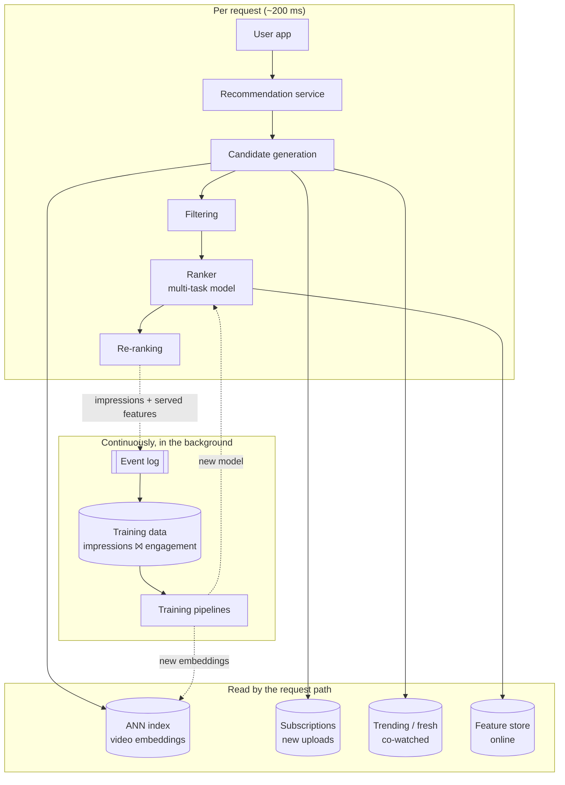
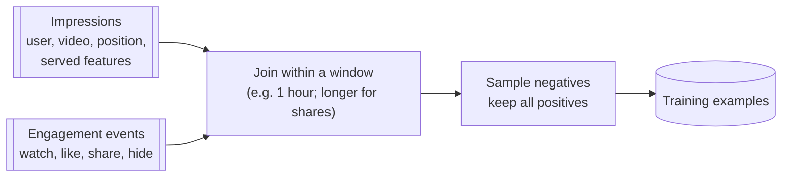

<Related ids={['ml-system-design-framework', 'design-news-feed', 'caching', 'batch-and-stream-processing', 'search-systems', 'design-video-streaming']} />

Design the recommendations on a video platform's home feed, like YouTube's home page or Instagram Reels: when a user opens the app, show a personalised list of videos they're likely to enjoy. This is the most common ML system design question, and the same design answers "design the Instagram feed", "design TikTok's For You page" and "design Netflix recommendations" with small changes.

The core idea is a **funnel**. No model can score a billion videos in 200 ms, so a cheap stage narrows the catalogue to about a thousand candidates, a heavier model ranks those, and a final stage reorders the top for variety and rules. Most of the interview is about what happens at each stage and how the training data is produced.

Read [The ML System Design Interview](/system-design/hld/ml-system-design-framework) first; this case study follows its steps.

## 1. Clarify the problem

| Question | Assumption |
| --- | --- |
| Surface | Home feed of a video app; the user scrolls a vertical list |
| Scale | 500M daily active users, ~10 feed loads each per day |
| Catalogue | ~1B videos, ~5M new uploads per day |
| Latency | Feed must load within 200 ms at p99 (server side) |
| Business goal | Long-term engagement: users come back and watch more, without clickbait |
| Constraints | New users and new videos must get reasonable results; content policy must be respected |

## 2. Frame it as an ML problem

The business wants satisfied users who return. Per impression we can observe several outcomes, so the ranker predicts each of them for a (user, video, context) triple:

| Prediction | Kind | Why it's there |
| --- | --- | --- |
| P(click / start watching) | Binary | Did the thumbnail draw them in? |
| E[watch seconds] or P(watch > 50%) | Regression / binary | Did the video deliver? This counters clickbait |
| P(like), P(share), P(comment) | Binary | Explicit satisfaction |
| P(dislike / "not interested" / report) | Binary | Negative signals that should cost ranking |

They're combined into one score with weights the product team owns:

```text
value = 0.2·P(click) + 1.0·E[watch minutes] + 3·P(like) + 6·P(share) − 20·P(not interested) − 200·P(report)
```

Weights are tuned through A/B tests against long-term metrics such as 7-day retention, not by the model. Changing a weight shifts the product's behaviour without retraining.

## 3. Metrics

**Offline**

- Candidate generation: **recall@k**, the share of videos the user actually engaged with (in a held-out future window) that appear among the top k retrieved candidates. If retrieval misses a video, no ranker can recover it.
- Ranking: **ROC-AUC and log loss per task**, plus **NDCG@10** on the combined score.
- Calibration per task, since the value formula adds probabilities from different heads and they must be on a true probability scale.

**Online (A/B test)**

- Primary: watch time per daily active user, and 7-day retention.
- Guardrails: "not interested" and report rates, diversity (distinct creators per session), feed latency, share of watch time from new creators (so the system doesn't only promote the already famous).

## 4. Capacity estimation

```text
Feed requests: 500M DAU × 10 = 5B/day ≈ 58K requests/s average, ~150K/s at peak

Ranking work: ~1,000 candidates per request × 150K req/s = 150M (user, video) scorings per second at peak
  → the ranker must be small and batched, typically on GPUs or optimised CPU inference

Training data: each feed shows ~20 videos → 100B impressions/day
  → sample negatives (impressions without engagement) to keep training data manageable

Video embeddings for retrieval: 1B × 128 dims × 1 byte (quantised) ≈ 128 GB
  → an approximate nearest neighbour (ANN) index sharded over machines
```

**So:** retrieval must be sub-linear in the catalogue size, ranking must be cheap per candidate, and training data has to be sampled.

## 5. High-level design

<FlowSteps title='One feed request, and the loop that trains the models' steps={[
  { path: ['U', 'API', 'CG'], text: 'The app asks for a feed. The recommendation service computes the user embedding and asks every candidate source for videos.' },
  { path: ['CG', 'ANN'], text: 'Two-tower retrieval: the user embedding queries an ANN index of video embeddings for the nearest few hundred.' },
  { path: ['CG', 'SUB'], nodes: ['TR'], text: 'Other sources add candidates: new videos from subscribed channels, trending and fresh videos, and videos often watched together with the user\'s recent ones.' },
  { path: ['CG', 'FIL'], text: 'About 1,500 candidates are merged and filtered: already watched, blocked creators, policy violations, unavailable in the region.' },
  { path: ['FIL', 'RANK', 'FS'], text: 'The ranker fetches features from the online feature store and scores each candidate on every task.' },
  { path: ['RANK', 'RR'], text: 'The value model combines the predictions; re-ranking enforces diversity, freshness and rules; the top 20 are returned to the app.' },
  { path: ['RR', 'LOG', 'TD'], text: 'Every impression is logged with the features as served, then joined with what the user did to become training data.' },
  { path: ['TD', 'TRAIN', 'RANK'], edges: [['TRAIN', 'ANN']], text: 'Models retrain continuously; new video embeddings are added to the ANN index as videos are uploaded.' },
]}>



</FlowSteps>

## 6. Deep dives

### Candidate generation: why several sources

Each source catches something the others miss, and the merge is what makes the feed feel both personal and fresh:

| Source | How it works | What it's good for |
| --- | --- | --- |
| **Two-tower retrieval** | Nearest videos to the user's embedding in an ANN index | Personal taste, including videos from channels the user has never seen |
| **Subscriptions** | New uploads from followed channels | Things the user explicitly asked for |
| **Item-to-item (co-watch)** | "People who watched X also watched Y", from the user's last few videos | Continuing a current interest; reacts instantly to this session |
| **Trending and fresh** | Popular in the user's region and language; recent uploads | Freshness and cold start |
| **Exploration** | A few videos from topics the model is unsure about | Discovering new interests; avoiding filter bubbles |

Each source returns a few hundred candidates; the merged, deduplicated set is about 1,000–1,500.

### The two-tower model

Two networks produce embeddings in the same space:

- The **user tower** takes the user's recent watch history (as a sequence of video embeddings), long-term interests, and context (time, device, country).
- The **video tower** takes the video ID embedding, the channel, and content embeddings from the title, thumbnail and audio.

Training pushes the user embedding close to videos the user engaged with and away from others. The usual trick is **in-batch negatives**: for a batch of (user, watched video) pairs, every other video in the batch serves as a negative for each user, which is cheap and effective. Because popular videos appear in many batches, they get pushed away too often, so a **sampling-bias correction** (subtracting the log of each video's sampling probability from its score) keeps retrieval from under-recommending popular items.

Why two towers? Because the video side doesn't depend on the user, **all video embeddings are computed offline** and loaded into an ANN index (HNSW, ScaNN or FAISS IVF-PQ). At request time only the user tower runs, once, and the index finds the nearest videos in a few milliseconds. A model that looks at user and video features together would be more accurate, but it would have to run a billion times per request. That model is the ranker, applied only to the shortlist.

New videos get an embedding at upload time from their content features, so they can be retrieved before anyone has watched them.

### The ranker

The ranker scores each candidate with far richer features than retrieval can afford, including **user–video cross features**: how often this user watched this channel, how similar this video is to the last five watched, how this video performed with similar users in the last hour.

A typical architecture is a **multi-task** network: shared layers over all features, then one small head per prediction (click, watch time, like, share, not interested). Sharing helps the rare tasks (shares, reports) learn from the common ones (clicks). When tasks conflict, a mixture-of-experts layer (MMoE) lets each head weight shared "expert" sub-networks differently.

Watch time needs care. One well-known approach (from YouTube's 2016 paper) trains a classifier where positive examples are **weighted by their watch time**; the odds the model learns then approximate expected watch time, which is exactly what you want to rank by.

Ranking 1,000 candidates must take a few tens of milliseconds, so the model is kept small, inference is batched (all candidates in one call), and features are fetched in one multi-get from the feature store.

### Re-ranking: what the model doesn't do

Pure score order produces a feed of ten nearly identical videos from one channel. The re-ranking stage applies rules on top of the scores:

- **Diversity:** at most two videos per channel in the top 10; penalise candidates too similar to ones already placed (maximal marginal relevance).
- **Freshness:** a boost for recent uploads, which the model under-predicts because they have little history.
- **Policy:** demote borderline content even if it scores well.
- **Format mixing:** interleave short and long videos, insert ad slots at fixed positions.

These rules are deliberately outside the model: product teams can change them in a day, and they're easy to audit.

### Training data: from logs to labels



- An **impression** is logged when a video actually appears on screen (not merely returned by the server), with its position and the exact features used to score it.
- Engagement events are joined to impressions by an impression ID within a time window. Shares and likes can come late, so their labels are finalised after a longer window.
- Most impressions have no engagement, so negatives are downsampled. Because the downsampling changes the base rate, predicted probabilities are corrected afterwards (see [Design Ad Click Prediction](/system-design/hld/design-ad-click-prediction) for the formula).
- **Position bias:** the position is included as a feature during training, so the model learns how much of a click is "because it was first". At serving time the position feature is set to a fixed value, so candidates are compared on their merits.

### Freshness and continuous training

Interests and trends change within hours. The ranker is **retrained continuously** (or fine-tuned every few hours) from the latest data, starting from the previous weights rather than from scratch. Real-time features such as "views in the last 10 minutes" come from a stream processor writing into the online feature store. Each new model version passes automated offline checks before it replaces the current one.

### Cold start

- **New users:** rely on context (country, language, device, referral source), popular-in-cohort videos, and an optional interest picker. Explore more heavily for the first sessions: each interaction says a lot.
- **New videos:** content embeddings let retrieval find them immediately; a fresh-content source and an exploration budget guarantee each new video some impressions, so it can earn engagement data. Without that, new creators never get started.

### Feedback loops

The model only learns from what it showed. Videos it ranks low are never seen, never engaged with, and so stay low: a self-reinforcing loop that narrows what users see and favours already-popular content. Counter-measures: a small amount of exploration with logged probabilities (so training can correct for it), diversity rules, and tracking guardrails such as the share of watch time from new creators.

## 7. Failure modes

| Failure | Mitigation |
| --- | --- |
| Feature store slow or down | Rank with default feature values; if that fails, serve a cached feed or popular videos for the user's region |
| ANN index stale | New uploads still arrive via the fresh-content source; rebuild the index on a schedule and append new vectors incrementally |
| Bad model version | Automatic offline checks before deploy; canary on 1% of traffic; one-click rollback |
| Training–serving skew | Train on logged served features; alert when served feature distributions drift from training |
| Logging pipeline broken | Training stalls rather than learning from partial data; alert on volume drops |
| Popularity collapse | Monitor diversity and new-creator guardrails; raise exploration |

## 8. Trade-offs summary

| Decision | Choice | Why |
| --- | --- | --- |
| Architecture | Retrieval → ranking → re-ranking funnel | Heavy models can only afford a shortlist |
| Retrieval | Two-tower + ANN, plus rule-based sources | Personal and sub-linear; rules add freshness and subscriptions |
| Ranking objective | Multi-task predictions combined by a value model | Avoids clickbait; product can tune trade-offs without retraining |
| Training data | Logged impressions joined with engagement, negatives sampled | Real behaviour, at affordable volume |
| Bias handling | Position as a training feature, exploration budget | Stops the model just copying its own past choices |
| Freshness | Continuous training and streaming features | Trends change within hours |

## 9. What interviewers look for

- **Mid-level:** a clear funnel, sensible features, a reasonable objective beyond clicks, offline and online metrics.
- **Senior:** two-tower retrieval and why it scales; multi-task ranking and the value model; how labels are built from logs; position bias; cold start; latency per stage.
- **Staff:** feedback loops and exploration, long-term metrics, continuous training and its risks, cost of serving at 150K requests per second, and how teams own different stages independently.

## Interview questions

<QA q="Why use a two-tower model for retrieval instead of the ranking model?">
In a two-tower model the video embedding doesn't depend on the user, so every video's embedding can be computed offline and stored in an approximate nearest neighbour index. At request time only the user tower runs once, and the index returns the closest videos among a billion in milliseconds. The ranking model uses user–video cross features, so it must run separately for every pair; that is affordable for a thousand candidates but impossible for a billion. Retrieval trades some accuracy for scale, and the ranker restores accuracy on the shortlist.
</QA>

<QA q="How do you stop the feed from becoming ten videos from the same channel?">
In the re-ranking stage, after scoring. Cap the number of items per channel in the top positions, and penalise each candidate by its similarity to items already placed (maximal marginal relevance), so the list balances score against variety. Keep these as explicit rules rather than training them into the model, so product teams can adjust them quickly and they are easy to audit. Watch a diversity guardrail metric in experiments to confirm the change doesn't cost long-term engagement.
</QA>

<QA q="A new creator uploads a great video. Why might the system never show it, and how do you fix that?">
The ranker relies heavily on engagement history, which a new video doesn't have, and the model only learns about videos it shows, so a video that starts low can stay low forever. Fixes: give new videos a content-based embedding at upload so retrieval can find them; add a fresh-content candidate source; reserve a small exploration budget of impressions for new videos, logging the probability they were shown with so training can correct for it; and boost freshness in re-ranking. Track the share of watch time going to new creators as a guardrail.
</QA>

<QA q="Your training data uses clicks on items at each position. What goes wrong, and how do you correct it?">
Users click top positions more simply because they are at the top, so the model learns to rank whatever the previous model ranked highly: it copies its predecessor instead of learning relevance. Correct it by including the position as a feature during training so the model attributes part of each click to position, then setting it to a constant at serving time. Alternatively, estimate position effects with a small randomised slice of traffic and weight training examples accordingly.
</QA>

## Practice

Write your answer before opening the suggested one. Anything you mark "Partly" or "Missed it" comes back in your review deck.

<Practice task="Adapt this design to TikTok's For You page, where users swipe through one full-screen video at a time and there are no subscriptions in the feed. What changes?">

- **Signals are richer and faster:** every swipe is an implicit rating. Watch completion, rewatches and how quickly someone swipes away become the main labels, available within seconds.
- **Session matters more:** the user's last few videos predict the next one well, so the item-to-item and sequence-aware user tower carry more weight than long-term history, and features update in real time within the session.
- **Ranking per item, not per page:** the next video can be chosen after each swipe, so the system can request small batches (a few videos) and adapt immediately.
- **Candidate sources:** no subscription source; more weight on embedding retrieval, trending, and exploration, which also gives new creators a real chance.
- **Exploration is cheaper:** a bad recommendation costs one swipe, so the system can explore more aggressively than a page-based feed.

</Practice>

<Practice task="Do the arithmetic: the ranker takes 0.05 ms of compute per candidate on a GPU in large batches. At 150K requests/s with 1,000 candidates each, how many GPUs do you need, and what could you change to need fewer?">

150K × 1,000 = 150M candidate scorings per second. At 0.05 ms each, that is 150M × 0.05 ms = 7,500 GPU-seconds of work per second, so about **7,500 GPUs** at full utilisation, and more like 10,000 with headroom.

Ways to cut it:
- Rank fewer candidates: add a light "pre-ranker" that cuts 1,000 to 300 before the heavy model (≈3× fewer).
- Distil the ranker into a smaller model with little loss.
- Cache: a user who reloads within a minute can get the rest of the previous ranked list.
- Precompute candidates or even rankings for users likely to open the app soon, during off-peak hours.

</Practice>

<Takeaways>

- Recommendations are a funnel: several cheap candidate sources, a heavy multi-task ranker on about a thousand candidates, then rule-based re-ranking.
- Two-tower retrieval scales because video embeddings are precomputed into an ANN index; only the user tower runs per request.
- Rank by a value model that combines predicted click, watch time, likes, shares and negative signals, with weights tuned by experiments.
- Training data comes from logged impressions joined with engagement; correct for position bias and negative sampling.
- Handle cold start with content embeddings, fresh-content sources and an exploration budget.
- Watch for feedback loops; diversity rules and exploration keep the system from narrowing itself.

</Takeaways>

## Further reading

- Paul Covington, Jay Adams and Emre Sargin, "Deep Neural Networks for YouTube Recommendations" (RecSys 2016).
- Xinyang Yi et al., "Sampling-Bias-Corrected Neural Modeling for Large Corpus Item Recommendations" (RecSys 2019) — two-tower retrieval with in-batch negatives.
- Jiaqi Ma et al., "Modeling Task Relationships in Multi-task Learning with Multi-gate Mixture-of-Experts" (KDD 2018).
- Zhe Zhao et al., "Recommending What Video to Watch Next: A Multitask Ranking System" (RecSys 2019).
