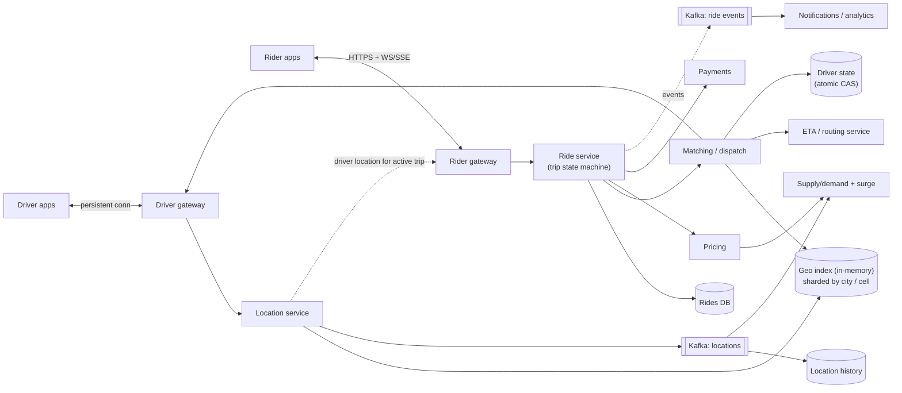
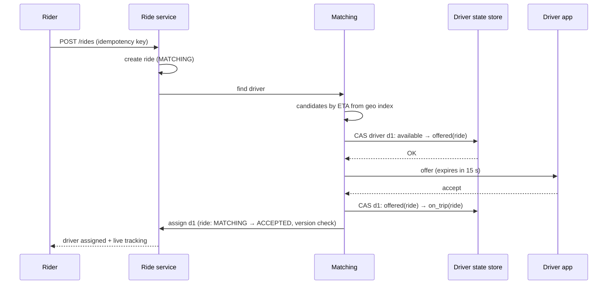
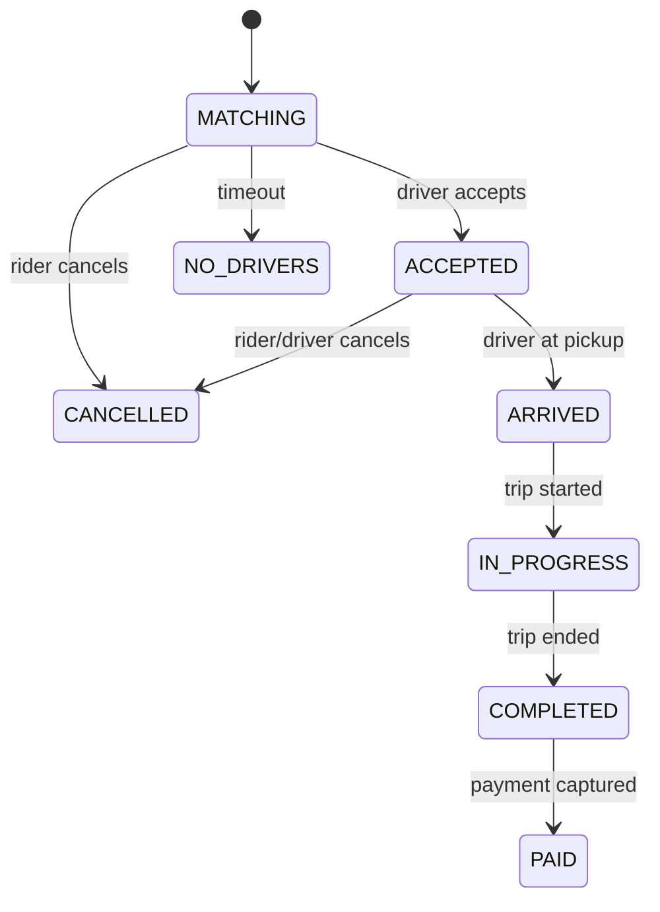

<Related ids={['geospatial-indexing', 'real-time-communication', 'transactions-and-isolation', 'message-queues', 'consensus', 'distributed-transactions', 'multi-region-architecture', 'caching']} />

Design a ride-hailing service like Uber, Ola or Lyft: riders request a trip, nearby drivers are matched, the driver navigates to the rider, and both see each other's live location until the trip ends and payment completes. It combines a **high-frequency location firehose**, **geospatial search**, a **matching problem with contention** (one driver can't accept two rides), and a long-lived **trip state machine**.

## 1. Clarify the problem

| Question | Assumption |
| --- | --- |
| Core flows? | Request ride, get fare estimate, match driver, live tracking, complete trip, pay |
| Scale? | 20M rides/day globally; 5M drivers online at peak; drivers send location every 4 s |
| Matching? | Nearest suitable available driver by ETA, offered one driver at a time with a timeout |
| Pricing? | Fare estimate + surge pricing by area |
| Out of scope | Pooling/shared rides, scheduled rides, driver onboarding |

## 2. Requirements

**Functional:** riders see nearby drivers and a fare estimate; request a ride; match to a driver who accepts; live location of driver for rider; trip lifecycle; payment at the end.

**Non-functional:**

- **Low-latency matching** — match within a few seconds.
- **No double assignment** — a driver gets at most one active trip; a ride gets at most one driver.
- **High availability** — riders and drivers depend on it in real time; trip state must survive failures.
- **Scale** for the location firehose.

## 3. Capacity estimation

```text
Location updates: 5M drivers ÷ 4 s = 1.25M updates/s at peak
Update size ~100 B → 125 MB/s ingest

Ride requests: 20M/day ÷ 10^5 ≈ 200/s average; peaks in a big city at rush hour → ~2,000/s globally
Nearby-driver queries: riders opening the app ~10× ride requests → a few thousand/s, plus matching queries

Trips storage: 20M × ~5 KB (trip record + events) ≈ 100 GB/day
Location history: 1.25M/s × 100 B ≈ 10 TB/day → to cheap storage (compressed)
```

**So:** location updates are by far the highest-volume workload — keep current locations **in memory**, sharded geographically, and stream history asynchronously. Matching volume is modest but needs strong consistency per driver.

## 4. API

```text
Driver app (persistent connection — WebSocket or MQTT/gRPC stream):
  → location { lat, lng, heading, speed, ts }           every ~4 s
  ← offer { tripId, pickup, eta, fare, expiresIn: 15s }
  → accept { tripId } / decline { tripId }
  → trip status updates (arrived, started, completed)

Rider app:
  GET  /v1/estimates?pickup=…&dropoff=…        → fare + ETA per product
  POST /v1/rides  { pickup, dropoff, product, estimateId }   Idempotency-Key  → 201 { rideId, status: MATCHING }
  WebSocket/SSE subscription for ride status and driver location
  POST /v1/rides/{id}/cancel
```

## 5. Data model

```text
drivers           (driver_id, vehicle, rating, status: offline/available/offered/on_trip, city)
driver_location   in-memory geo index: cell → set of driver_ids; driver_id → (lat, lng, ts)   [TTL]
rides             (ride_id, rider_id, driver_id, status, pickup, dropoff, product,
                   fare_estimate, surge_multiplier, created_at, version)
ride_events       (ride_id, seq, type, payload, ts)   -- append-only lifecycle log
location_history  (driver_id, time bucket) → compressed points        -- cold storage / analytics
```

Rides need transactional state transitions → a relational/NewSQL store (sharded by city or ride_id). Driver status needs an atomic compare-and-set.

## 6. High-level design

<FlowSteps title='Requesting a ride' steps={[
  { path: ['DRV', 'DGW', 'LOC', 'GEO'], text: 'Drivers send their location every few seconds; the location service updates the in-memory geo index.' },
  { path: ['LOC', 'K', 'SURGE'], nodes: ['HIST'], edges: [['K', 'HIST']], text: 'Locations also stream into Kafka for history and for supply and demand (surge) calculations.' },
  { path: ['RID', 'RGW', 'RIDE', 'RDB'], text: 'A rider requests a trip; the ride service creates it in the trip state machine.' },
  { path: ['RIDE', 'MATCH', 'GEO'], text: 'Matching searches the geo index for nearby available drivers…' },
  { path: ['MATCH', 'ETA'], text: '…ranks them by ETA from the routing service…' },
  { path: ['MATCH', 'DSTATE'], text: '…and reserves the best driver with an atomic compare-and-set, so two trips cannot take the same driver.' },
  { path: ['MATCH', 'DGW', 'DRV'], text: 'The offer goes to the driver\'s app; when the driver accepts, the trip moves to \'driver en route\'.' },
  { path: ['LOC', 'RGW', 'RID'], text: 'During the trip, the driver\'s position is forwarded to the rider\'s app.' },
]}>



</FlowSteps>

## 7. Deep dives

### Ingesting locations and finding nearby drivers

- Drivers keep a persistent connection to a **driver gateway**; updates go to the **location service**.
- The location service maps each point to a cell (geohash, S2 or H3) and updates an **in-memory geo index** sharded by city/region: `cell → {driver_ids}`, plus `driver_id → latest position` with a TTL (drivers who stop reporting disappear).
- Only update cell membership when the driver crosses a cell boundary; otherwise just update the position.
- "Nearby drivers" = look up the rider's cell and neighbouring rings of cells, filter by availability and product, sort by straight-line distance, then compute **road ETAs** for the top few candidates via the routing service.
- History is streamed to Kafka → storage, never written synchronously.

See [Geospatial Indexing](/system-design/hld/geospatial-indexing).

### Matching without double booking

Sequence for a ride request:



- **Lock the driver, not just the ride**: an atomic **compare-and-set** on driver status (`available → offered` with the ride ID) ensures a driver is offered only one ride at a time, even if two matching workers pick them concurrently. The loser picks the next candidate.
- **Offer timeouts**: if the driver doesn't accept within ~15 s, revert `offered → available` (conditional on still holding this offer) and try the next candidate.
- **Ride transitions** use optimistic concurrency (version column) so a cancel and an accept racing each other resolve cleanly — exactly one wins.
- **Matching per city** can be owned by a partitioned set of dispatch workers (each city/zone owned by one worker via leases) — this also enables **batch matching**: collect requests for a second or two and solve an assignment problem that minimises total ETA, rather than greedy nearest-driver.

### Trip state machine



Every transition is persisted with an event (append-only `ride_events`) — useful for support, disputes and analytics. Side effects (notifications, payment) are triggered from events via the outbox pattern.

### Live tracking for the rider

During an active trip, the rider subscribes (WebSocket/SSE) to the trip channel. The location service publishes the assigned driver's updates to that channel (via pub/sub keyed by trip). Clients **interpolate** between 4-second updates for smooth movement. If the connection drops, the client reconnects and gets the latest position.

### Pricing and surge

- Fare estimate = base + per-km + per-minute (from routing ETA) × surge multiplier. Return an **estimate ID** that locks the quoted price for a few minutes, so the price the rider accepted is honoured.
- **Surge**: a streaming job aggregates supply (available drivers) and demand (open requests, app opens) per cell (H3 hexagons) per minute and computes multipliers, smoothed across neighbouring cells and time to avoid jitter.

### Payments

At completion, compute the final fare, then charge the stored payment method via the payment service with an **idempotency key = ride ID** (so retries never double-charge). Often a pre-authorisation is placed at booking and captured at the end. See [Design a Payment System](/system-design/hld/design-payment-system).

### Geography and availability

Partition everything **by city/region**: geo indexes, dispatch ownership, even data stores. Cities are naturally independent, which limits blast radius and lets you run regional deployments near users. A city's dispatch owner fails over via lease expiry to another worker, rebuilding the in-memory geo index from the next round of driver updates (which arrive every 4 s — the state self-heals quickly).

## 8. Failure modes

| Failure | Mitigation |
| --- | --- |
| Geo index node lost | Rebuilt within seconds from incoming updates; replicas for hot cities |
| Driver loses connectivity mid-trip | Trip continues; app buffers locations and uploads when back; ride state is server-side |
| Two dispatchers pick the same driver | Atomic CAS on driver status — only one succeeds |
| Driver never responds to offer | Offer timeout reverts status; next candidate |
| Payment provider down | Ride completes; charge retried asynchronously with the same idempotency key |

## 9. Trade-offs summary

| Decision | Choice | Why |
| --- | --- | --- |
| Current locations | In-memory geo index sharded by city, TTL | 1M+ updates/s; freshness over durability |
| Location history | Async via Kafka | Keep the hot path light |
| Driver assignment | CAS on driver status + offer timeouts | Prevent double booking without global locks |
| Matching | Greedy nearest-ETA (batch optimisation as upgrade) | Simple; batching improves global efficiency |
| Partitioning | By city/region | Natural isolation and locality |

## 10. What interviewers look for

- **Mid-level**: location updates, finding nearby drivers with a geo index, ride request flow, WebSockets for tracking.
- **Senior**: in-memory sharded geo index, atomic driver assignment and offer timeouts, trip state machine, idempotent ride creation and payment, surge computation via streaming.
- **Staff**: batch matching optimisation, city-level partitioning and failover, ETA service cost, multi-region strategy, marketplace dynamics.

## 11. Variations interviewers ask

The same geospatial ideas power several other common questions. What changes is how often the location data changes, and what must be strongly consistent.

### Nearby places (Yelp)

- **Places don't move.** Drivers report their position every few seconds; a restaurant's position changes almost never. So there is no in-memory index churning with updates. A geo index in a database or search engine, built once and updated rarely, is enough: PostGIS, or **Elasticsearch** with a `geo_point` field, which also handles the text query ("pizza"), filters (open now, price) and ranking in one request.
- **Query:** find the geohash or quadtree cells covering the search circle, fetch the places in those cells, filter by exact distance, then rank by distance, rating and relevance.
- **Density varies wildly.** A fixed-size cell in central Mumbai holds thousands of places, and one in the countryside holds none. A **quadtree** splits cells until each holds at most N places, or the search keeps widening its radius until it has enough results. See [Geospatial Indexing](/system-design/hld/geospatial-indexing).
- **Average rating** shouldn't be computed by scanning every review. Store `rating_sum` and `rating_count` on the business row and update them in the same transaction as the review insert. A unique constraint on `(user_id, business_id)` enforces one review per user.
- Reads dwarf writes, so cache popular searches by (cell, category) for a few minutes.

### Swipe matching (Tinder)

- **Candidates:** select profiles near the user (geo cell) that match their preferences, and precompute a **stack** of about 100 candidates per user, cached and refilled in the background.
- **Swipes** are a huge write stream, hundreds per user per day. Store them in a wide-column store keyed by the swiper, and keep a **Bloom filter** of already-swiped IDs per user so the stack never shows someone twice.
- **The match check must be atomic.** When A likes B, the system checks whether B already liked A. If both swipe at the same moment and each checks before the other's write lands, nobody gets a match. Store both directions under **one key** for the pair (the two IDs sorted, so A–B and B–A are the same key) and update it atomically, for example with a Redis Lua script or a conditional write. Whichever swipe arrives second then sees the first and creates the match.
- On a match, notify both users via push.

### Local delivery (Gopuff, Blinkit)

- The question behind every product page is "**can this item reach this address within 30 minutes?**" That means: which dark stores can deliver here in time, and do they have it in stock?
- Precompute each store's **delivery area** as a travel-time polygon. For an address, find the stores whose polygons contain it. There are few stores, so cache the result per geohash.
- **Availability** = stock summed across those stores. Browsing tolerates a few seconds of staleness, so cache it briefly.
- **Ordering must not oversell:** reserve stock in the chosen store's database atomically (`UPDATE stock SET qty = qty - 2 WHERE store = ? AND sku = ? AND qty >= 2`), exactly like seat holds in the ticket booking case study. Browsing can be eventually consistent; ordering must be strongly consistent.

## Interview questions

<QA q="How do you prevent two riders from being assigned the same driver?">
Make driver assignment an atomic state transition on the driver's record: compare-and-set from available to offered (tagged with the ride ID) in a strongly consistent store, or have a single dispatch owner per city that serialises assignments. Only one transition can succeed; competing matchers move to the next candidate. Offer expiry conditionally reverts the state only if it still references the same ride.
</QA>

<QA q="Why not store driver locations in the main database?">
At over a million updates per second, writing each to a durable database would be enormously expensive, and almost all of those writes are overwritten seconds later. Only the latest position matters for matching, and it self-heals from the next update if lost. So keep current positions in a sharded in-memory geo index with TTLs and stream history asynchronously to cheap storage for trips and analytics.
</QA>

<QA q="How would batch matching improve over greedy matching?">
Greedy matching assigns each request the nearest available driver as it arrives, which can be globally inefficient — taking a driver who would have been perfect for the next request. Collecting requests and available drivers in a short window (a second or two) and solving an assignment problem minimises total pickup ETA across all of them, improving average wait times and driver utilisation at the cost of a small added delay.
</QA>

## Practice

Write your answer before opening the suggested one. Anything you mark "Partly" or "Missed it" comes back in your review deck.

<Practice task="A city has 50,000 active drivers sending a location every 4 seconds, and riders request about 500 trips per second at peak. What write rate does the location service handle, and what index lets you find nearby drivers quickly?">

50,000 ÷ 4 s = 12,500 location writes/s per city, and only the latest position matters.

Store it in memory, keyed by driver, with a geospatial index: Redis `GEO` (geohash in a sorted set), or cells from H3/S2 mapping cell → set of driver IDs. On each update, move the driver between cells if the cell changed.

A ride request searches the rider's cell and its neighbours (expanding rings until enough candidates are found), filters by status (available, vehicle type), then ranks by estimated time of arrival from a routing service, not straight-line distance. 500 searches/s against an in-memory index is easy; the 12.5K writes/s are what decide the sharding (by city or region).

</Practice>

<Practice task="Two riders request a ride at the same moment and the matcher offers both of them the same driver. How do you guarantee a driver is assigned to only one trip?">

Make the assignment an atomic state change on the driver.

1. Keep each driver's state (available, offered, on trip) in one place, owned by one shard.
2. The matcher reserves a driver with a conditional update: set `state = offered(trip 123)` only if `state = available` (compare-and-set, Redis `SET` with `NX` on a lock key, or a database conditional update). Exactly one of the two attempts wins.
3. The loser moves on to its next-best candidate.
4. The offer has a timeout (say 15 s). If the driver does not accept, the state goes back to available.

Optimistic CAS is better than a distributed lock here: it is one round trip, and contention on a single driver is rare.

</Practice>

<Takeaways>

- The location firehose dominates: keep current positions in an in-memory, city-sharded geo index with TTLs.
- Find candidates by cells and rings, then rank by routed ETA for the top few.
- Assign drivers with atomic compare-and-set plus offer timeouts; manage trips as a persisted state machine.
- Track live locations over WebSocket/SSE via pub/sub per trip; compute surge with stream aggregation over hex cells.
- Partition by city for scale and isolation; make ride creation and payment idempotent.

</Takeaways>

## Further reading

- Uber Engineering, "H3: Uber's Hexagonal Hierarchical Spatial Index" (2018).
- [Ringpop](https://github.com/uber-node/ringpop-node) — Uber's open-source library for consistent hashing and gossip-based membership, built for its dispatch services.
- Lyft Engineering, "Matchmaking in Lyft Line" (2016) — the evolution of matching algorithms.
- Related: [Geospatial Indexing](/system-design/hld/geospatial-indexing), [Design a Payment System](/system-design/hld/design-payment-system).
