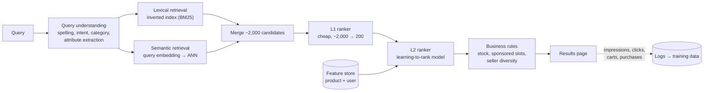

<Related ids={['ml-system-design-framework', 'search-systems', 'design-recommendation-system', 'design-typeahead', 'caching']} />

Design product search for a large e-commerce site: a user types "running shoes for flat feet" and gets a ranked list of products they're likely to buy. Amazon, Flipkart, Airbnb and Google ask versions of this, and it differs from feed recommendations in one important way: **the user has told you what they want**. Relevance to the query comes first; personalisation and business goals refine the order within relevant results.

This lesson builds on [Search & Inverted Indexes](/system-design/hld/search-systems), which covers the indexing side, and [The ML System Design Interview](/system-design/hld/ml-system-design-framework).

## 1. Clarify the problem

| Question | Assumption |
| --- | --- |
| Catalogue | 200M products, with titles, descriptions, attributes, images, prices, ratings |
| Traffic | 20K queries/s at peak |
| Latency | Results within 300 ms at p99 |
| Business goal | Purchases (and revenue) from search, while users find things quickly |
| Languages | Several; queries are short (2–4 words), often misspelled or mixed-language ("jute bag chota") |

## 2. Frame it as an ML problem

- **Input:** a query, a user, a context (device, location) and a set of candidate products.
- **Output:** an ordering of the candidates.
- **Task:** **learning to rank**. The model scores (query, product, user) and the products are sorted by score.
- **What "good" means:** a graded relevance judgement (perfect / good / fair / irrelevant), plus behavioural outcomes: click, add to cart, purchase.

## 3. Metrics

**Offline**

- **NDCG@10** (normalised discounted cumulative gain): rewards putting the most relevant results at the top, with graded relevance and a discount for lower positions. The standard search ranking metric.
- **MRR** (mean reciprocal rank) when one right answer exists, such as navigational queries ("iPhone 16 Pro 256GB blue").
- **Recall@k** of the retrieval stage: did the relevant products survive into the candidate set?

**Online**

- Purchases (or revenue) per search, click-through rate on results.
- **Zero-result rate**, **reformulation rate** (user immediately rewrites the query) and **abandonment**: signs the search failed.
- Guardrails: latency, diversity of sellers.

Search also uses **interleaving** experiments: results from the old and new rankers are merged into one list (alternating picks, de-duplicated), and whichever ranker's items get more clicks wins. It needs far less traffic than an A/B test to detect a difference, so it's used to screen rankers before a full A/B test.

## 4. High-level design

## 5. Deep dives

### Query understanding

Most of search quality is decided before ranking:

- **Spelling correction** ("runing shoos"), using query logs: if many users who typed X immediately searched Y and clicked, X → Y is a likely correction.
- **Query classification:** predict the product category ("running shoes" → Footwear › Sports). Used to filter or boost candidates.
- **Attribute extraction:** "red Nike shoes size 9 under 3000" → `colour=red, brand=Nike, size=9, price<3000`. These become structured filters, which are far more precise than matching the words.
- **Query expansion and synonyms:** "sneakers" ≈ "trainers"; "tv" ≈ "television".
- **Intent:** navigational (a specific product), broad (browsing a category), or a question ("how to clean suede"). Each may need a different results layout.

### Retrieval: lexical plus semantic

| | Lexical (inverted index, BM25) | Semantic (embeddings + ANN) |
| --- | --- | --- |
| Finds | Products containing the query's words | Products with similar meaning, even with different words |
| Strong at | Exact terms: model numbers, brands, sizes | Vague or descriptive queries: "shoes for flat feet" |
| Weak at | Synonyms, paraphrases, other languages | Exact identifiers; can return near-misses |
| Cost | Very cheap, mature (Elasticsearch, Lucene) | Needs an embedding model and an ANN index |

Use both (**hybrid retrieval**) and merge the candidate lists, for example with reciprocal rank fusion, which adds `1 / (60 + rank)` from each list so items ranked well by either survive. The semantic side is usually a two-tower model trained on (query, purchased product) pairs, with product embeddings precomputed into an ANN index.

### Ranking in two stages

Scoring 2,000 candidates with a heavy model in 300 ms is costly, so:

- **L1:** a cheap model (linear, or small trees) on a few precomputed features: text match scores, popularity, price. Keeps ~200.
- **L2:** the full learning-to-rank model on hundreds of features.

Feature groups for L2:

| Group | Examples |
| --- | --- |
| Query–product match | BM25 per field (title, brand, attributes), semantic similarity, category match, attribute matches |
| Product quality | Ratings and count, return rate, sales velocity, price competitiveness, delivery time, in stock |
| Behavioural | Historical CTR and conversion **for this query–product pair** (smoothed), add-to-cart rate |
| User | Preferred brands, price range, size, past purchases (personalisation) |
| Context | Device, location (delivery availability), time |

### Learning to rank

Three ways to train the ranker:

- **Pointwise:** predict each product's relevance or purchase probability independently (regression or classification). Simple, but the loss doesn't care about order.
- **Pairwise:** learn which of two products should rank higher for a query (RankNet, LambdaMART with trees). Directly optimises order.
- **Listwise:** optimise a list metric like NDCG directly (LambdaMART approximates this; also softmax-based list losses).

**LambdaMART** (gradient-boosted trees with a ranking loss) is a strong and very common production choice; deep ranking models take over when there are rich text and embedding features.

### Labels: human judgements and clicks

| Source | Pros | Cons |
| --- | --- | --- |
| Human raters grading (query, product) relevance | Precise, graded, independent of current ranking | Expensive; raters don't know an individual user's intent |
| Clicks, carts, purchases from logs | Huge volume, reflects real intent, free | Position bias; only shown items get feedback; purchases depend on price and stock too |

Most teams combine them: human labels for a **golden evaluation set** and for training relevance features, and behavioural signals (purchases weighted above carts above clicks) for training the main ranker.

**Position bias** is severe in search: the first result gets many times the clicks of the fifth regardless of quality. Correct it by estimating click probability by position (from randomisation experiments or from the same product appearing at different positions) and weighting training examples by the inverse, or by including position as a training feature that is fixed at serving time.

### Relevance first, business second

Revenue goals can quietly wreck search: boost high-margin items too much and users stop trusting the results. Keep the order of concerns explicit:

1. **Relevance gate:** products below a relevance threshold are not shown, whatever their margin.
2. **Ranking** within relevant products optimises purchase likelihood.
3. **Business rules** on top: out-of-stock items demoted, sponsored products only in labelled slots, seller diversity.

### Latency and caching

- Head queries ("iphone", "saree") are a small set that makes up a large share of traffic. Cache their retrieval results (not the final personalised ranking) for minutes.
- Precompute product features and embeddings; only query features and user features are computed per request.
- Run lexical and semantic retrieval in parallel.

## 6. Failure modes

| Failure | Mitigation |
| --- | --- |
| Zero results for valid intent | Spelling correction, relaxing filters, semantic retrieval as fallback; monitor zero-result rate by query |
| Semantic retrieval returns near-misses for exact queries | Hybrid retrieval; boost exact matches on identifiers and brands |
| Ranker overfits to popular items | Smoothed behavioural features; relevance features weighted; new-product exploration |
| Index lag (new products or price changes missing) | Near-real-time index updates for price and stock; full rebuilds offline |
| Embedding model update breaks the ANN index | Re-embed the whole catalogue with the new model before switching; keep the old index until then |

## 7. Trade-offs summary

| Decision | Choice | Why |
| --- | --- | --- |
| Retrieval | Hybrid lexical + semantic | Exact terms and meaning both matter |
| Ranking | L1 cheap filter, L2 learning-to-rank | Latency budget |
| Model | LambdaMART or a deep ranker | Optimises order directly |
| Labels | Human golden set + purchase-weighted behaviour | Precision for evaluation, volume for training |
| Bias | Position-bias correction | Otherwise the ranker copies its predecessor |
| Business goals | Relevance gate before business rules | Trust in search outlasts any single sale |

## 8. What interviewers look for

- **Mid-level:** query → retrieval → ranking, sensible features, NDCG and conversion metrics.
- **Senior:** query understanding with attribute extraction, hybrid retrieval, learning-to-rank losses, label sources and position bias, interleaving.
- **Staff:** balancing relevance against revenue, personalisation without filter bubbles, multilingual queries, evaluation programmes with human raters, and cost of re-embedding the catalogue.

## Interview questions

<QA q="Why combine keyword search with embedding search instead of using only embeddings?">
Each fails where the other succeeds. Keyword matching with an inverted index is precise for exact terms such as model numbers, sizes and brand names, where embeddings often return similar but wrong products. Embeddings handle synonyms, paraphrases, descriptive queries and other languages, where keyword matching finds nothing. Running both and fusing the candidate lists gives high recall for both kinds of queries, and the ranker then decides the order using features from both.
</QA>

<QA q="What is NDCG, and why is it preferred to accuracy for search?">
Normalised discounted cumulative gain sums the graded relevance of the results, discounting each by its position (usually by log2 of the position plus one), and divides by the best possible score for that query. It rewards putting the most relevant items at the top, handles graded rather than binary relevance, and is comparable across queries. Accuracy treats every result independently and ignores order, but in search, what matters is the order of the first few results.
</QA>

<QA q="How would you evaluate a new ranker faster than a two-week A/B test?">
Use interleaving. For each search, merge the results of the old and new rankers into one list by alternating picks, remove duplicates, and remember which ranker contributed each item. Count which ranker's items receive more clicks or purchases. Because every user sees both rankers at once, differences between users cancel out, and interleaving typically needs far less traffic than an A/B test to reach a decision. It screens candidates; the final launch still goes through an A/B test on business metrics.
</QA>

## Practice

Write your answer before opening the suggested one. Anything you mark "Partly" or "Missed it" comes back in your review deck.

<Practice task="Users search for 'iphone charger' and the top results are iPhones, because iPhones get far more clicks overall. What went wrong and how do you fix it?">

The ranker leans on popularity and behavioural features that are not specific to the query, and query understanding didn't capture that the user wants an accessory, not a phone.

Fixes:
- **Query understanding:** classify the query into the accessories category ("charger" is the head noun; "iphone" is a compatibility attribute) and use it as a filter or strong feature.
- **Behavioural features per query–product pair,** smoothed, rather than global popularity: for this query, chargers get bought, phones don't.
- **Relevance gate:** products whose category doesn't match the query intent fall below the threshold.
- Add such queries to the human-labelled golden set to catch regressions.

</Practice>

<Takeaways>

- Search ranking puts relevance to the query first; personalisation and business rules refine the order.
- Query understanding (spelling, category, attributes, synonyms) decides much of the quality.
- Use hybrid retrieval: inverted index for exact terms, embeddings for meaning, fused before ranking.
- Rank in stages (cheap L1, learning-to-rank L2); LambdaMART is a common strong choice.
- Combine human relevance labels with purchase-weighted behaviour, and correct for position bias.
- Measure with NDCG offline, interleaving for fast online screening, and A/B tests for launch.

</Takeaways>

## Further reading

- Christopher Burges, "From RankNet to LambdaRank to LambdaMART: An Overview" (Microsoft Research, 2010).
- Thorsten Joachims et al., "Unbiased Learning-to-Rank with Biased Feedback" (WSDM 2017).
- Olivier Chapelle et al., "Large-Scale Validation and Analysis of Interleaved Search Evaluation" (ACM TOIS, 2012).
- Christopher Manning, Prabhakar Raghavan and Hinrich Schütze, *Introduction to Information Retrieval* (Cambridge, 2008) — free online.
