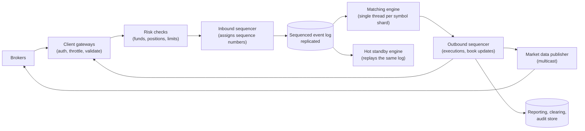

<Related ids={['consensus', 'replication', 'event-driven-architecture', 'time-and-ordering', 'availability-and-fault-tolerance', 'message-queues', 'networking-essentials']} />

Design the core of a stock exchange: brokers send buy and sell orders, a **matching engine** pairs them into trades, and everyone receives a **market data** feed of prices. Exchanges care about three things above all: **correctness** (no lost or duplicated orders, no trade at a wrong price), **fairness** (orders are handled strictly in the order they arrive) and **latency** (microseconds, not milliseconds).

This design is unusual because the usual scaling tools — many stateless servers, caches, eventual consistency — do not apply to the critical path. Instead, the answer is a single-threaded, in-memory, **deterministic** engine fed by a sequenced log, with replicas that replay the same log.

## 1. Clarify the problem

| Question | Assumption |
| --- | --- |
| What is traded? | Stocks; about 100 symbols to start, scaling to thousands |
| Order types? | Limit orders and cancels (market orders as a follow-up) |
| Volume? | 1 billion orders a day during 6.5 trading hours |
| Latency? | Order in to acknowledgement out: low microseconds inside the exchange |
| Who connects? | Brokers (not retail users), over FIX or a binary protocol |
| Out of scope? | Clearing and settlement details, margin lending |

## 2. Requirements

**Functional:** accept new limit orders and cancellations; match buy and sell orders by **price-time priority**; report executions to both sides; publish market data (best bid and offer, order book depth, trades); pre-trade risk checks (does the broker have the funds or shares?).

**Non-functional:** deterministic and auditable — the same inputs always give the same trades; no acknowledged order is ever lost; very low and predictable latency; high availability during trading hours with fast failover; fair treatment of all participants.

## 3. Capacity estimation

```text
Orders: 1B per day ÷ (6.5 h × 3,600 s = 23,400 s) ≈ 43K orders/s average
Peak (market open/close, news): ~5–10× → 200K–400K orders/s

Per message ~100 B → 400K × 100 B = 40 MB/s at peak: small in bytes
The constraint is latency per order, not throughput or storage.

Event log per day: 1B × ~100 B ≈ 100 GB, kept for years for audit
```

**So:** the volume fits on a single, well-tuned machine per group of symbols. The difficulty is doing each order in microseconds, deterministically, and surviving failures without losing anything.

## 4. Order book and matching

For each symbol the engine keeps an **order book**: buy orders (bids) sorted from the highest price down, sell orders (asks) sorted from the lowest price up. At each price level, orders wait in a FIFO queue.

```text
AAPL order book (asks above, bids below)
  ASK  101.20   300   orders A, B
  ASK  101.10   200   order C
  ASK  101.00   400   order D        ← best ask
  ---------------- spread 0.10 ----------------
  BID  100.90   500   order E        ← best bid
  BID  100.80   200   orders F, G
```

A new buy limit order at 101.10 for 500 shares **matches** against the best asks first: 400 at 101.00 (order D), then 100 of the 200 at 101.10 (order C). Within a price level, the oldest order fills first — that is **price-time priority**. Any unfilled remainder of an incoming limit order rests on the book.

Data structures for fast operations:
- Price levels in a sorted structure (or an array indexed by price tick when the range is bounded), each holding a doubly linked list of orders.
- A hash map from order ID to its node in the list, so a **cancel** is O(1): unlink the node.
- Best bid and best ask kept as pointers, so matching starts in O(1).

## 5. API

```text
Broker → exchange (FIX or binary):
  NewOrder(clientOrderId, symbol, side, price, quantity, timeInForce)
  Cancel(clientOrderId, origClientOrderId)
Exchange → broker:
  Ack / Reject(reason)
  Execution(orderId, price, quantity, leavesQuantity, tradeId)

Market data (multicast, binary):
  Incremental updates: add / modify / delete at price level, trade
  Periodic snapshots for late joiners
```

## 6. High-level design



**Order flow**
1. A gateway authenticates the broker, checks message format and rate limits.
2. Risk checks confirm the broker can afford the order (or owns the shares), reserving funds or shares.
3. The **sequencer** gives the order the next sequence number and appends it to a replicated log. From this moment the order cannot be lost, and its position in line is fixed.
4. The matching engine reads orders from the log strictly in sequence, updates the book and emits execution events.
5. Execution events are sequenced again on the way out, sent to the brokers involved, and turned into market data for everyone.

Reporting, clearing and settlement read the outbound events asynchronously and stay off the critical path.

## 7. Deep dives

### Determinism and event sourcing

The matching engine is a pure state machine: given the same sequence of input events, it produces exactly the same trades and the same book. It reads no wall clock (time comes from the sequencer's events), uses no randomness and no thread scheduling. This gives you:

- **Recovery:** rebuild the engine by replaying the log from the last snapshot.
- **Hot standby:** a second engine consumes the same log and holds an identical book in memory. If the primary fails, the standby takes over within milliseconds without losing state.
- **Audit:** regulators can replay any trading day and get the same results.

### Why a single thread?

Matching is inherently sequential per symbol — each order changes the book that the next order sees. Locks between threads would add latency and make behaviour depend on scheduling, breaking determinism. A single thread per symbol (or per shard of symbols) running from memory, with no locks, handles millions of operations per second; LMAX's exchange processed about 6 million orders per second on one thread. Scale out by **sharding symbols** across engines, not by adding threads to one book.

### The sequencer and the replicated log

Fairness and durability both come from the sequencer: every inbound event gets one global order, and it is written to a log replicated to other machines before the engine processes it. The replication must be synchronous (or quorum-based, for example with Raft) so an acknowledged order is never lost. Writing to a memory-mapped file and replicating over a fast, dedicated network keeps this in microseconds.

### Low latency techniques

- Keep the whole critical path on as few machines as possible; every network hop costs microseconds.
- Preallocate memory and avoid garbage collection pauses (object pools, or languages without a garbage collector on the hot path).
- Pin threads to CPU cores, use busy-spinning instead of sleeping, and pass messages through lock-free ring buffers (the LMAX Disruptor pattern).
- Use kernel-bypass networking for gateways and market data.
- Measure tail latency (p99, p99.9), not averages.

### Market data fairness

Every participant must receive updates at the same time. Exchanges publish market data over **UDP multicast** so one packet reaches everyone simultaneously, offer co-location (customers' servers in the exchange's data centre, often with equal cable lengths), and provide sequence numbers so receivers detect gaps and request retransmission or a snapshot.

### Risk and safety controls

Pre-trade checks (sufficient funds, position limits, maximum order size, price far from the market) stop errors before they reach the book. Market-wide **circuit breakers** pause trading in a symbol after extreme moves. A "kill switch" lets a broker cancel all of its orders at once if its own systems misbehave.

## 8. Failure modes

| Failure | Mitigation |
| --- | --- |
| Matching engine crashes | Hot standby, already in sync from the same log, takes over |
| Sequencer node fails | Replicated sequencer (leader election through consensus); log has every acknowledged event |
| Gateway fails | Brokers reconnect to another gateway; resend with the same client order IDs (duplicates rejected) |
| Market data packet lost | Gap detected by sequence number; retransmission or snapshot |
| Runaway broker algorithm | Rate limits, risk limits, kill switch |
| Extreme volatility | Circuit breakers / trading halts per symbol |

## 9. Trade-offs summary

| Decision | Choice | Why |
| --- | --- | --- |
| Matching | Single-threaded, in-memory per symbol shard | Deterministic, lock-free, microsecond latency |
| Ordering and durability | Sequencer + synchronously replicated log | Fairness and no lost orders |
| High availability | Hot standby replaying the same log | Instant failover with identical state |
| Scaling | Shard by symbol | Books are independent per symbol |
| Market data | UDP multicast with sequence numbers | Simultaneous delivery to everyone |
| Non-critical work | Asynchronous from the outbound log | Keeps the hot path short |

## 10. What interviewers look for

- **Mid-level:** order book with price-time priority, a matching service, executions and market data, persistence.
- **Senior:** determinism and event sourcing, the sequencer, single-threaded engine and why, hot standby, O(1) cancels, symbol sharding.
- **Staff:** latency engineering (hops, garbage collection, kernel bypass), fairness of market data, replication protocol for the log, risk controls and circuit breakers, regulatory audit and replay.

## Interview questions

<QA q="Why not run the matching engine on many threads to use all CPU cores?">
Each order changes the book that the next order sees, so matching for one symbol is sequential by nature. Several threads would need locks, which add latency and make the result depend on thread scheduling, so the same inputs could produce different trades — unacceptable for fairness and audit. Use one thread per symbol shard and spread symbols across cores or machines instead.
</QA>

<QA q="The primary matching engine dies in the middle of the trading day. How do you continue without losing orders?">
Every order was written to the replicated, sequenced log before the engine processed it. A hot standby engine consumes the same log and, because the engine is deterministic, has exactly the same book. The standby is promoted, continues from the next sequence number, and brokers' gateways reconnect. Orders acknowledged before the crash are in the log, so none are lost; orders that were not yet sequenced were never acknowledged and the broker resends them with the same client order ID, which deduplicates them.
</QA>

<QA q="How do you make cancelling an order fast in a book with thousands of resting orders?">
Keep a hash map from order ID to the order's node in its price level's doubly linked list. Cancelling looks up the node in O(1) and unlinks it in O(1), adjusting the price level's total quantity, and removes the price level if it becomes empty. Without the map you would have to search the queue at that price.
</QA>

## Practice

Write your answer before opening the suggested one. Anything you mark "Partly" or "Missed it" comes back in your review deck.

<Practice task="The best ask is 50.10 for 300 shares (order A, older) and 50.10 for 200 shares (order B), then 50.20 for 1,000 shares. A buy limit order arrives for 700 shares at 50.20. List the trades and what rests on the book afterwards.">

Price-time priority:
1. 300 at 50.10 with order A (oldest at the best price).
2. 200 at 50.10 with order B.
3. 200 at 50.20 with the 1,000-share order (the buyer still needs 700 − 500 = 200).

Afterwards: the asks at 50.10 are gone; 800 shares remain at 50.20. The buy order is completely filled, so nothing of it rests on the book. Note that the first 500 shares traded at 50.10, better than the buyer's 50.20 limit — trades happen at the resting order's price.

</Practice>

<Practice task="The exchange grows from 100 symbols to 8,000, and one engine can no longer keep up. How do you scale it while keeping fairness and determinism?">

Shard by symbol: each engine owns a set of symbols and its own sequenced input stream, and orders for a symbol always go to the engine that owns it (gateways route by symbol). Books are independent, so no cross-shard coordination is needed for matching.

Balance shards by activity, not by count: a few very active symbols get their own engine, quiet ones are grouped together. Each shard has its own sequencer, replicated log and hot standby.

Fairness and determinism hold per symbol, which is what matters: every order for that symbol passes through one sequencer. Cross-symbol consistency (a broker's total buying power) is handled by the risk layer, which reserves funds before orders reach any shard.

</Practice>

<Takeaways>

- The order book keeps bids and asks sorted by price, with FIFO queues per price level: price-time priority.
- Use a hash map from order ID to list node for O(1) cancels, and pointers to the best bid and ask.
- A sequencer gives every order a place in one global line and writes it to a replicated log before matching.
- The matching engine is single-threaded, in-memory and deterministic, so replaying the log rebuilds it exactly.
- A hot standby replays the same log for instant failover; scale out by sharding symbols.
- Keep clearing, reporting and analytics off the critical path; publish market data by multicast with sequence numbers.

</Takeaways>

## Further reading

- Martin Fowler, "The LMAX Architecture" (2011).
- Martin Thompson et al., "Disruptor: High performance alternative to bounded queues for exchanging data between concurrent threads" (LMAX technical paper, 2011).
- Nasdaq, "TotalView-ITCH 5.0" specification — how an exchange publishes order book data.
- Alex Xu and Sahn Lam, *System Design Interview*, Vol. 2 (2022) — ch. "Stock Exchange".
