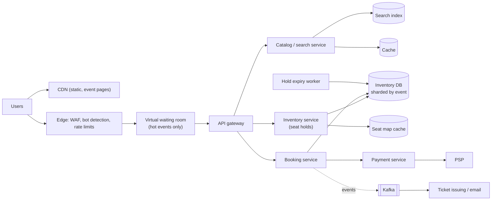
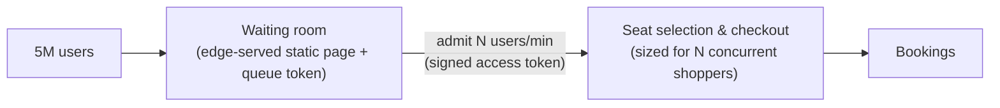

<Related ids={['transactions-and-isolation', 'caching', 'distributed-transactions', 'rate-limiting', 'message-queues', 'search-systems', 'availability-and-fault-tolerance', 'real-time-communication']} />

Design a ticket booking system like Ticketmaster or BookMyShow: users browse events, pick seats on a seat map, hold them while paying, and receive tickets. Most of the time it's an ordinary read-heavy catalogue. Then a superstar's concert goes on sale, millions of people arrive in the same minute for 50,000 seats, and the system must stay up, stay fair, and **never sell the same seat twice**.

## 1. Clarify the problem

| Question | Assumption |
| --- | --- |
| Seat selection? | Reserved seating with a seat map (plus general admission sections) |
| Hold period? | Selected seats held for 10 minutes while the user pays |
| Scale? | 10M daily users normally; hot on-sales draw 5–10M users for a single event |
| Payments? | Via a payment service provider (PSP) |
| Fairness? | First come, first served for hot events; limit tickets per user; resist bots |

## 2. Requirements

**Functional:** search/browse events; view seat map with availability; hold seats; pay and confirm booking; release holds on expiry or cancellation; issue tickets.

**Non-functional:**

- **Strong consistency for seat allocation** — never double-book.
- **High availability and graceful behaviour under extreme spikes** — no meltdown during on-sales.
- **Low latency** for browsing; seat maps reasonably fresh (seconds).
- **Fairness and bot resistance**.

## 3. Capacity estimation

```text
Normal: 10M DAU × 20 page views ≈ 200M views/day ≈ 2K/s (peak 6K/s), bookings ~50/s

Hot on-sale: 5M users arrive within ~10 minutes for 50K seats
Arrival ≈ 5M / 600 s ≈ 8K new users/s; each polls seat maps / retries → 100K+ requests/s on one event
Actual seat-hold writes the system must handle: at most ~50K successful holds (plus contention)
```

**So:** the catalogue is a normal cached read workload. The on-sale is a **contention** problem — 100× more demand than supply hitting the same few rows. The answer isn't "scale the database 100×"; it's **controlling admission** and making seat allocation an efficient atomic operation.

## 4. API

```text
GET  /v1/events?city=pune&q=…                 → search (served from search index + cache)
GET  /v1/events/{id}                          → details (cache/CDN)
GET  /v1/events/{id}/seats                    → seat map availability (cached a few seconds)
POST /v1/events/{id}/holds  { seatIds: [...] }   Idempotency-Key
     → 201 { holdId, expiresAt }   | 409 { unavailableSeats: [...] }
POST /v1/holds/{holdId}/checkout  { paymentMethod }  Idempotency-Key  → 202 { bookingId, status: PENDING }
GET  /v1/bookings/{id}
DELETE /v1/holds/{holdId}
```

## 5. Data model

```text
events     (event_id, venue_id, name, start_time, on_sale_at, status)
seats      (event_id, seat_id, section, row, number, price_tier,
            status: AVAILABLE | HELD | BOOKED, hold_id, hold_expires_at, booking_id, version)
            PRIMARY KEY (event_id, seat_id)
holds      (hold_id, user_id, event_id, seat_ids, expires_at, status)
bookings   (booking_id, user_id, event_id, seat_ids, amount, status: PENDING | CONFIRMED | FAILED, payment_ref)
```

Seat inventory needs **transactions and conditional updates** → a relational database (PostgreSQL/MySQL), sharded by `event_id` if needed (all seats of an event on one shard, so a multi-seat hold is a single-shard transaction).

## 6. High-level design

<FlowSteps title='Booking seats for a hot event' steps={[
  { path: ['U', 'EDGE', 'WR'], text: 'Users pass the edge\'s bot checks and rate limits and wait in the virtual waiting room.' },
  { path: ['WR', 'GW', 'CAT', 'ES'], text: 'Admitted users browse the event through the catalog service.' },
  { path: ['GW', 'INV', 'SMC'], text: 'The seat map comes from a cache that is updated as holds change.' },
  { path: ['INV', 'DB'], text: 'Choosing seats places a hold with a conditional update, so only one user can hold a seat.' },
  { path: ['GW', 'BK', 'PAY', 'PSP'], text: 'At checkout, the booking service charges the user through the payment service.' },
  { path: ['BK', 'DB'], text: 'On success the held seats are marked sold, on the condition that the hold is still yours.' },
  { path: ['BK', 'K', 'TIX'], text: 'A booking event triggers ticket issuing and the confirmation email.' },
  { path: ['EXP', 'DB'], text: 'Holds that expire without payment are released for other users.' },
]}>



</FlowSteps>

## 7. Deep dives

### Never double-book: atomic seat holds

The hold must be a single atomic operation that succeeds only if **every** requested seat is available:

```sql
BEGIN;
UPDATE seats
   SET status = 'HELD', hold_id = :hold, hold_expires_at = now() + interval '10 minutes'
 WHERE event_id = :event
   AND seat_id = ANY(:seats)
   AND (status = 'AVAILABLE' OR (status = 'HELD' AND hold_expires_at < now()));
-- if affected rows <> number of requested seats → ROLLBACK (some seat was taken)
COMMIT;
```

- The conditional `WHERE` makes the check and the update one atomic step; concurrent attempts on the same seat serialise on the row lock, and only one sees the seat as available.
- All seats of an event live on one shard, so this is a local transaction.
- Alternative: an in-memory hold layer (Redis `SET seat:{event}:{seat} hold NX EX 600` per seat, with a Lua script for all-or-nothing multi-seat holds) in front of the database for extreme throughput — the database remains the source of truth for confirmed bookings.

See [Transactions, Isolation & MVCC](/system-design/hld/transactions-and-isolation).

### Hold expiry

Holds must reliably expire so unpaid seats return to sale:

- **Lazy expiry**: the hold query above treats an expired hold as available, so correctness doesn't depend on a cleanup job.
- **Active cleanup**: a worker (or delayed queue message scheduled at hold creation) flips expired holds back to `AVAILABLE` so seat maps look accurate.

### Checkout and payment

1. Checkout verifies the hold is still valid and belongs to the user, creates a `PENDING` booking, and calls the payment service with an **idempotency key**.
2. On payment success, a transaction converts seats `HELD → BOOKED` (conditional on the same `hold_id`) and marks the booking `CONFIRMED`; an outbox event triggers ticket issuance and email.
3. If payment fails or times out, the booking is marked failed and the hold released (or left to expire).
4. **Edge case**: payment succeeds after the hold expired and someone else grabbed the seat → refund automatically (compensation), and design the hold time to make this rare (extend the hold while a payment is in flight).

### Surviving the on-sale: the virtual waiting room

Letting 5M users hammer seat maps and holds at once would overwhelm everything and reward whoever has the fastest bot. Instead:



- Users arriving before or at on-sale time get a **position in a queue** (randomised among those who arrived before the start, then FIFO) — served from the edge/CDN, which can absorb millions of lightweight requests.
- The waiting room **admits users at a controlled rate** matching what the booking system handles comfortably, issuing a signed, time-limited **access token** that the gateway requires for the shopping endpoints.
- Users see their position and estimated wait (updated via polling or SSE).
- Once tickets sell out, close the queue and tell everyone immediately.

This converts an uncontrolled spike into a steady, predictable flow — the same principle as load levelling with queues.

### Seat map reads at scale

Seat map availability is read far more than it changes. Serve it from a cache updated on every hold/booking (or rebuilt every 1–2 s), and accept a little staleness — the atomic hold is the real check. Push updates via SSE/WebSockets to users currently viewing the map during hot sales, or simply refresh on interval.

### Fairness and abuse

- Per-user and per-payment-method ticket limits enforced at hold time.
- Bot mitigation at the edge (behavioural detection, CAPTCHA challenges in the waiting room, device fingerprints), verified fan programs for very hot events.
- Rate limits per account and IP on hold endpoints.

## 8. Failure modes

| Failure | Mitigation |
| --- | --- |
| Inventory DB overloaded during on-sale | Waiting room admission control; in-memory hold layer; read traffic on caches/replicas |
| Payment provider slow | Hold extended while payment is in flight; idempotent retries; timeouts with clear user messaging |
| User pays twice (double-click / retry) | Idempotency keys on checkout and payment |
| Hold cleanup worker down | Lazy expiry in the hold query keeps correctness |
| Paid after seat lost | Automatic refund (compensation) + alert |

## 9. Trade-offs summary

| Decision | Choice | Why |
| --- | --- | --- |
| Seat allocation | Atomic conditional update on a single shard per event | Correctness under contention |
| Hold model | Time-limited holds, lazy + active expiry | Users can pay without losing seats; seats return reliably |
| Spike handling | Virtual waiting room with admission tokens | Converts spikes into steady load; fairness |
| Seat map | Cached, slightly stale | Reads vastly exceed writes; hold is the real check |
| Payment | Saga with idempotency and compensations | External PSP can't join a transaction |

## 10. What interviewers look for

- **Mid-level**: event/seat data model, a reservation with expiry, payment integration.
- **Senior**: atomic seat holds (and why naive check-then-write fails), hold expiry, idempotent checkout, caching seat maps, waiting room for spikes.
- **Staff**: fairness and bot defences, capacity planning for on-sales, in-memory hold layer vs DB trade-offs, failure handling between payment and inventory.

## Interview questions

<QA q="Why is 'SELECT seat status, then UPDATE if available' wrong?">
Two requests can both read AVAILABLE before either updates, and both then mark the seat as theirs — a classic race (lost update / write skew). The check and the update must be a single atomic operation: a conditional UPDATE with the availability condition in the WHERE clause (checking the affected row count), SELECT … FOR UPDATE within a transaction, or a unique constraint on the booking of a seat.
</QA>

<QA q="How does a virtual waiting room protect the booking system?">
It decouples arrival rate from processing rate. Millions of users are held in a lightweight, edge-served queue that costs almost nothing per user, and only a controlled number are admitted to the stateful booking flow per minute, each with a signed time-limited access token checked by the gateway. The booking system therefore sees a steady load it's sized for, avoids collapse, and users get a fair, transparent order instead of random failures.
</QA>

<QA q="A user's payment succeeds but their hold expired a second earlier and another user booked the seat. What now?">
The confirm step's conditional update fails because the seat no longer carries this user's hold ID, so the booking can't be confirmed. The saga compensates by refunding the payment automatically and informing the user, possibly offering alternative seats. To make this rare, extend or freeze the hold when checkout begins and use a payment timeout shorter than the remaining hold time.
</QA>

## Practice

Write your answer before opening the suggested one. Anything you mark "Partly" or "Missed it" comes back in your review deck.

<Practice task="A concert with 50,000 seats goes on sale and 2 million people arrive in the first minute. What fails if they all hit the booking service directly, and what do you put in front of it?">

2M users in a minute is ~33K requests/s, mostly for the same few thousand seats. The seat database would see massive contention, and the site would slow down for everyone, including people who already have seats in their basket.

Put a virtual waiting room in front:
1. Everyone gets a queue position (a signed token with a timestamp or a randomised order at opening time).
2. Users are admitted at a rate the booking path can handle (for example 2,000/minute), each with a time-limited session.
3. Show the queue position and an estimate, and keep the queue state at the edge or in a fast store, not in the booking database.

Inside, seat holds use short reservations with a TTL, so abandoned baskets release seats automatically.

</Practice>

<Practice task="Design the seat hold so that a seat is never sold twice, and abandoned holds release the seat after 10 minutes.">

1. Each seat has a row with `status` (free, held, sold), `holdId` and `holdExpiresAt`.
2. Hold: a conditional update `UPDATE seats SET status='held', holdId=?, holdExpiresAt=now()+10min WHERE id=? AND (status='free' OR (status='held' AND holdExpiresAt < now()))`. If no row changes, someone else has it. For several seats, do it in one transaction so the user gets all or none.
3. Payment: charge with an idempotency key, then `UPDATE … SET status='sold' WHERE id=? AND holdId=?`. If the hold expired and someone else took the seat, refund automatically.
4. Expired holds become free by the condition in step 2; a background job can also clean them up for accurate availability counts.

Redis with `SET NX EX` can front this for speed, but the database row stays the source of truth.

</Practice>

<Takeaways>

- Most of the system is a cached catalogue; the hard part is contention during on-sales.
- Allocate seats with a single atomic conditional update on a single shard per event; never check-then-write.
- Use time-limited holds with lazy and active expiry; confirm bookings conditionally after payment.
- Protect the system with a virtual waiting room that admits users at a sustainable rate.
- Make checkout idempotent, compensate with refunds, and enforce limits and bot defences for fairness.

</Takeaways>

## Further reading

- Queue-it and Cloudflare documentation on virtual waiting rooms (e.g., Cloudflare blog, "Cloudflare Waiting Room" (2021)).
- Martin Kleppmann, *Designing Data-Intensive Applications* — ch. 7, on write skew and preventing double booking.
- Related: [Transactions, Isolation & MVCC](/system-design/hld/transactions-and-isolation), [Distributed Transactions](/system-design/hld/distributed-transactions), [Design a Payment System](/system-design/hld/design-payment-system).
